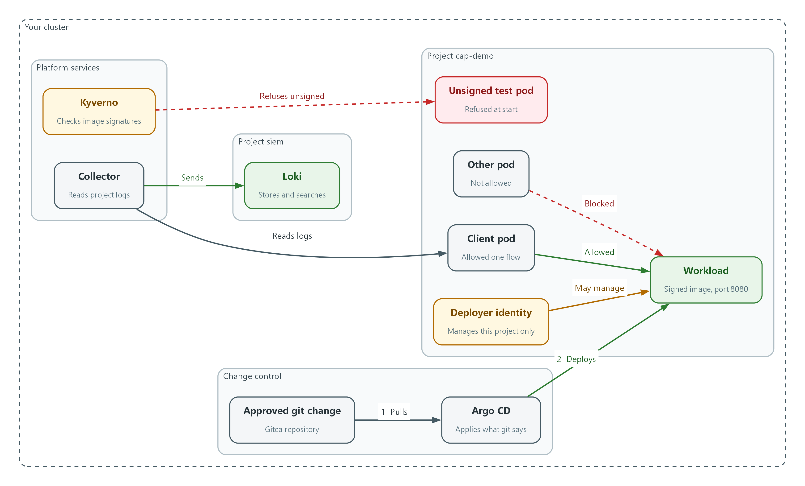
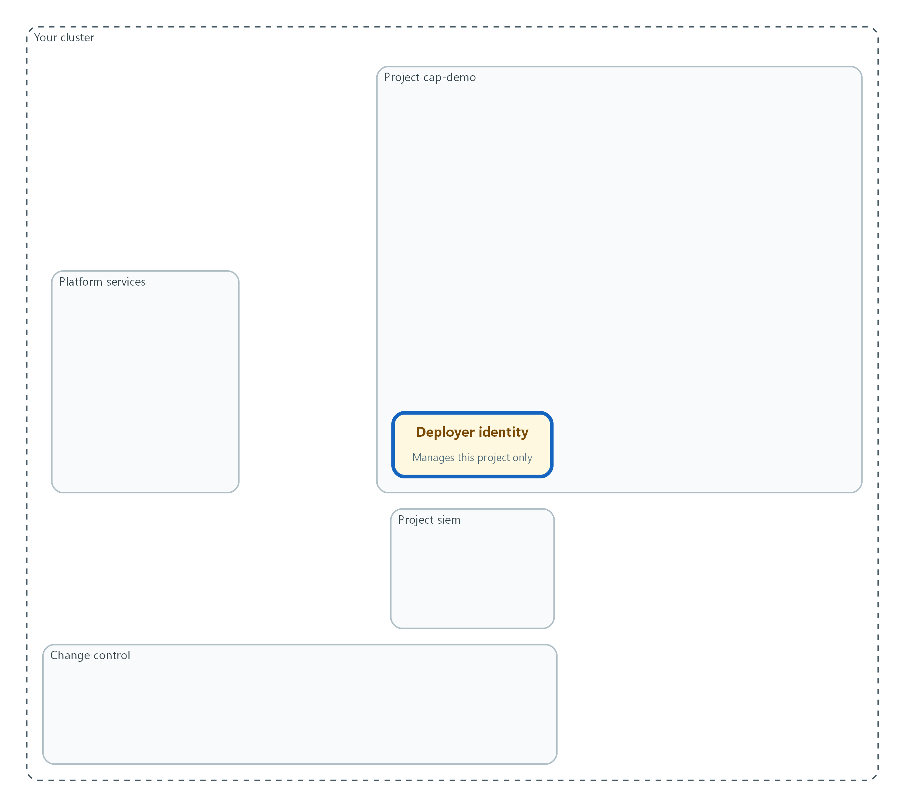
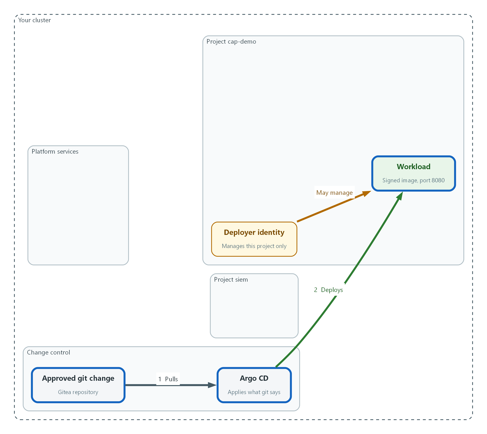
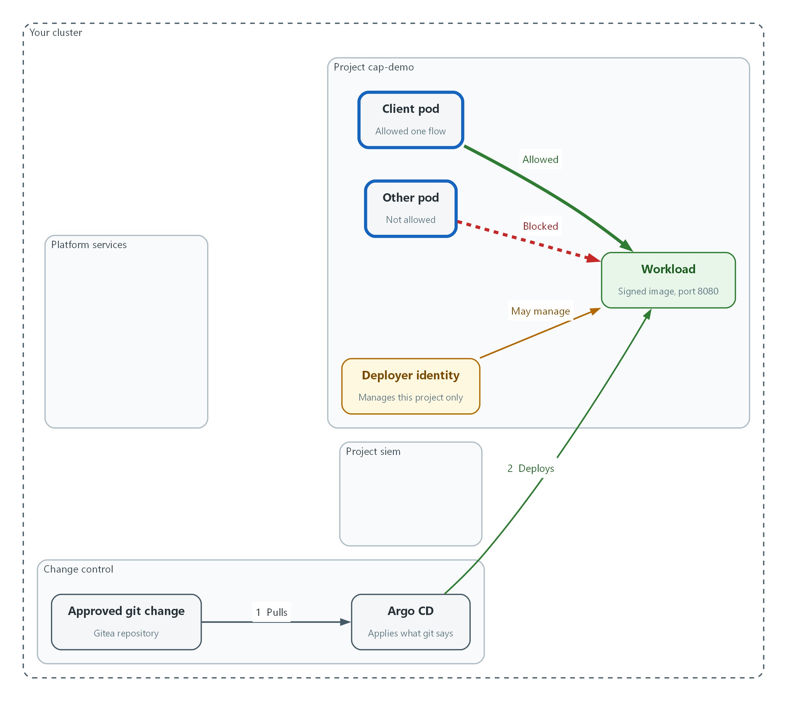
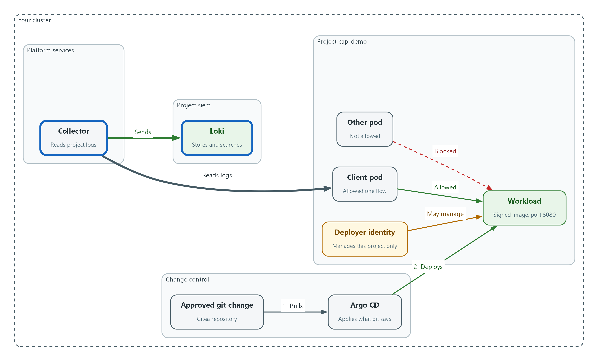
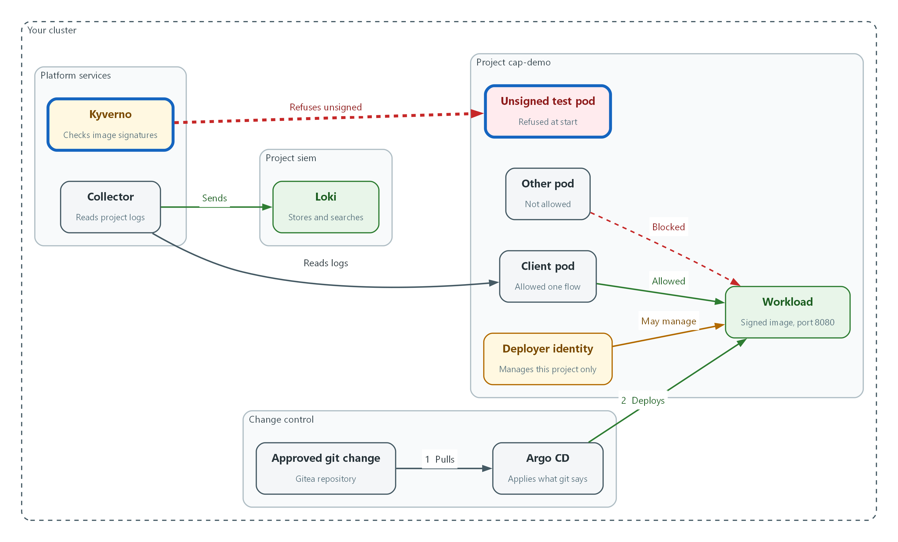

# CAP: Capstone: One Workload, Five Controls (AC-6, CM-3, SC-7, AU-12, SI-7)

> 📌 DRAFT. Live-lab-only items, none yet run in the lab: (1) the demo image is assumed to answer HTTP on port 8080, so confirm that port with oc get deployment demo-app -n demo -o yaml before Step 2 and change the port in the Step 2 and Step 3 files if it differs; (2) the registry pull secret is assumed to be named registry-pull in the kyverno project and to be a Docker config secret; (3) Loki is assumed to accept the LOKI_USER and LOKI_PASSWORD read that SIEM-1 used, and the label name kubernetes_namespace_name is the one SIEM-3 and the malware module used; (4) the Kyverno refusal wording 'was blocked due to the following policies' matches the Kyverno documentation, but the exact text can differ in your Kyverno release, so Check 8 also requires the policy name; (5) how fast Argo CD reverts a manual change depends on the Argo CD release, so Check 4 waits before it reads the answer; (6) the Gitea review and merge calls use the Sudo header, which needs an administrator token, and the Gitea version the lab runs is not pinned in the lab contract; (7) the audit search in Step 4 and Check 7 assumes each audit record is stored as JSON with a verb field, as shown in SIEM-1. Every apply is first checked with a server dry run.

| Item | Detail |
| --- | --- |
| Sequence | Module 17 of 17 in the recommended order |
| Timed work | About 75 minutes (50 hands-on, 25 verify) |
| Modes | Ready Lab (prebuilt) or Architect (you design and build it) |
| Standalone start | `lab start cap` |
| Combined start | Continue from the end state of the previous module |
| End state | `lab check cap` passes |
| Tools | OpenShift Container Platform, OpenShift GitOps (Argo CD), Gitea, NetworkPolicy, Kyverno, OpenShift Logging, Grafana Loki, oc, curl, jq, Git |
| Prerequisites | Module 0 (terminal and git basics), Module 2 (lab running), SIEM-1 and SIEM-2 (logs reach Loki), M06 (roles), M03 (default-deny), M09 (signed image and policy), M10 (GitOps) |
| Extra lab needs | End state of the earlier modules: audit and application logs reach Loki (SIEM-1), Kyverno policy require-signed-images exists (M09), Argo CD runs in openshift-gitops and trusts the Gitea certificate (M10), and demo-app in project demo runs the signed image.; Gitea repository cap-config under GITEA_USER with a README on branch main. Branch main is protected: pushes are refused and one approval from Gitea user lab-reviewer is required. Provided by lab start cap.; Secret registry-pull in project kyverno holds a Docker config for REGISTRY_HOST (from the release pipeline module), so it can be copied to cap-demo to pull the signed image.; The demo-app image answers HTTP on port 8080 (live-lab-only: confirm before Step 2).; The cluster can pull registry.access.redhat.com/ubi9/ubi-minimal, which is the image for the two test pods. |

## 1. Why This Matters

An IL5 system is not secure because each tool works alone. It is secure when the controls hold together on one real workload. This capstone has no new tool and no new theory. You take one fresh workload in a new project and put five controls around it using what you built in earlier modules: least-privilege access, deployment only through approved git changes, default-deny networking, records in the SIEM, and admission of signed images only. Then `lab check cap` runs nine checks and prints a score. Each check passes or fails on its own and prints a one-line fix.

### Control mapping

| Control | What it requires, in plain words | Source of the value | Where this module covers it |
| --- | --- | --- | --- |
| AC-6 Least Privilege | The identity that deploys to the project gets only the access it needs inside that project. | NIST; FedRAMP | Step 1 creates the role. Checks 1 and 2 prove what it can and cannot do. |
| CM-3 Configuration Change Control | Changes reach the system only through a reviewed, approved and recorded path. | NIST; FedRAMP | Step 2 deploys through a reviewed git change and Argo CD. Checks 3 and 4 prove the deployment is in sync and a manual change is undone. |
| SC-7 Boundary Protection | Traffic is controlled at the edge and also between internal components, and anything not on the allowed list is blocked. | NIST; DoD SRG | Step 3 applies default-deny and one allowed flow. Checks 5 and 6 test the allowed flow and three blocked ones. |
| AU-12 Audit Record Generation | The workload and the actions on it produce records, and the records reach the central store. | NIST; FedRAMP | Step 4 finds the workload's records and an audit record in Loki. Check 7 proves both arrived. |
| SI-7 Software, Firmware, and Information Integrity | Software is checked for unauthorized change before it runs, and a failed check stops it. | NIST; FedRAMP | Step 5 extends the signature policy to the project. Check 8 shows an unsigned image refused and Check 9 shows the signed workload admitted. |

### What each control is for

Read these answers first. They explain what each control is trying to prevent and how this module's tool meets it.

#### AC-6 Least Privilege

| Question | Answer |
| --- | --- |
| What the control author feared | A pipeline or developer identity can do far more than its job needs, so one stolen token can change the whole cluster. |
| Is it in scope for the system | Every identity that deploys to or runs in the project. |
| The operational question | If this identity were stolen today, what is the worst it could do, and does that stop at the project boundary? |
| What evidence proves it | The role and its binding, plus a can-i test for what the identity may and may not do. |
| How much is enough | The identity holds only the actions its job needs, and only inside its own project. In this lab, application teams may change resources only within the namespaces assigned to their team. |
| Who is told when it fails | Someone reviews the binding when the team or its job changes. |
| How the tool in this module satisfies it | A Role and RoleBinding (Step 1) and `oc auth can-i` (Checks 1 and 2). |

#### CM-3 Configuration Change Control

| Question | Answer |
| --- | --- |
| What the control author feared | A change reaches the running system without review, or someone alters it by hand and nobody notices. |
| Is it in scope for the system | Everything deployed into the project. |
| The operational question | Can I show who approved the change that is running now, and what happens if someone edits it by hand? |
| What evidence proves it | The merged and approved change in git, the Argo CD status, and the result of a manual edit. |
| How much is enough | Changes enter by an approved git change, the system applies it automatically, and a manual edit is put back. In this lab, direct pushes to the main branch are prohibited and Argo CD applies approved baselines. |
| Who is told when it fails | Reviewers are named, and the protected branch rule is kept in place. |
| How the tool in this module satisfies it | Gitea branch protection, a pull request, and an Argo CD application with self-heal (Step 2). |

#### SC-7 Boundary Protection

| Question | Answer |
| --- | --- |
| What the control author feared | A compromised pod reaches anything else in the system because nothing inside is blocked. |
| Is it in scope for the system | Traffic between pods in the project and from them to the rest of the cluster. |
| The operational question | Is traffic protected only at the boundary, or also between internal components? |
| What evidence proves it | The policies, one successful test of the allowed flow, and failed tests of the others. |
| How much is enough | Everything is denied by default and each allowed flow is listed with one port. The NIST text says to deny by default and allow by exception. |
| Who is told when it fails | A new flow is added to the list through change control before it is allowed. |
| How the tool in this module satisfies it | NetworkPolicy (Step 3) and `curl` from two test pods (Checks 5 and 6). |

#### AU-12 Audit Record Generation

| Question | Answer |
| --- | --- |
| What the control author feared | A new workload runs and nobody can see what it did, because its records never reach the SIEM. |
| Is it in scope for the system | Application records from the workload and audit records of actions on the project. |
| The operational question | For a workload created today, can an analyst find its records in the SIEM, and the record of who changed its network rules? |
| What evidence proves it | A search result from Loki for each of the two record types. |
| How much is enough | Records from the new project arrive without extra setup, because the collector already reads all projects. |
| Who is told when it fails | Someone notices when a new project stops producing records. The detection module adds that alert. |
| How the tool in this module satisfies it | The collector and Loki built in SIEM-1 and SIEM-2, searched with LogQL (Step 4). |

#### SI-7 Software, Firmware, and Information Integrity

| Question | Answer |
| --- | --- |
| What the control author feared | A tampered or unapproved image runs in the project because nothing checks where it came from. |
| Is it in scope for the system | Every image started in the project. |
| The operational question | If someone tries to run an image the pipeline never signed, what stops it? |
| What evidence proves it | The policy, the refusal of an unsigned image, and the admission of the signed workload. |
| How much is enough | Signatures are checked before any application starts, and a failed check aborts the start. |
| Who is told when it fails | The signing key and the policy are owned by named people and kept in git. |
| How the tool in this module satisfies it | The Kyverno policy from the release pipeline module, extended to this project (Step 5). |

### Architect mode brief

Draw the project before building it. List the one identity and what it may touch, the one flow the network must allow and its port, the two kinds of record you expect in the SIEM, and the one image source you trust. Note the order, because a rule that refuses unsigned images also refuses your own unsigned test pods once it is on. Then build in the step order and run `lab check cap`.

### Terms in this module

Each term is also explained the first time it appears. This table is a quick lookup.

| Term | Plain meaning |
| --- | --- |
| Capstone | A final exercise that combines skills from earlier modules instead of teaching a new one. |
| Least privilege | Giving an identity only the access its job needs. |
| Default-deny | A network rule set where everything is blocked unless a rule allows it. |
| Admission control | A check the cluster runs on a new pod before it is allowed to start. |
| Self-heal (Argo CD) | Argo CD puts back what git says when someone changes the cluster by hand. |
| Perimeter-only protection | Controls that protect traffic only where it enters or leaves the system, with nothing between internal components. |

## 2. The Tools

### Tools used in this module

Each tool name links to its official overview. The last column says how the tool is used in the lab.

| Tool (overview link) | What it is | Used in this lab |
| --- | --- | --- |
| [OpenShift GitOps (Argo CD)](https://docs.redhat.com/en/documentation/openshift_container_platform/4.22/html/gitops/index) | Deploys what a git repository says should be running, using Argo CD. | Deploys the capstone workload from an approved git change. |
| [Gitea](https://docs.gitea.com/) | A lightweight self-hosted git server. | Holds the reviewed change that Argo CD applies. |
| [NetworkPolicy](https://docs.redhat.com/en/documentation/openshift_container_platform/4.22/html/network_security/network-policy) | Rules for which pods may talk to which. Once a policy selects a pod, it accepts only what the policies allow. | Blocks all traffic in the project except one listed flow. |
| [Kyverno](https://kyverno.io/docs/) | A policy engine that checks and enforces rules on Kubernetes resources. | Refuses images that are not signed. |
| [OpenShift Logging](https://docs.redhat.com/en/documentation/openshift_container_platform/4.22/html/logging/index) | Collects, forwards and stores cluster log data. (Loki as the store is described in the Logging 6.x docs, not on this page.) | Carries the project's records to the SIEM. |
| [Grafana Loki](https://grafana.com/docs/loki/latest/) | Log storage that indexes only labels and keeps compressed log data in object storage. | Searched to prove the records arrived. |
| [Git](https://git-scm.com/about) | Version control that stores repository history. | Branch, commit and pull request for the change. |
| [OpenShift Container Platform](https://docs.redhat.com/en/documentation/openshift_container_platform/4.22/html/overview/ocp-overview) | A Kubernetes container platform for running and managing containerized applications. | The cluster every command in this module runs against. |
| [oc](https://docs.redhat.com/en/documentation/openshift_container_platform/4.22/html/cli_tools/openshift-cli-oc) | The OpenShift command-line tool for creating and managing applications and projects from a terminal. | Runs the cluster commands in each step. |
| [jq](https://jqlang.org/) | Command-line JSON processor. | Picks fields out of JSON output. |
| [curl](https://curl.se/docs/manpage.html) | Command-line tool for transferring data over URLs, used here to call web endpoints. | Calls web endpoints to test behavior. |

### How it fits together

#### One workload under five controls

A new project holds one workload. Each step adds one control around it: a limited identity, deployment from git with a signed image, a default-deny network, records in the SIEM, and a rule that refuses unsigned images. New parts are drawn with thick lines.



- A change approved in git is pulled by Argo CD, which deploys the workload into the project (flows 1 and 2).
- The deployer identity may manage things inside the project only.
- The client pod may reach the workload. The other pod is blocked.
- The collector reads the project's logs and sends them to Loki.
- Kyverno refuses a pod whose image is not signed.
### 2.1 How the capstone works

What is this? One new project named cap-demo holds one workload (a program the cluster keeps running). You apply five controls to it, one per step, in the same order the earlier modules taught them.

Why? Controls rarely fail on their own. They fail where they meet: a policy that blocks your own test pod, a network rule that blocks the log collector, a role that is too wide for the pipeline. The capstone makes those meetings visible.

How is it scored? `lab check cap` runs nine checks. Each prints PASS or FAIL. A FAIL prints the expected and actual output and a one-line fix. The last line is your score. The checks run commands against your cluster; there is no hidden answer key.

| Check | Control | What it proves |
| --- | --- | --- |
| 1 and 2 | AC-6 | The identity can deploy in cap-demo and is refused everywhere else |
| 3 and 4 | CM-3 | Argo CD reports the workload in sync, and a manual change is undone |
| 5 and 6 | SC-7 | The one allowed flow works and three others are blocked |
| 7 | AU-12 | Application records and an audit record are in Loki |
| 8 and 9 | SI-7 | An unsigned image is refused and the signed workload is admitted |

### 2.2 Order matters

The signature rule in Step 5 applies to every pod in the project. Once it is on, the unsigned test pods you used in Steps 3 and 4 could no longer be created. So you create them first, apply the rule last, and use the rule's refusal of an unsigned pod as Check 8.

Before Step 3 the project has perimeter-only protection: anything inside it can talk to anything else. The network rule in Step 3 blocks outbound traffic from every pod, including the name lookup that finds the workload by its service name. The first rule you write therefore allows name lookups, and the second allows the one real flow.

## 3. Implement

Ready Lab learners start with `lab start cap`. Architect learners design each step first using the brief above.

### Step 1. Create the project and a limited deployer identity (AC-6)

Start with who may act. A role is a list of allowed actions, and a role binding gives that list to one identity. This identity may manage deployments and services in cap-demo only, which is least privilege: it cannot create projects or read anything outside cap-demo.

What this step adds (thick lines and outlines are new):



- The project cap-demo is created, and one limited identity may manage deployments inside it and nowhere else.
```bash
oc get deployment demo-app -n demo
oc get clusterpolicy require-signed-images
oc create namespace cap-demo
```

| Part | What it does |
| --- | --- |
| oc get deployment demo-app -n demo | Confirms the signed workload from the release pipeline module exists. You copy its image in Step 2. |
| oc get clusterpolicy require-signed-images | Confirms the signature policy from the release pipeline module exists. You extend it in Step 5. |
| oc create namespace cap-demo | Creates the new project (a named workspace in the cluster). |

```yaml
apiVersion: v1
kind: ServiceAccount
metadata:
  name: cap-deployer
  namespace: cap-demo
---
apiVersion: rbac.authorization.k8s.io/v1
kind: Role
metadata:
  name: cap-deployer
  namespace: cap-demo
rules:
  - apiGroups: ["apps"]
    resources: ["deployments"]
    verbs: ["get", "list", "watch", "create", "update", "patch", "delete"]
  - apiGroups: [""]
    resources: ["services", "pods"]
    verbs: ["get", "list", "watch", "create", "update", "patch", "delete"]
---
apiVersion: rbac.authorization.k8s.io/v1
kind: RoleBinding
metadata:
  name: cap-deployer
  namespace: cap-demo
roleRef:
  apiGroup: rbac.authorization.k8s.io
  kind: Role
  name: cap-deployer
subjects:
  - kind: ServiceAccount
    name: cap-deployer
    namespace: cap-demo
```

| Part | What it does |
| --- | --- |
| kind: ServiceAccount | The identity for a program instead of a person. |
| kind: Role ... rules | The allowed actions: manage deployments, services and pods, in cap-demo only. A Role is limited to one project; a ClusterRole is not. |
| kind: RoleBinding | Gives the Role to the service account. |

```bash
oc apply -f cap-identity.yaml --dry-run=server
oc apply -f cap-identity.yaml
oc auth can-i create deployments -n cap-demo --as=system:serviceaccount:cap-demo:cap-deployer
```

| Part | What it does |
| --- | --- |
| --dry-run=server | Asks the cluster to check the file without saving it. |
| oc apply -f | Saves the three resources. |
| oc auth can-i ... --as=... | Asks the cluster whether the identity may do the action. The answer is yes or no. |

> ▶ YOUR TURN: Save the YAML as cap-identity.yaml, then run the three command groups.

> ✅ CHECKPOINT: The last command prints yes.

### Step 2. Deploy the signed workload through git and Argo CD (CM-3, SI-7)

Nothing is created by hand. You put the workload definition in git, a second person approves the change, and Argo CD applies it. The image is the exact signed one that demo-app already runs, so it passes the signature check in Step 5. The main branch of cap-config is protected, so a direct push is refused, as this lab requires. Argo CD gets its own project that allows only this repository and only the cap-demo destination, so even a mistake in the application cannot deploy anywhere else.

What this step adds (thick lines and outlines are new):



- Argo CD deploys the workload from an approved git change. The image is the signed one the release pipeline built.
```bash
oc label namespace cap-demo argocd.argoproj.io/managed-by=openshift-gitops
oc get secret registry-pull -n kyverno -o json | jq '{apiVersion, kind, type, data, metadata: {name: "registry-pull"}}' | oc apply -n cap-demo -f -
oc secrets link default registry-pull --for=pull -n cap-demo
oc create secret generic cap-config-repo -n openshift-gitops \
  --from-literal=type=git \
  --from-literal=url="$GITEA_URL/$GITEA_USER/cap-config.git" \
  --from-literal=username="$GITEA_USER" \
  --from-literal=password="$GITEA_TOKEN"
oc label secret cap-config-repo -n openshift-gitops argocd.argoproj.io/secret-type=repository
```

| Part | What it does |
| --- | --- |
| oc label namespace ... managed-by | Tells Argo CD it may manage this project. |
| oc get secret registry-pull ... | jq ... | oc apply | Copies the registry pull secret into cap-demo, keeping only its name and contents. |
| oc secrets link default registry-pull --for=pull | Lets pods in cap-demo use that secret to pull the signed image. |
| oc create secret generic cap-config-repo | Gives Argo CD the address and login for the git repository. The token comes from the lab variable, so you never type it. |
| argocd.argoproj.io/secret-type=repository | The label that makes Argo CD treat the secret as a repository login. |

```yaml
apiVersion: apps/v1
kind: Deployment
metadata:
  name: cap-app
  namespace: cap-demo
spec:
  replicas: 1
  selector:
    matchLabels:
      app: cap-app
  template:
    metadata:
      labels:
        app: cap-app
    spec:
      securityContext:
        runAsNonRoot: true
        seccompProfile:
          type: RuntimeDefault
      containers:
        - name: cap-app
          image: ${CAP_IMAGE}
          ports:
            - containerPort: 8080
          securityContext:
            allowPrivilegeEscalation: false
            capabilities:
              drop: ["ALL"]
---
apiVersion: v1
kind: Service
metadata:
  name: cap-app
  namespace: cap-demo
spec:
  selector:
    app: cap-app
  ports:
    - port: 8080
      targetPort: 8080
```

| Part | What it does |
| --- | --- |
| image: ${CAP_IMAGE} | A placeholder. The next block fills it with the signed image reference from demo-app. |
| runAsNonRoot ... drop ALL | Runs the workload with no extra rights, as the hardening module's policies expect. |
| kind: Service | Gives the workload a stable name, cap-app, on port 8080. The network step allows traffic to it. |

```bash
export CAP_IMAGE=$(oc get deployment demo-app -n demo -o jsonpath='{.spec.template.spec.containers[0].image}')
echo "$CAP_IMAGE" | grep '@sha256:' || echo "STOP: the image is not pinned by digest"
git clone "$GITEA_URL/$GITEA_USER/cap-config.git"
envsubst < cap-app.tpl.yaml > cap-config/cap-app.yaml
cd cap-config
git checkout -b add-cap-app
git add cap-app.yaml
git commit -m "Add cap-app"
git push origin add-cap-app
git push origin HEAD:main
cd ..
```

| Part | What it does |
| --- | --- |
| export CAP_IMAGE=$(oc get deployment demo-app ...) | Reads the signed image reference (name plus digest) that demo-app runs. |
| echo ... | grep ... | Prints the image only if its reference contains a digest (the fixed fingerprint after the at sign). If you see STOP, do not go on: Step 5 needs the digest form. |
| git clone | Copies the repository to the lab shell. The lab supplies the git login. |
| envsubst < cap-app.tpl.yaml > cap-config/cap-app.yaml | Writes the final file with the real image filled in. |
| git checkout -b add-cap-app | Starts a branch for the change, because main is protected. |
| git commit -m ... / git push origin add-cap-app | Records the change and sends the branch to Gitea. |
| git push origin HEAD:main | Tries to push straight to main. Gitea refuses it, which is the point. Expect a line saying the branch is protected. |
| cd .. | Returns to the folder that holds your saved files, so the later blocks find them. |

```bash
PR=$(curl -s -X POST -H "Authorization: token $GITEA_TOKEN" -H "Content-Type: application/json" "$GITEA_URL/api/v1/repos/$GITEA_USER/cap-config/pulls" -d '{"head":"add-cap-app","base":"main","title":"Add cap-app"}' | jq -r '.number')
echo "pull request number: $PR"
curl -s -X POST -H "Authorization: token $GITEA_TOKEN" -H "Sudo: lab-reviewer" -H "Content-Type: application/json" "$GITEA_URL/api/v1/repos/$GITEA_USER/cap-config/pulls/$PR/reviews" -d '{"event":"APPROVED"}' | jq -r '.state'
curl -s -o /dev/null -w "%{http_code}\n" -X POST -H "Authorization: token $GITEA_TOKEN" -H "Content-Type: application/json" "$GITEA_URL/api/v1/repos/$GITEA_USER/cap-config/pulls/$PR/merge" -d '{"do":"merge"}'
```

| Part | What it does |
| --- | --- |
| pulls ... | jq -r '.number' | Opens a pull request (a request to merge the branch into main) and keeps its number. |
| Sudo: lab-reviewer ... reviews | Approves it as the reviewer account. In real work a different person approves; the lab gives you a reviewer so you can finish alone. |
| pulls/$PR/merge | Merges the approved change. 200 means it worked. |

```yaml
apiVersion: argoproj.io/v1alpha1
kind: AppProject
metadata:
  name: cap
  namespace: openshift-gitops
spec:
  description: Capstone workload
  sourceRepos:
    - ${GITEA_URL}/${GITEA_USER}/cap-config.git
  destinations:
    - server: https://kubernetes.default.svc
      namespace: cap-demo
---
apiVersion: argoproj.io/v1alpha1
kind: Application
metadata:
  name: cap-app
  namespace: openshift-gitops
spec:
  project: cap
  source:
    repoURL: ${GITEA_URL}/${GITEA_USER}/cap-config.git
    targetRevision: main
    path: .
  destination:
    server: https://kubernetes.default.svc
    namespace: cap-demo
  syncPolicy:
    automated:
      prune: true
      selfHeal: true
```

| Part | What it does |
| --- | --- |
| kind: AppProject | A dedicated Argo CD project (a rule set for one application). It allows exactly one source repository and one destination project, instead of the default Argo CD project, which allows any repository and any destination. |
| project: cap | Puts the application under that project. |
| repoURL ... targetRevision: main | Watch the main branch of cap-config. |
| destination ... namespace: cap-demo | Apply what is found there into cap-demo. |
| automated ... selfHeal: true | Apply changes on their own, and put back anything changed by hand. |

```bash
oc explain applications.spec.syncPolicy.automated --api-version=argoproj.io/v1alpha1
envsubst < cap-argo.yaml | oc apply --dry-run=server -f -
envsubst < cap-argo.yaml | oc apply -f -
oc wait applications.argoproj.io/cap-app -n openshift-gitops --for=jsonpath='{.status.sync.status}'=Synced --timeout=180s
oc rollout status deployment/cap-app -n cap-demo --timeout=180s
```

| Part | What it does |
| --- | --- |
| oc explain application.spec.syncPolicy.automated | Prints the fields your Argo CD release accepts. If a name differs, use the one it shows. |
| envsubst < cap-argo.yaml | oc apply | Fills in the git address from the lab variables, then saves the Argo CD project and the application. |
| oc wait applications.argoproj.io/cap-app ... Synced | Waits until Argo CD reports the cluster matches git. |
| oc rollout status deployment/cap-app | Waits until the workload pod is running. |

> 📌 Save the first YAML as cap-app.tpl.yaml and the second as cap-argo.yaml, both in the folder where you run the commands, not inside the cloned cap-config folder. The push to main in the third block is meant to fail; if it succeeds, branch protection is missing on cap-config, so tell the lab maintainer.

> 🔒 The signed image is pinned by digest (a fixed fingerprint of the exact image), so Step 5 can verify it. A tag can be moved to different content; a digest cannot.

> ▶ YOUR TURN: Run each block in order. Read the refusal from the push to main.

> ✅ CHECKPOINT: The application is Synced and one cap-app pod is running.

### Step 3. Deny all traffic and allow one flow (SC-7)

Add two test pods: client, which will be allowed to call the workload, and other, which will not. Then block everything and open one path. The first policy denies all incoming and outgoing traffic for every pod. The second allows name lookups, because pods cannot find cap-app by name without them. The last two allow only client to call cap-app on port 8080. This answers the question: is traffic protected only at the boundary, or also between internal components?

What this step adds (thick lines and outlines are new):



- Default-deny blocks everything. The client may reach the workload on one port, and the other pod may not.
```bash
oc run client -n cap-demo --image=registry.access.redhat.com/ubi9/ubi-minimal --labels=app=client -- sh -c 'while true; do echo cap-marker-client; sleep 30; done'
oc run other -n cap-demo --image=registry.access.redhat.com/ubi9/ubi-minimal --labels=app=other -- sleep infinity
oc wait --for=condition=Ready pod/client pod/other -n cap-demo --timeout=120s
oc exec -n cap-demo pod/other -- curl -s -o /dev/null -m 5 -w '%{http_code}\n' http://cap-app:8080
```

| Part | What it does |
| --- | --- |
| oc run client ... --labels=app=client | Starts a test pod. Its loop writes a marker line every 30 seconds, so Step 4 has something to find. |
| oc run other ... --labels=app=other | Starts a second test pod that will stay blocked. |
| oc wait --for=condition=Ready | Waits until both pods are running. |
| oc exec ... curl ... cap-app:8080 | The starting problem: before any policy, the pod that should not reach the workload can. Any number except 000 means it connected. |

```yaml
apiVersion: networking.k8s.io/v1
kind: NetworkPolicy
metadata:
  name: default-deny-all
  namespace: cap-demo
spec:
  podSelector: {}
  policyTypes:
    - Ingress
    - Egress
---
apiVersion: networking.k8s.io/v1
kind: NetworkPolicy
metadata:
  name: allow-dns
  namespace: cap-demo
spec:
  podSelector: {}
  policyTypes:
    - Egress
  egress:
    - to:
        - namespaceSelector:
            matchLabels:
              kubernetes.io/metadata.name: openshift-dns
      ports:
        - protocol: UDP
          port: 53
        - protocol: TCP
          port: 53
        - protocol: UDP
          port: 5353
        - protocol: TCP
          port: 5353
---
apiVersion: networking.k8s.io/v1
kind: NetworkPolicy
metadata:
  name: client-to-app
  namespace: cap-demo
spec:
  podSelector:
    matchLabels:
      app: client
  policyTypes:
    - Egress
  egress:
    - to:
        - podSelector:
            matchLabels:
              app: cap-app
      ports:
        - protocol: TCP
          port: 8080
---
apiVersion: networking.k8s.io/v1
kind: NetworkPolicy
metadata:
  name: app-from-client
  namespace: cap-demo
spec:
  podSelector:
    matchLabels:
      app: cap-app
  policyTypes:
    - Ingress
  ingress:
    - from:
        - podSelector:
            matchLabels:
              app: client
      ports:
        - protocol: TCP
          port: 8080
```

| Part | What it does |
| --- | --- |
| default-deny-all | Selects every pod and lists both directions with no rules, so nothing is allowed. |
| allow-dns | Lets every pod send name lookups to the cluster DNS service on its ports. |
| client-to-app | Lets only pods labeled app=client send traffic to pods labeled app=cap-app, on port 8080 only. |
| app-from-client | The matching rule on the receiving side. Both sides must allow a flow. |

```bash
oc explain networkpolicy.spec.egress.to
oc apply -f cap-network.yaml --dry-run=server
oc apply -f cap-network.yaml
oc get networkpolicy -n cap-demo
```

| Part | What it does |
| --- | --- |
| oc explain ... | Prints the fields your cluster accepts. |
| --dry-run=server | Checks the file without saving it. |
| oc get networkpolicy | Lists the four policies you applied. |

> ▶ YOUR TURN: Run the first block and note the starting answer. Save the YAML as cap-network.yaml and run the third block.

> ✅ CHECKPOINT: Four policies are listed.

### Step 4. Find the workload's records in the SIEM (AU-12)

A workload that cannot be searched cannot be investigated. The collector from SIEM-1 already reads every project, so nothing needs configuring. Prove it: search Loki for the marker the client pod writes, and for the audit record of your network policy change. Loki finds streams by label, so you name the project in the label and filter the text after it.

What this step adds (thick lines and outlines are new):



- The collector reads the project's records and sends them to Loki, so you can search them.
```bash
sleep 60
START="$(date -d "$(oc get namespace cap-demo -o jsonpath='{.metadata.creationTimestamp}')" +%s)000000000"
curl -s --cacert "$LOKI_CA_FILE" -u "$LOKI_USER:$LOKI_PASSWORD" "$LOKI_URL/loki/api/v1/label/kubernetes_namespace_name/values" | jq -c .
curl -sG --cacert "$LOKI_CA_FILE" -u "$LOKI_USER:$LOKI_PASSWORD" "$LOKI_URL/loki/api/v1/query_range" --data-urlencode "start=$START" --data-urlencode 'limit=1' --data-urlencode 'query={log_type="application", kubernetes_namespace_name="cap-demo"} |= "cap-marker-client"' | jq '.data.result | length'
curl -sG --cacert "$LOKI_CA_FILE" -u "$LOKI_USER:$LOKI_PASSWORD" "$LOKI_URL/loki/api/v1/query_range" --data-urlencode "start=$START" --data-urlencode 'limit=1' --data-urlencode 'query={log_type="audit"} |= "cap-demo" |= "networkpolicies" | json | verb="create"' | jq '.data.result | length'
```

| Part | What it does |
| --- | --- |
| sleep 60 | Gives the collector time to send the first records. |
| START=... | Sets the start of the search window to the moment cap-demo was created. Records from an earlier attempt, before the project existed, cannot be counted, and the search still works if you come back later. |
| label/kubernetes_namespace_name/values | Lists the project names Loki holds records for. cap-demo must be in the list. |
| query={log_type="application", ...} | Searches application records from cap-demo that contain the marker. |
| query={log_type="audit"} |= "cap-demo" |= "networkpolicies" | json | verb="create" | Searches audit records that mention cap-demo and network policies, reads each record as JSON, and keeps only the ones whose verb is create. This is the record of who created the policies in Step 3. |
| jq '.data.result | length' | Counts the matching streams. 1 or more means found; 0 means none. |

> 📌 The label name kubernetes_namespace_name is the one earlier modules used. If cap-demo is missing from the list, run the label query again and use the name your Logging release shows. Loki answers the label-values query for a default recent window unless you give a start, so a new project can take a minute to appear.

> ▶ YOUR TURN: Run the block and read the two counts.

> ✅ CHECKPOINT: Both counts are 1 or more.

### Step 5. Admit only signed images in the project (SI-7)

The signature policy from the release pipeline module covers only the demo project. Add cap-demo to it. From now on every pod in cap-demo must carry a valid signature, so the workload (signed) is admitted and the unsigned image is refused. This step comes last because the rule would have refused your own test pods.

What this step adds (thick lines and outlines are new):



- Kyverno now checks every image in cap-demo and refuses the unsigned test pod. The signed workload is still admitted.
```bash
oc get clusterpolicy require-signed-images -o jsonpath='{.spec.rules[0].match.any[0].resources.namespaces}{"\n"}'
oc patch clusterpolicy require-signed-images --type json -p '[{"op":"add","path":"/spec/rules/0/match/any/0/resources/namespaces/-","value":"cap-demo"}]' --dry-run=server
oc patch clusterpolicy require-signed-images --type json -p '[{"op":"add","path":"/spec/rules/0/match/any/0/resources/namespaces/-","value":"cap-demo"}]'
oc get clusterpolicy require-signed-images -o jsonpath='{.spec.rules[0].match.any[0].resources.namespaces}{"\n"}'
```

| Part | What it does |
| --- | --- |
| oc get clusterpolicy ... namespaces | Prints the projects the policy covers. Run before and after. |
| --type json -p '[{"op":"add" ...}]' | Adds cap-demo to the end of that list without touching the rest of the policy. |
| --dry-run=server | Checks the change without saving it. |

```bash
sleep 10
oc run unsigned-test -n cap-demo --image=registry.access.redhat.com/ubi9/ubi-minimal --restart=Never -- sleep 60
oc get pod unsigned-test -n cap-demo
```

| Part | What it does |
| --- | --- |
| sleep 10 | Gives Kyverno a moment to load the changed policy before the test. |
| oc run unsigned-test ... ubi-minimal | Tries to start a pod from an image nobody signed. |
| oc get pod unsigned-test | Shows the pod does not exist, because the cluster refused it. |

> 💡 Read the refusal text. It names the policy and the rule that blocked the pod, which is the first thing an administrator checks when a pod will not start.

> ▶ YOUR TURN: Add the project to the policy, then try the unsigned pod.

> ✅ CHECKPOINT: The unsigned pod is refused and the list now includes cap-demo.

## 4. Verify It Works

### Test 1 (positive). Check 1: The deployer identity can manage deployments in its own project

AC-6. The identity needs the access its job requires.

```bash
SA=system:serviceaccount:cap-demo:cap-deployer
echo "create deployments in cap-demo: $(oc auth can-i create deployments -n cap-demo --as=$SA 2>/dev/null)"
```

**Expected output:**

```
create deployments in cap-demo: yes
```

> ✅ CHECKPOINT: The answer is yes.

### Test 2 (negative). Check 2: The same identity is refused everywhere else

AC-6. Least privilege is proven by what is refused, not by what works. The first line is a control: if the identity does not exist, every answer is no, so the control must say yes for the three no answers to mean anything.

```bash
SA=system:serviceaccount:cap-demo:cap-deployer
echo "control, create deployments in cap-demo: $(oc auth can-i create deployments -n cap-demo --as=$SA 2>/dev/null)"
echo "create deployments in demo: $(oc auth can-i create deployments -n demo --as=$SA 2>/dev/null)"
echo "read secrets in openshift-config: $(oc auth can-i get secrets -n openshift-config --as=$SA 2>/dev/null)"
echo "create namespaces: $(oc auth can-i create namespaces --as=$SA 2>/dev/null)"
```

**Expected output:**

```
control, create deployments in cap-demo: yes
create deployments in demo: no
read secrets in openshift-config: no
create namespaces: no
```

> ✅ CHECKPOINT: The control line says yes and the three other answers are no.

### Test 3 (positive). Check 3: The workload is in sync, healthy, and came from an approved pull request

CM-3. The running workload must match the approved git change. The last line reads Gitea: a merged pull request must carry an approval from lab-reviewer, so a workload that was applied some other way does not pass.

```bash
oc get applications.argoproj.io cap-app -n openshift-gitops -o jsonpath='{.status.sync.status} {.status.health.status}{"\n"}'
oc get deployment cap-app -n cap-demo -o jsonpath='{.status.readyReplicas}{"\n"}'
API="$GITEA_URL/api/v1/repos/$GITEA_USER/cap-config"
MERGED='[.[] | select(.merged == true)] | .[0].number // empty'
APPROVED='[.[] | select(.state == "APPROVED" and .user.login == "lab-reviewer")] | length'
PRN=$(curl -s -H "Authorization: token $GITEA_TOKEN" "$API/pulls?state=closed" | jq -r "$MERGED")
NAP=$(curl -s -H "Authorization: token $GITEA_TOKEN" "$API/pulls/$PRN/reviews" | jq "$APPROVED")
test -n "$PRN" && test "${NAP:-0}" -ge 1 && echo "merged pull request approved: yes" || echo "merged pull request approved: no"
```

**Expected output:**

```
Synced Healthy
1
merged pull request approved: yes
```

> ✅ CHECKPOINT: The first line is Synced Healthy, the second is 1, and the third says yes.

### Test 4 (negative). Check 4: A manual change is reverted by Argo CD

CM-3. A change made outside git must not last. The first line proves the manual change was accepted, so a rejected change cannot pass by accident.

```bash
oc scale deployment/cap-app -n cap-demo --replicas=3
sleep 45
AFTER=$(oc get deployment cap-app -n cap-demo -o jsonpath='{.spec.replicas}')
oc scale deployment/cap-app -n cap-demo --replicas=1 > /dev/null
echo "replicas after the wait: $AFTER"
```

**Expected output:**

```
deployment.apps/cap-app scaled
replicas after the wait: 1
```

> ✅ CHECKPOINT: The scale command confirms the manual change, and the count is back to 1 after the wait. The check puts the count back to 1 itself afterwards, so a failed check leaves nothing changed.

### Test 5 (positive). Check 5: The one allowed flow works

SC-7. The listed flow must still work after default-deny.

```bash
CODE=$(oc exec -n cap-demo pod/client -- curl -s -o /dev/null -m 5 -w '%{http_code}' http://cap-app:8080)
test "$CODE" != "000" && echo reachable || echo blocked
```

**Expected output:**

```
reachable
```

> ✅ CHECKPOINT: The answer is reachable.

### Test 6 (negative). Check 6: Every flow that is not listed is blocked

SC-7. Anything not on the list must fail. 000 means no connection was made. The first line is a control: a closed port also prints 000, so the allowed flow must work for the 000 answers to mean blocked by policy.

```bash
CODE=$(oc exec -n cap-demo pod/client -- curl -s -o /dev/null -m 5 -w '%{http_code}' http://cap-app:8080 2>/dev/null)
test -n "$CODE" && test "$CODE" != "000" && echo "control, allowed flow: reachable" || echo "control, allowed flow: blocked"
echo "other to app: $(oc exec -n cap-demo pod/other -- curl -s -o /dev/null -m 5 -w '%{http_code}' http://cap-app:8080 2>/dev/null)"
echo "client to API: $(oc exec -n cap-demo pod/client -- curl -sk -o /dev/null -m 5 -w '%{http_code}' https://kubernetes.default.svc:443 2>/dev/null)"
echo "other to API: $(oc exec -n cap-demo pod/other -- curl -sk -o /dev/null -m 5 -w '%{http_code}' https://kubernetes.default.svc:443 2>/dev/null)"
```

**Expected output:**

```
control, allowed flow: reachable
other to app: 000
client to API: 000
other to API: 000
```

> ✅ CHECKPOINT: The control says reachable and the three other lines print 000.

### Test 7 (positive). Check 7: The workload's records and the audit record are in the SIEM

AU-12. An application record and an audit record from the new project must both be searchable.

```bash
START="$(date -d "$(oc get namespace cap-demo -o jsonpath='{.metadata.creationTimestamp}')" +%s)000000000"
NA=$(curl -sG --cacert "$LOKI_CA_FILE" -u "$LOKI_USER:$LOKI_PASSWORD" "$LOKI_URL/loki/api/v1/query_range" --data-urlencode "start=$START" --data-urlencode 'limit=1' --data-urlencode 'query={log_type="application", kubernetes_namespace_name="cap-demo"} |= "cap-marker-client"' | jq '.data.result | length')
NB=$(curl -sG --cacert "$LOKI_CA_FILE" -u "$LOKI_USER:$LOKI_PASSWORD" "$LOKI_URL/loki/api/v1/query_range" --data-urlencode "start=$START" --data-urlencode 'limit=1' --data-urlencode 'query={log_type="audit"} |= "cap-demo" |= "networkpolicies" | json | verb="create"' | jq '.data.result | length')
test "${NA:-0}" -ge 1 && echo "application records: found" || echo "application records: missing"
test "${NB:-0}" -ge 1 && echo "audit records: found" || echo "audit records: missing"
```

**Expected output:**

```
application records: found
audit records: found
```

> ✅ CHECKPOINT: Both lines say found.

### Test 8 (negative). Check 8: An unsigned image is refused in the project

SI-7. A failed signature check must stop the pod from starting. The check looks for the policy name in the refusal, so a refusal from some other policy does not count.

```bash
oc delete pod unsigned-test -n cap-demo --ignore-not-found > /dev/null
OUT=$(oc run unsigned-test -n cap-demo --image=registry.access.redhat.com/ubi9/ubi-minimal --restart=Never -- sleep 60 2>&1)
echo "$OUT" | grep -q 'was blocked due to the following policies' && echo "$OUT" | grep -q 'require-signed-images' && echo "refused by require-signed-images" || echo "not refused by require-signed-images"
oc get pod -n cap-demo -o name | grep -c unsigned-test
oc delete pod unsigned-test -n cap-demo --ignore-not-found > /dev/null
```

**Expected output:**

```
refused by require-signed-images
0
```

> ✅ CHECKPOINT: The refusal names the policy require-signed-images and no unsigned pod exists. The check deletes the test pod at the end if it was created.

### Test 9 (positive). Check 9: The signed workload is admitted again after a restart

SI-7. The rule must refuse the unsigned image without stopping the signed one.

```bash
oc delete pod -n cap-demo -l app=cap-app > /dev/null
sleep 15
oc wait --for=condition=Ready pod -l app=cap-app -n cap-demo --timeout=180s > /dev/null
oc get pod -n cap-demo -l app=cap-app -o jsonpath='{.items[0].spec.containers[0].image}' | grep -c '@sha256:'
```

**Expected output:**

```
1
```

> ✅ CHECKPOINT: A new pod is Ready and runs an image pinned by digest.

Run `lab check cap` to run these tests automatically. It checks:

- The deployer identity can manage deployments in cap-demo and nothing outside it.
- Argo CD reports the workload Synced and Healthy, it came from a merged and approved pull request, and a manual change is reverted.
- The one allowed flow works and every other flow is blocked.
- The workload's application records and the audit record of the network policy are found in Loki.
- An unsigned image is refused and a signed one is admitted.
## 5. Glossary and Next Steps

| Term | Meaning |
| --- | --- |
| Role and RoleBinding | A Role lists allowed actions in one project. A RoleBinding gives that list to an identity. |
| Service account | An identity for a program instead of a person. |
| Project (OpenShift) | A named workspace in the cluster. |
| Pull request | A request to merge a branch into main that someone else can review and approve. |
| Digest | A fixed fingerprint of the exact content of an image. |
| Policy (Kyverno) | A rule the cluster checks when a resource is created. |
| LogQL | Loki's search language. |

> 💡 This is the last module. When all nine checks pass, you have shown the five controls work together on a new workload.
