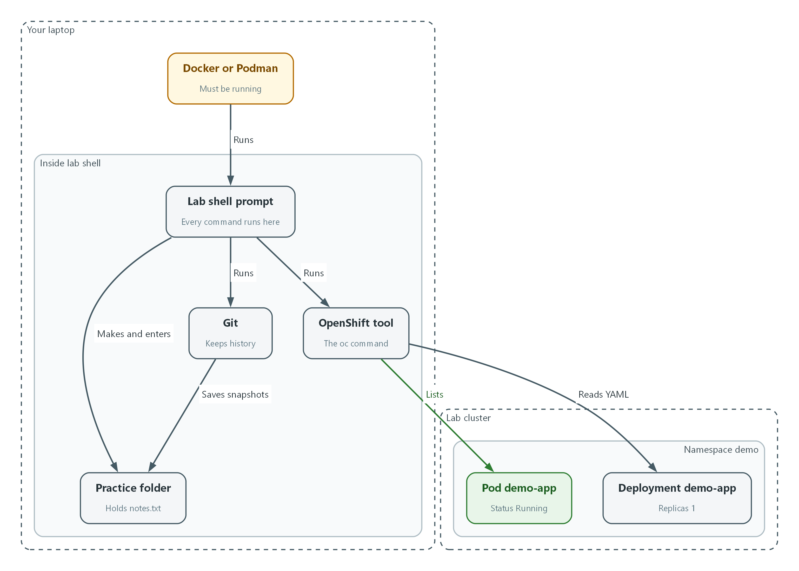
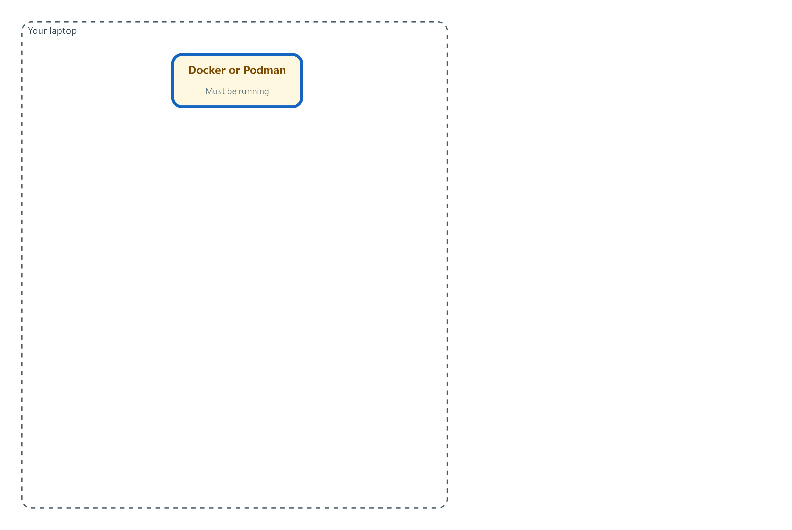
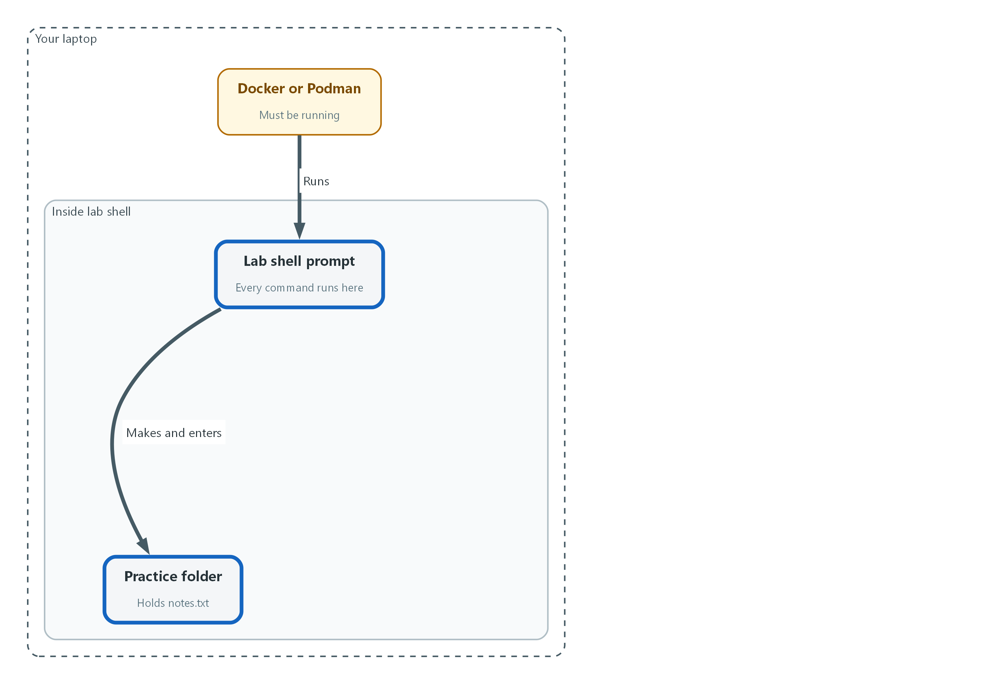
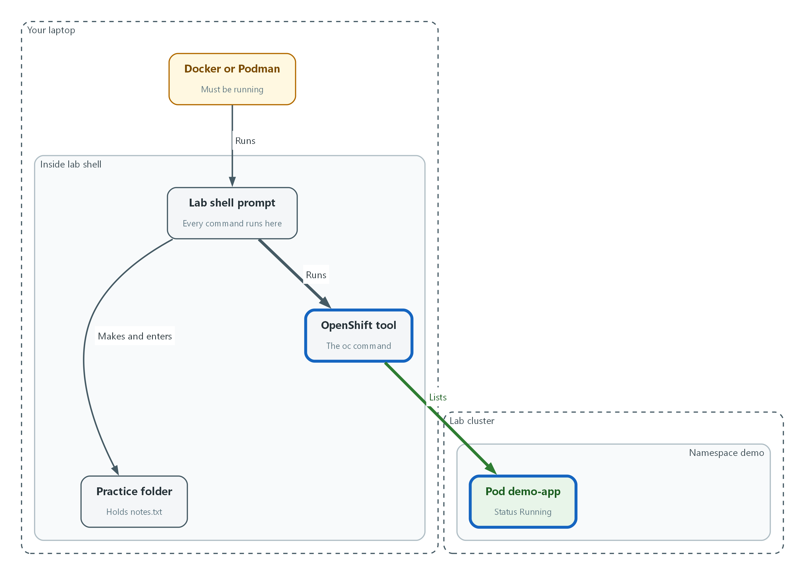
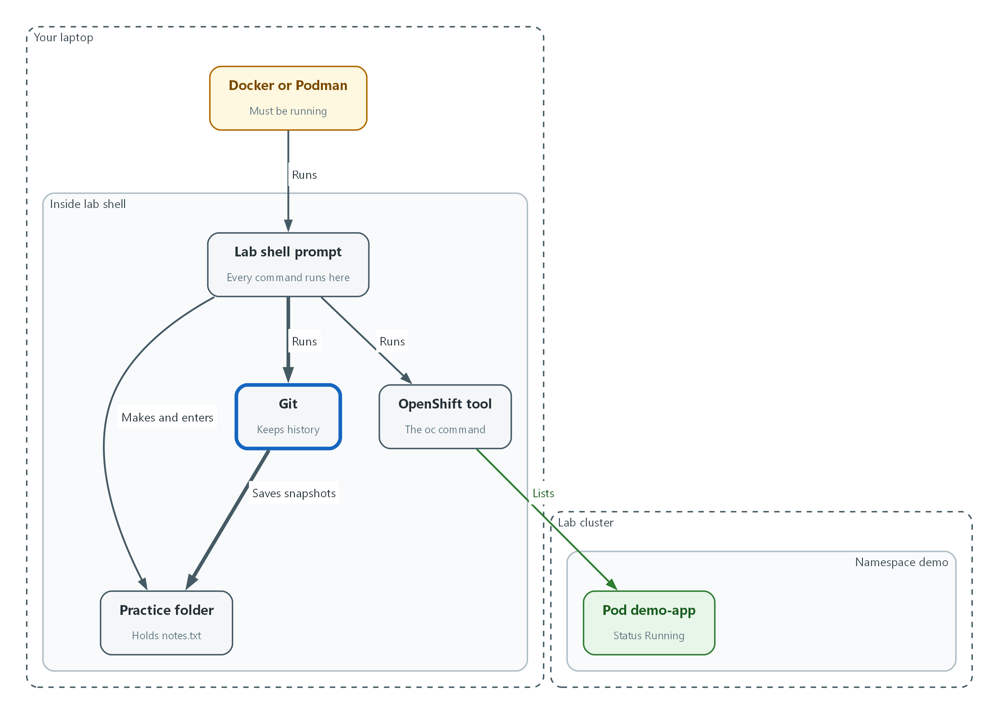
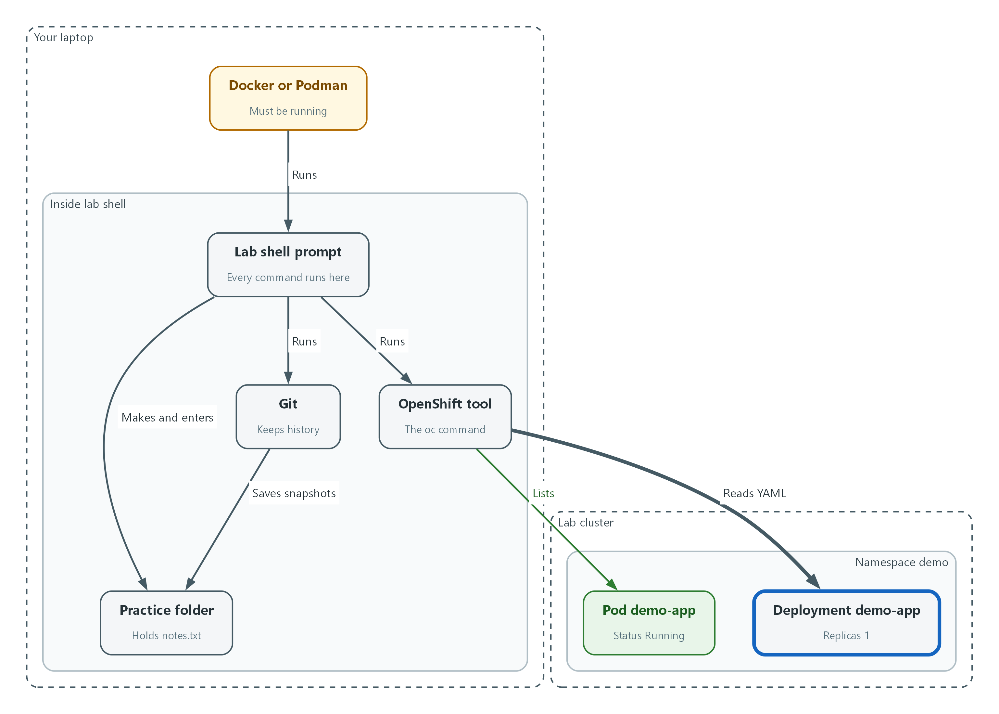

# M00: Keyboard Survival and Machine Check

> 📌 DRAFT. Host-machine commands (Mac and Windows) and the lab commands have not yet run in the lab. The laptop minimum spec and the lab install steps are published by the lab team, so this module shows you how to read your own numbers and does not state a minimum. The demo-app workload is assumed to be a Deployment. Step 1: the Docker check uses docker version --format '{{.Server.Version}}', the documented example on the Docker CLI reference page; the exact text printed when the daemon is stopped is not documented, so confirm it in lab. The macOS commands sysctl -n hw.memsize, sysctl -n hw.ncpu and df -h / are not described on a vendor page that could be fetched; confirm on a Mac with sysctl hw.memsize and man df. Negative test: the namespace check uses oc get namespace no-such-project, whose NotFound error format matches the example in the OpenShift 4.22 documentation; the wording of the misspelled-resource error (the server doesn't have a resource type) comes from kubectl and is not in the OpenShift pages, so confirm it in lab with oc get podz -n demo.

| Item | Detail |
| --- | --- |
| Sequence | Module 1 of 17 in the recommended order |
| Timed work | About 55 minutes (40 hands-on, 15 verify) |
| Modes | Ready Lab (prebuilt) or Architect (you design and build it) |
| Standalone start | `lab start m00` |
| Combined start | Continue from the end state of the previous module |
| End state | `lab check m00` passes |
| Tools | Terminal (Mac Terminal or Windows PowerShell), Docker or Podman, lab shell, oc, git |
| Prerequisites | None. This is the first module. |
| Extra lab needs | Published laptop minimum spec and lab install page that this module can point to.; A demo namespace with a workload named demo-app (a Deployment) that is running at the start state. |

## 1. Why This Matters

Every later module asks you to type commands, read what comes back, and decide if it is right. This module has no security control in it. It teaches the few keyboard skills those modules lean on: opening the lab, moving around, running oc and git, reading YAML (a plain-text format for settings), and reading errors without panic. It also checks that your laptop can run the lab at all.

### Terms in this module

Each term is also explained the first time it appears. This table is a quick lookup.

| Term | Plain meaning |
| --- | --- |
| Terminal | A window where you type commands and read the answers. |
| Command | One line you type that tells the computer to do one thing. |
| Prompt | The short text at the start of the line that shows the terminal is waiting for you. |
| Directory | A folder. The terminal is always 'in' one directory, called the current directory. |
| Container | A sealed box that holds a program and everything it needs, so it runs the same on any computer. |
| lab shell | The command that opens a terminal inside a prebuilt container full of the tools you need. |
| Git repository | A folder whose history git tracks, so you can see what changed and when. |
| YAML | A text format for settings. Indentation shows which setting belongs to which. |

## 2. The Tools

### Tools used in this module

Each tool name links to its official overview. The last column says how the tool is used in the lab.

| Tool (overview link) | What it is | Used in this lab |
| --- | --- | --- |
| [Podman / Docker](https://docs.podman.io/en/latest/) | Runs containers. Docker alternative: https://docs.docker.com/get-started/docker-overview/ | Runs the lab shell container, so every command behaves the same on Mac and Windows. |
| [oc](https://docs.redhat.com/en/documentation/openshift_container_platform/4.22/html/cli_tools/openshift-cli-oc) | The OpenShift command-line tool for creating and managing applications and projects from a terminal. | Learners run their first cluster commands. |
| [Git](https://git-scm.com/about) | Version control that stores repository history. | First clone, commit and diff. |

### How it fits together

#### How your laptop reaches the cluster

Your laptop runs a container program, which runs lab shell. Every command you type happens inside lab shell. From there oc talks to the cluster and git keeps history in your practice folder. Each step below adds one part, drawn with thick lines.



- Docker or Podman must be running on your laptop, and it runs lab shell.
- Inside lab shell, oc lists the pods in the demo namespace of the lab cluster.
- Git saves snapshots of the files in your practice folder.
- The oc tool can also read the demo-app Deployment as YAML.
### 1.1 The terminal and lab shell

What is this? A terminal (a window where you type commands) takes one line at a time, runs it, and prints the answer. You do not need a mouse. Every module in this track works this way.

Why lab shell? Your laptop is a Mac or a Windows machine, and their commands differ. The lab shell (a prebuilt container, which is a sealed box holding a program and the tools it needs) gives you the same tools on both, so the instructions are identical for everyone. It needs Docker or Podman (programs that run containers) to be running on your laptop.

| Key or command | What it does |
| --- | --- |
| Up arrow | Brings back the last command so you can fix a typo instead of retyping. |
| Tab | Finishes a word for you. If nothing happens, press Tab twice to see the choices. |
| Ctrl+C | Stops a command that is running or stuck. It is safe. |
| pwd | Prints where you are (the current directory). |
| ls | Lists what is in the current directory. |
| cd NAME | Moves into the directory called NAME. cd .. moves up one level. |

### 1.2 oc and git

oc is the command-line tool for OpenShift, the platform your lab cluster runs on (a cluster is a group of servers that work as one). You use it to ask the cluster questions and to change it. Almost every oc command is a verb (get, describe, apply, delete) followed by what it acts on.

git is the tool that records the history of a folder. A commit is one saved snapshot with a short message. Later modules keep their settings files in git so every change can be seen and traced to a person.

| Column in oc get pods | What it tells you |
| --- | --- |
| NAME | The pod's name. A pod is the smallest running unit: one or more containers together. |
| READY | How many of its containers are up, for example 1/1 means all of one. |
| STATUS | Running is healthy. Pending, Error and CrashLoopBackOff mean something is wrong. |
| RESTARTS | How many times it had to be restarted. A growing number is a warning. |
| AGE | How long it has existed. |

### 1.3 Reading YAML

What is this? YAML is how you describe settings to the cluster. Three rules cover almost everything you will read. A line like name: demo-app is a setting called name with the value demo-app. Lines indented under another line belong to it. A line starting with a hyphen is one item in a list.

Why it matters: a wrong indent changes the meaning, and the cluster will either reject the file or do something you did not intend. Use spaces, never the Tab key, inside YAML.

```text
spec:                  <- a group of settings
  replicas: 1          <- indented: belongs to spec
  containers:          <- another setting under spec
    - name: web        <- hyphen: first item in the list
    - name: helper     <- hyphen: second item in the list
```

## 3. Implement

Ready Lab learners start with `lab start m00`. Architect learners design each step first using the brief above.

### Step 1. Check your machine

The lab runs a container on your laptop, so the laptop needs enough memory, disk space and a container program that is running. Do this first, before anything else. Run the block for your system in your normal terminal (Terminal on a Mac, PowerShell on Windows). You are not in lab shell yet.

What this step adds (thick lines and outlines are new):



- Your laptop must have a container program, Docker or Podman, that is running.
```bash
uname -m
sysctl -n hw.memsize
sysctl -n hw.ncpu
df -h /
```

| Part | What it does |
| --- | --- |
| uname -m | Prints the processor family. arm64 means Apple silicon. x86_64 means Intel. |
| sysctl -n hw.memsize | Prints your memory in bytes. Divide by 1073741824 to get gigabytes (GB). |
| sysctl -n hw.ncpu | Prints how many processor cores you have. |
| df -h / | Shows disk space. Read the Avail column, which is the free space. |

```powershell
$env:PROCESSOR_ARCHITECTURE
(Get-CimInstance Win32_ComputerSystem).TotalPhysicalMemory
(Get-CimInstance Win32_Processor).NumberOfLogicalProcessors
Get-PSDrive C
```

| Part | What it does |
| --- | --- |
| $env:PROCESSOR_ARCHITECTURE | Prints the processor family, such as AMD64 or ARM64. |
| TotalPhysicalMemory | Prints your memory in bytes. Divide by 1073741824 to get gigabytes (GB). |
| NumberOfLogicalProcessors | Prints how many processor threads you have. |
| Get-PSDrive C | Shows used and free space on the C drive. |

```bash
docker version --format '{{.Server.Version}}'
podman machine list --format '{{.Name}} {{.Running}}'
```

| Part | What it does |
| --- | --- |
| docker version --format ... | Asks the Docker engine for its version. If Docker is running you get a version number. If not, you get an error that says it cannot connect. |
| podman machine list --format ... | Use this instead if your team uses Podman. It prints the name of each Podman machine, then true or false for whether it is running. |

> 📌 You need only one of Docker or Podman. If Docker prints an error such as 'Cannot connect to the Docker daemon' (Mac) or 'error during connect' (Windows), the program is installed but not started. Open Docker Desktop, wait until it says it is running, and run the command again. For Podman, run podman machine start.

> ▶ YOUR TURN: Run the block for your system and the container check. Write down your processor family, memory in GB, free disk space, and which container program answered. Compare them with the minimum spec on the lab setup page.

> ✅ CHECKPOINT: Your numbers meet the published minimum, and Docker or Podman answers without an error.

### Step 2. Open lab shell and move around

lab shell is where every later command runs. Learn to open it, see where you are, move between directories, and make a practice folder. Nothing here can damage the cluster.

What this step adds (thick lines and outlines are new):



- The container program runs lab shell, and you make a practice folder inside it.
```bash
lab shell
```

| Part | What it does |
| --- | --- |
| lab | The lab helper program installed with the lab. |
| shell | Tells it to open the tools container. Your prompt changes to show you are inside. |

```bash
pwd
ls
whoami
echo "$LAB_ID"
echo "$CLUSTER_NAME"
mkdir -p ~/practice
cd ~/practice
pwd
```

| Part | What it does |
| --- | --- |
| pwd | Prints your current directory, so you know where you are. |
| ls | Lists what is here. An empty answer is fine. |
| whoami | Prints the user inside the container. This is not your cluster identity, which you meet in Step 3. |
| echo "$LAB_ID" | Prints a variable. A variable is a named value the lab sets for you. The dollar sign means 'use the value of'. |
| mkdir -p ~/practice | Makes a directory named practice in your home directory (the tilde ~ means home). -p means no error if it already exists. |
| cd ~/practice | Moves into it. |
| pwd | Prints the new location so you can see the move worked. |

> 🔒 Passwords and tokens in this lab live in variables you never print. Do not run echo on a variable whose name contains PASSWORD or TOKEN. Printing one puts it in your terminal history and on screen.

> 💡 Typed something wrong? Press Up arrow, fix the line, press Enter. Press Tab while typing a long name to finish it.

> ▶ YOUR TURN: Open lab shell, run the commands, and say out loud what each answer tells you.

> ✅ CHECKPOINT: The last pwd prints a path ending in /practice.

### Step 3. Ask the cluster questions with oc

Most of this track is asking the cluster what is true and reading the answer. These four commands are the ones you will use most. All of them only read, so they change nothing.

What this step adds (thick lines and outlines are new):



- The oc tool asks the cluster questions and lists the pods in the demo namespace.
```bash
oc whoami
oc get nodes
oc get namespaces
oc get pods -n demo
```

| Part | What it does |
| --- | --- |
| oc whoami | Prints who the cluster thinks you are. This is your cluster identity. |
| oc get nodes | Lists the servers in the cluster. A node is one server. Look for Ready in the STATUS column. |
| oc get namespaces | Lists the namespaces (named sections of the cluster that keep workloads apart). |
| oc get pods -n demo | Lists the pods in the namespace called demo. -n means namespace. |

```bash
oc get pods -n demo -o wide
oc get pods --help | head -n 5
```

| Part | What it does |
| --- | --- |
| -o wide | Asks for more columns. -o sets the output format. A flag is an option that starts with a dash and changes how a command behaves. |
| --help | Almost every command prints its own manual with --help. The pipe symbol | hands the output to the next command. |
| head -n 5 | Keeps only the first five lines, so a long manual does not flood the screen. |

> ▶ YOUR TURN: Run the commands. In the pod list, find the STATUS and READY of each pod.

> ✅ CHECKPOINT: oc whoami prints a name, and every pod in demo shows Running.

### Step 4. Save your work with git

You will keep settings files in git so every change has a record. Make a small repository in your practice folder, save one file, and read the history.

What this step adds (thick lines and outlines are new):



- Git saves snapshots of the files in your practice folder.
```bash
cd ~/practice
git init
git config user.name "Your Name"
git config user.email "you@example.com"
echo "first note" > notes.txt
git status
git add notes.txt
git commit -m "Add first note"
git log --oneline
```

| Part | What it does |
| --- | --- |
| git init | Turns the current directory into a repository that git tracks. |
| git config user.name / user.email | Tells git who you are, so each commit carries a name. Use your own name. These stay inside this repository. |
| echo "first note" > notes.txt | Writes the words first note into a new file. The > sends the output into the file. |
| git status | Shows what changed. notes.txt appears as untracked, meaning git sees it but is not saving it yet. |
| git add notes.txt | Marks the file to be saved in the next snapshot. |
| git commit -m ... | Saves the snapshot with a short message after -m. |
| git log --oneline | Lists the snapshots, newest first, one line each. |

> 🔒 Never put a password, token or key in a file you commit. Git keeps every version forever, so deleting it later does not remove it from the history.

> ▶ YOUR TURN: Run the block. Run git status once more and read what it says now.

> ✅ CHECKPOINT: git log shows one commit with your message, and git status says the working tree is clean.

### Step 5. Read a YAML file from the cluster

Every workload on the cluster is described in YAML. You will read it far more often than you write it, so practice finding one setting in a long file.

What this step adds (thick lines and outlines are new):



- The oc tool reads the demo-app Deployment as YAML.
```yaml
apiVersion: apps/v1
kind: Deployment
metadata:
  name: demo-app
  namespace: demo
spec:
  replicas: 1
  template:
    spec:
      containers:
        - name: demo-app
```

| Part | What it does |
| --- | --- |
| kind: Deployment | The type of object. A Deployment keeps a set number of copies of a program running. |
| metadata | Identity: the name and the namespace it lives in. |
| spec | The wanted state: what you asked the cluster to keep true. |
| replicas: 1 | How many copies should run. |
| containers / - name | The hyphen starts a list item: one container, named demo-app. This is the shape only. The real file has more lines. |

```bash
oc get deployment demo-app -n demo -o yaml | head -n 30
oc get deployment demo-app -n demo -o jsonpath='{.spec.replicas}'
oc explain deployment.spec.replicas
```

| Part | What it does |
| --- | --- |
| -o yaml | Prints the whole object as YAML. head -n 30 keeps the first thirty lines. |
| -o jsonpath='{.spec.replicas}' | Pulls out one value by following its path: spec, then replicas. |
| oc explain ... | Prints what a setting means. Use it any time a field is unfamiliar. |

> 📌 The words in the file you see on screen were produced by the cluster, so you will find extra lines that you did not ask for (status and defaults). That is normal. Look for the lines you know.

> ▶ YOUR TURN: Run the three commands. In the real output, find replicas and the container name.

> ✅ CHECKPOINT: The jsonpath answer matches the replicas line you found in the YAML.

## 4. Verify It Works

### Test 1 (positive). Your tools answer

One short run proves lab shell, git and oc all work together.

```bash
cd ~/practice
git log --oneline
oc whoami
oc get pods -n demo
```

**Expected output:**

```
Example only. Names and ages will differ.
a1b2c3d Add first note
admin
NAME                        READY   STATUS    RESTARTS   AGE
demo-app-6d9f7c8b5d-x2k4q   1/1     Running   0          2d
```

> ✅ CHECKPOINT: You see your commit, a cluster identity, and the demo pods Running.

### Test 2 (negative). Make three mistakes on purpose and read the errors

Errors are information, not failure. Each command below is wrong in a different way. Read each answer and say what it means. Notice that none of them changes the cluster.

```bash
oc get podz -n demo
oc get namespace no-such-project
cat missing-file.txt
```

**Expected output:**

```
Example only. Wording can differ slightly.
error: the server doesn't have a resource type "podz"
Error from server (NotFound): namespaces "no-such-project" not found
cat: missing-file.txt: No such file or directory
```

> ✅ CHECKPOINT: You can explain each line: a misspelled word, a namespace that does not exist, and a missing file.

Run `lab check m00` to run these tests automatically. It checks:

- lab shell opens and oc answers as the cluster administrator.
- A practice folder exists with a git repository holding at least one commit.
- The demo namespace lists its pods.
- A mistyped oc command produces an error and no change to the cluster.
## 5. Glossary and Next Steps

| Term | Meaning |
| --- | --- |
| Cluster | A group of servers that work together as one platform. |
| Node | One server in the cluster. |
| Namespace | A named section of the cluster that keeps workloads apart. |
| Pod | The smallest running unit: one or more containers together. |
| Flag | An option that starts with a dash and changes how a command behaves. |
| Variable | A named value. The dollar sign in front of the name means 'use the value of'. |
| Commit | One saved snapshot in git, with a short message. |
| Deployment | A cluster object that keeps a set number of copies of a program running. |

> 💡 Next module: M02 Lab Build with Terraform: build the lab cluster that every later module runs on.
