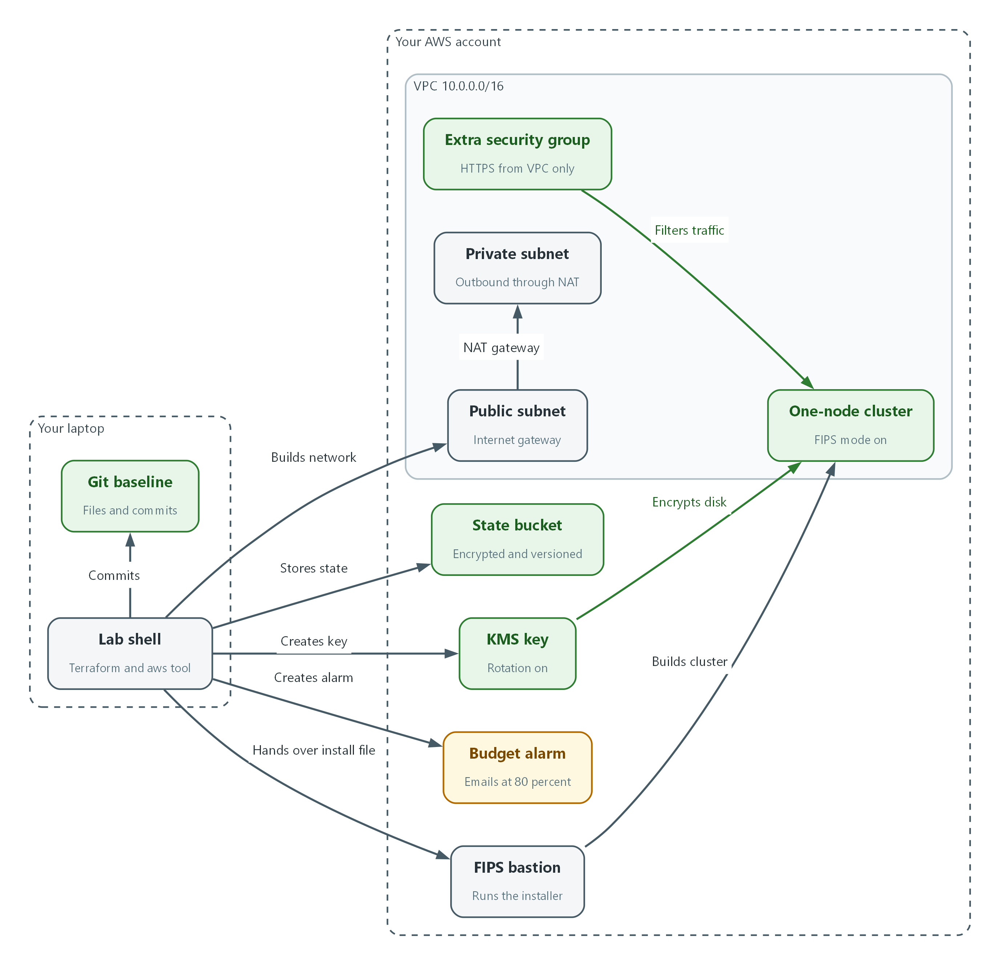
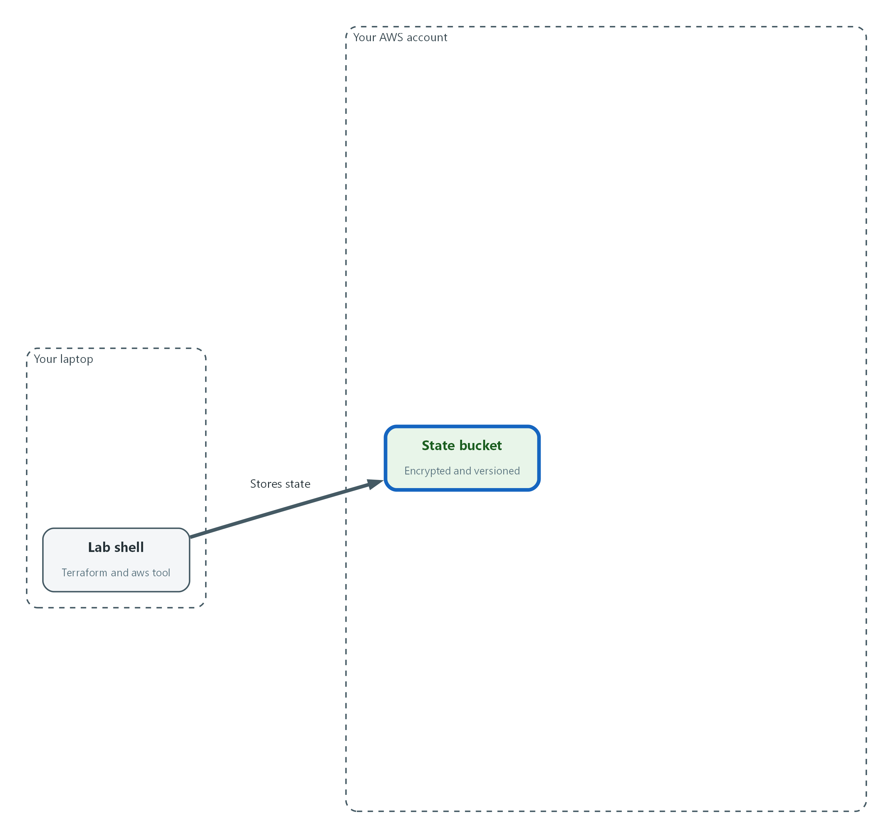
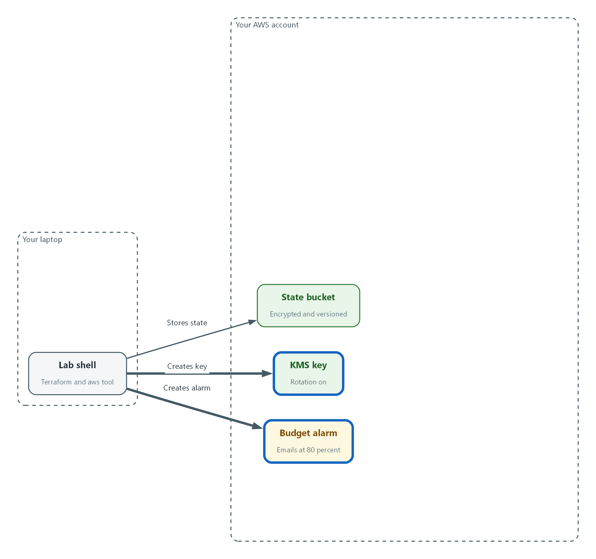
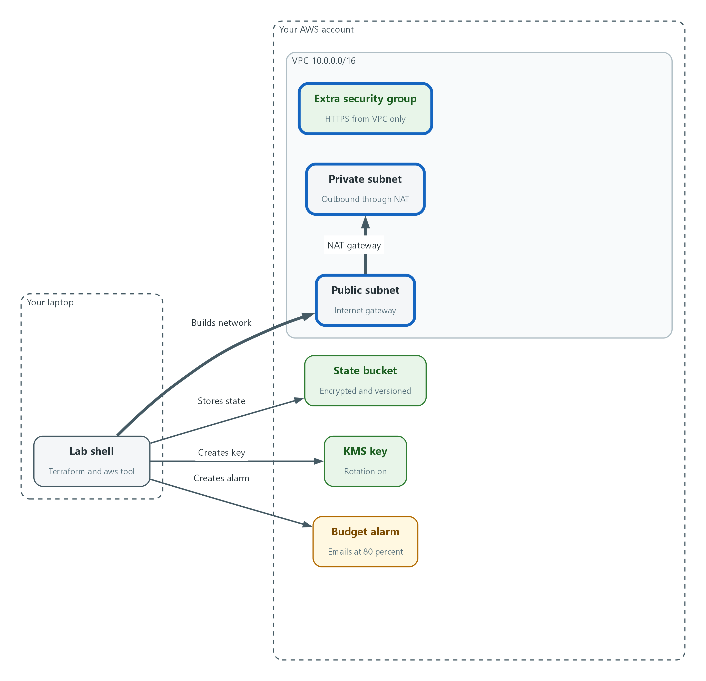
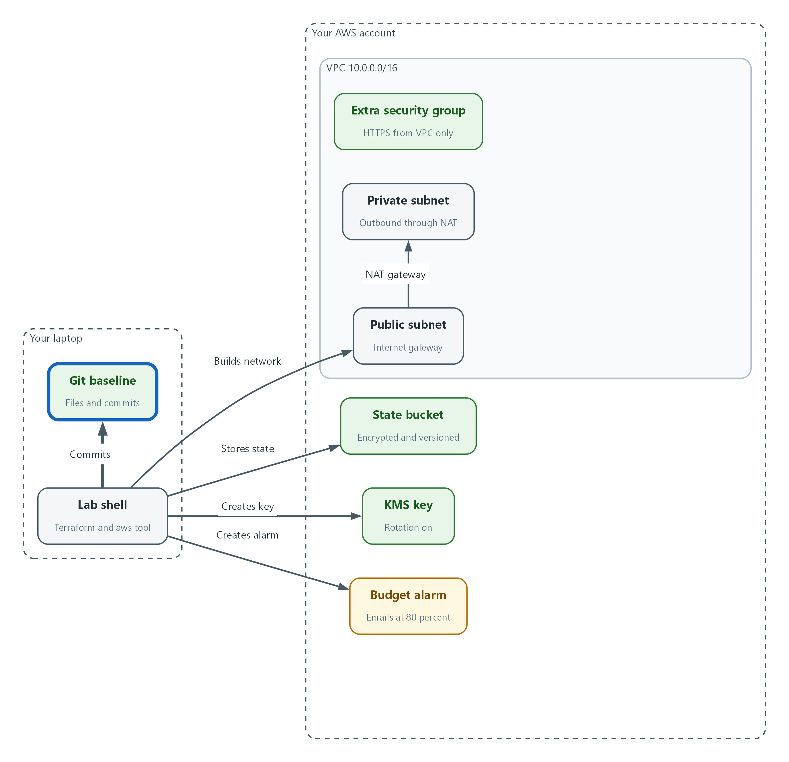
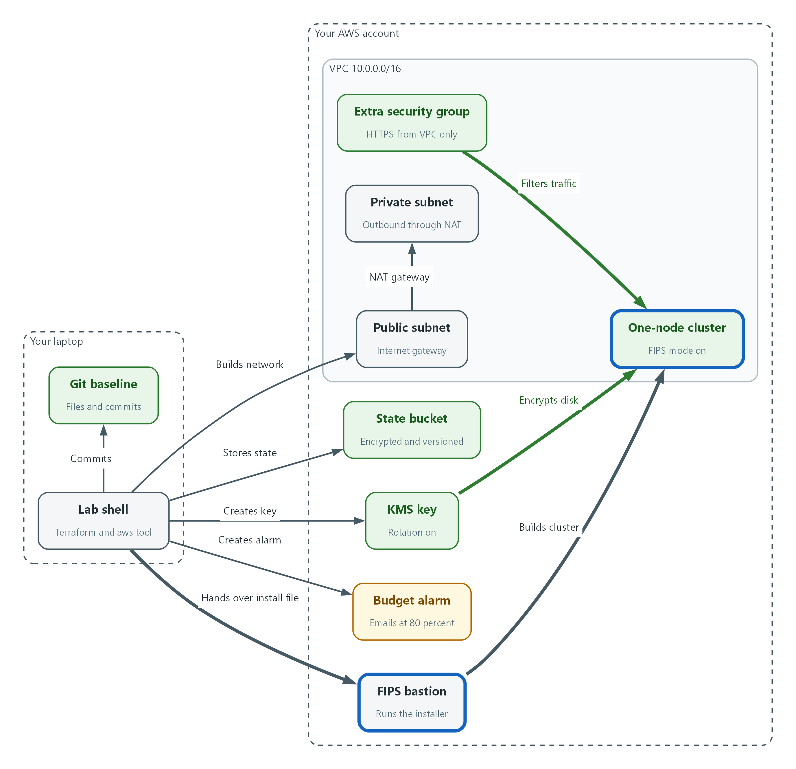

# M02: Lab Build with Terraform (CM-2, CM-6)

> 📌 DRAFT. Terraform blocks pass terraform fmt and terraform validate offline against the AWS provider, but have not been applied in a real account. The OpenShift procedure follows Red Hat's published pages for installing on a single node, installing on AWS into an existing VPC, and the AWS installation configuration parameters (checked against the 4.22 pages). CONFIRMED from OCP 4.22 docs: the FIPS installer binary is named openshift-install-fips (not openshift-install); it must be run from a RHEL 9 computer configured to operate in FIPS mode (docs.redhat.com OCP 4.22 Chapter 4 Support for FIPS cryptography). A Docker/Podman container on a Mac or Windows laptop does not satisfy this requirement. Step 5 therefore assumes the lab build provides a FIPS-mode RHEL 9 EC2 bastion that runs openshift-install-fips; learners watch the progress from their lab shell via SSH but do not invoke the binary directly from the container. The lab_needs list states this requirement explicitly. Unconfirmed: (1) the instance type and root volume size in install-config.yaml are placeholders. Red Hat's stated single-node minimum in the 4.22 pages is 4 vCPUs, 16 GB of RAM and 120 GB of storage, and the pages warn that 4 vCPUs leaves very little headroom, so the lab build must confirm both values. (2) Subnet roles are left out, which matches the 4.22 existing-VPC sample (id only); confirm it works for a single public and single private subnet. (3) The first availability zone returned may not offer the chosen instance type. (4) The installer needs extra AWS permissions to use a customer KMS key for the root volume; confirm the lab policy includes them. (5) Confirm that the drift check still reports no changes after the installer finishes (the provider setting that ignores tags starting with kubernetes.io/ is there for that reason). (6) The budget amount is a placeholder. (7) The Step 5 log watch uses the Session Manager document AWS-StartInteractiveCommand, which no AWS page fetched for this review names; confirm with aws ssm describe-document --name AWS-StartInteractiveCommand and note that aws ssm start-session needs the Session Manager plugin on the machine that runs it (AWS documentation). (8) The FIPS check reads /proc/sys/crypto/fips_enabled, which the RHEL 9 documentation describes (1 means FIPS mode); the same documentation's own check is fips-mode-setup --check, which can be run through oc debug if preferred. (9) The expected plan count in the teardown preview (resources Terraform owns) must be re-counted if the Terraform files change.

| Item | Detail |
| --- | --- |
| Sequence | Module 2 of 17 in the recommended order |
| Timed work | About 70 minutes (45 hands-on, 25 verify) |
| Modes | Ready Lab (prebuilt) or Architect (you design and build it) |
| Standalone start | `lab start m02` |
| Combined start | Continue from the end state of the previous module |
| End state | `lab check m02` passes |
| Tools | Terraform, AWS command-line tool (aws), Amazon S3, KMS, VPC and Budgets, OpenShift Container Platform (single node), openshift-install-fips, oc, git, jq |
| Prerequisites | Module 0 (terminal and git basics) |
| Extra lab needs | AWS credentials already present in lab shell, with a policy covering EC2, VPC, KMS, S3, Budgets, Route 53, load balancing, IAM and tagging, plus the extra KMS permissions Red Hat lists for the installer. For the state key, the same identity can create a key, enable rotation, create an alias, and use the key to encrypt and decrypt state (kms:CreateKey, EnableKeyRotation, CreateAlias, DescribeKey, GenerateDataKey, Decrypt, ScheduleKeyDeletion). The bastion and installer roles never touch the state bucket or state key.; A FIPS-mode RHEL 9 EC2 bastion instance (not the lab shell container) from which the lab runs openshift-install-fips. OCP 4.22 requires the installer to run from a RHEL 9 host that is itself configured for FIPS mode; a container on a Mac or Windows laptop does not qualify. The lab builds and manages this bastion automatically. The openshift-install-fips binary (extracted from the OCP release image with oc adm release extract --command=openshift-install-fips) is present on the bastion, not in the learner's lab shell container.; Red Hat pull secret at $HOME/pull-secret.json, supplied by the lab so the learner never types it.; Exactly one public Route 53 hosted zone in the learner's account, used as the base domain.; ssh-keygen, GNU date, and a git identity (user.name and user.email) configured in lab shell.; Terraform 1.11 or newer in lab shell (S3 native state locking is generally available from 1.11), and the Session Manager plugin for the AWS CLI installed in lab shell, with ssm:StartSession allowed for the learner on the bastion. The plugin is not in the lab contract tool list.; AWS service quotas for the chosen instance type, one Elastic IP and one NAT gateway.; A real budget amount (the module default is a placeholder) and a sweeper that destroys anything past its auto-destroy date, because a tag alone deletes nothing.; After this module, lab start exports KMS_KEY_ARN and VPC_ID from the Terraform outputs for later modules. |

## 1. Why This Matters

An IL5 system must have a written, current baseline: a complete description of how the system is built that can be rebuilt from and compared against. It must also have secure configuration settings that are applied on purpose and checked for unauthorized change. This module teaches infrastructure as code (describing servers, networks and keys in text files that a tool applies, instead of clicking in a console) by having you build your own lab with it. The files become the baseline, the settings in them become the configuration settings, and a comparison command shows when reality has drifted from them.

### Control mapping

| Control | What it requires, in plain words | Source of the value | Where this module covers it |
| --- | --- | --- | --- |
| CM-2 Baseline Configuration | Keep a current, documented baseline of the system under configuration control, review it, and keep earlier versions so you can roll back. | NIST; FedRAMP | Steps 1 and 4 keep the baseline in versioned files and a versioned state store. Test 1 compares reality to it. |
| CM-6 Configuration Settings | Choose the most restrictive settings that still work, apply them, record any exception, and watch for unauthorized changes. | NIST; FedRAMP | Steps 2, 3 and 5 write the settings as code (key rotation, encryption, FIPS mode, network rules). Test 5 shows a hand change being caught. |

### What each control is for

Read these answers first. They explain what each control is trying to prevent and how this module's tool meets it.

#### CM-2 Baseline Configuration

| Question | Answer |
| --- | --- |
| What the control author feared | Nobody can say what the system is supposed to look like, so a rebuild after a failure or an attack produces something different, and a change can slip in unnoticed. |
| Is it in scope for the system | Every component the system team builds: the cloud network, the encryption keys, the cluster and its settings. Anything a customer builds in their own tenant is theirs to answer for. |
| The operational question | If this environment were destroyed tonight, could you rebuild exactly what was approved, and could you prove what the approved version was? |
| What evidence proves it | The baseline files with their full change history, the stored state of what was built, and the date of the last review. |
| How much is enough | The baseline is current and under change control, and it is reviewed on a set schedule. FedRAMP assigns review at least annually and when a significant change occurs, and leaves the number of previous versions retained to the organization; this lab keeps all previous versions (every commit) to support rollback. |
| Who is told when it fails | Someone owns each baseline file, and a significant change triggers a review without waiting for the schedule. |
| How the tool in this module satisfies it | Terraform files in git are the baseline (Steps 2 to 4), the S3 state bucket keeps every version of the record of what was built (Step 1), and the drift check in Test 1 shows reality still matches. |

#### CM-6 Configuration Settings

| Question | Answer |
| --- | --- |
| What the control author feared | A component runs with weak settings, or a setting is quietly changed by hand, and no one knows until it is used against the system. |
| Is it in scope for the system | Settings on every component the team configures: cloud resources, keys, network rules and cluster nodes. |
| The operational question | For each setting that affects security, is it written down, was it applied automatically, and would you find out if someone changed it? |
| What evidence proves it | The configuration files showing each setting, the record of approved exceptions, and a comparison run showing no unapproved difference. |
| How much is enough | Settings follow organization-defined common secure configurations (FedRAMP names DoD STIGs, and CIS Level 2 guidelines where no STIG exists), are applied by automation, exceptions are justified and approved, and changes are controlled and monitored. This module covers the first, second and fourth parts for cloud and cluster settings. Choosing the benchmark and approving an exception are organizational. |
| Who is told when it fails | Something runs the comparison on a schedule and sends the result to someone who acts. This module runs it by hand. |
| How the tool in this module satisfies it | Settings are code (key rotation on, encrypted volume, FIPS mode, restricted network rule). Applying them is terraform apply and openshift-install-fips, and Test 5 shows a hand change being detected. |

### Architect mode brief

Design the build before running it. Decide what Terraform will own and what the OpenShift installer will own, where the record of what was built is kept and who can read it, which settings must be set on purpose (key rotation, encryption, FIPS mode, the narrowest network rule that works), how every resource will be labeled so it can be found and removed, and what will warn you before the bill grows. Then build it and run the tests.

### Terms in this module

Each term is also explained the first time it appears. This table is a quick lookup.

| Term | Plain meaning |
| --- | --- |
| Infrastructure as code | Describing servers, networks and keys in text files that a tool applies, so the files are the record of what exists. |
| Terraform | A free tool that reads infrastructure files, compares them to what exists, and makes the changes needed. |
| State | Terraform's record of what it has built. Without it Terraform cannot tell what already exists. |
| Backend | The place Terraform keeps its state. A remote backend keeps it in shared storage instead of on one computer. |
| Plan and apply | A plan is a preview of the changes Terraform would make. Apply carries them out. |
| Drift | A difference between what the files say and what actually exists, usually from a change made by hand. |
| KMS key | A key held in AWS Key Management Service, used to encrypt data such as disk volumes. You never see the key itself. |
| VPC | Virtual Private Cloud: your own private network inside AWS. |
| Security group | A set of allow rules for network traffic to and from a resource. |
| Tag | A key and value label attached to a cloud resource, used to find, group and bill it. |
| Single-node OpenShift | An OpenShift cluster that runs everything on one server. |
| FIPS mode | A setting that makes the operating system use only cryptography modules validated under the federal FIPS standard. |

## 2. The Tools

### Tools used in this module

Each tool name links to its official overview. The last column says how the tool is used in the lab.

| Tool (overview link) | What it is | Used in this lab |
| --- | --- | --- |
| [Terraform](https://developer.hashicorp.com/terraform/intro) | Describes infrastructure in text files, then creates, updates and tracks it. | Creates the lab's AWS resources from code. |
| [AWS CLI](https://docs.aws.amazon.com/cli/latest/userguide/cli-chap-welcome.html) | Runs AWS actions from a shell instead of the browser console. | Checks what Terraform built. |
| [AWS KMS](https://docs.aws.amazon.com/kms/latest/developerguide/overview.html) | Creates and controls encryption keys, held in FIPS-validated hardware. | Creates the key used to encrypt lab storage. |
| [Amazon VPC](https://docs.aws.amazon.com/vpc/latest/userguide/what-is-amazon-vpc.html) | A logically isolated virtual network for AWS resources. | The isolated network the cluster is built in. |
| [AWS Budgets](https://docs.aws.amazon.com/cost-management/latest/userguide/budgets-managing-costs.html) | Tracks spend against a budget and can notify when it is exceeded. | Sets a spend alert on the learner's lab. |
| [openshift-install](https://docs.redhat.com/en/documentation/openshift_container_platform/4.22/html/installing_on_aws/installing-methods-aws) | The installer that provisions the cluster's AWS infrastructure and builds the cluster. | Builds the single-node cluster. |
| [jq](https://jqlang.org/) | Command-line JSON processor. | Reads JSON output. |
| [OpenShift Container Platform](https://docs.redhat.com/en/documentation/openshift_container_platform/4.22/html/overview/ocp-overview) | A Kubernetes container platform for running and managing containerized applications. | The cluster every command in this module runs against. |
| [oc](https://docs.redhat.com/en/documentation/openshift_container_platform/4.22/html/cli_tools/openshift-cli-oc) | The OpenShift command-line tool for creating and managing applications and projects from a terminal. | Runs the cluster commands in each step. |
| [Git](https://git-scm.com/about) | Version control that stores repository history. | Tracks and reviews file changes. |

### How it fits together

#### What the lab build creates

From lab shell, Terraform builds the foundation in your AWS account: a state bucket, an encryption key, a budget alarm and a network. A bastion then runs the installer, which builds a one-node cluster on that foundation. Each step below adds one part, drawn with thick lines.



- Lab shell stores Terraform state in an encrypted, versioned bucket in your AWS account.
- Terraform builds the encryption key, the budget alarm, the VPC with two subnets, and the extra security group.
- The baseline files are saved in git on your side.
- A FIPS-mode bastion runs the installer, which builds one node in the VPC with its disk encrypted by the key.
### 2.1 Infrastructure as code, and how you run it

What is this? Normally someone builds a network by clicking through a web console. Nothing records exactly what was clicked. With infrastructure as code you write what you want in text files, and a tool called Terraform makes it so. The files can be reviewed, kept in git (a tool that keeps every version of a file), compared and replayed.

Why? A baseline configuration (CM-2) is only useful if it is exact and current, and a setting (CM-6) is only trustworthy if it was applied the same way every time. Files plus a tool give both. They also let you destroy the lab and rebuild it, which is how you stop paying for it.

Where do you run it? Every command in this module runs inside lab shell, a prepared terminal that already has Terraform, the AWS command-line tool and the others installed. On a Mac, open Terminal. On Windows, open PowerShell. In either, type lab shell. From there the commands are identical on both systems.

### 2.2 State and remote state

Terraform writes down what it built in a state file. Each plan compares your files to that record and to the real cloud. If the state is lost, Terraform thinks nothing exists and tries to build everything again. If two people run it at once, the state can be corrupted.

A remote backend solves this by keeping the state in shared storage. Here that is an S3 bucket (S3 is Amazon's file storage service, and a bucket is a named container in it). The bucket needs protection because state can contain sensitive values: encryption at rest, versioning so every earlier state is kept, blocked public access, and a lock so two runs cannot overlap.

| Protection | What it does | Where it is set |
| --- | --- | --- |
| Encryption | Stored data is unreadable without AWS permission and use of the state key (SSE-KMS) | Bucket default (Step 1) and backend settings encrypt and kms_key_id |
| Versioning | Every earlier state stays available for rollback | Bucket setting (Step 1) |
| Public access block | No one can make the bucket public by mistake | Bucket setting (Step 1) |
| Locking | Only one run changes state at a time | Backend setting use_lockfile |

> 🏭 IN PRODUCTION: In the real environment the state bucket lives in its own protected account, is encrypted with a customer-managed key (as the lab does), is readable only by the build pipeline, and changes to the files arrive through a reviewed merge request. The lab uses one bucket so you practice the same steps.

### 2.3 Plan before apply, and how to read a plan

Terraform never changes anything on terraform plan. It prints what it would do. You read it, and only then run apply. Saving the plan to a file and applying that exact file guarantees you apply what you reviewed.

Read a plan from the symbols on the left and the summary line at the bottom. Anything you did not expect, especially a destroy or a replace, is a reason to stop.

| Symbol | Meaning | Your reaction |
| --- | --- | --- |
| + | Will be created | Check names and tags |
| ~ | Will be changed in place | Read which setting changes, and from what to what |
| - | Will be destroyed | Stop unless you meant it |
| -/+ | Will be destroyed and created again | Stop and find out why |

```text
terraform plan  -->  you read it  -->  terraform apply  -->  terraform plan
(preview only)       (approve or       (make the change)     (must say: No changes.
                      stop)                                   That is the drift check)
```

### 2.4 What Terraform builds and what the installer builds

Terraform builds the foundation: the encryption key, the VPC (your private network in AWS), its subnets (slices of that network), the routes, and an extra security group (a set of allow rules for network traffic). The OpenShift installer then builds the cluster inside that foundation. The installer keeps its own record, so the cluster is not in Terraform state.

The cluster is single-node OpenShift: the control plane and your workloads share one server. In install-config.yaml (the installer's input file), that means one control plane machine and zero compute machines. It also sets fips to true, which makes the operating system use only validated cryptography (SC-13).

```text
Terraform (this module)            OpenShift installer (Step 5)
-----------------------            ----------------------------
KMS key, budget alarm, tags   -->  reads the key, subnets, security group
VPC, subnets, NAT, routes     -->  builds one node, load balancers, DNS records
extra security group          -->  attaches it to the node

Destroy in reverse: installer first, then Terraform.
```

### 2.5 Tags, cost safety and destroying

A tag is a key and value label on a cloud resource. Terraform can put the same tags on everything it creates (default tags), and the installer can do the same for the cluster resources. Two tags matter here: one names the lab, and one holds a date after which the lab should be destroyed.

A tag by itself deletes nothing. It lets a person or an automated sweeper find what is overdue. The budget alarm is the second guard: AWS Budgets emails you when spending passes a share of the limit you set, or is forecast to. Neither replaces destroying the lab when you stop for the day.

Destroy in the reverse order of building. First run openshift-install-fips destroy cluster for the cluster, because it lives inside your VPC and would block the network from being removed. Then run terraform destroy for the foundation. Last, delete the state bucket by hand, because Terraform cannot delete the place that holds its own record, and then schedule the state key for deletion with the seven-day minimum waiting period.

## 3. Implement

Ready Lab learners start with `lab start m02`. Architect learners design each step first using the brief above.

### Step 1. Create the protected state bucket and connect Terraform to it (CM-2)

Terraform needs somewhere safe to keep its record before it builds anything. You create the bucket with the AWS command-line tool (not Terraform, which cannot store its record in a bucket that does not exist yet), turn on versioning, encryption and the public access block, then point Terraform at it. Keeping every version of the state supports rolling back to an earlier known state.

What this step adds (thick lines and outlines are new):



- You create the protected state bucket first, so Terraform has a safe place to keep its record.
```bash
aws sts get-caller-identity
ACCOUNT_ID=$(aws sts get-caller-identity --query Account --output text)
STATE_BUCKET="$LAB_ID-tfstate-$ACCOUNT_ID"
DESTROY_AFTER=$(date -u -d '+1 day' +%Y-%m-%d)
mkdir -p "$HOME/lab-infra"
cd "$HOME/lab-infra"
STATE_KEY_ARN=$(aws kms create-key --description "$LAB_ID Terraform state key" --tags TagKey=LabId,TagValue="$LAB_ID" --region "$AWS_REGION" --query KeyMetadata.Arn --output text)
aws kms enable-key-rotation --key-id "$STATE_KEY_ARN" --region "$AWS_REGION"
aws kms create-alias --alias-name "alias/$LAB_ID-tfstate" --target-key-id "$STATE_KEY_ARN" --region "$AWS_REGION"
aws s3 mb "s3://$STATE_BUCKET" --region "$AWS_REGION"
aws s3api put-bucket-versioning --bucket "$STATE_BUCKET" --versioning-configuration Status=Enabled
aws s3api put-bucket-encryption --bucket "$STATE_BUCKET" \
  --server-side-encryption-configuration "$(jq -n --arg k "$STATE_KEY_ARN" '{Rules:[{ApplyServerSideEncryptionByDefault:{SSEAlgorithm:"aws:kms",KMSMasterKeyID:$k},BucketKeyEnabled:true}]}')"
aws s3api put-public-access-block --bucket "$STATE_BUCKET" \
  --public-access-block-configuration BlockPublicAcls=true,IgnorePublicAcls=true,BlockPublicPolicy=true,RestrictPublicBuckets=true
```

| Part | What it does |
| --- | --- |
| aws sts get-caller-identity | Shows which AWS account and identity your commands run as. Check it is your lab account before you create anything. |
| ACCOUNT_ID=... STATE_BUCKET=... | Builds a bucket name from your lab ID and account number. Bucket names must be unique across all of AWS. |
| DESTROY_AFTER=$(date ...) | Today's date plus one day, in UTC. It becomes the auto-destroy tag. Lab shell uses GNU date, so this works the same on Mac and Windows. |
| mkdir -p / cd | Makes the working folder for your Terraform files and moves into it. |
| aws kms create-key / enable-key-rotation / create-alias | Creates a customer-managed key just for the state, turns on its rotation and gives it a readable name. It is separate from the key Terraform builds in Step 2, because that key does not exist until Terraform has a place to keep its record. |
| aws s3 mb | Makes the bucket (mb means make bucket) in your lab region. |
| put-bucket-versioning | Keeps every earlier version of every object, so earlier states can be recovered. |
| put-bucket-encryption | Encrypts everything stored in the bucket by default with the state key (SSE-KMS), not with the S3 managed key. jq fills in the key address so you do not type it. |
| put-public-access-block | Turns off every way the bucket could be made public. |

```hcl
terraform {
  required_version = ">= 1.11"

  required_providers {
    aws = {
      source  = "hashicorp/aws"
      version = "~> 6.0"
    }
  }

  backend "s3" {
    key          = "lab/terraform.tfstate"
    encrypt      = true
    use_lockfile = true
  }
}
```

| Part | What it does |
| --- | --- |
| required_version | Refuses to run on a Terraform too old to understand this file. S3 locking needs this version or newer. |
| required_providers | A provider is the plug-in that talks to one service. This pins the AWS provider to the 6.x family so a new major release cannot change your build. |
| backend "s3" | Keeps state in the S3 bucket. The bucket name and region are left out on purpose and given at init, so the file works in any lab. |
| key | The path of the state file inside the bucket. |
| encrypt | Asks S3 to encrypt the state file when Terraform writes it. The key is left out on purpose and given at init as kms_key_id, so Terraform writes with your state key and does not fall back to the S3 managed key. |
| use_lockfile | Writes a lock file in the bucket during a run, so two runs cannot change state at the same time. |

```bash
export TF_VAR_lab_id="$LAB_ID"
export TF_VAR_region="$AWS_REGION"
export TF_VAR_destroy_after="$DESTROY_AFTER"
export TF_VAR_alert_email="replace-with-your-email-address"
terraform init -backend-config="bucket=$STATE_BUCKET" -backend-config="region=$AWS_REGION" -backend-config="kms_key_id=$STATE_KEY_ARN"
```

| Part | What it does |
| --- | --- |
| export TF_VAR_... | Terraform reads any environment variable that starts with TF_VAR_ as an input named after the rest. This passes four inputs without writing them in a file. |
| TF_VAR_alert_email | Replace the placeholder text with your own email address before you continue. Budget alerts go there. |
| terraform init | Downloads the AWS provider and connects to the bucket. The three backend-config options supply the bucket name, region and state key. |

> 📌 If you open a new lab shell later, run the commands that start with ACCOUNT_ID, STATE_BUCKET, DESTROY_AFTER and export again, and set STATE_KEY_ARN with: STATE_KEY_ARN=$(aws kms describe-key --key-id alias/$LAB_ID-tfstate --region $AWS_REGION --query KeyMetadata.Arn --output text). The variables do not survive a new shell.

> 🔒 Save the first block's file as versions.tf in the lab-infra folder before running init. State files can hold sensitive values, which is why the bucket is encrypted, versioned and closed to the public. Never commit a state file to git. Keeping the state in the bucket means none ever sits in your folder.

> ▶ YOUR TURN: Run the first block, save the second as versions.tf in the lab-infra folder, then run the third.

> ✅ CHECKPOINT: Terraform prints that it successfully configured the backend s3 and initialized the provider.

### Step 2. Write the provider, tags, encryption key and budget alarm (CM-6)

These files hold the first security-relevant settings, written as code: key rotation on, and labels on everything. Default tags apply the same labels to every resource Terraform creates, including the date after which the lab should be destroyed. The budget alarm emails you before costs run away. A KMS key encrypts the cluster's disk, and rotating it regularly is a hardening setting (SC-12).

What this step adds (thick lines and outlines are new):



- Terraform adds the encryption key with rotation on, and the budget alarm.
```hcl
variable "lab_id" {
  type        = string
  description = "Short name of this lab. Used in names and tags."
}

variable "region" {
  type        = string
  description = "AWS region for every resource."
}

variable "destroy_after" {
  type        = string
  description = "Date (YYYY-MM-DD) after which this lab should be destroyed."

  validation {
    condition     = can(regex("^[0-9]{4}-[0-9]{2}-[0-9]{2}$", var.destroy_after))
    error_message = "destroy_after must look like 2026-10-26."
  }
}

variable "alert_email" {
  type        = string
  description = "Address that receives budget alerts."
}

variable "budget_limit_usd" {
  type        = string
  default     = "25"
  description = "Monthly budget in US dollars. Placeholder; the lab sets the real amount."
}
```

| Part | What it does |
| --- | --- |
| variable "lab_id" / "region" | Inputs filled from the TF_VAR_ variables you exported in Step 1. |
| destroy_after + validation | The date for the auto-destroy tag. The validation rejects anything that is not a year-month-day date, so a typo fails at plan time. |
| alert_email | Where budget alerts are sent. |
| budget_limit_usd | The monthly spending limit in US dollars. The value here is a placeholder. The lab build sets the real amount. |

```hcl
provider "aws" {
  region = var.region

  default_tags {
    tags = {
      LabId            = var.lab_id
      ManagedBy        = "terraform"
      AutoDestroyAfter = var.destroy_after
    }
  }

  ignore_tags {
    key_prefixes = ["kubernetes.io/"]
  }
}

resource "aws_kms_key" "lab" {
  description             = "Encrypts the ${var.lab_id} cluster root volume"
  enable_key_rotation     = true
  deletion_window_in_days = 7
}

resource "aws_kms_alias" "lab" {
  name          = "alias/${var.lab_id}-lab"
  target_key_id = aws_kms_key.lab.key_id
}

resource "aws_budgets_budget" "lab" {
  name         = "${var.lab_id}-monthly"
  budget_type  = "COST"
  limit_amount = var.budget_limit_usd
  limit_unit   = "USD"
  time_unit    = "MONTHLY"

  notification {
    comparison_operator        = "GREATER_THAN"
    threshold                  = 80
    threshold_type             = "PERCENTAGE"
    notification_type          = "ACTUAL"
    subscriber_email_addresses = [var.alert_email]
  }

  notification {
    comparison_operator        = "GREATER_THAN"
    threshold                  = 100
    threshold_type             = "PERCENTAGE"
    notification_type          = "FORECASTED"
    subscriber_email_addresses = [var.alert_email]
  }
}
```

| Part | What it does |
| --- | --- |
| provider "aws" | Tells Terraform which region to build in. |
| default_tags | Puts LabId, ManagedBy and AutoDestroyAfter on every resource Terraform creates, without repeating them on each one. |
| ignore_tags | Tells Terraform to ignore tags whose names start with kubernetes.io/. The installer adds those to your subnets later, and without this line the drift check would report them as changes. |
| aws_kms_key | Creates the encryption key. enable_key_rotation makes AWS replace the key material automatically on a schedule. The deletion window is the number of days AWS waits before really deleting a key you remove, which protects against mistakes. |
| aws_kms_alias | A readable name for the key. |
| aws_budgets_budget | Creates a monthly cost budget. |
| notification (two) | The first emails you when actual spending passes 80 percent of the limit. The second emails you when forecast spending passes 100 percent. |

```bash
terraform fmt -check
terraform validate
```

| Part | What it does |
| --- | --- |
| terraform fmt -check | Checks that the files are formatted the standard way and prints the name of any that are not. Run terraform fmt to fix them. |
| terraform validate | Checks the files for mistakes in structure and names without touching AWS. |

> 💡 Save the blocks as variables.tf and main.tf in the lab-infra folder. Keeping one topic per file (inputs, settings, network, outputs) makes later changes small and easy to review.

> ▶ YOUR TURN: Save the two files, then run the checks.

> ✅ CHECKPOINT: fmt prints nothing and validate says the configuration is valid.

### Step 3. Write the network (CM-6)

The network is built from code so its rules are the same every time. A VPC is your private network in AWS. Subnets are slices of it: the public subnet can reach the internet directly, and the private subnet reaches out only through a NAT gateway (a device that lets private machines start outbound connections but accepts no inbound ones). The extra security group allows web traffic (port 443) only from inside the VPC. Protecting traffic at the boundary and between internal parts is SC-7.

What this step adds (thick lines and outlines are new):



- Terraform builds the network: two subnets in one VPC and an extra security group that allows HTTPS from inside the VPC only.
```hcl
data "aws_availability_zones" "available" {
  state = "available"
}

locals {
  az = data.aws_availability_zones.available.names[0]
}

resource "aws_vpc" "lab" {
  cidr_block           = "10.0.0.0/16"
  enable_dns_support   = true
  enable_dns_hostnames = true
}

resource "aws_internet_gateway" "lab" {
  vpc_id = aws_vpc.lab.id

  tags = { Name = "${var.lab_id}-igw" }
}

resource "aws_subnet" "public" {
  vpc_id            = aws_vpc.lab.id
  cidr_block        = "10.0.0.0/24"
  availability_zone = local.az
}

resource "aws_subnet" "private" {
  vpc_id            = aws_vpc.lab.id
  cidr_block        = "10.0.1.0/24"
  availability_zone = local.az
}

resource "aws_eip" "nat" {
  domain = "vpc"

  tags = { Name = "${var.lab_id}-nat" }
}

resource "aws_nat_gateway" "lab" {
  allocation_id = aws_eip.nat.id
  subnet_id     = aws_subnet.public.id

  depends_on = [aws_internet_gateway.lab]

  tags = { Name = "${var.lab_id}-nat" }
}

resource "aws_route_table" "public" {
  vpc_id = aws_vpc.lab.id

  route {
    cidr_block = "0.0.0.0/0"
    gateway_id = aws_internet_gateway.lab.id
  }

  tags = { Name = "${var.lab_id}-public" }
}

resource "aws_route_table" "private" {
  vpc_id = aws_vpc.lab.id

  route {
    cidr_block     = "0.0.0.0/0"
    nat_gateway_id = aws_nat_gateway.lab.id
  }

  tags = { Name = "${var.lab_id}-private" }
}

resource "aws_route_table_association" "public" {
  subnet_id      = aws_subnet.public.id
  route_table_id = aws_route_table.public.id
}

resource "aws_route_table_association" "private" {
  subnet_id      = aws_subnet.private.id
  route_table_id = aws_route_table.private.id
}

resource "aws_security_group" "nodes_extra" {
  name        = "${var.lab_id}-nodes-extra"
  description = "Extra rules for the cluster node"
  vpc_id      = aws_vpc.lab.id

  tags = { Name = "${var.lab_id}-nodes-extra" }
}

resource "aws_vpc_security_group_ingress_rule" "https_from_vpc" {
  security_group_id = aws_security_group.nodes_extra.id
  description       = "HTTPS from inside the VPC only"
  cidr_ipv4         = aws_vpc.lab.cidr_block
  from_port         = 443
  to_port           = 443
  ip_protocol       = "tcp"
}

resource "aws_vpc_security_group_egress_rule" "all_outbound" {
  security_group_id = aws_security_group.nodes_extra.id
  description       = "All outbound"
  cidr_ipv4         = "0.0.0.0/0"
  ip_protocol       = "-1"
}
```

| Part | What it does |
| --- | --- |
| aws_availability_zones | Looks up which data centers (availability zones) the region has. The lab uses the first one. |
| aws_vpc | The private network. The address range 10.0.0.0/16 is private space. DNS settings are on because the installer requires them. |
| aws_subnet public / private | Two slices of the network in the same zone: one routed to the internet gateway, one routed to the NAT gateway. |
| aws_internet_gateway | The door between the public subnet and the internet. |
| aws_eip + aws_nat_gateway | A fixed public address and the NAT gateway that uses it. It sits in the public subnet and carries the private subnet's outbound traffic. |
| aws_route_table (two) | The routing rules: public traffic leaves by the internet gateway, private traffic leaves by the NAT gateway. |
| aws_route_table_association | Attaches each route table to its subnet. |
| aws_security_group nodes_extra | The extra security group itself. Its rules are separate resources below, which is the approach the Terraform AWS provider documentation calls the current best practice. |
| aws_vpc_security_group_ingress_rule / egress_rule | One rule each: HTTPS allowed only from the VPC's own address range, and all outbound traffic allowed. Terraform removes AWS's automatic allow-all outbound rule, so the outbound rule is written out on purpose. The installer adds its own security groups too. This one is an extra restriction layer you control. |

```hcl
output "kms_key_arn" {
  value = aws_kms_key.lab.arn
}

output "vpc_id" {
  value = aws_vpc.lab.id
}

output "public_subnet_id" {
  value = aws_subnet.public.id
}

output "private_subnet_id" {
  value = aws_subnet.private.id
}

output "extra_security_group_id" {
  value = aws_security_group.nodes_extra.id
}
```

| Part | What it does |
| --- | --- |
| output (five) | Prints the identifiers that Step 5 feeds to the installer. Outputs let one stage hand values to the next without copying them by hand. |

```bash
terraform fmt -check
terraform validate
```

| Part | What it does |
| --- | --- |
| terraform fmt -check | Format check, as before. |
| terraform validate | Structure and name check, as before. |

> 📌 The NAT gateway is the largest ongoing cost in this foundation, because AWS charges for it every hour it exists. That is one reason to destroy the lab when you stop for the day. The VPC and subnets deliberately carry no Name tag, because Red Hat's requirements for an existing VPC say the installation fails if they use one.

> ▶ YOUR TURN: Save the two files as network.tf and outputs.tf, then run the checks.

> ✅ CHECKPOINT: fmt prints nothing and validate says the configuration is valid.

### Step 4. Plan, read the plan, apply, and record the baseline (CM-2, CM-6)

Now build it, in the safe order: save a plan, read it, apply exactly that plan. Then commit the files to git. That commit is your baseline, and every later change becomes another commit, so all previous versions are kept (CM-2). Changes to settings should be reviewed and approved before they are applied, which is what reading the plan is practice for (CM-3).

What this step adds (thick lines and outlines are new):



- You save the files to git. That commit is the baseline.
```bash
cd "$HOME/lab-infra"
terraform plan -out=lab.tfplan
terraform show lab.tfplan
terraform apply lab.tfplan
terraform output
```

| Part | What it does |
| --- | --- |
| terraform plan -out=lab.tfplan | Previews every change and saves the preview to a file. Nothing is built yet. |
| terraform show lab.tfplan | Prints the saved plan again so you can read it slowly. Look for the plus signs and the summary line at the bottom. You expect only creates. |
| terraform apply lab.tfplan | Carries out exactly the saved plan. It does not ask again, because you approved it by reading it. |
| terraform output | Prints the identifiers of what was built. |

```bash
printf '.terraform/\n*.tfplan\ncluster/\n' > .gitignore
git init -q
git add .
git commit -q -m "Baseline: state backend, KMS key, budget, network"
git log --oneline
aws resourcegroupstaggingapi get-resources --tag-filters Key=LabId,Values="$LAB_ID" --query 'ResourceTagMappingList[].ResourceARN' --output text
```

| Part | What it does |
| --- | --- |
| printf ... > .gitignore | Tells git never to store Terraform's working folder, saved plans or the cluster folder (which will hold secrets). |
| git init / add / commit | Starts a repository and saves the first version of your files with a message. |
| git log --oneline | Lists saved versions. One line per version is the history CM-2 wants kept. |
| aws resourcegroupstaggingapi get-resources | Lists everything in your account that carries your lab's LabId tag. This is how you find what a destroy must remove, or what a sweeper would act on. |

```bash
terraform plan -destroy -target=aws_kms_alias.lab
terraform destroy -target=aws_kms_alias.lab -auto-approve
terraform plan -out=restore.tfplan
terraform apply restore.tfplan
```

| Part | What it does |
| --- | --- |
| plan -destroy -target=... | Previews a destroy of one named item, the key's readable alias. The name is harmless to lose. |
| destroy -target=... -auto-approve | Destroys only that item without asking again. Use -auto-approve only on something you have just previewed and can afford to lose. |
| plan -out=restore.tfplan | Shows that Terraform sees the missing alias and plans to create it. |
| apply restore.tfplan | Puts it back. You have now seen a destroy end to end on something safe. |

> 🔒 Targeted commands (the -target option) skip Terraform's normal full comparison, so Terraform warns about them. They are for practice and emergencies. Real changes use a full plan and apply.

> ▶ YOUR TURN: Run the first block and read the plan before it applies. Run the second and count the tagged resources. Run the third to practice a destroy.

> ✅ CHECKPOINT: The summary says the resources were added, the git log shows one version, and the tag search lists your lab's resources.

### Step 5. Build the single-node OpenShift cluster with FIPS mode on (CM-6)

The cluster definition is also a set of settings: one control plane machine, no compute machines, FIPS mode on, the root disk encrypted with your KMS key, and the extra security group attached. Per Red Hat's published single-node procedure for AWS, you set controlPlane replicas to 1 and compute replicas to 0 in install-config.yaml (the file that tells the installer what to build), and give it the existing VPC's subnets. You keep a copy of the template, without secrets, in git so the cluster definition is part of the baseline too.

What this step adds (thick lines and outlines are new):



- A FIPS-mode bastion runs the installer, which builds one node in the VPC with its disk encrypted by the key.
```yaml
apiVersion: v1
baseDomain: __BASE_DOMAIN__
metadata:
  name: __CLUSTER_NAME__
fips: true
publish: External
networking:
  machineNetwork:
    - cidr: 10.0.0.0/16
controlPlane:
  name: master
  replicas: 1
  platform:
    aws:
      type: m6i.4xlarge
      rootVolume:
        size: 120
        type: gp3
        kmsKeyARN: __KMS_ARN__
      additionalSecurityGroupIDs:
        - __EXTRA_SG__
compute:
  - name: worker
    replicas: 0
platform:
  aws:
    region: __AWS_REGION__
    vpc:
      subnets:
        - id: __PUBLIC_SUBNET__
        - id: __PRIVATE_SUBNET__
    propagateUserTags: true
    userTags:
      LabId: __LAB_ID__
      AutoDestroyAfter: "__DESTROY_AFTER__"
```

| Part | What it does |
| --- | --- |
| baseDomain / metadata.name | The cluster's address is its name followed by the base domain. A base domain is a domain you own in Route 53, the AWS DNS service. |
| fips: true | Turns on FIPS mode for the nodes. This can only be chosen at install time. |
| controlPlane replicas: 1 | One control plane machine, which is what makes the cluster single-node. |
| compute replicas: 0 | No separate worker machines. This also makes the control plane machine run your workloads. |
| type / rootVolume | The machine size and the root disk. The size shown is a placeholder for the lab build to confirm. |
| kmsKeyARN | Encrypts the root disk with the key Terraform built. |
| additionalSecurityGroupIDs | Attaches the extra security group Terraform built. |
| machineNetwork | The address range of the VPC the machine lives in. It must match the VPC. |
| vpc.subnets | The existing public and private subnets Terraform built, so the installer uses them instead of making its own. |
| userTags + propagateUserTags | Puts your lab and auto-destroy tags on everything the installer and the cluster create. |
| __NAME__ words | Placeholders. The next block fills them in so the file in git holds no secret. |

```bash
cd "$HOME/lab-infra"
KMS_ARN=$(terraform output -raw kms_key_arn)
PUBLIC_SUBNET=$(terraform output -raw public_subnet_id)
PRIVATE_SUBNET=$(terraform output -raw private_subnet_id)
EXTRA_SG=$(terraform output -raw extra_security_group_id)
BASE_DOMAIN=$(aws route53 list-hosted-zones --query 'HostedZones[?Config.PrivateZone==`false`].Name | [0]' --output text | sed 's/\.$//')
PULL_SECRET=$(jq -c . "$HOME/pull-secret.json")
mkdir -p "$HOME/.ssh" "$HOME/cluster"
ssh-keygen -q -t ecdsa -b 384 -N "" -f "$HOME/.ssh/lab_ecdsa"
SSH_PUB=$(cat "$HOME/.ssh/lab_ecdsa.pub")
sed \
  -e "s|__BASE_DOMAIN__|$BASE_DOMAIN|" \
  -e "s|__CLUSTER_NAME__|$CLUSTER_NAME|" \
  -e "s|__KMS_ARN__|$KMS_ARN|" \
  -e "s|__EXTRA_SG__|$EXTRA_SG|" \
  -e "s|__AWS_REGION__|$AWS_REGION|" \
  -e "s|__PUBLIC_SUBNET__|$PUBLIC_SUBNET|" \
  -e "s|__PRIVATE_SUBNET__|$PRIVATE_SUBNET|" \
  -e "s|__LAB_ID__|$LAB_ID|" \
  -e "s|__DESTROY_AFTER__|$DESTROY_AFTER|" \
  install-config.template.yaml > "$HOME/cluster/install-config.yaml"
printf "pullSecret: '%s'\nsshKey: '%s'\n" "$PULL_SECRET" "$SSH_PUB" >> "$HOME/cluster/install-config.yaml"
git add install-config.template.yaml
git commit -q -m "Add single-node install-config template"
```

| Part | What it does |
| --- | --- |
| terraform output -raw ... | Reads the key, subnet and security group identifiers Terraform built, with no quotes or spaces. |
| BASE_DOMAIN=... route53 | Reads your public hosted zone's name from Route 53 (the filter skips private zones, such as the one the installer adds later) and strips the trailing dot. The lab account has exactly one public zone. |
| PULL_SECRET=$(jq -c ...) | Reads the Red Hat pull secret (the credential that lets the cluster download Red Hat images) from the file the lab placed in your home folder. jq -c puts it on one line. |
| ssh-keygen | Makes a key pair for logging in to the node if ever needed. The public half goes in the file. It uses the ecdsa type because Red Hat says a FIPS-mode cluster must not use an ed25519 key. |
| sed -e ... template > install-config.yaml | Copies the template and replaces each placeholder with a real value. The output goes in the cluster folder, which git ignores. |
| printf ... >> install-config.yaml | Adds the two secret lines last, straight from the variables, so they never sit in the template or in git. |
| git add / commit | Saves the template, without secrets, to the baseline. |

```bash
mkdir -p "$HOME/cluster/auth"
aws s3 cp "$HOME/cluster/install-config.yaml" "s3://$ARTIFACTS_BUCKET/install/install-config.yaml" --sse aws:kms --sse-kms-key-id "$KMS_ARN"
aws ssm start-session --target "$BASTION_ID" --document-name AWS-StartInteractiveCommand --parameters command="tail -n +1 -F /var/log/lab-install.log"
aws s3 cp "s3://$ARTIFACTS_BUCKET/install/status" -
aws s3 cp "s3://$ARTIFACTS_BUCKET/install/auth/kubeconfig" "$HOME/cluster/auth/kubeconfig"
export KUBECONFIG="$HOME/cluster/auth/kubeconfig"
oc get nodes
```

| Part | What it does |
| --- | --- |
| mkdir -p ... auth | Makes the local auth folder so the login file has a place to land. |
| aws s3 cp ... install-config.yaml | Uploads the finished file to the handoff bucket, encrypted with the lab key. The bastion has no inbound access, so this bucket is how the file reaches it. The bastion picks the file up, deletes it from the bucket, and starts the installer. |
| aws ssm start-session ... tail -F | Opens a Session Manager session to the bastion and follows the installer's log. No address, password or key is needed. Press Ctrl+C when you want to stop watching; the installer keeps running. |
| aws s3 cp .../install/status - | Prints the one-word install status: installing, complete, or failed with a number. Run it again until it says complete. |
| aws s3 cp .../auth/kubeconfig | Copies the admin login file the installer wrote to the handoff bucket into your lab shell. |
| export KUBECONFIG | Points oc at the kubeconfig. No password is typed or saved. |
| oc get nodes | Lists the servers in the cluster. You expect exactly one. |

> 📌 Red Hat requires that openshift-install-fips runs on a RHEL 9 host that is itself configured for FIPS mode (documented in OCP 4.22 Chapter 4, Support for FIPS cryptography). Your lab shell container on a Mac or Windows laptop does not satisfy this requirement. The lab provisions a FIPS-mode RHEL 9 EC2 bastion with no public address, no key pair and no inbound rule. You never log in to it to run commands. Instead, the third block uploads your install-config.yaml to an encrypted handoff bucket, the bastion picks it up and runs the installer, and you watch the log through Session Manager and read the kubeconfig back from the same bucket. The oc command in the last line runs in your lab shell using that kubeconfig.

> 🔒 The pull secret and the installer's login files are credentials. They stay in the cluster folder, which git ignores, and in shell variables. Never paste them into a command or a file in git. The installer consumes install-config.yaml when it starts, so the file with the secrets is gone afterward.

> 💡 Read the installer's first lines carefully. It validates the file before it builds anything, and a wrong instance type, a missing hosted zone or a missing permission fails there, cheaply, with a clear message.

> ▶ YOUR TURN: Save the YAML as install-config.template.yaml in the lab-infra folder. Run the second block, then the third, and wait for the installer to finish.

> ✅ CHECKPOINT: oc get nodes lists one node with status Ready.

## 4. Verify It Works

### Test 1 (positive). The state is in an encrypted, versioned bucket

A record of what was built is only a baseline if it survives and is protected. Check the live state object for encryption and for stored versions.

```bash
ACCOUNT_ID=$(aws sts get-caller-identity --query Account --output text)
STATE_BUCKET="$LAB_ID-tfstate-$ACCOUNT_ID"
aws s3api head-object --bucket "$STATE_BUCKET" --key lab/terraform.tfstate --query '{Algorithm:ServerSideEncryption,Key:SSEKMSKeyId}' --output json
aws s3api get-bucket-versioning --bucket "$STATE_BUCKET" --query Status --output text
aws s3api list-object-versions --bucket "$STATE_BUCKET" --prefix lab/terraform.tfstate --query 'Versions[].VersionId' --output text
```

**Expected output:**

```
Example only. Your version IDs will differ.
{ "Algorithm": "aws:kms", "Key": "arn:aws:kms:region:account:key/example" }
Enabled
3Lg5kQxExample1 aB7ExampleVersion2 Zp9ExampleVersion3
```

> ✅ CHECKPOINT: Encryption shows aws:kms with your state key address, versioning shows Enabled, and more than one version is listed.

### Test 2 (positive). Drift check: the plan shows no changes after apply

If the files and the real cloud agree, a new plan has nothing to do. This is the check that the baseline is the truth. Exit code 0 means no changes and 2 means changes found.

```bash
cd "$HOME/lab-infra"
terraform plan -detailed-exitcode
echo "exit code: $?"
```

**Expected output:**

```
Example only.
No changes. Your infrastructure matches the configuration.
exit code: 0
```

> ✅ CHECKPOINT: The plan says No changes and the exit code is 0, even though the installer has since added a cluster to your VPC.

### Test 3 (positive). The node is in FIPS mode and its disk is encrypted with your key

Settings written in code must show up on the running system. A value of 1 in the kernel file means FIPS mode is on. The volume query shows whether the root disk uses your KMS key, and the tag filter proves the installer carried your tags.

```bash
cd "$HOME/lab-infra"
KMS_ARN=$(terraform output -raw kms_key_arn)
NODE=$(oc get nodes -o jsonpath='{.items[0].metadata.name}')
oc debug node/$NODE -- chroot /host cat /proc/sys/crypto/fips_enabled
aws ec2 describe-volumes --filters "Name=tag:LabId,Values=$LAB_ID" --query 'Volumes[].[VolumeId,Encrypted,KmsKeyId]' --output text
echo "expected key: $KMS_ARN"
```

**Expected output:**

```
Example only. Your names and IDs will differ.
Starting pod/NODE-NAME-debug ...
To use host binaries, run `chroot /host`
1
vol-0abc123example   True   arn:aws:kms:us-east-1:111122223333:key/1234abcd-example
expected key: arn:aws:kms:us-east-1:111122223333:key/1234abcd-example
```

> ✅ CHECKPOINT: After the two debug lines the value is 1, every volume says True, and the key shown matches the expected key.

### Test 4 (positive). Preview the full teardown without running it

Know what destroying the lab will remove before you need to stop the cost. This only previews. It destroys nothing.

```bash
cd "$HOME/lab-infra"
terraform plan -destroy | grep '^Plan:'
```

**Expected output:**

```
Example only.
Plan: 0 to add, 0 to change, 16 to destroy.
```

> ✅ CHECKPOINT: The plan lists the foundation only (key, network, budget). The cluster is not listed, because the installer owns it and is destroyed first.

### Test 5 (negative). Turn key rotation off by hand and watch Terraform detect it

A setting you have only seen applied is not proven. Switch one security setting off outside Terraform, as an administrator in a hurry might, and see whether the comparison catches it. Then let Terraform put it back.

```bash
cd "$HOME/lab-infra"
KMS_ARN=$(terraform output -raw kms_key_arn)
aws kms disable-key-rotation --key-id "$KMS_ARN"
terraform plan -detailed-exitcode
echo "exit code: $?"
terraform plan -out=fix.tfplan
terraform apply fix.tfplan
terraform plan -detailed-exitcode
echo "exit code: $?"
```

**Expected output:**

```
Example only. Your resource details will differ.
  # aws_kms_key.lab will be updated in-place
  ~ resource "aws_kms_key" "lab" {
      ~ enable_key_rotation = false -> true
    }
Plan: 0 to add, 1 to change, 0 to destroy.
exit code: 2
...
Apply complete! Resources: 0 added, 1 changed, 0 destroyed.
No changes. Your infrastructure matches the configuration.
exit code: 0
```

> ✅ CHECKPOINT: The first plan shows enable_key_rotation changing from false to true with exit code 2. After apply, the plan is clean again with exit code 0. The change was caught, but only because you ran the comparison. Nothing warned you, which is the gap the tie-off in the CM-6 intent describes.

Run `lab check m02` to run these tests automatically. It checks:

- Terraform state is stored in a versioned S3 bucket encrypted with a customer-managed KMS key.
- terraform plan reports no changes after apply.
- The cluster has one node, FIPS mode is on, and its root volume is encrypted with the Terraform-built KMS key.
- Turning key rotation off by hand is detected as drift and then corrected.
## 5. Glossary and Next Steps

| Term | Meaning |
| --- | --- |
| Baseline configuration | The approved, documented description of how a system is built. |
| Configuration settings | The adjustable parameters of a component that affect security or function. |
| Default tags | Terraform tags set once on the provider and applied to every resource. |
| NAT gateway | A device that lets machines on a private network start outbound connections while accepting no inbound ones. |
| S3 bucket | A named container for files in Amazon's storage service. |
| Provider (Terraform) | The plug-in that lets Terraform talk to one service, such as AWS. |
| install-config.yaml | The OpenShift installer's input file that describes the cluster to build. |
| Pull secret | A Red Hat credential that lets the cluster download Red Hat software images. |
| Route 53 | The AWS DNS service, which turns names into addresses. |

> 💡 Next module: SIEM-1 Collect Audit Logs: with your cluster running, you send its audit, infrastructure and application logs to a SIEM.
