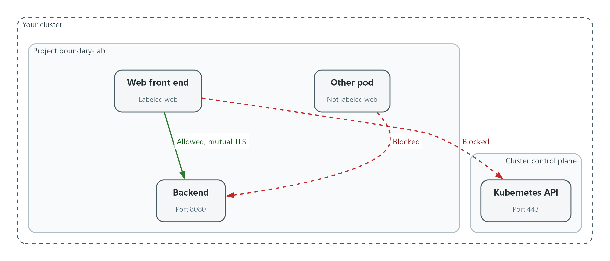
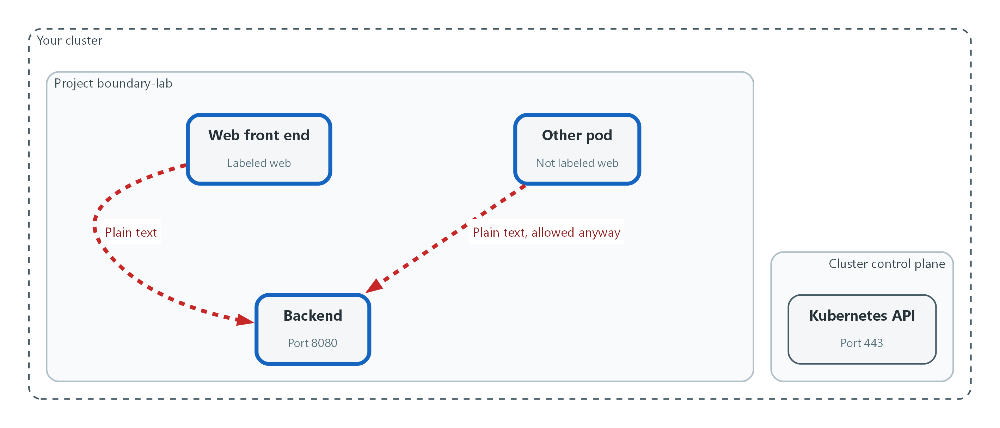
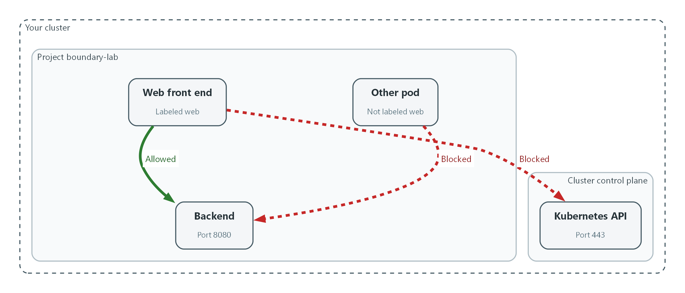
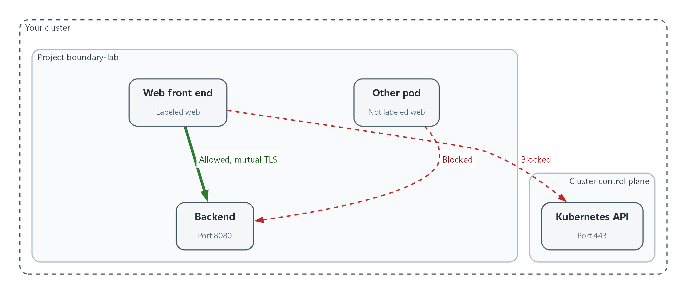

# M03: Boundary and Default-Deny (SC-7, AC-4, CA-3, SC-8)

> 📌 DRAFT. Commands follow Red Hat's published OpenShift Service Mesh 3 and Kubernetes NetworkPolicy documentation but have not yet run in the lab. Check the container names, the Istio resource names and the DNS ports on your cluster with the oc explain and dry-run commands before each apply. The label istio-injection=enabled only works when the Istio resource uses the InPlace update strategy (the default) so its revision is named default; oc get istiorevision confirms this. Red Hat's documentation lists an OpenShift Container Platform subscription as the prerequisite for Service Mesh 3 and names no separate Service Mesh subscription, but confirm the entitlement before the lab build.

| Item | Detail |
| --- | --- |
| Sequence | Module 14 of 17 in the recommended order |
| Timed work | About 65 minutes (45 hands-on, 20 verify) |
| Modes | Ready Lab (prebuilt) or Architect (you design and build it) |
| Standalone start | `lab start m03` |
| Combined start | Continue from the end state of the previous module |
| End state | `lab check m03` passes |
| Tools | OpenShift Container Platform, Kubernetes NetworkPolicy (included with OpenShift), Red Hat OpenShift Service Mesh 3 (Istio based, installed from the OpenShift operator catalog), oc, curl |
| Prerequisites | Module 0 (terminal and git basics), Module 2 (lab running) |
| Extra lab needs | Red Hat OpenShift Service Mesh 3 Operator installed by lab start, with an Istio resource named default (update strategy InPlace, the default, so the revision is also named default) and an IstioCNI resource named default already created and healthy. The Istio control plane runs in the namespace istio-system (Red Hat's example namespace); the Step 2 egress rule names that namespace, so change the rule if the lab uses another.; The cluster can pull images from registry.access.redhat.com (ubi9/ubi-minimal and ubi9/python-311).; OVN-Kubernetes network plugin (the OpenShift default) so NetworkPolicy is enforced. |

## 1. Why This Matters

An IL5 system must not trust the inside of its own network. Traffic is controlled at the boundary of the system and also between the internal components (the separate pieces inside the system that talk to each other, such as the web front end and the database). The question this module answers is: Is traffic protected only at the boundary, or also between internal components? Protection at the boundary alone is called perimeter-only protection, and anything that gets past the boundary can then move freely. This module blocks all internal traffic by default, allows only the flows that are listed, controls outbound traffic, encrypts the allowed flows, and proves each rule with a connection check.

### Control mapping

| Control | What it requires, in plain words | Source of the value | Where this module covers it |
| --- | --- | --- | --- |
| SC-7 Boundary Protection | Control traffic at the edge of the system and at key internal edges, and block everything that is not on the allowed list. | NIST; DoD SRG | Step 2 applies default-deny rules in both directions. Step 4 and Tests 1 and 2 check them. |
| AC-4 Information Flow Enforcement | Decide which flows of information are approved, and enforce that decision. | NIST; FedRAMP | Step 2 turns the approved flow list into rules. Test 2 shows an unapproved flow failing. |
| CA-3 Information Exchange | Every connection to another system is approved and written down, with the ports and protocols it uses. | NIST; FedRAMP; DoD SRG | Concept 2.4 gives the ports, protocols and services table. Step 4 checks every row with a connection test. |
| SC-8 Transmission Confidentiality and Integrity | Information sent between components is encrypted, including between internal components. | NIST; FedRAMP | Step 3 requires mutual TLS in the namespace. Test 3 shows plain-text traffic refused. |

### What each control is for

Read these answers first. They explain what each control is trying to prevent and how this module's tool meets it.

#### SC-7 Boundary Protection

| Question | Answer |
| --- | --- |
| What the control author feared | An attacker or a mistake gets one component past the edge, and from there every other component is reachable. |
| Is it in scope for the system | The system boundary, and the key internal boundaries between components the system team operates. |
| The operational question | Is traffic protected only at the boundary, or also between internal components? |
| What evidence proves it | The rules that deny by default, the list of exceptions, and a connection check for each. |
| How much is enough | Traffic is denied by default at managed interfaces and allowed only by exception, in both directions, and the rules are kept in version control. NIST SC-7(5) says deny by default and allow by exception. What counts as an approved exception is organization-defined; the lab lists its exceptions in the table in concept 2.4. |
| Who is told when it fails | Someone owns the exception list and removes entries that no longer have a reason. |
| How the tool in this module satisfies it | NetworkPolicy (Step 2) is the default-deny layer inside the cluster. Egress rules in the same step control outbound traffic. |

#### AC-4 Information Flow Enforcement

| Question | Answer |
| --- | --- |
| What the control author feared | Data moves between components along paths nobody approved. |
| Is it in scope for the system | Flows between internal components and between tenant workloads. |
| The operational question | Which flows are approved, and what stops the others? |
| What evidence proves it | The approved flow list and a failed attempt on an unapproved flow. |
| How much is enough | Each approved flow is written as a rule, and an unapproved flow fails. The lab limits traffic between pods in the same project (east-west traffic) with NetworkPolicy. |
| Who is told when it fails | New flows go through change control (CM-3) before a rule is added. |
| How the tool in this module satisfies it | The allow rules in Step 2 are the approved flow list. Test 2 proves the rest are blocked. |

#### CA-3 Information Exchange

| Question | Answer |
| --- | --- |
| What the control author feared | A connection exists that nobody documented, so nobody checks the ports it uses. |
| Is it in scope for the system | Connections to other systems, and as practice the connections between internal components. |
| The operational question | For every connection, can you name the ports, protocols and services it uses, and show a test that proves nothing else works? |
| What evidence proves it | The ports, protocols and services table and the output of its connection checks. |
| How much is enough | The table matches what the rules allow and each row has a test. For connections that cross the DISN, the DISA connection process guide says a connection request needs a valid PPSM Tracking Identifier. For information exchange agreements, FedRAMP assigns review and update at least annually (CA-3 c). |
| Who is told when it fails | The table is updated whenever a rule changes. |
| How the tool in this module satisfies it | Step 4 runs one connection check per table row. |

#### SC-8 Transmission Confidentiality and Integrity

| Question | Answer |
| --- | --- |
| What the control author feared | Someone on the internal network reads or alters traffic between two components. |
| Is it in scope for the system | Traffic between internal components, not only traffic that leaves the system. |
| The operational question | If an attacker could watch the wire between two internal components, what would they see? |
| What evidence proves it | The policy that requires mutual TLS and a failed plain-text attempt. |
| How much is enough | Traffic between components is encrypted with FIPS validated cryptography (module 4 checks the cryptography itself). The lab uses the Istio-based service mesh to enforce mTLS for service-to-service traffic. |
| Who is told when it fails | Something detects a component that sends plain text. Test 3 shows what that looks like. |
| How the tool in this module satisfies it | OpenShift Service Mesh sidecars (Step 3) encrypt every allowed flow, and a STRICT policy refuses plain text. |

### Architect mode brief

Draw the flows first. List every component, every flow between components, and for each flow the one port and protocol it needs. Decide what is allowed outbound. Anything you did not list is denied. Then build the rules from the list and test the list.

### Terms in this module

Each term is also explained the first time it appears. This table is a quick lookup.

| Term | Plain meaning |
| --- | --- |
| Internal components | The separate pieces inside the system that talk to each other, such as the web front end and the database. |
| Perimeter-only protection | Controls that protect traffic only where it enters or leaves the system, with nothing between internal components. |
| Default-deny | A rule set that blocks all traffic unless a specific rule allows it. Also called deny by default, allow by exception. |
| NetworkPolicy | A Kubernetes resource that lists which pods may send traffic to which other pods and addresses. |
| Egress and ingress | Egress is traffic leaving a pod. Ingress is traffic arriving at a pod. |
| East-west traffic | Traffic between components inside the system, as opposed to north-south traffic that enters or leaves it. |
| PPSM | Ports, Protocols and Services Management: the DoD process that registers which ports, protocols and services a system uses. |
| mTLS | Mutual TLS: both sides of a connection present a certificate and prove who they are, and the traffic is encrypted. |
| Service mesh and sidecar | A service mesh adds a small helper program (a sidecar) next to each pod. The sidecars encrypt and check traffic between pods. |

## 2. The Tools

### Tools used in this module

Each tool name links to its official overview. The last column says how the tool is used in the lab.

| Tool (overview link) | What it is | Used in this lab |
| --- | --- | --- |
| [NetworkPolicy](https://docs.redhat.com/en/documentation/openshift_container_platform/4.22/html/network_security/network-policy) | Rules for which pods may talk to which. Once a policy selects a pod, it accepts only what the policies allow. | Blocks all traffic between pods except what is allowed. |
| [Service Mesh 3](https://docs.redhat.com/en/documentation/red_hat_openshift_service_mesh/3.4/html/about/ossm-about-openshift-service-mesh) | An Istio-based layer that adds encrypted service identity, traffic policy and telemetry between components without code changes. | Encrypts traffic between internal components. |
| [curl](https://curl.se/docs/manpage.html) | Command-line tool for transferring data over URLs, used here to call web endpoints. | Tests that blocked paths are blocked and allowed paths work. |
| [OpenShift Container Platform](https://docs.redhat.com/en/documentation/openshift_container_platform/4.22/html/overview/ocp-overview) | A Kubernetes container platform for running and managing containerized applications. | The cluster every command in this module runs against. |
| [oc](https://docs.redhat.com/en/documentation/openshift_container_platform/4.22/html/cli_tools/openshift-cli-oc) | The OpenShift command-line tool for creating and managing applications and projects from a terminal. | Runs the cluster commands in each step. |

### How it fits together

#### From perimeter-only to default-deny

At first, anything inside the project can reach anything else, and the traffic is plain text. Each step below adds a rule: block everything, allow one flow, then encrypt that flow. New parts are drawn with thick lines.



- The Web front end may reach the backend on port 8080, and the traffic is encrypted with mutual TLS.
- The Other pod is blocked from the backend because it is not labeled web.
- The Web front end is also blocked from the Kubernetes API.
- Blocked paths return no answer, so the check shows code 000.
### 2.1 What default-deny means

What is this? Default-deny means every connection is blocked unless a rule says it is allowed. The opposite is default-allow, where every connection works unless a rule blocks it.

Why? With perimeter-only protection, one compromised component can reach all the others. With default-deny between internal components, each component can reach only the few things it needs. The question to ask of any system is: Is traffic protected only at the boundary, or also between internal components?

| Design | Inside the system | If one component is compromised |
| --- | --- | --- |
| Perimeter-only protection | Every component can reach every other | The attacker can try them all |
| Default-deny between components | Only listed flows work | The attacker reaches only what that component was allowed to reach |

### 2.2 NetworkPolicy: the default-deny layer

A pod is one running copy of a program in the cluster. A NetworkPolicy selects pods by label (a key=value tag) and says what may reach them (ingress) and what they may reach (egress). Once any policy selects a pod for a direction, everything in that direction that is not listed is denied.

The first policy you write selects every pod and lists nothing. That is the default-deny. Each later policy adds one allowed flow.

```text
web pod  --(allowed: backend, port 8080)-->  backend pod
web pod  --(blocked: any other port)------X
other pod --(blocked: not on the list)-----X  backend pod
```

### 2.3 Mutual TLS with OpenShift Service Mesh

Red Hat OpenShift Service Mesh 3 is Red Hat's supported build of Istio, installed from the OpenShift operator catalog. Red Hat documentation names an OpenShift Container Platform subscription as the prerequisite and lists no separate Service Mesh subscription. It is the simplest supported way to get mTLS between pods without changing the programs, and it provides the encryption between internal components that SC-8 calls for.

When a namespace is labeled for injection, new pods get a sidecar. The sidecars use certificates issued by the mesh to set up mTLS. A PeerAuthentication resource in mode STRICT makes the sidecar refuse any connection that is not mTLS, so plain text fails.

| Mode | What the receiving sidecar accepts |
| --- | --- |
| PERMISSIVE | Both mTLS and plain text (the mesh default) |
| STRICT | Only mTLS |

### 2.4 The ports, protocols and services table

PPSM is the DoD process for registering the ports, protocols and services a system uses. The DoD Cloud Computing SRG says Mission Owners restrict unused ports and protocols as listed in the PPSM Category Assurance List, and the DISA connection process guide says a connection request needs a valid PPSM Tracking Identifier for connections to the DISN. Those registrations apply to connections that cross the boundary. Inside the cluster you keep the same kind of table, one row per allowed flow, and test each row. Every row is a rule, and every rule has a check.

| Flow | Port and protocol | Service | Rule | Check in Step 4 |
| --- | --- | --- | --- | --- |
| web to backend | 8080 TCP | HTTP, carried inside mTLS | Allow | Returns 200 |
| web or backend to cluster DNS | 53 and 5353, UDP and TCP | Name lookup | Allow | Names resolve |
| sidecars to the mesh control plane | 15012 TCP | Certificate and configuration delivery | Allow | Pods start with two containers |
| web to backend, other ports | Any other | None | Deny | Returns 000 |
| web to the Kubernetes API | 443 TCP | None | Deny (egress) | Returns 000 |
| any pod not labeled web to backend | 8080 TCP | None | Deny | Returns 000 |

## 3. Implement

Ready Lab learners start with `lab start m03`. Architect learners design each step first using the brief above.

### Step 1. Create two components and see the starting problem

A project is a named workspace in the cluster. You create one, put a backend and a web component in it, and add a third pod that has no business talking to the backend. With no rules, all three talk freely. That is the starting problem.

What this step adds (thick lines and outlines are new):



- Both pods can reach the backend, and the traffic is plain text. The Other pod has no reason to reach it, yet it can.
```bash
oc new-project boundary-lab
oc create deployment backend --image=registry.access.redhat.com/ubi9/python-311 --port=8080 -- python3 -m http.server 8080
oc expose deployment backend --port=8080
oc create deployment web --image=registry.access.redhat.com/ubi9/ubi-minimal -- sleep infinity
oc run other --image=registry.access.redhat.com/ubi9/ubi-minimal --labels=app=other,sidecar.istio.io/inject=false -- sleep infinity
oc rollout status deployment/backend
oc rollout status deployment/web
oc wait --for=condition=Ready pod/other --timeout=120s
```

| Part | What it does |
| --- | --- |
| oc new-project boundary-lab | Creates the workspace for this module. |
| oc create deployment backend ... | Starts a small web server on port 8080. A deployment keeps a pod running. Everything after the double hyphen is the command the pod runs. |
| oc expose deployment backend | Gives the backend a stable name (backend) that other pods can use. |
| oc create deployment web ... | Starts the web component. It only waits, and you use it to send test requests. |
| oc run other ... | Starts a third pod labeled app=other. The inject=false label keeps the mesh sidecar off it, which Test 3 relies on. |
| rollout status and wait | Wait until the pods are ready. |

```bash
oc exec pod/other -- curl -s -o /dev/null -m 5 -w '%{http_code}\n' http://backend:8080
oc exec deployment/web -- curl -s -o /dev/null -m 5 -w '%{http_code}\n' http://backend:8080
```

| Part | What it does |
| --- | --- |
| oc exec pod/other -- curl ... | Runs curl inside the other pod. curl sends a web request. |
| -s -o /dev/null | Hides the progress bar and the page body. |
| -m 5 | Gives up if there is no answer after a short wait. |
| -w '%{http_code}\n' | Prints only the HTTP status code. 200 means success. 000 means no answer at all. |

> ▶ YOUR TURN: Run both blocks and read the two codes.

> ✅ CHECKPOINT: Both requests print 200. The pod that should not be talking to the backend can.

### Step 2. Deny everything, then allow only the listed flows (SC-7, AC-4)

A NetworkPolicy that selects every pod and lists nothing is the default-deny. It covers ingress (traffic arriving) and egress (traffic leaving). The next rules add back the rows of the table in concept 2.4. Outbound access is limited by the same step: the web component may reach the backend, name lookup and the mesh control plane, and nothing else. Keep the file in git so changes are reviewed under change control (CM-3).

What this step adds (thick lines and outlines are new):



- Default-deny blocks everything. Only the Web front end may reach the backend on port 8080, and traffic to the Kubernetes API is blocked.
```yaml
apiVersion: networking.k8s.io/v1
kind: NetworkPolicy
metadata:
  name: default-deny-all
  namespace: boundary-lab
spec:
  podSelector: {}
  policyTypes:
    - Ingress
    - Egress
---
apiVersion: networking.k8s.io/v1
kind: NetworkPolicy
metadata:
  name: allow-dns-and-mesh
  namespace: boundary-lab
spec:
  podSelector: {}
  policyTypes:
    - Egress
  egress:
    - to:
        - namespaceSelector:
            matchLabels:
              kubernetes.io/metadata.name: openshift-dns
      ports:
        - protocol: UDP
          port: 53
        - protocol: TCP
          port: 53
        - protocol: UDP
          port: 5353
        - protocol: TCP
          port: 5353
    - to:
        - namespaceSelector:
            matchLabels:
              kubernetes.io/metadata.name: istio-system
      ports:
        - protocol: TCP
          port: 15012
---
apiVersion: networking.k8s.io/v1
kind: NetworkPolicy
metadata:
  name: web-to-backend
  namespace: boundary-lab
spec:
  podSelector:
    matchLabels:
      app: web
  policyTypes:
    - Egress
  egress:
    - to:
        - podSelector:
            matchLabels:
              app: backend
      ports:
        - protocol: TCP
          port: 8080
---
apiVersion: networking.k8s.io/v1
kind: NetworkPolicy
metadata:
  name: backend-from-web
  namespace: boundary-lab
spec:
  podSelector:
    matchLabels:
      app: backend
  policyTypes:
    - Ingress
  ingress:
    - from:
        - podSelector:
            matchLabels:
              app: web
      ports:
        - protocol: TCP
          port: 8080
```

| Part | What it does |
| --- | --- |
| default-deny-all | podSelector {} means every pod. Listing Ingress and Egress with no rules blocks both directions. |
| allow-dns-and-mesh | Lets every pod do name lookups in the cluster DNS and reach the mesh control plane (istio-system, port 15012). Without these, pods cannot find each other or get certificates. |
| web-to-backend (egress) | The web pods may send traffic only to backend pods on TCP 8080. |
| backend-from-web (ingress) | The backend pods accept traffic only from web pods on TCP 8080. This is the one approved flow. |

```bash
oc explain networkpolicy.spec.egress.to
oc apply -f networkpolicy.yaml --dry-run=server
oc apply -f networkpolicy.yaml
oc get networkpolicy -n boundary-lab
```

| Part | What it does |
| --- | --- |
| oc explain ... | Prints the fields the cluster accepts, so you can check the file against your cluster. |
| --dry-run=server | Asks the cluster to check the file without saving it. |
| oc apply -f | Saves the policies. They take effect within moments. |
| oc get networkpolicy | Lists the four policies. |

> 📌 NetworkPolicy rules only add allowed flows. There is no deny rule to write. Anything not matched by an allow rule is denied once a pod is selected by the default-deny.

> 💡 The cluster DNS pods are reached on port 5353 behind the standard name service port 53. The file lists both so name lookup works whichever your release uses.

> ▶ YOUR TURN: Save the YAML as networkpolicy.yaml, validate it, apply it, and list the policies.

> ✅ CHECKPOINT: Four policies are listed.

### Step 3. Encrypt the allowed flow with mutual TLS (SC-8)

The allowed flow still crosses the network as plain text. A service mesh adds a sidecar next to each pod so the pods authenticate each other and encrypt the traffic. You label the project so new pods get a sidecar, restart the two deployments to pick it up, and then set the project to accept only mTLS. Do the restart first. A STRICT policy applied to pods with no sidecar would cut them off.

What this step adds (thick lines and outlines are new):



- Sidecars encrypt the one allowed flow with mutual TLS.
```bash
oc get csv -n openshift-operators | grep -i servicemesh
oc get istio default
oc get istiocni default
oc get istiorevision
oc label namespace boundary-lab istio-injection=enabled
oc rollout restart deployment/backend deployment/web -n boundary-lab
oc rollout status deployment/backend -n boundary-lab
oc rollout status deployment/web -n boundary-lab
oc get pods -n boundary-lab
```

| Part | What it does |
| --- | --- |
| oc get csv ... grep | Shows the installed Service Mesh operator. The lab installs it. |
| oc get istio default | Shows the mesh control plane resource and whether it is healthy. |
| oc get istiocni default | Shows the network helper that lets sidecars start without extra privileges. |
| oc get istiorevision | Lists the mesh revisions. One must be named default, because the label in the next line selects the revision named default. |
| oc label namespace ... | Tells the mesh to add a sidecar to new pods in this project. |
| oc rollout restart | Recreates the two deployments so their pods get sidecars. |
| oc get pods | The READY column should read 2/2 for backend and web: the program plus the sidecar. |

```yaml
apiVersion: security.istio.io/v1
kind: PeerAuthentication
metadata:
  name: default
  namespace: boundary-lab
spec:
  mtls:
    mode: STRICT
```

| Part | What it does |
| --- | --- |
| PeerAuthentication | The mesh resource that sets what connections a sidecar accepts. |
| namespace: boundary-lab | Applies to this project only, so other workloads are not affected. |
| mode: STRICT | Refuses every connection that is not mTLS. |

```bash
oc explain peerauthentication.spec.mtls
oc apply -f peerauthentication.yaml --dry-run=server
oc apply -f peerauthentication.yaml
oc exec deployment/web -- curl -s -o /dev/null -m 5 -w '%{http_code}\n' http://backend:8080
```

| Part | What it does |
| --- | --- |
| oc explain ... | Prints the accepted fields for your mesh release. |
| --dry-run=server | Checks the file without saving it. |
| oc apply -f | Saves the policy. |
| oc exec ... curl | Repeats the allowed request. It should still work, now over mTLS. |

> 🔒 Mutual TLS proves which component is calling as well as encrypting the traffic. Whether the cryptography underneath is FIPS validated is checked in module 4.

> ▶ YOUR TURN: Run the first block, save the YAML as peerauthentication.yaml, then run the third block. If a pod shows 1/1, wait for the restart to finish and list the pods again.

> ✅ CHECKPOINT: Backend and web show 2/2 and the web request still prints 200.

### Step 4. Check every row of the ports, protocols and services table (CA-3, SC-7)

A table that nobody tests drifts out of date. This step runs one connection check per row of the table in concept 2.4. Allowed rows must work. Denied rows must fail. The code 000 means curl got no answer.

What this step adds (thick lines and outlines are new):


- Every rule is checked against the ports, protocols and services table.
```bash
oc exec deployment/web -- curl -s -o /dev/null -m 5 -w '%{http_code}\n' http://backend:8080
oc exec deployment/web -- curl -s -o /dev/null -m 5 -w '%{http_code}\n' http://backend:8081
oc exec deployment/web -- curl -s -o /dev/null -m 5 -w '%{http_code}\n' -k https://kubernetes.default.svc:443
oc exec pod/other -- curl -s -o /dev/null -m 5 -w '%{http_code}\n' http://backend:8080
```

| Part | What it does |
| --- | --- |
| http://backend:8080 from web | Allowed row. Expect 200. |
| http://backend:8081 from web | Denied row: the right target but a port that is not on the list. Expect 000. |
| https://kubernetes.default.svc:443 from web | Denied egress row: the web component may not reach the Kubernetes API. -k skips the certificate check because only reachability matters here. Expect 000. |
| http://backend:8080 from other | Denied row: the pod is not labeled web. Expect 000. |

> 📌 If the first line prints 000 instead of 200, name lookup or the mesh control plane rule is not working. Check the pods show 2/2 and read the policies from Step 2 again.

> ▶ YOUR TURN: Run the four checks and mark each row of the table pass or fail.

> ✅ CHECKPOINT: The output is 200, 000, 000, 000 in that order.

## 4. Verify It Works

### Test 1 (positive). The allowed flow works and is encrypted

The allowed flow must work, and the backend sidecar should show it has completed TLS handshakes. A handshake counter above zero means traffic arrived over TLS.

```bash
oc exec deployment/web -- curl -s -o /dev/null -m 5 -w '%{http_code}\n' http://backend:8080
oc exec deployment/backend -c istio-proxy -- pilot-agent request GET stats | grep ssl.handshake
```

**Expected output:**

```
Example only. Counter names and values will differ.
200
listener.0.0.0.0_15006.ssl.handshake: 3
```

> ✅ CHECKPOINT: The request prints 200 and at least one ssl.handshake counter is above zero.

### Test 2 (negative). A disallowed flow is blocked

The pod labeled other is not on the allowed list. It must get no answer from the backend, and neither must the web component on an unlisted port or toward the Kubernetes API.

```bash
oc exec pod/other -- curl -s -o /dev/null -m 5 -w '%{http_code}\n' http://backend:8080
oc exec deployment/web -- curl -s -o /dev/null -m 5 -w '%{http_code}\n' http://backend:8081
```

**Expected output:**

```
000
000
```

> ✅ CHECKPOINT: Both print 000. Nothing warned you that the attempts happened, which is why module SIEM-3 builds alerts on denied traffic.

### Test 3 (negative). Plain-text traffic between internal components is refused

A pod with the web label but no sidecar is allowed by the network rules, so the only thing that can stop it is the mTLS requirement. Run the request, relax the policy to prove mTLS is the cause, then restore STRICT.

```bash
oc run plain --image=registry.access.redhat.com/ubi9/ubi-minimal --labels=app=web,sidecar.istio.io/inject=false -- sleep infinity
oc wait --for=condition=Ready pod/plain --timeout=120s
oc exec pod/plain -- curl -s -o /dev/null -m 5 -w '%{http_code}\n' http://backend:8080
oc patch peerauthentication default -n boundary-lab --type=merge -p '{"spec":{"mtls":{"mode":"PERMISSIVE"}}}'
sleep 15
oc exec pod/plain -- curl -s -o /dev/null -m 5 -w '%{http_code}\n' http://backend:8080
oc patch peerauthentication default -n boundary-lab --type=merge -p '{"spec":{"mtls":{"mode":"STRICT"}}}'
sleep 15
oc exec pod/plain -- curl -s -o /dev/null -m 5 -w '%{http_code}\n' http://backend:8080
```

**Expected output:**

```
000
200
000
```

> ✅ CHECKPOINT: Plain text is refused under STRICT (000), works under PERMISSIVE (200), and is refused again after you restore STRICT (000).

Run `lab check m03` to run these tests automatically. It checks:

- The backend answers the web component on its one allowed port.
- A pod with a different label cannot reach the backend, and the web component cannot reach unlisted ports or the Kubernetes API.
- Plain-text traffic from a pod with no sidecar to the backend is refused while the namespace requires mutual TLS.
## 5. Glossary and Next Steps

| Term | Meaning |
| --- | --- |
| Deployment | A Kubernetes resource that keeps a set of identical pods running. |
| Label | A key=value tag on a resource, used by rules to select it. |
| Pod | One running copy of a program in the cluster. |
| Sidecar | A helper program that runs next to the main program in the same pod. |
| PeerAuthentication | The mesh resource that sets whether a sidecar requires mTLS. |
| DISN | Defense Information Systems Network: the DoD global network. |
| Project (OpenShift) | A named workspace in the cluster. |

> 💡 Next module: M09 Secure Release Pipeline: build, test, scan and sign an image before it can run.
