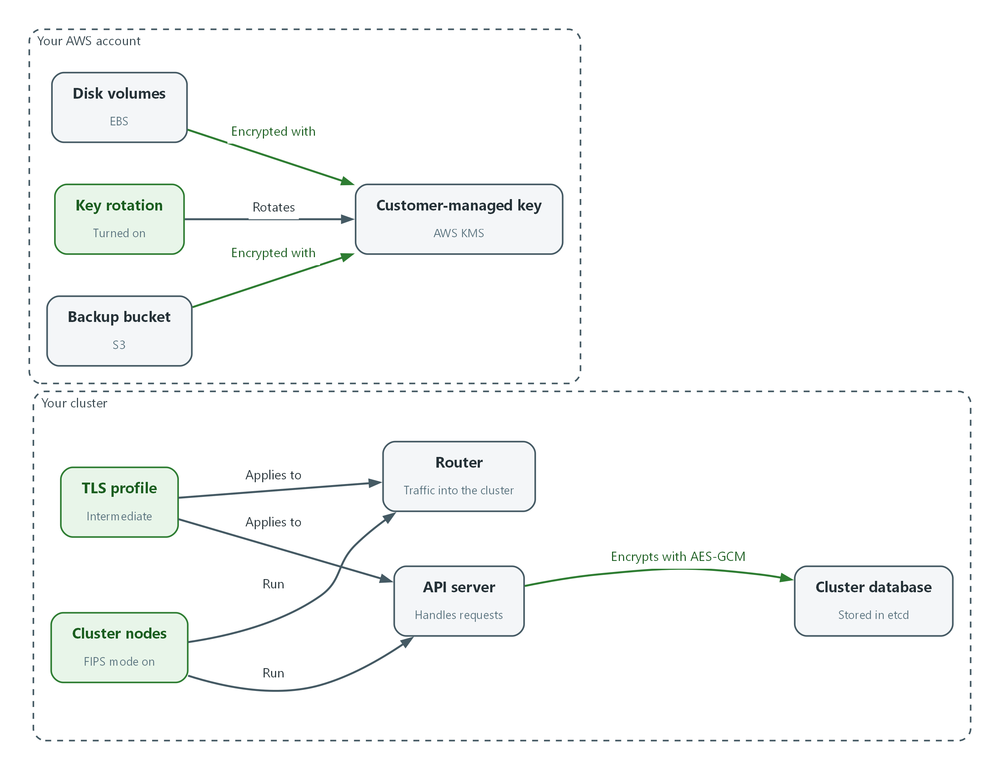
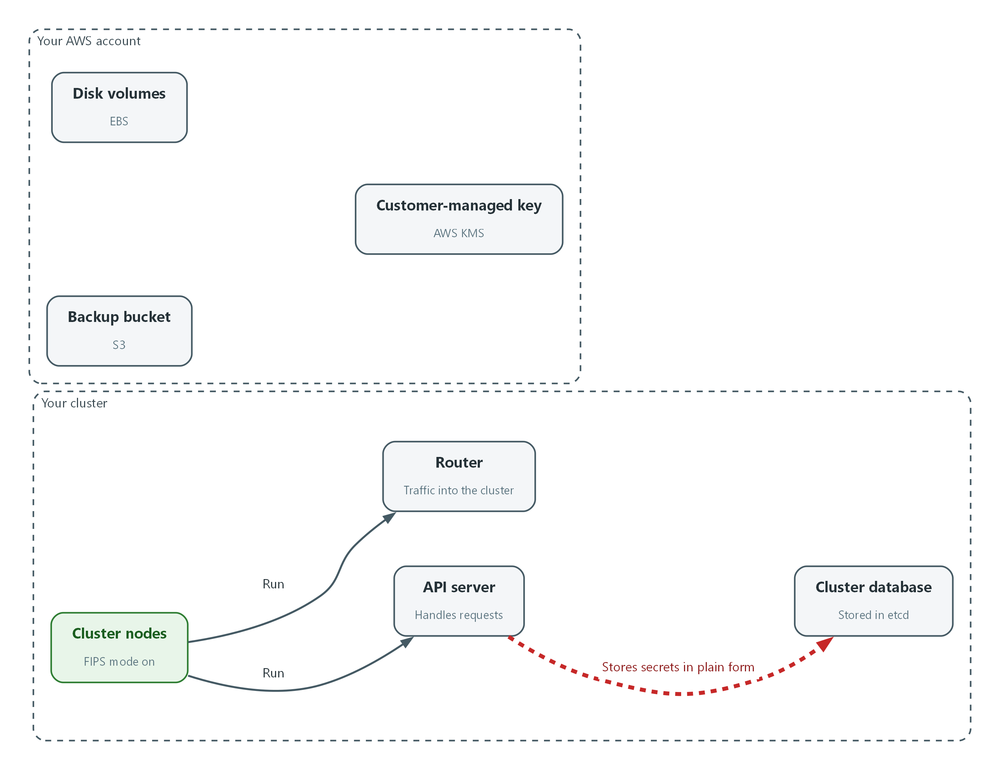
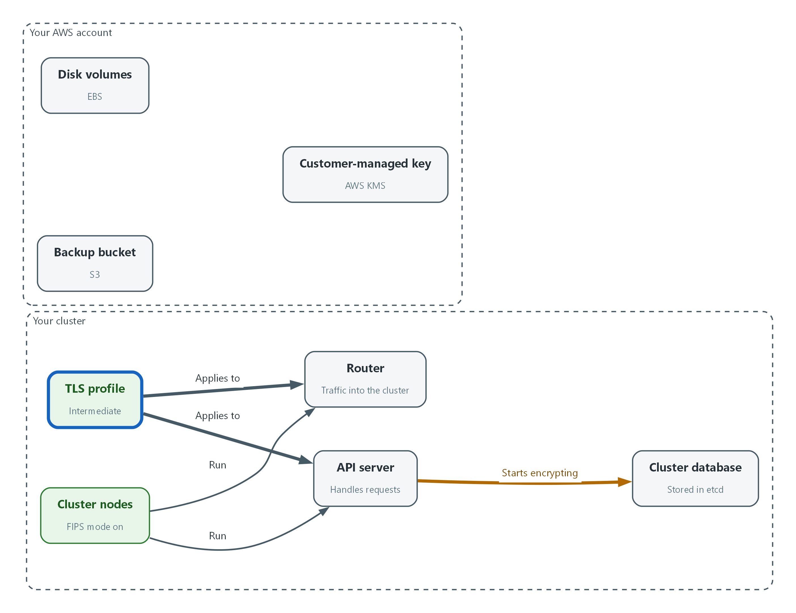
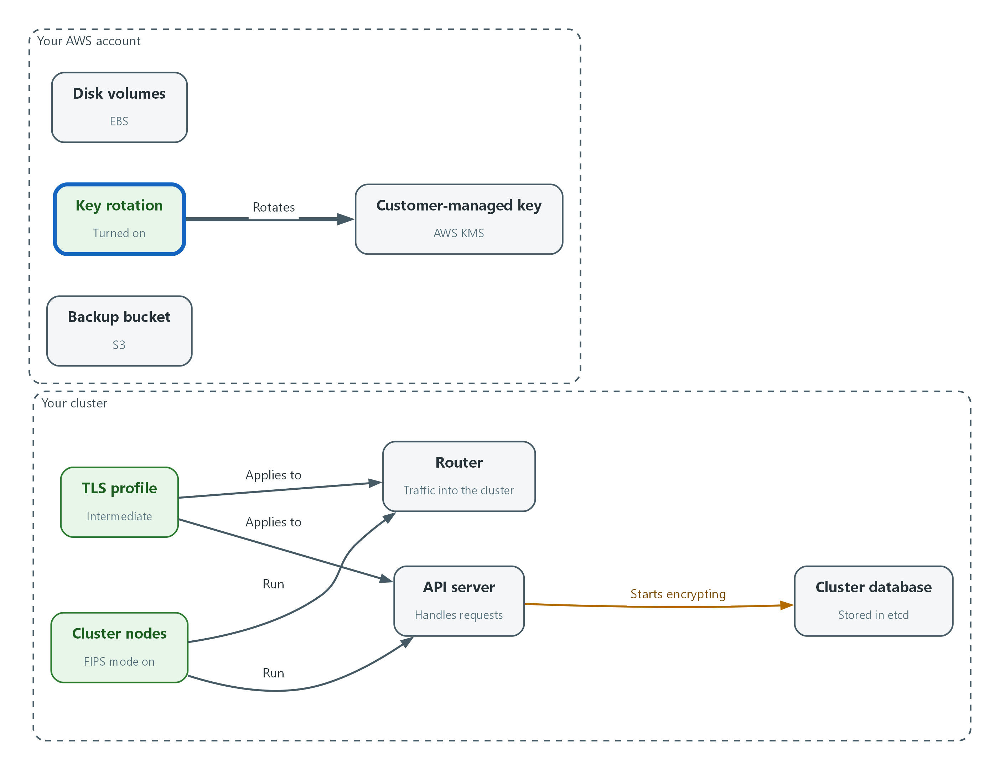
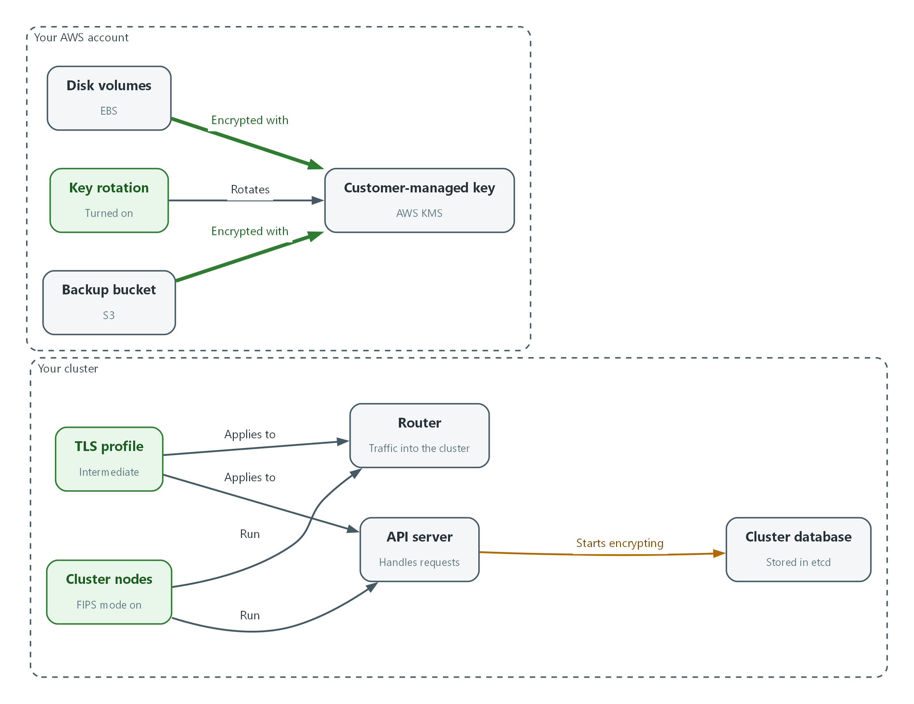

# M04: FIPS Cryptography and Keys (SC-13, SC-12, SC-28)

> 📌 DRAFT. Commands follow Red Hat's published OpenShift Container Platform documentation (etcd encryption, TLS security profiles, FIPS) and the AWS CLI reference, but have not yet run in the lab. The node FIPS check reads the kernel flag in /proc, and the openssl messages on a FIPS node differ between releases, so the expected output is labeled as an example. The etcd pod lookup and the openssl cipher names are checked by the dry-run and by the first run of Test 1 and Test 4. Not confirmable without a live cluster: the AWS CLI version in the tools container (Test 5 needs AWS CLI v2 for base64 handling; confirm with aws --version), and whether the lab network can reach the router on port 443 for Test 4 (confirm with the first openssl command). Red Hat's documentation (the 4.21 guide and the matching OKD 4.22 guide) also describes an external KMS v2 option for etcd that is marked Technology Preview, is not recommended for production and needs the TechPreviewNoUpgrade feature set; this module does not use it.

| Item | Detail |
| --- | --- |
| Sequence | Module 13 of 17 in the recommended order |
| Timed work | About 65 minutes (45 hands-on, 20 verify) |
| Modes | Ready Lab (prebuilt) or Architect (you design and build it) |
| Standalone start | `lab start m04` |
| Combined start | Continue from the end state of the previous module |
| End state | `lab check m04` passes |
| Tools | OpenShift Container Platform (built with FIPS mode on), AWS Key Management Service (KMS), oc, aws, openssl, jq |
| Prerequisites | Module 0 (terminal and git basics), Module 2 (lab running) |
| Extra lab needs | The lab AWS identity can call kms:DescribeKey, EnableKeyRotation, DisableKeyRotation, GetKeyRotationStatus, CreateKey (only with the tag ManagedBy=lab-exercise), TagResource, and Encrypt, Decrypt, DisableKey and ScheduleKeyDeletion (only on keys carrying that tag), the EC2 describe-volumes and default-encryption calls, and S3 get and put bucket encryption. DisableKeyRotation is used by lab start to turn rotation off before the module begins.; KMS_KEY_ARN is a symmetric customer-managed key. The roles used by the cluster storage drivers and by the backup tool are allowed to use it.; lab start m04 leaves etcd encryption off, the TLS profiles unset, and key rotation off.; openssl in the tools container supports the s_client command with the -cipher option, and the AWS CLI in the tools container is version 2 (Test 5 passes base64 values).; The lab network can reach the cluster router on port 443 (Test 4). |

## 1. Why This Matters

An IL5 system must use cryptography that has been validated against the federal standard, must keep data encrypted where it is stored, and must control the keys that do the encrypting. This module checks that the platform runs in FIPS mode, sets the TLS profile on the platform, turns on encryption of the cluster database, and puts the storage encryption keys under a customer-managed key with rotation. Each step is followed by a check that the setting works and a check that a weaker setting fails.

### Control mapping

| Control | What it requires, in plain words | Source of the value | Where this module covers it |
| --- | --- | --- | --- |
| SC-13 Cryptographic Protection | Use the kinds of cryptography the organization has approved for each use, implemented by validated modules. | NIST; DoD SRG | Step 1 reads the FIPS state of the nodes and the TLS profiles. Step 2 sets the TLS profile. Tests 3 and 4 show a weak algorithm and a weak cipher refused. |
| SC-12 Cryptographic Key Establishment and Management | Keys are generated, stored, used, rotated and destroyed under rules, and the system owner controls them. | NIST; DoD SRG | Step 3 turns on rotation for the customer-managed key. Test 5 disables a key and shows data can no longer be decrypted. |
| SC-28 Protection of Information at Rest | Stored information is encrypted, and the keys for it are protected. | NIST; DoD SRG | Steps 2, 4 and 5 turn on etcd, volume and bucket encryption. Tests 1 and 2 read the evidence. |

### What each control is for

Read these answers first. They explain what each control is trying to prevent and how this module's tool meets it.

#### SC-13 Cryptographic Protection

| Question | Answer |
| --- | --- |
| What the control author feared | Data is encrypted with something that looks strong but was never validated, so the protection cannot be shown to an assessor. |
| Is it in scope for the system | Every place the system uses cryptography: node operating systems, platform TLS, storage, and signing. |
| The operational question | For each use of cryptography, can you name the module that does it and show it is validated and running in FIPS mode? |
| What evidence proves it | The FIPS state of the nodes, the TLS profile of each platform endpoint, and a failed attempt to use a non-approved algorithm. |
| How much is enough | The DoD Cloud Computing SRG accepts FIPS 140-2 or FIPS 140-3 validated modules operated in FIPS mode. This lab uses FIPS 140-3 or the current version for hardware, software and firmware components, and TLS for all network session traffic. Red Hat describes its modules as FIPS validated or Modules In Process, so record each module's status. The approved version and level for each use are organization-defined, so find them in the SSP. |
| Who is told when it fails | Someone tracks the validation status of the modules and re-checks when a platform release changes. |
| How the tool in this module satisfies it | OpenShift built in FIPS mode (Step 1) and the platform TLS profile (Step 2). |

#### SC-12 Cryptographic Key Establishment and Management

| Question | Answer |
| --- | --- |
| What the control author feared | Whoever holds the keys can read everything, or a lost or leaked key cannot be dealt with. |
| Is it in scope for the system | Keys for data at rest: the AWS KMS key used for volumes and buckets, and the etcd encryption keys. |
| The operational question | Who can use each key, who can change it, and what happens to the data if the key is disabled? |
| What evidence proves it | The key description, the rotation status, the key policy, and a test that a disabled key stops decryption. |
| How much is enough | Keys are generated in FIPS validated hardware, access is limited by IAM policy and key policy, and destruction is by scheduled deletion with a mandatory waiting period. The DoD SRG requires hardware security modules used in cloud-based key management to have FIPS 140-2 or 140-3 Level 3 accreditation. The rotation interval is organization-defined, so read it from the SSP or ask the ISSO before you rely on the AWS default. |
| Who is told when it fails | Someone owns the key policy and reviews who is on it. |
| How the tool in this module satisfies it | Step 3 turns on rotation for the key, and Test 5 shows what disabling a key does. |

#### SC-28 Protection of Information at Rest

| Question | Answer |
| --- | --- |
| What the control author feared | Someone gets a copy of a disk, a snapshot, a bucket or the cluster database and reads it in plain text. |
| Is it in scope for the system | The cluster database (etcd), the volumes the cluster uses, and the backup bucket. |
| The operational question | If you were handed a raw copy of each place data is stored, what would you see? |
| What evidence proves it | The raw value of a secret in etcd, the key used by each volume, and the bucket's default encryption setting. |
| How much is enough | Each store is encrypted, the keys for storage are managed in AWS KMS, and the controls are documented in the SSP. The DoD SRG says to implement FIPS 140-2 or 140-3 compliant data-at-rest encryption for files in IaaS storage services. |
| Who is told when it fails | Something detects a new volume or bucket that is not encrypted. Default encryption (Step 4) prevents most of them. |
| How the tool in this module satisfies it | etcd encryption (Step 2), default volume encryption and bucket encryption with the customer-managed key (Step 4). |

### Architect mode brief

Decide before you build. For each store (etcd, volumes, buckets) decide which key protects it and who may use that key. For each network endpoint decide the lowest TLS version and the allowed ciphers. Find the organization-defined values first: the approved FIPS version and level, and the key rotation interval.

### Terms in this module

Each term is also explained the first time it appears. This table is a quick lookup.

| Term | Plain meaning |
| --- | --- |
| FIPS 140 | The federal standard for cryptographic modules. A module is validated when an accredited lab has tested it against the standard. Versions 140-2 and 140-3 both appear in the sources. |
| FIPS mode | A setting that makes the operating system use only the validated modules and approved algorithms. |
| TLS security profile | A named setting (Old, Intermediate or Modern) that fixes the lowest TLS version and the allowed ciphers for a platform endpoint. |
| Cipher | The algorithm that encrypts the data. A TLS connection picks one from the list both sides allow. |
| etcd | The database where the cluster keeps its configuration and its secrets. |
| Customer-managed key | An AWS KMS key that you create and control, as opposed to a key AWS creates and manages for you. |
| Key rotation | Replacing the key material in a key on a schedule, so old key material is used less and less. |
| Cryptographic erase | Making data unreadable by destroying or disabling the key that encrypts it. |
| Data at rest | Information that is stored, not moving across a network. |

## 2. The Tools

### Tools used in this module

Each tool name links to its official overview. The last column says how the tool is used in the lab.

| Tool (overview link) | What it is | Used in this lab |
| --- | --- | --- |
| [OpenShift FIPS support](https://docs.redhat.com/en/documentation/openshift_container_platform/4.22/html/installation_overview/installing-fips) | FIPS mode makes core components use RHEL cryptographic libraries submitted to NIST for FIPS validation. It can only be set at install time. | Shows how FIPS mode is checked on the running cluster. |
| [AWS KMS](https://docs.aws.amazon.com/kms/latest/developerguide/overview.html) | Creates and controls encryption keys, held in FIPS-validated hardware. | Key creation, rotation and use. |
| [OpenSSL](https://docs.openssl.org/master/man1/openssl/) | Command-line tool for keys, certificates and testing TLS connections. | Tests which TLS versions and ciphers a service accepts. |
| [AWS CLI](https://docs.aws.amazon.com/cli/latest/userguide/cli-chap-welcome.html) | Runs AWS actions from a shell instead of the browser console. | Reads key settings. |
| [OpenShift Container Platform](https://docs.redhat.com/en/documentation/openshift_container_platform/4.22/html/overview/ocp-overview) | A Kubernetes container platform for running and managing containerized applications. | The cluster every command in this module runs against. |
| [oc](https://docs.redhat.com/en/documentation/openshift_container_platform/4.22/html/cli_tools/openshift-cli-oc) | The OpenShift command-line tool for creating and managing applications and projects from a terminal. | Runs the cluster commands in each step. |
| [jq](https://jqlang.org/) | Command-line JSON processor. | Picks fields out of JSON output. |

### How it fits together

#### Encryption at rest under one customer-managed key

The cluster nodes already run in FIPS mode. The steps set the TLS profile, start encrypting the cluster database, and put the disks and the backup bucket under a key you control. New parts are drawn with thick lines.



- The cluster nodes run in FIPS mode and host the API server and the router.
- A TLS profile is applied to the API server and the router.
- The API server encrypts secrets in etcd with AES-GCM once the rollout is complete.
- Disk volumes and the backup bucket are encrypted with the customer-managed key, and the key rotates.
### 2.1 Validated cryptography and FIPS mode

What is this? FIPS 140 is the federal standard for the software and hardware that do encryption. A validated module has been tested by a lab. FIPS mode is the setting that makes a system use only those modules. Both matter: the DoD Cloud Computing SRG says to use validated modules and to operate them in FIPS mode.

Why? Without FIPS mode a system can silently fall back to an algorithm that is not approved. The OpenShift cluster in this lab is installed with FIPS mode on, and FIPS mode can only be chosen at install time, so you check it rather than set it. Read Red Hat's wording carefully: it says OpenShift uses FIPS validated or Modules In Process modules from the operating system, and that TLS FIPS support is not yet complete. Record the validation status of each module in your evidence instead of assuming every module is validated.

| Parameter | Value | Where it is set |
| --- | --- | --- |
| Cryptography standard | FIPS 140-3 or the current version | The lab (SC-13) |
| Accepted validated modules | FIPS 140-2 or FIPS 140-3, operated in FIPS mode | DoD Cloud Computing SRG |
| Key management hardware (HSM) | FIPS 140-2 or FIPS 140-3 Level 3 | DoD Cloud Service Provider SRG (cloud-based key management) |
| Validated modules apply at | All Impact Levels (the SRG says minimally Impact Level 1) | DoD Cloud Computing SRG (data at rest) |
| Network session traffic | TLS | The lab (SC-13) |
| Key rotation interval | Organization-defined | Your SSP |
| Encryption algorithm for the cluster database | Organization-defined | Your SSP |

### 2.2 TLS security profiles

TLS (Transport Layer Security) is the encryption used on web connections. OpenShift lets you choose a TLS security profile for the API server, the ingress router (which handles traffic into the cluster) and the kubelet (the agent on each node). The profile fixes the lowest TLS version and the list of ciphers.

Intermediate requires TLS 1.2 or higher and offers only modern ciphers. Old also allows older versions and older ciphers. Modern is stricter than Intermediate. This lab uses TLS on all network sessions, and the requirement does not name a profile. Which profile your organization requires is organization-defined, so find it in the SSP. Intermediate is the platform default, so setting it explicitly records the choice and does not change behavior.

| Profile | Meaning |
| --- | --- |
| Old | Accepts older TLS versions and ciphers for old clients |
| Intermediate | TLS 1.2 or higher and modern ciphers (the control plane default) |
| Modern | The strictest built-in profile: TLS 1.3 only. Red Hat marks it currently unsupported on some endpoints, so Intermediate is the profile this lab uses |
| Custom | You list the version and ciphers yourself |

### 2.3 Encryption at rest: three stores

etcd is the cluster database. It holds every secret in the cluster. OpenShift does not encrypt it until you turn encryption on. Volumes hold program data, and AWS can encrypt them with a KMS key. Buckets hold backups and logs, and S3 can encrypt each object with a KMS key by default.

```text
Secret in etcd  --> encrypted by the API server (AES-GCM) --> key stored in the cluster
Volume (EBS)    --> encrypted by AWS with the customer-managed key
Object (S3)     --> encrypted by AWS with the customer-managed key
```

### 2.4 Who controls the key

The DoD Cloud Computing SRG says the mission owner keeps control of the keys from creation through storage and use to destruction. A customer-managed key in AWS KMS gives you the controls for that: a key policy that names who can use it, rotation, and disable or scheduled deletion.

Disabling or destroying a key makes everything encrypted under it unreadable. That is cryptographic erase, and the SRG describes it as a way to destroy data or clean up a data spill without the cloud provider's help. Test 5 shows it on a throwaway key.

Two cautions from the SRG. It says one key should not be used to encrypt all or large chunks of Mission Owner data, so the single lab key in this module is a teaching simplification and your SSP decides how many keys you need. It also describes the options for key control as a hardware security module, a dedicated HSM service, or a cloud KMS service evaluated by NSA, so confirm with the ISSO that the KMS in use meets that.

## 3. Implement

Ready Lab learners start with `lab start m04`. Architect learners design each step first using the brief above.

### Step 1. Read the platform's cryptographic state (SC-13)

Before changing anything, read what is set now. FIPS mode is a kernel setting on each node. A value of 1 means the kernel is running in FIPS mode. An empty TLS profile means the platform default is in use.

What this step adds (thick lines and outlines are new):



- You only read the state: the nodes are in FIPS mode and the cluster database holds secrets in plain form.
```bash
NODE=$(oc get nodes -o jsonpath='{.items[0].metadata.name}')
oc debug node/$NODE -- chroot /host cat /proc/sys/crypto/fips_enabled
oc get configmap cluster-config-v1 -n kube-system -o jsonpath='{.data.install-config}' | grep -i fips
oc get apiserver cluster -o jsonpath='{.spec.tlsSecurityProfile}{"\n"}'
oc get ingresscontroller default -n openshift-ingress-operator -o jsonpath='{.spec.tlsSecurityProfile}{"\n"}'
oc get apiserver cluster -o jsonpath='{.spec.encryption}{"\n"}'
```

| Part | What it does |
| --- | --- |
| NODE=$(...) | Saves the name of the first node in a variable. |
| oc debug node/$NODE -- chroot /host cat ... | Opens a short-lived shell on the node and reads the kernel's FIPS flag. The result 1 means FIPS mode is on. |
| oc get configmap cluster-config-v1 ... grep | Reads the install settings the cluster was built with. Look for fips: true. |
| oc get apiserver ... tlsSecurityProfile | Shows the API server's TLS profile. Empty means the default, which is Intermediate. |
| oc get ingresscontroller ... | Shows the router's TLS profile. Empty means it follows the API server. |
| ... .spec.encryption | Shows the etcd encryption setting. Empty means etcd is not encrypted. |

> 📌 oc debug prints a few extra lines about starting the node shell. The one-character answer 1 is the line that matters. Red Hat states that FIPS cannot be turned on after a cluster is deployed, and that TLS FIPS support is not complete in this release. If the node prints 0, the cluster has to be rebuilt; no setting in this module fixes it.

> ▶ YOUR TURN: Run the block and write down the six answers.

> ✅ CHECKPOINT: The node prints 1, the install settings show fips: true, and the TLS profiles and the encryption setting are empty.

### Step 2. Set the TLS profile and turn on etcd encryption (SC-13, SC-28)

An empty setting relies on a default that can change with a release. Setting the profile makes the choice explicit and visible to an assessor. The same change to the API server object also turns on etcd encryption with AES-GCM. Neither NIST nor the SRG names an algorithm for the cluster database, so use the one in your SSP. Red Hat documents two types, aesgcm and aescbc, and this lab uses aesgcm. The platform rolls the change out, which takes a while. OpenShift rotates the etcd encryption keys on its own schedule, which is separate from the AWS KMS key in Step 3.

What this step adds (thick lines and outlines are new):



- The TLS profile is set on the API server and the router, and the cluster database starts encrypting its secrets.
```bash
oc patch apiserver cluster --type=merge --dry-run=server -p '{"spec":{"encryption":{"type":"aesgcm"},"tlsSecurityProfile":{"type":"Intermediate","intermediate":{}}}}'
oc patch apiserver cluster --type=merge -p '{"spec":{"encryption":{"type":"aesgcm"},"tlsSecurityProfile":{"type":"Intermediate","intermediate":{}}}}'
oc patch ingresscontroller default -n openshift-ingress-operator --type=merge -p '{"spec":{"tlsSecurityProfile":{"type":"Intermediate","intermediate":{}}}}'
```

| Part | What it does |
| --- | --- |
| --dry-run=server | Checks the change without saving it. |
| oc patch apiserver cluster | Changes the API server object: encryption type aesgcm and the Intermediate TLS profile. |
| --type=merge -p '{...}' | Merges the JSON into the object and leaves other settings alone. |
| oc patch ingresscontroller default | Sets the same profile on the router that handles traffic into the cluster. |

> 🔒 Do not take an etcd backup until Step 5 reports that encryption is complete. A backup taken part way through can be only partly encrypted.

> 💡 Keep the three patches in git, so changes to cryptographic settings show who changed them and when (CM-3).

> ▶ YOUR TURN: Run the three commands. The API server restarts its pods, and on a single-node cluster oc can fail for several minutes. Retry the command if it does.

> ✅ CHECKPOINT: Both patch commands print patched.

### Step 3. Turn on rotation for the customer-managed key (SC-12)

The lab gives you a customer-managed key in AWS KMS (KMS_KEY_ARN). Check it is one you control and that it is a key AWS can rotate, then turn rotation on. The rotation interval is organization-defined, so this lab uses the setting AWS applies when you do not choose.

What this step adds (thick lines and outlines are new):



- Rotation is turned on for the customer-managed key.
```bash
aws kms describe-key --key-id "$KMS_KEY_ARN" --region "$AWS_REGION" --query 'KeyMetadata.{Manager:KeyManager,State:KeyState,Spec:KeySpec,Origin:Origin}' --output json
aws kms enable-key-rotation --key-id "$KMS_KEY_ARN" --region "$AWS_REGION"
aws kms get-key-rotation-status --key-id "$KMS_KEY_ARN" --region "$AWS_REGION"
```

| Part | What it does |
| --- | --- |
| describe-key ... --query | Shows who manages the key (CUSTOMER means you), its state, its type and where the key material came from. |
| enable-key-rotation | Turns on automatic rotation for the key. |
| get-key-rotation-status | Confirms rotation is on. |

> 📌 Rotation replaces the key material inside the same key. Data encrypted earlier stays readable, and nothing needs re-encrypting.

> ▶ YOUR TURN: Run the three commands.

> ✅ CHECKPOINT: Manager is CUSTOMER, State is Enabled, and KeyRotationEnabled is true.

### Step 4. Encrypt volumes and the backup bucket with the key (SC-28, SC-12)

Default encryption makes the safe choice automatic. Setting it means a new volume or object is encrypted under your key even if nobody asks for encryption. These are the two storage services this lab covers.

What this step adds (thick lines and outlines are new):



- Disk volumes and the backup bucket are encrypted by default with the same key.
```bash
aws ec2 enable-ebs-encryption-by-default --region "$AWS_REGION"
aws ec2 modify-ebs-default-kms-key-id --kms-key-id "$KMS_KEY_ARN" --region "$AWS_REGION"
aws ec2 get-ebs-default-kms-key-id --region "$AWS_REGION"
aws s3api put-bucket-encryption --bucket "$BACKUP_BUCKET" --region "$AWS_REGION" --server-side-encryption-configuration "$(jq -n --arg k "$KMS_KEY_ARN" '{Rules:[{ApplyServerSideEncryptionByDefault:{SSEAlgorithm:"aws:kms",KMSMasterKeyID:$k},BucketKeyEnabled:true}]}')"
aws s3api get-bucket-encryption --bucket "$BACKUP_BUCKET" --region "$AWS_REGION"
```

| Part | What it does |
| --- | --- |
| enable-ebs-encryption-by-default | New volumes in this region are encrypted automatically. |
| modify-ebs-default-kms-key-id | Says which key encrypts them: your customer-managed key. |
| get-ebs-default-kms-key-id | Reads the setting back. |
| put-bucket-encryption ... jq -n | Builds the setting with jq so the key address is filled in without typing it. Every new object in the bucket is encrypted with your key. |
| get-bucket-encryption | Reads the bucket setting back. |

> 📌 These settings apply to new volumes and new objects. Volumes that already exist keep the encryption they were created with. Test 2 lists them. One key for both stores is a lab simplification; the SRG says one key should not encrypt large chunks of data (see 2.4).

> ▶ YOUR TURN: Run the block and read the last two answers.

> ✅ CHECKPOINT: The default key is your key address, and the bucket's rule shows aws:kms with the same key address.

### Step 5. Wait for etcd encryption to finish (SC-28)

Turning on etcd encryption starts a background job that rewrites every secret in encrypted form. Red Hat documents that it can take 20 minutes or longer. Three components report their own progress, and all three must say the work is complete.

What this step adds (thick lines and outlines are new):


- All three components report that the secrets are encrypted.
```bash
oc get openshiftapiserver -o=jsonpath='{range .items[0].status.conditions[?(@.type=="Encrypted")]}{.reason}{"\n"}{.message}{"\n"}'
oc get kubeapiserver -o=jsonpath='{range .items[0].status.conditions[?(@.type=="Encrypted")]}{.reason}{"\n"}{.message}{"\n"}'
oc get authentication.operator.openshift.io -o=jsonpath='{range .items[0].status.conditions[?(@.type=="Encrypted")]}{.reason}{"\n"}{.message}{"\n"}'
```

| Part | What it does |
| --- | --- |
| oc get openshiftapiserver ... | Reads the Encrypted status of the OpenShift API server. |
| oc get kubeapiserver ... | Reads the same status for the Kubernetes API server. |
| oc get authentication.operator.openshift.io ... | Reads it for the OAuth servers that handle logins. |
| jsonpath range ... Encrypted | Prints the reason and the message from the condition named Encrypted. |

> 📌 EncryptionInProgress means keep waiting. Run the block again every few minutes while you do the checks in Test 2 and Test 3.

> ▶ YOUR TURN: Run the block until all three print EncryptionCompleted.

> ✅ CHECKPOINT: All three components print EncryptionCompleted.

## 4. Verify It Works

### Test 1 (positive). A secret is stored encrypted in etcd

Do not trust the status message alone. Read the stored value from etcd itself. An encrypted value starts with a marker that names the algorithm.

```bash
ETCD_POD=$(oc get pods -n openshift-etcd -l app=etcd -o name | head -1)
oc exec -n openshift-etcd $ETCD_POD -- etcdctl get /kubernetes.io/secrets/openshift-config/pull-secret --print-value-only | head -c 18
echo
```

**Expected output:**

```
Example only.
k8s:enc:aesgcm:v1:
```

> ✅ CHECKPOINT: The value starts with k8s:enc:aesgcm. Before encryption was on, it started with k8s and unreadable characters instead.

### Test 2 (positive). The key rotates and storage uses it

Show the three pieces of evidence an assessor asks for: rotation on, volumes encrypted, bucket encrypted with your key.

```bash
aws kms get-key-rotation-status --key-id "$KMS_KEY_ARN" --region "$AWS_REGION"
aws ec2 describe-volumes --region "$AWS_REGION" --filters "Name=tag-key,Values=kubernetes.io/cluster/*" --query 'Volumes[].{Volume:VolumeId,Encrypted:Encrypted,Key:KmsKeyId}' --output table
aws s3api get-bucket-encryption --bucket "$BACKUP_BUCKET" --region "$AWS_REGION" | jq '.ServerSideEncryptionConfiguration.Rules[0].ApplyServerSideEncryptionByDefault'
```

**Expected output:**

```
Example only. Your identifiers will differ.
{ "KeyRotationEnabled": true, ... other fields such as the next rotation date }
| Volume | Encrypted | Key |
| vol-0abc | True | arn:aws:kms:region:account:key/example |
{ "SSEAlgorithm": "aws:kms", "KMSMasterKeyID": "arn:aws:kms:region:account:key/example" }
```

> ✅ CHECKPOINT: Rotation is true, every cluster volume shows Encrypted True, and the bucket shows aws:kms. A volume that shows a different key was created before default encryption was set, so note it for the owner.

### Test 3 (negative). A non-approved algorithm is refused on the FIPS node

FIPS mode works if it removes the algorithms that are not approved. SHA-256 is approved. MD5 is not.

```bash
NODE=$(oc get nodes -o jsonpath='{.items[0].metadata.name}')
oc debug node/$NODE -- chroot /host sh -c 'echo test | openssl sha256'
oc debug node/$NODE -- chroot /host sh -c 'echo test | openssl md5'
```

**Expected output:**

```
Example only. Wording varies by release.
SHA2-256(stdin)= f2ca1bb6c7e907d06dafe4687e579fce76b37e4e93b7605022da52e6ccc26fd2
Error setting digest
(error text that includes the word unsupported)
```

> ✅ CHECKPOINT: SHA-256 prints a hash. MD5 prints an error and no hash.

### Test 4 (negative). The router refuses a weak cipher

Ask the router to use an older cipher that the Intermediate profile does not allow. First show what it does negotiate.

```bash
oc get ingresscontroller default -n openshift-ingress-operator -o jsonpath='{.spec.tlsSecurityProfile.type}{"\n"}'
HOST=$(oc get route console -n openshift-console -o jsonpath='{.spec.host}')
openssl s_client -connect "$HOST:443" -servername "$HOST" </dev/null 2>&1 | grep -E "Protocol|Cipher"
openssl s_client -connect "$HOST:443" -servername "$HOST" -tls1_2 -cipher AES128-SHA </dev/null 2>&1 | grep -i "cipher is"
openssl s_client -connect "$HOST:443" -servername "$HOST" -tls1_2 -cipher ECDHE-RSA-AES128-GCM-SHA256 </dev/null 2>&1 | grep -i "cipher is"
```

**Expected output:**

```
Example only.
Intermediate
Protocol  : TLSv1.3
Cipher    : TLS_AES_256_GCM_SHA384
New, (NONE), Cipher is (NONE)
New, TLSv1.2, Cipher is ECDHE-RSA-AES128-GCM-SHA256
```

> ✅ CHECKPOINT: The profile reads Intermediate. The first openssl command negotiates TLS 1.2 or higher with an approved cipher. The weak cipher shows (NONE) or prints nothing, meaning no connection was made. The last command, with an Intermediate cipher, connects: that shows the weak cipher was refused by the router and not by a missing feature in your openssl. The default profile refuses the weak cipher too; setting the profile explicitly is what makes the choice visible.

### Test 5 (negative). A disabled key cannot decrypt (cryptographic erase)

Create a throwaway key tagged ManagedBy=lab-exercise (the lab identity may only disable or delete keys that carry this tag), encrypt a word, then disable the key and try to decrypt. Then schedule the key for deletion so it does not stay in your account. Never run this against your real key.

```bash
KEY_ID=$(aws kms create-key --description "lab throwaway key" --tags TagKey=ManagedBy,TagValue=lab-exercise --region "$AWS_REGION" --query KeyMetadata.KeyId --output text)
CT=$(aws kms encrypt --key-id "$KEY_ID" --plaintext aGVsbG8= --region "$AWS_REGION" --query CiphertextBlob --output text)
aws kms decrypt --ciphertext-blob "$CT" --region "$AWS_REGION" --query Plaintext --output text
aws kms disable-key --key-id "$KEY_ID" --region "$AWS_REGION"
aws kms decrypt --ciphertext-blob "$CT" --region "$AWS_REGION" --query Plaintext --output text
aws kms schedule-key-deletion --key-id "$KEY_ID" --pending-window-in-days 7 --region "$AWS_REGION"
```

**Expected output:**

```
Example only.
aGVsbG8=
An error occurred (DisabledException) when calling the Decrypt operation: ... is disabled.
```

> ✅ CHECKPOINT: The first decrypt prints the encoded word. After the key is disabled, decrypt fails with DisabledException. The last command schedules deletion using the shortest waiting period AWS accepts.

Run `lab check m04` to run these tests automatically. It checks:

- A secret read directly from etcd starts with the AES-GCM encryption marker.
- Key rotation is on, cluster volumes use encryption, and the backup bucket's default encryption uses the customer-managed key.
- MD5 is refused on a FIPS node while SHA-256 works.
- The router refuses a weak cipher and negotiates TLS 1.2 or higher with an approved cipher.
- A disabled key cannot decrypt data.
## 5. Glossary and Next Steps

| Term | Meaning |
| --- | --- |
| AES-GCM | An approved encryption algorithm that also detects tampering. |
| HSM | Hardware Security Module: tamper-resistant hardware that generates and protects keys. |
| KMS | AWS Key Management Service: the AWS service that creates and controls encryption keys. |
| EBS | Elastic Block Store: the AWS service that provides disk volumes. |
| S3 | Simple Storage Service: the AWS object storage service. Its containers are called buckets. |
| Router (ingress) | The part of OpenShift that receives web traffic into the cluster. |
| Kubelet | The agent on each node that runs the pods. |
| Key policy | The rule document on a KMS key that says who may use and manage it. |

> 💡 Next module: M03 Boundary and Default-Deny: which components may talk to which, and whether traffic is protected only at the boundary or also between internal components.
