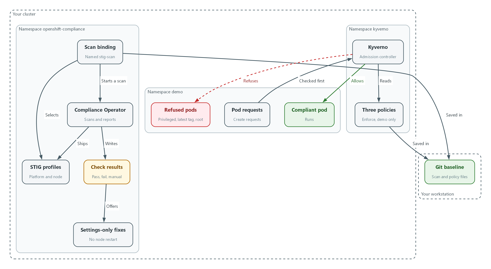
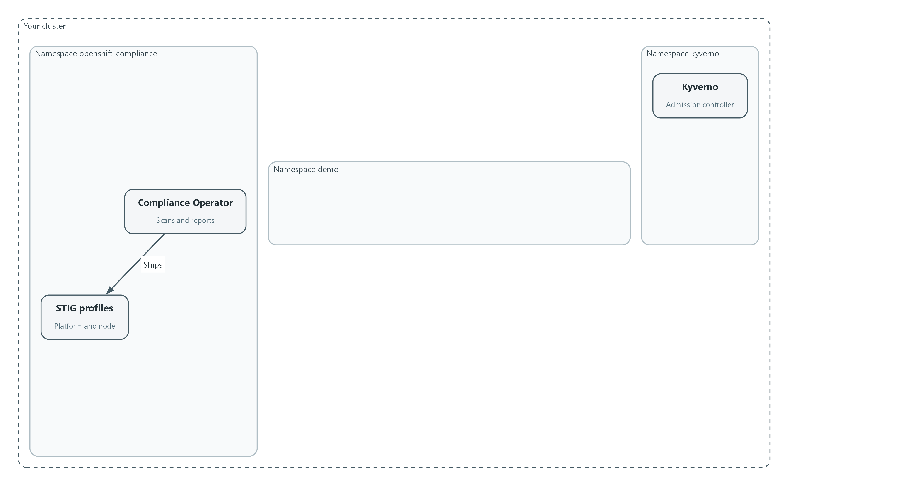
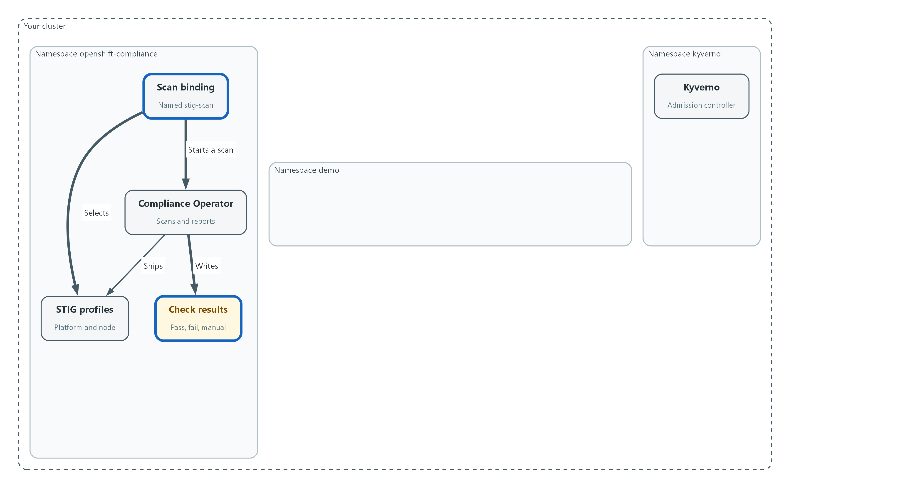
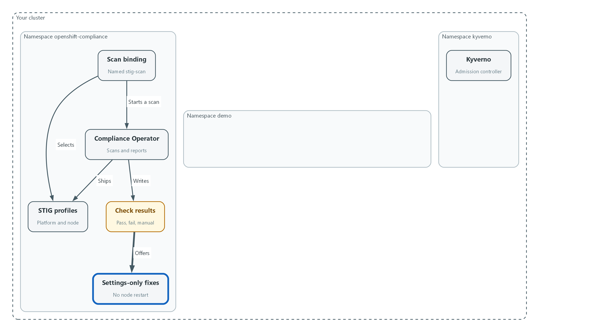
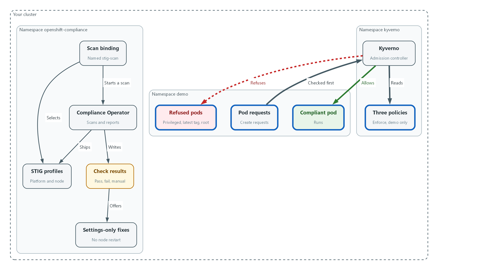
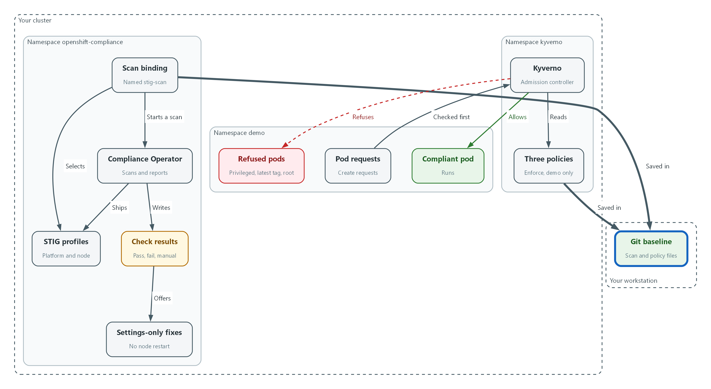

# M07: Hardening and Policy as Code (CM-6, CM-7, CM-2)

> 📌 DRAFT. Commands follow Red Hat's published Compliance Operator documentation and the Kyverno policy library but have not yet run in the lab. Profile names are read from the cluster with oc get before they are used. Kyverno field names differ between releases, so the policies are checked with oc explain and a server-side dry run before they are applied. Which rules fail on a fresh cluster, and which of those have a fix that needs no node restart, depends on the cluster, so Step 3 and Test 4 find them with a query instead of naming one. Red Hat's Compliance Operator documentation states that ocp4-stig, ocp4-stig-node and rhcos4-stig always point to the latest STIG version and that a node profile must be used with its platform profile; the live profile list on your cluster is still the authority (oc get profiles.compliance -o wide). The lab pins Kyverno 1.19.2 (Helm chart kyverno/kyverno 3.9.2). In that release ClusterPolicy (kyverno.io/v1) is deprecated in favor of the newer CEL-based policy types (ValidatingPolicy and others in policies.kyverno.io), and the Kyverno project says it will remove ClusterPolicy in 1.20, but 1.19 still fully supports it. This module therefore keeps ClusterPolicy, because the lab pins 1.19.2, and the rule-level validate.failureAction field is the documented spelling there; the cluster may print a deprecation warning when you apply the policies, which is expected. Do not move the lab to Kyverno 1.20 or later without rewriting the policies. Confirm the fields with oc explain and oc get crd clusterpolicies.kyverno.io. OpenShift's built-in security context admission may add a non-root setting to the bad-root pod, which would let it through (Red Hat documents that the restricted SCCs assign a user ID from the namespace range, but does not say whether runAsNonRoot is added); confirm with oc apply --dry-run=server -o yaml on bad-pods.yaml before relying on Test 3.

| Item | Detail |
| --- | --- |
| Sequence | Module 12 of 17 in the recommended order |
| Timed work | About 70 minutes (45 hands-on, 25 verify) |
| Modes | Ready Lab (prebuilt) or Architect (you design and build it) |
| Standalone start | `lab start m07` |
| Combined start | Continue from the end state of the previous module |
| End state | `lab check m07` passes |
| Tools | OpenShift Container Platform, OpenShift Compliance Operator, Kyverno (free, open source), oc, jq, git |
| Prerequisites | Module 0 (terminal and git basics), Module 2 (lab running) |
| Extra lab needs | Compliance Operator installed in the openshift-compliance namespace with the default ProfileBundles valid.; The demo-app deployment in the demo namespace uses a fixed version tag (not latest) and sets runAsNonRoot: true in its pod spec, so its pods pass the three policies when they restart.; Kyverno 1.19.2 (Helm chart kyverno/kyverno 3.9.2) running in the kyverno namespace. Do not install 1.20 or later, which removes the ClusterPolicy type this module uses. |

## 1. Why This Matters

An IL5 system must be set up in the most restrictive way that still lets it do its job, and it must stay that way. This module does two things. First, it scans the cluster against the DISA STIG (a security checklist published by the Defense Information Systems Agency) and fixes a failing setting. Second, it writes rules as code (policy as code: rules kept in files that the cluster itself enforces) so that workloads asking for more power than they need are refused at the door.

### Control mapping

| Control | What it requires, in plain words | Source of the value | Where this module covers it |
| --- | --- | --- | --- |
| CM-6 Configuration Settings | Pick a secure checklist, apply it, record any exception, and watch for changes. | NIST; FedRAMP | Steps 2 and 3 scan against the DISA STIG profiles. Test 4 fixes a failing rule. |
| CM-7 Least Functionality | Allow only the capabilities the mission needs and block the rest. | NIST; FedRAMP; DoD SRG | Step 4 writes three Kyverno policies. Tests 2 and 3 show an allowed pod and refused pods. |
| CM-2 Baseline Configuration | Keep a current, version-controlled baseline and review it on a schedule. | NIST; FedRAMP | Step 5 records the pinned checklist and commits the policies to git. |

### What each control is for

Read these answers first. They explain what each control is trying to prevent and how this module's tool meets it.

#### CM-6 Configuration Settings

| Question | Answer |
| --- | --- |
| What the control author feared | A system component runs with a default or weak setting nobody chose, and an attacker uses it. |
| Is it in scope for the system | Every component the system team operates, including the cluster and the nodes it runs on. Settings the cloud provider controls belong to the provider. |
| The operational question | For this component, which checklist defines the right setting, and does the live setting match it today? |
| What evidence proves it | The chosen checklist, the scan result for each setting, and the recorded reason for every setting that deviates. |
| How much is enough | The checklist is named, applied, and checked automatically. Every deviation is approved and written down. FedRAMP requires the DoD STIGs to establish configuration settings, with CIS Level 2 and then custom baselines only where no STIG exists. The lab uses the DISA STIGs and sends each deviation to a Plan of Action and Milestones (POA&M: the tracked list of known weaknesses and the dates they will be fixed). |
| Who is told when it fails | Someone owns each failing rule until it is fixed or formally accepted. Changes to a setting go through change control (CM-3). |
| How the tool in this module satisfies it | The Compliance Operator scans against the STIG profiles (Steps 2 and 3) and can apply many fixes itself. Test 4 shows a failing rule becoming a passing one. |

#### CM-7 Least Functionality

| Question | Answer |
| --- | --- |
| What the control author feared | A workload runs with more power than it needs, such as full control of the node, and a flaw in it becomes a takeover of the platform. |
| Is it in scope for the system | Every workload and service the team lets run on the platform. |
| The operational question | What is the least this workload needs, and what stops it from asking for more? |
| What evidence proves it | The policies that refuse extra capability, and a refused request that proves they work. |
| How much is enough | Only essential capabilities are allowed, the rest are blocked by something automatic rather than by good intentions, and the list is reviewed on a schedule. FedRAMP sets that review (CM-7(1)) to at least annually. The DoD SRG says DSPAV (DoD-specific assignment values) must be used for CM-7(5), so this module does not invent an allow list. |
| Who is told when it fails | Someone tells the policy owner when a team needs an exception, and the exception is recorded. |
| How the tool in this module satisfies it | Kyverno policies (Step 4) refuse privileged containers, containers that can run as root, and the mutable latest image tag. |

#### CM-2 Baseline Configuration

| Question | Answer |
| --- | --- |
| What the control author feared | Nobody can say what the approved configuration is, so nobody can tell a legitimate change from an attack. |
| Is it in scope for the system | The system as a whole, kept in files that can be compared over time. |
| The operational question | Where is the approved configuration written, and how would we know it changed? |
| What evidence proves it | The pinned checklist content, the policy files, and the version history that shows each change. |
| How much is enough | The baseline is under configuration control, reviewed on a set frequency and when circumstances change, and earlier versions are kept so a change can be undone. FedRAMP sets the review to at least annually and when a significant change occurs. The lab reviews semi-annually or upon significant changes, and keeps all previous versions in version control (CM-2(3)). |
| Who is told when it fails | Someone owns each review and records it. |
| How the tool in this module satisfies it | Step 5 reads the pinned checklist version from the cluster and commits the policy files to git, which keeps every version. |

### Architect mode brief

Decide which checklist applies, which scans you will run and which you will leave out and why, which workload requests the platform must refuse, and where the approved policy files live so changes are reviewed. Then build it and run the tests.

### Terms in this module

Each term is also explained the first time it appears. This table is a quick lookup.

| Term | Plain meaning |
| --- | --- |
| STIG | Security Technical Implementation Guide: a checklist of secure settings published by the Defense Information Systems Agency. |
| Compliance Operator | An OpenShift add-on (an operator is a program that manages another program for you) that scans the cluster against a checklist and reports each rule as pass or fail. |
| Profile and rule | A profile is a named checklist. A rule is one item on it, such as one setting that must have one value. |
| Remediation | A prepared fix for a failing rule that the operator can apply for you. |
| Policy as code | Security rules kept in files that the cluster itself enforces, so they can be reviewed and versioned like software. |
| Admission controller | A gate in the cluster that checks every create or change request before it is saved and can refuse it. |
| Kyverno | A free, open source admission controller that reads policies written in YAML. |
| Privileged container | A container with nearly the same power as the node it runs on. |
| Image tag | The label after the colon in an image name, such as :1.2. The tag latest is a label that moves, so it does not say which version runs. |

## 2. The Tools

### Tools used in this module

Each tool name links to its official overview. The last column says how the tool is used in the lab.

| Tool (overview link) | What it is | Used in this lab |
| --- | --- | --- |
| [Compliance Operator](https://docs.redhat.com/en/documentation/openshift_container_platform/4.22/html/security_and_compliance/compliance-operator) | Checks cluster configuration against standards and benchmarks. It is not an auditor. | Scans the cluster against a hardening benchmark. |
| [Kyverno](https://kyverno.io/docs/) | A policy engine that checks and enforces rules on Kubernetes resources. | Blocks resources that break a written policy. |
| [Git](https://git-scm.com/about) | Version control that stores repository history. | Policies are kept as files in version control. |
| [OpenShift Container Platform](https://docs.redhat.com/en/documentation/openshift_container_platform/4.22/html/overview/ocp-overview) | A Kubernetes container platform for running and managing containerized applications. | The cluster every command in this module runs against. |
| [oc](https://docs.redhat.com/en/documentation/openshift_container_platform/4.22/html/cli_tools/openshift-cli-oc) | The OpenShift command-line tool for creating and managing applications and projects from a terminal. | Runs the cluster commands in each step. |
| [jq](https://jqlang.org/) | Command-line JSON processor. | Picks fields out of JSON output. |

### How it fits together

#### Scan the cluster, then refuse bad pods

The Compliance Operator checks the cluster against the STIG and reports pass or fail. Kyverno checks every new pod in the demo namespace and refuses the ones that ask for too much. Your baseline files are saved in git. New parts are drawn with thick lines.



- The Compliance Operator uses a scan binding to run the STIG profiles and writes the check results.
- Some failing rules come with a settings-only fix that needs no node restart.
- Kyverno reads three policies and checks each pod request in the demo namespace.
- A compliant pod is allowed. Privileged, latest-tag and root pods are refused.
- The scan binding and the policy files are saved in git as the baseline.
### 7.1 Two ways to enforce least functionality

What is this? A setting can be wrong in two ways. The platform itself can be set up loosely (a hardening problem), or a workload can ask for more power than it needs (a policy problem). This module checks the first with the Compliance Operator and blocks the second with Kyverno.

Why? A scan finds problems after the fact. A policy refuses the problem before it exists. An IL5 system needs both, because the scan proves the baseline is in place and the policy keeps it there.

| Tool | When it acts | Question it answers |
| --- | --- | --- |
| Compliance Operator scan | On a schedule or on demand, after things are running | Does the cluster match the STIG today? |
| Kyverno policy | At the moment someone creates a workload | Should this request be allowed at all? |

### 7.2 The STIG profiles the operator ships

The Compliance Operator ships ready-made profiles built from the DISA STIG for Red Hat OpenShift. A platform profile checks cluster settings such as the API server. A node profile checks each node. Red Hat documents that a node profile must be used with its matching platform profile. The names without a version suffix always point to the newest STIG release the operator carries.

You do not type these names from memory. Step 1 lists them from your own cluster, which is the source of truth for your release.

| Profile name | Checks |
| --- | --- |
| ocp4-stig | Platform: cluster settings (latest STIG release) |
| ocp4-stig-node | Node: OpenShift settings on each host (latest STIG release) |
| rhcos4-stig | Node: operating system settings of each host (latest STIG release) |
| names ending in a version such as -v2r3 | An older, pinned STIG release, kept for teams that must stay on it |

### 7.3 How Kyverno decides

When anyone creates a pod, the cluster's admission controller (the gate described in the terms table) asks Kyverno before saving it. Kyverno compares the pod to each policy. In Enforce mode a pod that breaks a policy is refused with a message. In Audit mode it is allowed and only reported. This module uses Enforce, scoped to the demo namespace (a named workspace in the cluster), so the rest of the lab keeps working.

```text
kubectl/oc create pod  -->  cluster API  -->  Kyverno policies  -->  saved and scheduled
                                                |
                                                +--> refused with a message (Enforce)
```

> 🏭 IN PRODUCTION: In the real environment policies are applied by the GitOps pipeline from a reviewed repository, never by hand, and a policy exception is a recorded change. The lab applies them by hand so you see each step.

## 3. Implement

Ready Lab learners start with `lab start m07`. Architect learners design each step first using the brief above.

### Step 1. Check what you have and read the real profile names

Confirm the Compliance Operator and Kyverno are ready, then list the STIG profiles your cluster actually ships. Profile names change between releases, so read them instead of trusting a document.

What this step adds (thick lines and outlines are new):



- Both tools are already installed. You only read the profile names and check that the pods are running.
```bash
oc get csv -n openshift-compliance
oc get profilebundle -n openshift-compliance
oc get profiles.compliance -n openshift-compliance | grep stig
oc get pods -n kyverno
```

| Part | What it does |
| --- | --- |
| oc get csv | Lists installed operators (a csv is the record of one installed operator). |
| oc get profilebundle | Shows the checklist content the operator loaded. Each bundle should say VALID. |
| oc get profiles.compliance ... | grep stig | Lists every checklist whose name contains stig. |
| oc get pods -n kyverno | Lists the Kyverno programs. They should be Running. |

> ▶ YOUR TURN: Run the commands. Write down the platform and node STIG profile names without a version suffix.

> ✅ CHECKPOINT: ProfileBundles are VALID, Kyverno pods are Running, and you can see ocp4-stig and ocp4-stig-node in the list (or the equivalent names your release shows).

### Step 2. Scan the cluster against the STIG (CM-6)

A ScanSettingBinding connects profiles to scan settings and starts the scan. The default scan setting reports problems and does not change anything, which is what you want for a first look. Only the platform and OpenShift node profiles are used here. The operating-system profile is left out because many of its fixes restart the node, and one of them turns off remote login.

What this step adds (thick lines and outlines are new):



- A scan binding picks the two STIG profiles and starts a scan that reports and changes nothing.
```yaml
apiVersion: compliance.openshift.io/v1alpha1
kind: ScanSettingBinding
metadata:
  name: stig-scan
  namespace: openshift-compliance
profiles:
  - name: ocp4-stig
    kind: Profile
    apiGroup: compliance.openshift.io/v1alpha1
  - name: ocp4-stig-node
    kind: Profile
    apiGroup: compliance.openshift.io/v1alpha1
settingsRef:
  name: default
  kind: ScanSetting
  apiGroup: compliance.openshift.io/v1alpha1
```

| Part | What it does |
| --- | --- |
| kind: ScanSettingBinding | The object that starts a scan. |
| profiles | The two checklists to run. Use the names you found in Step 1. |
| settingsRef: default | Uses the built-in setting that scans and reports without changing anything. |

```bash
oc apply -f stig-scan.yaml --dry-run=server
oc apply -f stig-scan.yaml
oc get compliancescan -n openshift-compliance
oc wait compliancesuite/stig-scan -n openshift-compliance --for=jsonpath='{.status.phase}'=DONE --timeout=30m
oc get compliancesuite stig-scan -n openshift-compliance
```

| Part | What it does |
| --- | --- |
| --dry-run=server | Asks the cluster to check the file without saving it. |
| oc apply -f | Saves the binding. The operator creates a suite and one scan per profile. |
| oc get compliancescan | Shows each scan moving through its phases. |
| oc wait ... DONE | Waits until the suite finishes. A node scan can take several minutes. |
| oc get compliancesuite | Shows the final phase and result. |

> 🔒 Red Hat warns that applying every automatic fix in a profile such as rhcos4-stig turns off the sshd service (the remote login service) on the nodes. This is why you review fixes before applying them. If an organization must keep a rule from being applied, the operator supports a tailored profile (a copy of a profile with named rules switched off) and the reason belongs in the POA&M.

> ▶ YOUR TURN: Save the YAML as stig-scan.yaml, validate it, apply it, then wait for the suite to finish.

> ✅ CHECKPOINT: The suite phase is DONE and its result is NON-COMPLIANT. That is the normal first result, not a failure of the tool.

### Step 3. Read the results and find fixes you can apply safely (CM-6)

Each rule becomes a result object with a status and a severity. For some failing rules the operator also prepares a remediation. A remediation that changes a node needs a restart, so look for the ones that change only cluster settings.

What this step adds (thick lines and outlines are new):



- Failing rules are read from the results, and some come with a fix that needs no node restart.
```bash
oc get compliancecheckresults -n openshift-compliance -l compliance.openshift.io/suite=stig-scan -o json | jq -r '.items[].status' | sort | uniq -c
oc get compliancecheckresults -n openshift-compliance -l 'compliance.openshift.io/suite=stig-scan,compliance.openshift.io/check-status=FAIL' --no-headers | head -20
oc get complianceremediations -n openshift-compliance -o json | jq -r '.items[] | select(.spec.current.object.kind != "MachineConfig") | .metadata.name'
```

| Part | What it does |
| --- | --- |
| jq -r '.items[].status' | sort | uniq -c | Counts how many rules passed, failed or need a manual look. |
| check-status=FAIL | Lists only the failing rules. |
| head -20 | Shows the first twenty lines so the list stays readable. |
| select(... != MachineConfig) | Keeps the remediations that change cluster settings only, with no node restart. |

> 📌 A status of MANUAL means the tool cannot decide and a person must check. Those rules still count toward the baseline. Red Hat documents that many platform findings cannot be fixed automatically (for example, the allowed registries list depends on the organization), so few rules have a ready settings-only fix. Some cluster-setting fixes make the API server restart its pods, so expect the cluster to be briefly unreachable after you apply one.

> ▶ YOUR TURN: Run the three commands. Copy one name from the last list for Test 4.

> ✅ CHECKPOINT: You see counts for each status and at least one safe remediation name. If the last list is empty, tell your instructor: the lab needs a rule with a settings-only fix.

### Step 4. Enforce least functionality with Kyverno (CM-7)

Write three policies. Together they block a container with node-level power, a container that may run as the root user (the all-powerful account), and the moving latest image tag. Each policy is scoped to the demo namespace and set to Enforce.

What this step adds (thick lines and outlines are new):



- Kyverno now checks each pod request against three policies and refuses the ones that break a rule.
```yaml
apiVersion: kyverno.io/v1
kind: ClusterPolicy
metadata:
  name: disallow-privileged-containers
spec:
  background: true
  rules:
    - name: privileged-containers
      match:
        any:
          - resources:
              kinds:
                - Pod
              namespaces:
                - demo
      validate:
        failureAction: Enforce
        message: "Privileged containers are not allowed."
        pattern:
          spec:
            =(ephemeralContainers):
              - =(securityContext):
                  =(privileged): "false"
            =(initContainers):
              - =(securityContext):
                  =(privileged): "false"
            containers:
              - =(securityContext):
                  =(privileged): "false"
---
apiVersion: kyverno.io/v1
kind: ClusterPolicy
metadata:
  name: require-run-as-nonroot
spec:
  background: true
  rules:
    - name: run-as-non-root
      match:
        any:
          - resources:
              kinds:
                - Pod
              namespaces:
                - demo
      validate:
        failureAction: Enforce
        message: "Containers must be set to run as a non-root user."
        anyPattern:
          - spec:
              securityContext:
                runAsNonRoot: "true"
              =(ephemeralContainers):
                - =(securityContext):
                    =(runAsNonRoot): "true"
              =(initContainers):
                - =(securityContext):
                    =(runAsNonRoot): "true"
              containers:
                - =(securityContext):
                    =(runAsNonRoot): "true"
          - spec:
              =(ephemeralContainers):
                - securityContext:
                    runAsNonRoot: "true"
              =(initContainers):
                - securityContext:
                    runAsNonRoot: "true"
              containers:
                - securityContext:
                    runAsNonRoot: "true"
---
apiVersion: kyverno.io/v1
kind: ClusterPolicy
metadata:
  name: disallow-latest-tag
spec:
  background: true
  rules:
    - name: require-image-tag
      match:
        any:
          - resources:
              kinds:
                - Pod
              namespaces:
                - demo
      validate:
        failureAction: Enforce
        message: "An image tag is required."
        foreach:
          - list: "request.object.spec.containers"
            pattern:
              image: "*:*"
          - list: "request.object.spec.initContainers"
            pattern:
              image: "*:*"
          - list: "request.object.spec.ephemeralContainers"
            pattern:
              image: "*:*"
    - name: block-latest-tag
      match:
        any:
          - resources:
              kinds:
                - Pod
              namespaces:
                - demo
      validate:
        failureAction: Enforce
        message: "The latest tag is not allowed. Use a fixed version."
        foreach:
          - list: "request.object.spec.containers"
            pattern:
              image: "!*:latest"
          - list: "request.object.spec.initContainers"
            pattern:
              image: "!*:latest"
          - list: "request.object.spec.ephemeralContainers"
            pattern:
              image: "!*:latest"
```

| Part | What it does |
| --- | --- |
| kind: ClusterPolicy | A Kyverno policy that applies across the cluster. |
| namespaces: demo | Limits each rule to the demo namespace so the rest of the lab is untouched. |
| failureAction: Enforce | Refuse the request. Audit would only report it. |
| =(securityContext): =(privileged): false | If a security setting is present, privileged must be false. The =( ) marks an optional field. |
| anyPattern | Passes if either listed shape matches: the pod is set non-root as a whole, or every container is. |
| foreach ... list | Checks every container, init container and ephemeral container (a temporary debugging container) in the pod, not only the main ones. |
| image: !*:latest | Refuses any image whose name ends in :latest. The other rule refuses an image with no tag. |

```bash
oc explain clusterpolicy.spec.rules.validate.failureAction
oc apply -f least-functionality.yaml --dry-run=server
oc apply -f least-functionality.yaml
oc get clusterpolicy
```

| Part | What it does |
| --- | --- |
| oc explain ... | Prints the field your Kyverno release accepts. Older releases set the action at the top of the policy instead. Use what it shows. |
| --dry-run=server | Asks the cluster to check the file without saving it. |
| oc get clusterpolicy | Lists the policies and whether each is ready. |

> 💡 The organization-defined list of what is a mission-essential capability is set by the system owner. These three rules are the common starting set, not the whole list. A team that needs an exception asks for it, and the exception is recorded.

> ▶ YOUR TURN: Save the YAML as least-functionality.yaml, validate it, apply it, and list the policies.

> ✅ CHECKPOINT: Three policies exist and each shows READY true.

### Step 5. Record the baseline (CM-2)

A baseline is only useful if you can say exactly what it is and see how it changed. The operator keeps the checklist content as a container image, and this lab pins it by digest (a fingerprint that identifies one exact version). The policy files go into git, which keeps every version.

What this step adds (thick lines and outlines are new):



- The scan binding and the policy files are saved in git, which keeps every version.
```bash
oc get profile.compliance ocp4-stig -n openshift-compliance
oc get profilebundle ocp4 -n openshift-compliance -o jsonpath='{.spec.contentImage}{"\n"}'
mkdir -p baseline
cp stig-scan.yaml least-functionality.yaml baseline/
cd baseline
git init
git add .
git -c user.name=learner -c user.email=learner@lab.internal commit -m "Record hardening baseline"
git log --oneline
```

| Part | What it does |
| --- | --- |
| oc get profile.compliance ocp4-stig | Shows the checklist and its version. |
| jsonpath='{.spec.contentImage}' | Prints the image the checklist content comes from. |
| git init, git add, git commit | Starts a repository and saves the first version of both files. |
| git log --oneline | Shows the version history. |

> 📌 If the image shown ends in a tag instead of a digest, record that. Pinning the content by digest is an operations decision, and the lab does not change it.

> ▶ YOUR TURN: Run the commands.

> ✅ CHECKPOINT: git log shows one commit, and you have the checklist version and content image on screen.

## 4. Verify It Works

### Test 1 (positive). The scan reports results

Count what the scan found. A scan that returns nothing proves nothing.

```bash
oc get compliancecheckresults -n openshift-compliance -l compliance.openshift.io/suite=stig-scan -o json | jq -r '.items[].status' | sort | uniq -c
oc get compliancesuite stig-scan -n openshift-compliance -o jsonpath='{.status.result}{"\n"}'
```

**Expected output:**

```
Example only. Your counts will differ.
     41 FAIL
     12 MANUAL
     58 PASS
NON-COMPLIANT
```

> ✅ CHECKPOINT: There are both PASS and FAIL results, and the suite result is NON-COMPLIANT or COMPLIANT.

### Test 2 (positive). A policy-compliant pod runs

The policies must not block good workloads. This pod sets itself to non-root, drops extra capabilities, and uses the fixed tag from the demo-app deployment.

```bash
DEMO_IMAGE=$(oc get deployment demo-app -n demo -o jsonpath='{.spec.template.spec.containers[0].image}')
echo "$DEMO_IMAGE"
cat policy-ok.yaml
sed "s|DEMO_IMAGE|$DEMO_IMAGE|" policy-ok.yaml | oc apply -f -
oc wait pod/policy-ok -n demo --for=condition=Ready --timeout=120s
oc get pod policy-ok -n demo
```

**Expected output:**

```
Example only. First save this file as policy-ok.yaml:
apiVersion: v1
kind: Pod
metadata:
  name: policy-ok
  namespace: demo
spec:
  securityContext:
    runAsNonRoot: true
    seccompProfile:
      type: RuntimeDefault
  containers:
    - name: app
      image: DEMO_IMAGE
      securityContext:
        allowPrivilegeEscalation: false
        capabilities:
          drop:
            - ALL

Then the run ends with:
NAME        READY   STATUS    RESTARTS   AGE
policy-ok   1/1     Running   0          15s
```

> ✅ CHECKPOINT: The pod is created and reaches Running. Nothing was refused.

### Test 3 (negative). Non-compliant pods are denied

Ask for what the policies forbid: a privileged container, the latest tag, and no non-root setting. Save the file below as bad-pods.yaml first. As cluster-admin you are allowed to ask for a privileged pod, so only the Kyverno policy stands in the way. That is the point.

```bash
cat bad-pods.yaml
sed "s|DEMO_IMAGE|$DEMO_IMAGE|" bad-pods.yaml | oc apply -f -
oc get pods -n demo | grep bad-
```

**Expected output:**

```
Example only. Save this as bad-pods.yaml first (three pods in one file):
apiVersion: v1
kind: Pod
metadata: { name: bad-privileged, namespace: demo }
spec:
  securityContext: { runAsNonRoot: true }
  containers:
    - { name: app, image: DEMO_IMAGE, securityContext: { privileged: true } }
---
apiVersion: v1
kind: Pod
metadata: { name: bad-latest, namespace: demo }
spec:
  securityContext: { runAsNonRoot: true }
  containers:
    - { name: app, image: "registry.access.redhat.com/ubi9/ubi-minimal:latest" }
---
apiVersion: v1
kind: Pod
metadata: { name: bad-root, namespace: demo }
spec:
  containers:
    - { name: app, image: DEMO_IMAGE }

Then the run prints one denial per pod and the last command prints nothing:
Error from server: admission webhook "validate.kyverno.svc-fail" denied the request:
resource Pod/demo/bad-privileged was blocked due to the following policies
disallow-privileged-containers:
  privileged-containers: 'validation error: Privileged containers are not allowed.'
(similar messages for bad-latest and bad-root)
```

> ✅ CHECKPOINT: Each of the three pods is refused with the message from its policy, and no bad- pod exists afterwards.

### Test 4 (negative). A failing hardening rule stays failed until it is fixed

A scan result that never changes teaches nothing. Take the safe remediation name you copied in Step 3, show that its rule fails, apply the fix, scan again, and show that it passes. If the rule was already fixed by an earlier run, pick another name from the Step 3 list.

```bash
FILTER='.items[] | select(.spec.current.object.kind != "MachineConfig") | .metadata.name'
RULE=$(oc get complianceremediations -n openshift-compliance -o json | jq -r "$FILTER" | head -1)
echo "$RULE"
oc get compliancecheckresult "$RULE" -n openshift-compliance -o jsonpath='{.status}{"\n"}'
oc patch complianceremediation "$RULE" -n openshift-compliance --type merge -p '{"spec":{"apply":true}}'
oc annotate compliancescans/ocp4-stig -n openshift-compliance compliance.openshift.io/rescan=
oc wait compliancesuite/stig-scan -n openshift-compliance --for=jsonpath='{.status.phase}'=DONE --timeout=30m
oc get compliancecheckresult "$RULE" -n openshift-compliance -o jsonpath='{.status}{"\n"}'
```

**Expected output:**

```
Example only. The rule name will differ.
ocp4-stig-example-rule
FAIL
complianceremediation.compliance.openshift.io/ocp4-stig-example-rule patched
compliancescan.compliance.openshift.io/ocp4-stig annotated
compliancesuite.compliance.openshift.io/stig-scan condition met
PASS
```

> ✅ CHECKPOINT: The same rule reads FAIL before the fix and PASS after the rescan. If the wait finishes before the rescan starts, wait 2 minutes and run the last command again.

Run `lab check m07` to run these tests automatically. It checks:

- The STIG scan suite finished and reports PASS and FAIL results.
- The three Kyverno policies exist and are set to enforce in the demo namespace.
- A policy-compliant pod runs in the demo namespace.
- A privileged pod, a latest-tag pod and a root pod are each denied.
- A failing hardening rule is fixed and passes on the next scan.
## 5. Glossary and Next Steps

| Term | Meaning |
| --- | --- |
| STIG | Security Technical Implementation Guide: a checklist of secure settings. |
| Compliance Operator | The OpenShift add-on that scans against checklists. |
| ScanSettingBinding | The object that connects profiles to scan settings and starts a scan. |
| Remediation | A prepared fix for a failing rule. |
| Policy as code | Security rules kept in files the cluster enforces. |
| Admission controller | A gate that checks every create or change request. |
| Kyverno | A free admission controller driven by YAML policies. |
| Namespace | A named workspace in the cluster. |
| POA&M | Plan of Action and Milestones: the tracked list of known weaknesses and the dates they will be fixed. |
| Digest | A fingerprint that identifies one exact version of an image. |

> 💡 Next module: M04 FIPS Cryptography and Keys: whether the encryption itself is approved, and who holds the keys.
