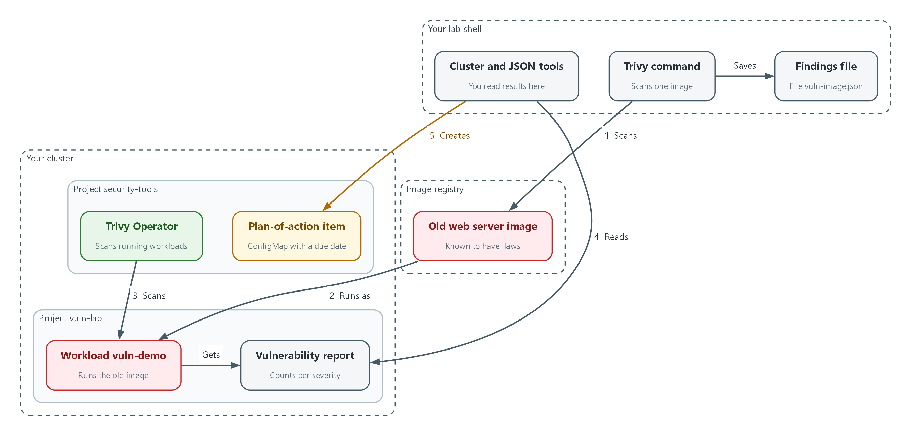
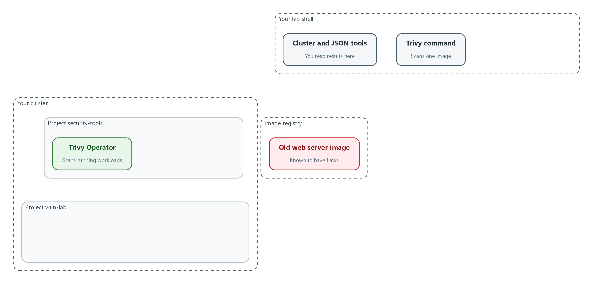
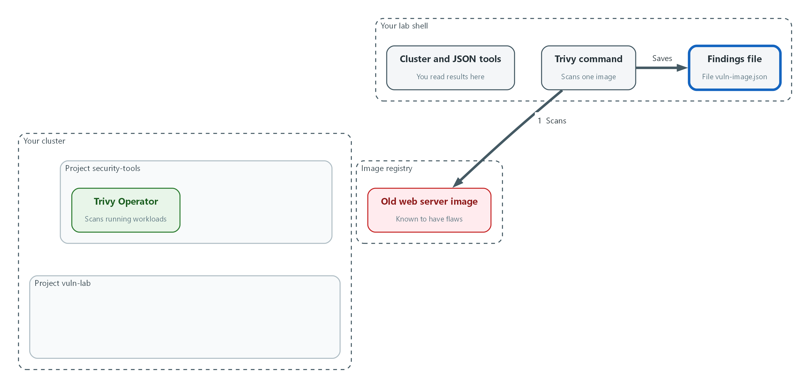
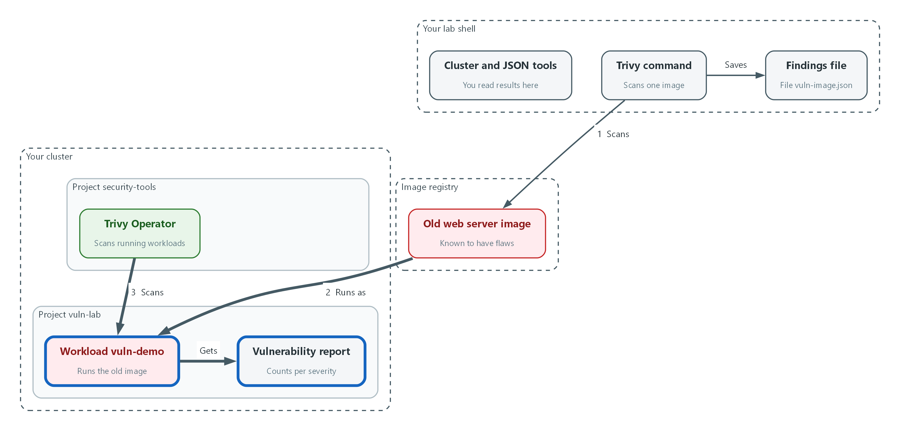
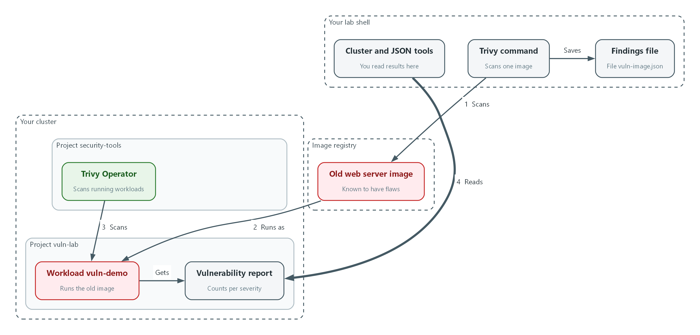
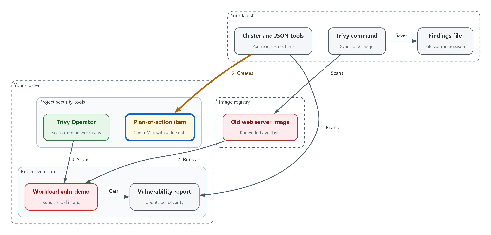

# M08: Vulnerability Management (RA-5, SI-2, CA-5)

> 📌 DRAFT. Commands follow the Trivy and Trivy Operator documentation but have not yet run in the lab. Report field names (for example report.summary.criticalCount) can differ between Trivy Operator releases, so Step 4 prints the summary before any filtering. The vulnerable and clean example images are public images chosen to show the two outcomes. Their findings change as the vulnerability database changes, so counts will differ from the examples. Registry listings on 2026-10-26 show both example tags exist (Docker Hub nginx 1.16 and the Chainguard static latest tag); not yet confirmed in the lab: that the lab shell can pull them (confirm with trivy image on each tag), that the lab shell has GNU date for date -d in Step 5 (confirm with date -d tomorrow +%F), and that the operator has its cluster RBAC assessment scanner enabled (confirm with oc get clusterrbacassessmentreports). The lab starts the fix clock on the day the scan found the flaw.

| Item | Detail |
| --- | --- |
| Sequence | Module 8 of 17 in the recommended order |
| Timed work | About 70 minutes (45 hands-on, 25 verify) |
| Modes | Ready Lab (prebuilt) or Architect (you design and build it) |
| Standalone start | `lab start m08` |
| Combined start | Continue from the end state of the previous module |
| End state | `lab check m08` passes |
| Tools | OpenShift Container Platform, Trivy and Trivy Operator (free, open source), oc, jq |
| Prerequisites | Module 0 (terminal and git basics), Module 2 (lab running) |
| Extra lab needs | Trivy Operator running in security-tools and set to scan the vuln-lab namespace; it must be able to fetch the vulnerability database or use a mirror the lab provides.; The lab shell can pull docker.io/library/nginx:1.16 and cgr.dev/chainguard/static:latest, or the lab mirrors them and the module is updated with the mirror names. |

## 1. Why This Matters

An IL5 system must look for known security flaws on a regular basis, rank what it finds, fix each flaw inside a set time, and keep a written plan for any flaw it cannot fix in time. This module uses Trivy to find flaws in container images and in the cluster, reads the findings by severity, compares them with the fix deadlines, and records an unfixed flaw as a plan-of-action item inside the cluster.

### Control mapping

| Control | What it requires, in plain words | Source of the value | Where this module covers it |
| --- | --- | --- | --- |
| RA-5 Vulnerability Monitoring and Scanning | Scan on a schedule, analyze the results, and fix findings within set response times. | NIST; FedRAMP; DoD SRG | Steps 2 to 4 scan and read findings. Tests 1 and 2 prove a known flaw is found. |
| SI-2 Flaw Remediation | Identify and report flaws, test the fix, install it within a set time, and use change control. | NIST | Step 5 sets a due date from the severity. Test 4 shows what a remediated image looks like (it scans clean). Testing a fix before install and change control are part of the requirement and are not exercised in this lab. NIST leaves the install time to the organization; the lab sets it by severity. |
| CA-5 Plan of Action and Milestones | Keep a tracked plan for each known weakness, with the cause, the steps and the dates, and keep it current. | NIST; DoD SRG | Step 5 creates a plan-of-action item. Test 3 lists it and checks for overdue items. |

### What each control is for

Read these answers first. They explain what each control is trying to prevent and how this module's tool meets it.

#### RA-5 Vulnerability Monitoring and Scanning

| Question | Answer |
| --- | --- |
| What the control author feared | A known flaw sits in a running component for months because nobody looked, or somebody looked and nobody read the result. |
| Is it in scope for the system | The system and the applications it hosts, including every container image that runs on the platform. |
| The operational question | If a serious flaw was published this morning, would we find out which running images contain it, and how soon? |
| What evidence proves it | Scan reports with dates, the list of what was scanned, and the findings sorted by severity. |
| How much is enough | Scans run on a defined schedule and when new flaws are published, the results are analyzed and not just stored, and findings are fixed within set response times. NIST leaves the scan frequency to the organization and FedRAMP High sets it to monthly. This lab scans on demand with Trivy and lets the operator rescan on a schedule it keeps. |
| Who is told when it fails | Someone reads each report and assigns every serious finding to an owner. |
| How the tool in this module satisfies it | Trivy finds the flaws (Step 2). Trivy Operator keeps a report for every running workload (Step 3) and Step 4 reads them by severity. |

#### SI-2 Flaw Remediation

| Question | Answer |
| --- | --- |
| What the control author feared | A fix exists but is never installed, or is installed untested and breaks the system. |
| Is it in scope for the system | Software and firmware in everything the team operates. Images the team builds are theirs to rebuild. |
| The operational question | For each finding, is there a fix, who is applying it, and by what date? |
| What evidence proves it | The finding, its severity, the date found, the fix version, the deadline, and the date it was closed. |
| How much is enough | Updates are tested before installation, installed within the set time for their severity, and go through change management. NIST leaves the install time to the organization, and FedRAMP High sets it to within 30 days of the release of the updates. This lab sets the times by severity and leaves Low and Informational to the system owner or their designee. |
| Who is told when it fails | Someone checks whether deadlines are being met and tells the owner when one is close. |
| How the tool in this module satisfies it | Step 5 turns a severity into a due date from the severity table. Test 4 shows what a remediated image looks like: no serious findings. |

#### CA-5 Plan of Action and Milestones

| Question | Answer |
| --- | --- |
| What the control author feared | A flaw that cannot be fixed in time simply disappears from view, and the people who accept the risk never see it. |
| Is it in scope for the system | Every known weakness in the system that is not yet fixed. |
| The operational question | For each flaw we have not fixed, where is the plan, who owns it, and when is it due? |
| What evidence proves it | One tracked item per open weakness, with cause, steps, dates and status, reviewed on a schedule. |
| How much is enough | Each open weakness has an entry showing the vulnerability, its root cause and its milestones, and entries are updated until they are closed or a risk acceptance is approved. NIST leaves the update frequency to the organization and FedRAMP High sets it to at least monthly; this lab reviews entries quarterly, which is less often than FedRAMP High allows. The DoD SRG says deviation requests must be tracked in the plan. |
| Who is told when it fails | Someone reviews the open items on the review schedule and closes the ones that are done. |
| How the tool in this module satisfies it | A labeled ConfigMap (a small stored record in the cluster) holds each item (Step 5), and one query lists the open and overdue ones (Test 3). The lab keeps the record in the cluster so you practice the fields. The official record is kept in the organization's system of record. |

### Architect mode brief

Decide what gets scanned (images before they run, images while they run, the cluster settings), how often, who reads the result, which severities have which deadlines, and how an item that misses its deadline becomes a tracked plan. Then build it and run the tests.

### Terms in this module

Each term is also explained the first time it appears. This table is a quick lookup.

| Term | Plain meaning |
| --- | --- |
| Vulnerability | A flaw in software that an attacker could use. |
| CVE | Common Vulnerabilities and Exposures: a public ID, such as CVE-2024-0001, for one known flaw. |
| Severity | How serious a flaw is: CRITICAL, HIGH, MEDIUM or LOW. |
| Container image | The packaged files a container starts from: a program and the pieces it needs. |
| Trivy | A free, open source scanner that compares what is inside an image or cluster with a database of known flaws. |
| Trivy Operator | A program that runs Trivy inside the cluster for you and saves each result as a report object. |
| Fixed version | The first version of a package in which a flaw is repaired. Empty means no fix is published yet. |
| POA&M | Plan of Action and Milestones: the tracked record of a known weakness, its cause, its steps and its dates. |
| ConfigMap | A small named record stored in the cluster. Labels on it let you search for groups of records. |

## 2. The Tools

### Tools used in this module

Each tool name links to its official overview. The last column says how the tool is used in the lab.

| Tool (overview link) | What it is | Used in this lab |
| --- | --- | --- |
| [Trivy](https://trivy.dev/) | Scans images, code and clusters for known flaws and misconfigurations. | Scans images for known flaws. |
| [Trivy Operator](https://aquasecurity.github.io/trivy-operator/latest/) | Runs Trivy inside the cluster continuously and stores findings as cluster resources. | Scans workloads in the cluster continuously and records findings. |
| [jq](https://jqlang.org/) | Command-line JSON processor. | Filters scan results. |
| [OpenShift Container Platform](https://docs.redhat.com/en/documentation/openshift_container_platform/4.22/html/overview/ocp-overview) | A Kubernetes container platform for running and managing containerized applications. | The cluster every command in this module runs against. |
| [oc](https://docs.redhat.com/en/documentation/openshift_container_platform/4.22/html/cli_tools/openshift-cli-oc) | The OpenShift command-line tool for creating and managing applications and projects from a terminal. | Runs the cluster commands in each step. |

### How it fits together

#### From a scan finding to a tracked deadline

You scan an old image by hand, then run it in the cluster so the operator scans it too. You read the operator's report and record one serious finding as a plan-of-action item with a due date. Each step below adds one part, drawn with thick lines.



- The Trivy command scans the old image and saves the findings to a file (flow 1).
- The old image runs as the vuln-demo workload in the vuln-lab project (flow 2).
- The Trivy Operator in security-tools scans the workload and writes a vulnerability report (flow 3).
- You read the report by severity with oc and jq (flow 4).
- You record one serious finding as a plan-of-action item in security-tools, with a due date from its severity (flow 5).
### 8.1 What a scan finds

What is this? Software is built from many smaller packages, and researchers publish flaws found in them. A scanner lists what is inside an image, looks each package up in a database of those published flaws, and reports the matches.

Why? You cannot fix what you cannot see, and the list changes every day. An image that was clean last month can have a serious finding today without a single byte changing, because new flaws are published about old packages.

| Field | What it tells you | What you do with it |
| --- | --- | --- |
| CVE ID | Which flaw | Look up details, search for it in other images |
| Package and installed version | Where the flaw lives | Find the owner of that package |
| Severity | How serious it is | Choose the deadline |
| Fixed version | The first repaired version, or empty | Rebuild with it, or start a plan-of-action item if empty |

### 8.2 Trivy two ways

The trivy command scans one image on demand, which is useful for a quick check and for a pass or fail gate (a check that stops a release when the scan finds something serious). Trivy Operator scans everything that runs in the cluster and keeps one report object for each workload, which is useful for reading the whole cluster at once. They use the same database, so they agree.

```text
Image  --trivy image-->  findings in your terminal  (gate: exit code 1 if serious findings)

Workload starts  -->  Trivy Operator scans it  -->  VulnerabilityReport object  -->  you read it with oc
Cluster objects  -->  Trivy Operator audits them -->  ConfigAuditReport, RBAC reports
```

### 8.3 Fix deadlines come from the sources

NIST leaves the response time to the organization (RA-5 and SI-2), and the DoD SRG assigns its own for cloud providers: High and Critical within 30 days and Moderate within 90 days. FedRAMP High assigns 30 days for high-risk, 90 days for moderate-risk and 180 days for low-risk vulnerabilities, counted from the date of discovery, and says a date in the CISA Known Exploited Vulnerabilities catalog replaces that value. Trivy calls the middle level MEDIUM where others say Medium or Moderate. The lab chooses the values shown in the lab column, and Step 5 uses them.

| Severity | This lab (RA-5 and SI-2) | DoD SRG (cloud providers) |
| --- | --- | --- |
| Critical | 15 days | 30 days (High and Critical together) |
| High | 30 days | 30 days (High and Critical together) |
| Medium or Moderate | 90 days | 90 days |
| Low | Set by the system owner or their designee | Aligned with FedRAMP guidance (180 days in FedRAMP High) |

### 8.4 What goes in a plan-of-action item

When a flaw cannot be fixed by its deadline, for example because no fixed version exists yet, it becomes a plan-of-action item. Each entry in this lab names the vulnerability, its root cause, its milestones and a completion date. In this lab each item is a ConfigMap with a poam label, so one query lists them all.

> 🏭 IN PRODUCTION: In the real environment the official POA&M lives in the organization's system of record, with approvals and reviews on a schedule. The cluster record in this lab teaches the fields and the habit of checking for overdue items.

## 3. Implement

Ready Lab learners start with `lab start m08`. Architect learners design each step first using the brief above.

### Step 1. Check what you have

Confirm the scanner program and the Trivy Operator are present before scanning anything.

What this step adds (thick lines and outlines are new):



- Nothing is new yet. You confirm the scanner in your lab shell and the Trivy Operator in the cluster.
```bash
trivy --version
oc get pods -n security-tools | grep trivy
oc get crd | grep aquasecurity
```

| Part | What it does |
| --- | --- |
| trivy --version | Prints the version of the scanner in your lab shell. |
| oc get pods -n security-tools | grep trivy | Shows the Trivy Operator program running in the cluster. |
| oc get crd | grep aquasecurity | Lists the report types the operator added (a crd is a new kind of object added to the cluster). |

> ▶ YOUR TURN: Run the commands.

> ✅ CHECKPOINT: You see a Trivy version, a Running operator pod, and report types such as vulnerabilityreports.

### Step 2. Scan a known-vulnerable image (RA-5)

Start with an old image that is known to contain flaws. The first scan downloads the vulnerability database, so it can take a few minutes. The results go to a file so you can read them several ways.

What this step adds (thick lines and outlines are new):



- The Trivy command scans the old image and saves the findings to a file.
```bash
VULN_IMAGE=docker.io/library/nginx:1.16
trivy image --scanners vuln --severity HIGH,CRITICAL --quiet --format json --output vuln-image.json "$VULN_IMAGE"
jq '[.Results[]?.Vulnerabilities[]?] | length' vuln-image.json
jq -r '[.Results[]?.Vulnerabilities[]? | .Severity] | group_by(.) | map([.[0], length]) | .[] | @tsv' vuln-image.json
jq -r '.Results[]?.Vulnerabilities[]? | select(.Severity=="CRITICAL") | [.VulnerabilityID, .PkgName, .InstalledVersion, .FixedVersion] | @tsv' vuln-image.json | head -10
```

| Part | What it does |
| --- | --- |
| VULN_IMAGE=... | Stores the image name in a variable so later commands reuse it. |
| trivy image --scanners vuln | Scans the image for known flaws only. |
| --severity HIGH,CRITICAL | Keeps only the two most serious levels. |
| --format json --output vuln-image.json | Saves the result as a JSON file. |
| jq ... | length | Counts the findings. |
| group_by(.) ... @tsv | Counts findings per severity. |
| select(.Severity==CRITICAL) | Lists the critical ones: ID, package, installed version, fixed version. An empty last column means no fix is published. |

> ▶ YOUR TURN: Run the commands and note how many findings there are and how many have an empty fixed version.

> ✅ CHECKPOINT: The count is greater than zero and the severity list shows HIGH and CRITICAL rows.

### Step 3. Run the image in the cluster and let the operator scan it (RA-5)

A scan you run by hand only covers what you remember to scan. Trivy Operator scans every workload as it starts. Start the old image in its own project (a named workspace in the cluster) and wait for the report. The command sleep keeps the container alive without starting the web server.

What this step adds (thick lines and outlines are new):



- The old image runs in the vuln-lab project, and the operator scans it and writes a vulnerability report.
```bash
oc new-project vuln-lab
oc create deployment vuln-demo --image="$VULN_IMAGE" -n vuln-lab -- sleep 3600
oc rollout status deployment/vuln-demo -n vuln-lab --timeout=300s
sleep 120
oc get vulnerabilityreports -n vuln-lab -o wide
```

| Part | What it does |
| --- | --- |
| oc new-project vuln-lab | Creates the workspace. |
| oc create deployment ... -- sleep 3600 | Starts the old image and keeps it running for an hour. |
| oc rollout status | Waits until the pod is up. |
| sleep 120 | Gives the operator time to scan. |
| oc get vulnerabilityreports ... -o wide | Lists the report with a count per severity. If the list is empty, wait 2 minutes and run it again. |

> ▶ YOUR TURN: Run the commands.

> ✅ CHECKPOINT: One report appears for the vuln-demo workload with counts in the CRITICAL and HIGH columns.

### Step 4. Read the findings by severity and look at the cluster itself (RA-5)

Analyzing the results means reading them: which severities, which packages, which have a fix. The operator also audits the cluster's own configuration and access rules, and saves those results the same way.

What this step adds (thick lines and outlines are new):



- You read the report by severity and note which findings have no fix.
```bash
REPORT=$(oc get vulnerabilityreports -n vuln-lab -o jsonpath='{.items[0].metadata.name}')
oc get vulnerabilityreport "$REPORT" -n vuln-lab -o json | jq '.report.summary'
oc get vulnerabilityreport "$REPORT" -n vuln-lab -o json | jq -r '.report.vulnerabilities[] | select(.severity=="CRITICAL") | [.vulnerabilityID, .resource, .installedVersion, .fixedVersion] | @tsv' | head -10
oc get configauditreports -n vuln-lab -o wide
oc get clusterrbacassessmentreports -o wide | head -10
```

| Part | What it does |
| --- | --- |
| REPORT=$(...) | Stores the name of the report you just found. |
| jq '.report.summary' | Prints the counts per severity. Check the field names here before filtering. |
| select(.severity==CRITICAL) | Lists the critical findings with their fix versions. |
| oc get configauditreports | Lists settings problems found in the workload's configuration. |
| oc get clusterrbacassessmentreports | Lists problems in who is allowed to do what across the cluster. |

> 📌 A finding with an empty fixed version cannot be repaired by updating yet. Those are the ones that become plan-of-action items in the next step.

> ▶ YOUR TURN: Run the commands. Choose the findings with the highest severity and note which have no fix.

> ✅ CHECKPOINT: You can say how many CRITICAL and HIGH findings the image has and how many have no fix.

### Step 5. Set the deadline and track it as a plan-of-action item (SI-2, CA-5)

Pick one HIGH or CRITICAL finding, preferring one with no fix. Its severity sets the deadline from this lab's table: 15 days for Critical and 30 days for High. Then record it as a ConfigMap labeled poam=open with these fields: the vulnerability, its root cause, the milestone, and the dates. No document is written.

What this step adds (thick lines and outlines are new):



- One serious finding becomes a plan-of-action item in security-tools, with a due date set by its severity.
```bash
PICK='[.report.vulnerabilities[] | select(.severity=="HIGH" or .severity=="CRITICAL")] | sort_by((.fixedVersion // "") != "") | .[0] | [.vulnerabilityID, .severity, .resource, .installedVersion] | @tsv'
ITEM=$(oc get vulnerabilityreport "$REPORT" -n vuln-lab -o json | jq -r "$PICK")
CVE=$(echo "$ITEM" | cut -f1)
SEV=$(echo "$ITEM" | cut -f2)
PKG=$(echo "$ITEM" | cut -f3)
VER=$(echo "$ITEM" | cut -f4)
test "$SEV" = CRITICAL && WINDOW=15 || WINDOW=30
TODAY=$(date -u +%F)
DUE=$(date -u -d "+${WINDOW} days" +%F)
echo "$CVE $SEV $PKG $VER due $DUE"
```

| Part | What it does |
| --- | --- |
| PICK=... sort_by(.fixedVersion != ...) | Picks one serious finding, putting the ones with no fix first. |
| cut -f1 ... cut -f4 | Splits the line into ID, severity, package and version. |
| test ... && WINDOW=15 || WINDOW=30 | Uses the lab window: 15 for Critical, 30 for High. |
| date -u -d ... +%F | Works out today and the due date as year-month-day, in UTC. |

```bash
NAME="poam-$(echo "$CVE" | tr 'A-Z' 'a-z')"
oc create configmap "$NAME" -n security-tools \
  --from-literal=finding="$CVE" \
  --from-literal=severity="$SEV" \
  --from-literal=component="$PKG" \
  --from-literal=installed-version="$VER" \
  --from-literal=root-cause="Vulnerable package in the base image" \
  --from-literal=milestone="Rebuild on a patched base image and redeploy" \
  --from-literal=identified="$TODAY" \
  --from-literal=due="$DUE" \
  --from-literal=status=open
oc label configmap "$NAME" -n security-tools poam=open
oc get configmap "$NAME" -n security-tools -o jsonpath='{.data}{"\n"}'
```

| Part | What it does |
| --- | --- |
| NAME=poam-... | Builds a record name from the CVE ID, in lower case because names must be. |
| oc create configmap --from-literal=... | Stores one field per line: finding, severity, component, root cause, milestone, dates. |
| oc label ... poam=open | Adds the label that lets one query find every open item. |
| oc get configmap -o jsonpath | Prints the stored fields so you can check them. |

> 💡 This lab reviews plan-of-action items quarterly, and individual items are updated until closure or an approved risk acceptance. Any change to an item (new milestone, new date) is an edit to this record, so keep the history by editing, not by deleting and recreating.

> ▶ YOUR TURN: Run both blocks, then read the printed fields.

> ✅ CHECKPOINT: The ConfigMap exists in security-tools with a poam=open label, a due date, and all nine fields.

## 4. Verify It Works

### Test 1 (negative). The scan finds the known-vulnerable image and fails the gate

A gate that never fails proves nothing. Run the scan with an exit code (a number a command returns: zero means success, anything else means failure) so a pipeline could stop on it.

```bash
trivy image --scanners vuln --severity CRITICAL --quiet --exit-code 1 --format json --output gate.json "$VULN_IMAGE"
echo "exit code: $?"
jq '[.Results[]?.Vulnerabilities[]?] | length' gate.json
jq -r '.Results[]?.Vulnerabilities[]? | [.VulnerabilityID, .PkgName, .Severity] | @tsv' gate.json | head -5
```

**Expected output:**

```
Example only. Your IDs and counts will differ.
exit code: 1
27
CVE-2019-XXXX	libexample	CRITICAL
CVE-2020-XXXX	libsample	CRITICAL
```

> ✅ CHECKPOINT: The exit code is 1, the count is greater than zero, and the first findings are listed with their severity.

### Test 2 (positive). The operator lists the same finding in the cluster

The cluster should know about the flaw without you scanning by hand. Read the operator's report for the running workload.

```bash
oc get vulnerabilityreports -n vuln-lab -o wide
oc get vulnerabilityreport "$REPORT" -n vuln-lab -o json | jq '.report.summary.criticalCount + .report.summary.highCount'
```

**Expected output:**

```
Example only.
NAME                              REPOSITORY      TAG    SCANNER   AGE   CRITICAL   HIGH   MEDIUM   LOW   UNKNOWN
replicaset-vuln-demo-6d9f7c8b-nginx   library/nginx   1.16   Trivy     6m    27         92     120      80    0
119
```

> ✅ CHECKPOINT: A report exists for the old image and the combined CRITICAL and HIGH number is greater than zero.

### Test 3 (positive). The plan-of-action item is listed and nothing is overdue

Tracking only works if you can ask two questions quickly: what is open, and what has passed its date.

```bash
oc get configmap -n security-tools -l poam=open -o json | jq -r '.items[] | [.metadata.name, .data.severity, .data.due] | @tsv'
TODAY=$(date -u +%F)
oc get configmap -n security-tools -l poam=open -o json | jq -r --arg today "$TODAY" '.items[] | select(.data.due < $today) | .metadata.name'
```

**Expected output:**

```
Example only.
poam-cve-2019-xxxx	HIGH	2026-11-25
(the second query prints nothing)
```

> ✅ CHECKPOINT: Your item appears in the first list, and the second list is empty because the due date has not passed.

### Test 4 (positive). A minimal, patched image scans clean and passes the gate

The other side of the test: an image with no serious findings must pass. This image stands in for a rebuilt, patched version of your workload. This minimal image contains almost no packages, so there is almost nothing to be flawed. If the gate failed here too, it would be noise rather than a control.

```bash
CLEAN_IMAGE=cgr.dev/chainguard/static:latest
trivy image --scanners vuln --severity HIGH,CRITICAL --quiet --exit-code 1 --format json --output clean.json "$CLEAN_IMAGE"
echo "exit code: $?"
jq '[.Results[]?.Vulnerabilities[]?] | length' clean.json
```

**Expected output:**

```
Example only. A new flaw published tomorrow can change this result, which is why the scan repeats.
exit code: 0
0
```

> ✅ CHECKPOINT: The exit code is 0 and the count is 0. If either differs, read the findings: that is the control working.

### Test 5 (positive). Close the item once the fix is in

An item that never closes becomes noise. When the fix is in and the new image scans clean, mark the item closed and record the date.

```bash
oc label configmap "$NAME" -n security-tools poam=closed --overwrite
oc annotate configmap "$NAME" -n security-tools closed-on="$TODAY" --overwrite
oc get configmap -n security-tools -l poam=open --no-headers | wc -l
```

**Expected output:**

```
Example only.
configmap/poam-cve-2019-xxxx labeled
configmap/poam-cve-2019-xxxx annotated
0
```

> ✅ CHECKPOINT: The open list no longer shows the item, and the item still exists with a closed label and a closing date.

Run `lab check m08` to run these tests automatically. It checks:

- The Trivy command-line scan of the old image reports findings and fails the gate.
- Trivy Operator lists a vulnerability report for the old image in the cluster.
- A plan-of-action item exists in security-tools with a due date, and none is overdue.
- The clean image scans with zero HIGH or CRITICAL findings and passes the gate.
- The plan-of-action item can be marked closed.
## 5. Glossary and Next Steps

| Term | Meaning |
| --- | --- |
| Vulnerability | A flaw in software that an attacker could use. |
| CVE | Common Vulnerabilities and Exposures: a public ID for one known flaw. |
| Severity | How serious a flaw is. |
| Exit code | A number a command returns when it ends: zero means success. |
| Gate | A check that stops a release when it fails. |
| Trivy Operator | The program that scans workloads inside the cluster. |
| POA&M | Plan of Action and Milestones: the tracked record of a known weakness. |
| ConfigMap | A small named record stored in the cluster. |
| Label | A key=value tag on an object that lets you search for groups of objects. |
| Project (OpenShift) | A named workspace in the cluster. |

> 💡 Next module: M05 Identity and Multi-Factor Sign-In: who may sign in, how they prove who they are, and what happens after failed attempts.
