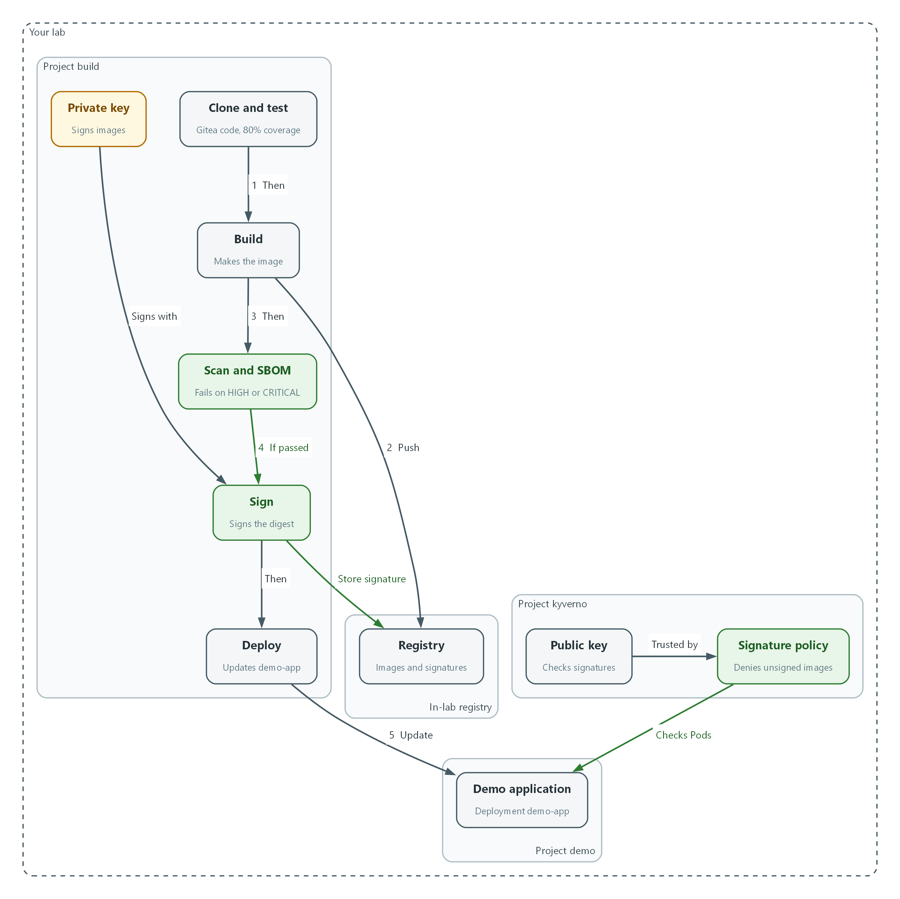
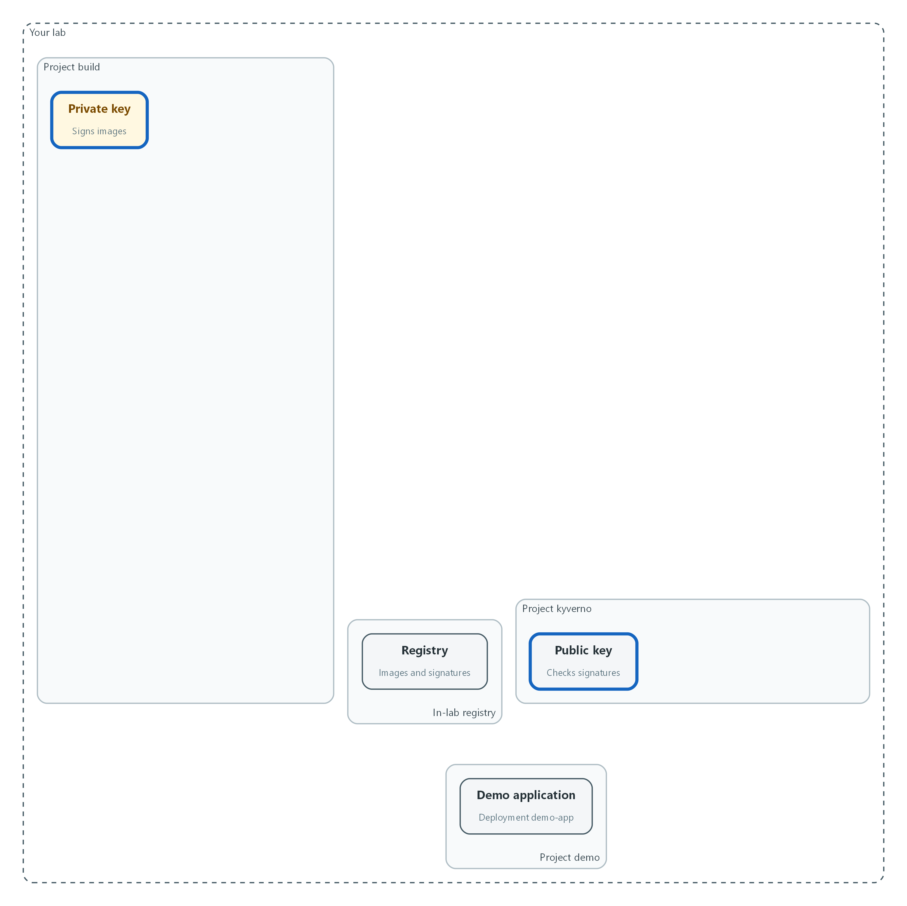
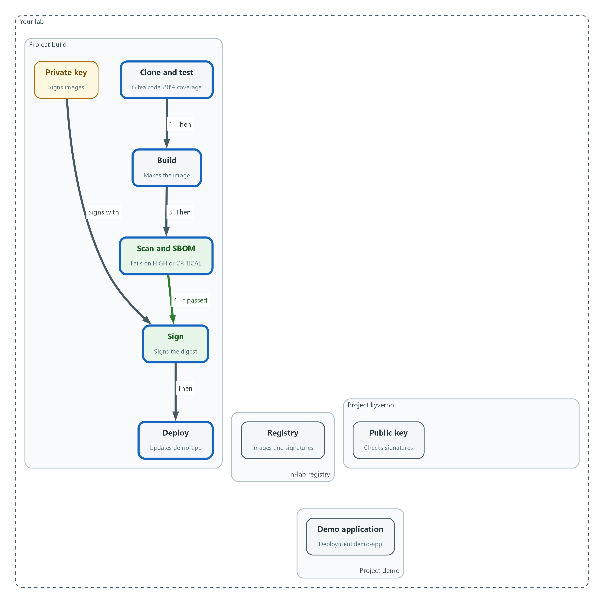
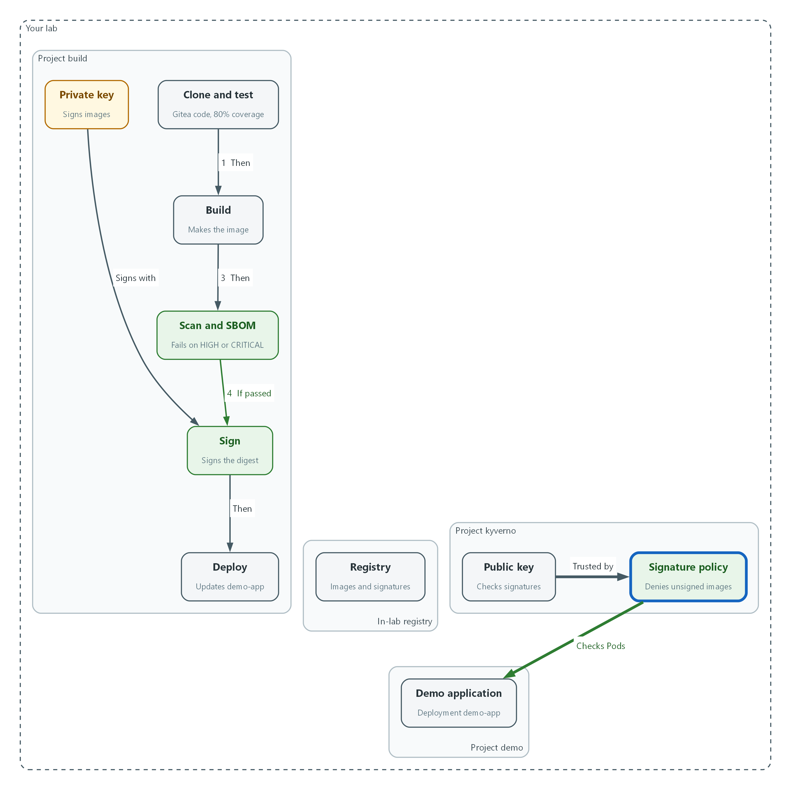
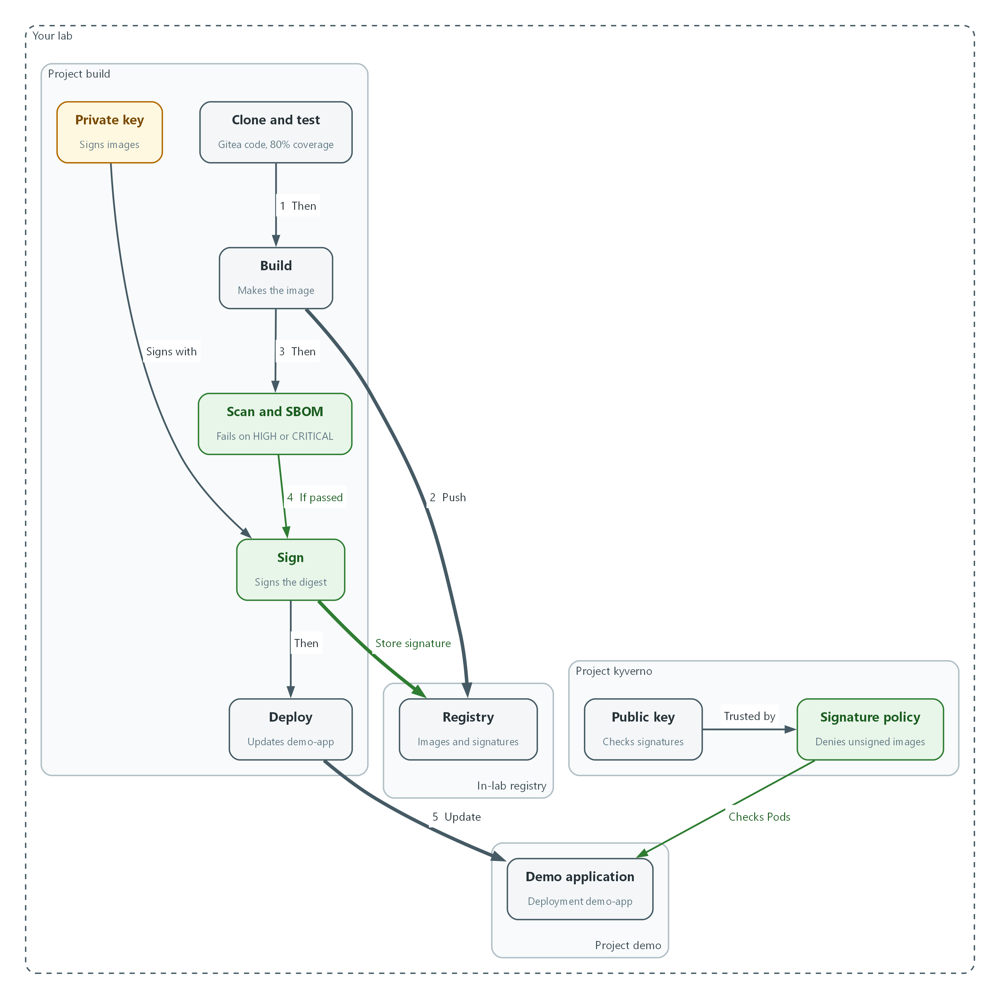

# M09: Secure Release Pipeline (SA-11, SI-7, SR-3)

> 📌 DRAFT. Commands follow the Red Hat OpenShift Pipelines, Kyverno, Cosign and Trivy documentation but have not yet run in the lab. Cosign 3 changed its default signature format. The module keeps the older format with three flags that Cosign 3 marks deprecated and hides from help, so the pipeline checks that Cosign accepts them (`cosign sign ... --help`) before it runs. Kyverno has marked ClusterPolicy deprecated, with removal planned for release 1.20, so the lab must install a Kyverno release that still serves it; the key fields are checked with `oc explain` and a server-side dry run. The Tekton task parameter and result names (git-clone, buildah, openshift-client) are listed from the cluster before they are used.

| Item | Detail |
| --- | --- |
| Sequence | Module 15 of 17 in the recommended order |
| Timed work | About 65 minutes (45 hands-on, 20 verify) |
| Modes | Ready Lab (prebuilt) or Architect (you design and build it) |
| Standalone start | `lab start m09` |
| Combined start | Continue from the end state of the previous module |
| End state | `lab check m09` passes |
| Tools | OpenShift Pipelines (Tekton), Gitea (in-lab git server), Trivy (free, open source), Cosign (free, open source), Kyverno (free, open source), oc, tkn, cosign, jq |
| Prerequisites | Module 0 (terminal and git basics), Module 2 (lab running) |
| Extra lab needs | Gitea repository demo-app under GITEA_USER: a small Python app, a Dockerfile, and a tests folder whose coverage is at least 80 percent on both branches. Branch main has no HIGH or CRITICAL findings. Branch critical-finding uses a base image with at least one CRITICAL finding (confirmed with trivy when the lab is built).; Tool images in REGISTRY_HOST: tools/python-test:lab (Python with the coverage package), tools/trivy:lab, tools/cosign:lab. The Trivy vulnerability database must be reachable from pipeline pods (mirrored or direct).; REGISTRY_HOST repository demo/demo-app accepts pushes from service account pipeline in namespace build. A pull secret named registry-pull exists in namespace kyverno so Kyverno can read signatures. The pipeline service account has a registry credential (a dockerconfigjson secret linked to it) that buildah, Trivy and Cosign use inside pipeline pods.; Cosign in tools/cosign:lab and in the lab shell is version 3.x. Kyverno is a release that still serves ClusterPolicy and verifyImages (1.19 or earlier; the project plans to remove ClusterPolicy in 1.20). Kyverno trusts the registry certificate. The lab shell is logged in to REGISTRY_HOST.; Pipeline pods and the lab shell trust the Gitea and registry certificates. The lab shell has a git credential helper that supplies GITEA_USER and GITEA_TOKEN for GITEA_URL.; Deployment demo-app (container name demo-app) exists in namespace demo, started from an image signed by the lab build. Kyverno, OpenShift Pipelines and its openshift-pipelines tasks are installed. |

## 1. Why This Matters

An IL5 system must not run software it cannot trust. This module builds a release pipeline (an automated sequence of steps that turns source code into a running application) that tests the code, scans the built container image (a packaged copy of the application and everything it needs to run) for known vulnerabilities, records what the image contains in a software bill of materials, and signs the image so its origin can be proven. The cluster then refuses to start any image that is unsigned. Anyone can build an image. Only an image that passed every gate runs.

### Control mapping

| Control | What it requires, in plain words | Source of the value | Where this module covers it |
| --- | --- | --- | --- |
| SA-11 Developer Testing and Evaluation | The people who build the system test it, keep the results as evidence, and fix the flaws the tests find. | NIST; FedRAMP | Step 2 puts the unit tests, the coverage check and the vulnerability scan in the pipeline as gates. Test 2 shows a failing scan stopping the release. |
| SI-7 Software, Firmware, and Information Integrity | Use tools that detect unauthorized changes to software, and act when one is found. | NIST; FedRAMP | Steps 2 and 3 sign the image and make the cluster check the signature. Test 3 shows an unsigned image denied. |
| SR-3 Supply Chain Controls and Processes | Use defined controls to catch weaknesses in the parts and tools your software is built from, and limit the harm if one is bad. | NIST; FedRAMP | Step 2 scans every build, writes an SBOM and signs the result. Test 1 shows the signature and the SBOM attached to the image. |

### What each control is for

Read these answers first. They explain what each control is trying to prevent and how this module's tool meets it.

#### SA-11 Developer Testing and Evaluation

| Question | Answer |
| --- | --- |
| What the control author feared | Code reaches production without anyone having tested it for security flaws, or flaws are found and then forgotten. |
| Is it in scope for the system | Everything the team builds and ships: platform services and tenant applications that go through the release pipeline. |
| The operational question | For the version running right now, can you show which tests and scans ran on it and what they found? |
| What evidence proves it | Test and scan results kept for each build, the gate settings that decide pass or fail, and a record of how flaws are tracked until fixed. |
| How much is enough | Testing covers unit and security checks, results are produced as evidence, flaws are corrected through a verifiable process, and a build that fails the acceptance criteria does not move forward. NIST leaves the testing frequency and the depth and coverage organization-defined; this lab sets a minimum of 80% test coverage where applicable, and its acceptance criteria are no new critical or high-severity vulnerabilities before the gate opens. |
| Who is told when it fails | The developer checks whether each finding is real and owns the fix. A flaw that cannot be fixed right away is documented in a plan of action (a POA&M), and submitted to the ISSO for tracking. |
| How the tool in this module satisfies it | The pipeline runs tests and a scan as gates (Step 2). A failed gate stops everything after it, so a flawed build cannot be signed or deployed. |

#### SI-7 Software, Firmware, and Information Integrity

| Question | Answer |
| --- | --- |
| What the control author feared | Someone swaps or alters the software between the build and the running system, and the system runs it without noticing. |
| Is it in scope for the system | Container images deployed to the cluster. Files on the nodes are covered in module M10. |
| The operational question | Could an image that did not come out of the pipeline start in this cluster? |
| What evidence proves it | The signing key, the admission policy, and a denied-deployment record for an unsigned image. |
| How much is enough | Images are signed at build, the signature is checked before anything runs, and a failed check stops the deployment. NIST leaves the response to a detected change organization-defined; in this lab the admission controller checks the signatures before any Pod starts in the demo namespace, and a failed check refuses the Pod. |
| Who is told when it fails | A denied deployment is logged. The lab's action on detection is to alert the cybersecurity team, which a later module wires to alerts. |
| How the tool in this module satisfies it | Cosign signs the image (Step 2). A Kyverno policy checks the signature on every Pod in the demo namespace (Step 3). |

#### SR-3 Supply Chain Controls and Processes

| Question | Answer |
| --- | --- |
| What the control author feared | A weak or poisoned component inside the software is discovered later, and nobody can tell which systems contain it. |
| Is it in scope for the system | Third-party libraries, base images and build tools that go into what the team ships. |
| The operational question | If a library is announced as dangerous tomorrow, can you list every build that contains it? |
| What evidence proves it | An SBOM for each build, scan results, and signatures that tie each image to the pipeline that made it. |
| How much is enough | Components are inventoried, scanned, and signed, and the controls that do this are documented. NIST leaves the exact list of supply chain controls organization-defined, so this lab uses its own list: hashing and signing every artifact, and an SBOM for third-party software. |
| Who is told when it fails | The ISSO reviews supply chain records. Learners can search stored SBOMs for a named component. |
| How the tool in this module satisfies it | Trivy writes an SBOM and scans (Step 2). Cosign signs the image and attaches the SBOM to it, so the inventory travels with the image. |

### Architect mode brief

Design the release path before building it. Decide which checks must pass before an image is signed, who holds the signing key and how the pipeline reaches it without a person handling it, what the cluster checks before it starts an image, and how you will prove both a good image and a bad image behave correctly. Then build it and run the tests.

### Terms in this module

Each term is also explained the first time it appears. This table is a quick lookup.

| Term | Plain meaning |
| --- | --- |
| Pipeline | An automated sequence of tasks that turns source code into a running application. |
| Task (Tekton) | One unit of work in a pipeline, such as cloning code or running a scan. Each task runs in its own pod. |
| Container image | A packaged copy of an application and everything it needs to run. |
| Registry | A server that stores container images. |
| Gate | A pass or fail check. If it fails, the pipeline stops. |
| Vulnerability scan | A check of the software inside an image against a list of publicly known flaws. |
| SBOM | Software bill of materials: a list of every component inside an image. |
| Digest | A fixed fingerprint of an image's exact contents. A tag can move to a different image. A digest cannot. |
| Signature | A value made with a private key that proves who produced an image and that it was not changed. |
| Admission controller | A cluster component that can accept or refuse a request before the object is created. |

## 2. The Tools

### Tools used in this module

Each tool name links to its official overview. The last column says how the tool is used in the lab.

| Tool (overview link) | What it is | Used in this lab |
| --- | --- | --- |
| [OpenShift Pipelines (Tekton)](https://docs.redhat.com/en/documentation/openshift_container_platform/4.22/html/pipelines/index) | Kubernetes-native CI/CD built on Tekton. | Runs the build, test, scan and sign steps. |
| [tkn](https://docs.redhat.com/en/documentation/openshift_container_platform/4.22/html/cli_tools/pipelines-cli-tkn) | Command-line tool for managing pipelines, runs and tasks. | Starts and watches pipeline runs. |
| [Gitea](https://docs.gitea.com/) | A lightweight self-hosted git server. | Holds the application source. |
| [Trivy](https://trivy.dev/) | Scans images, code and clusters for known flaws and misconfigurations. | Fails the build on serious findings. |
| [Cosign](https://docs.sigstore.dev/cosign/signing/overview/) | Signs container images and verifies the signature. | Signs the built image. |
| [Kyverno](https://kyverno.io/docs/) | A policy engine that checks and enforces rules on Kubernetes resources. | Refuses unsigned images. |
| [oc](https://docs.redhat.com/en/documentation/openshift_container_platform/4.22/html/cli_tools/openshift-cli-oc) | The OpenShift command-line tool for creating and managing applications and projects from a terminal. | Runs the cluster commands in each step. |
| [jq](https://jqlang.org/) | Command-line JSON processor. | Picks fields out of JSON output. |

### How it fits together

#### How an image earns the right to run

The pipeline tests, builds, scans and signs an image, then deploys it. The cluster policy checks the signature before any Pod starts in the demo project. Each step below adds one part, drawn with thick lines.



- The pipeline fetches source from Gitea, tests it, builds the image and pushes it to the registry (flow 1 and 2).
- The scan stops the run if it finds a HIGH or CRITICAL flaw. Only an image that passes is signed (flow 3 and 4).
- The private key in the build project signs the image, and the signature is stored in the registry.
- The deploy task updates demo-app (flow 5).
- The policy in the kyverno project uses the public key to check every Pod in the demo project and denies unsigned images.
### 2.1 Why a release pipeline

What is this? Software is built from parts you did not write: libraries, base images (the starting layer an image is built on) and build tools. A supply chain is that whole chain of parts and the steps that assemble them. An attacker who changes any link gets code into your system without ever touching it.

Why? A pipeline makes the safe path the only path. Every release goes through the same checks, in the same order, and leaves the same evidence. The cluster then trusts only what the pipeline produced.

| Stage | What happens | What it protects against |
| --- | --- | --- |
| Clone | Fetch the source from the in-lab Gitea server | Building from the wrong code |
| Test | Run unit tests and a coverage check | Shipping code nobody tested |
| Build | Make the container image and push it to the registry | Hand-built images with unknown contents |
| Scan and SBOM | Look for known vulnerabilities and list every component | Known-bad components and not knowing what is inside |
| Sign | Sign the image digest and attach the SBOM | Swapped or altered images |
| Deploy | Update the running application to the signed digest | Running something other than what was approved |

### 2.2 The tools

Tekton (shipped as OpenShift Pipelines) runs the pipeline. A Pipeline resource lists the tasks and their order. A PipelineRun is one execution. tkn is the Tekton command-line tool.

Trivy is a scanner. It reads an image, finds the operating system packages and libraries inside, and compares them with a database of known flaws. Each flaw has a severity (LOW, MEDIUM, HIGH or CRITICAL). The same run can write the SBOM in CycloneDX format, one of the standard formats for an SBOM.

Cosign signs images and stores the signature in the registry next to the image. Kyverno is a policy engine that runs as an admission controller. Its verifyImages rule asks the registry for the signature and checks it against a public key before a Pod is allowed to exist.

```text
Gitea --> clone --> test --> build --> scan + SBOM --> sign --> deploy
                              |            |           |         |
                              v            v           v         v
                           registry      FAIL stops   signature  demo-app
                           (image)       the run      in registry

Any Pod in the demo namespace --> Kyverno checks signature --> allowed or denied
```

### 2.3 Keys and signatures

A key pair is two linked keys. The private key signs and must stay secret. The public key checks signatures and can be shared. Anyone with the public key can confirm a signature, but only the holder of the private key can make one.

In this lab the pipeline holds the private key in a Kubernetes secret (a protected object for sensitive values) and Kyverno holds only the public key. Nobody types a key or password.

> 🏭 IN PRODUCTION: In the real environment the private key lives in a hardware security module or a key management service, not in a cluster secret, and signing is limited to the release pipeline identity. The lab uses a secret so you practice the same checks.

## 3. Implement

Ready Lab learners start with `lab start m09`. Architect learners design each step first using the brief above.

### Step 1. Create the signing key and give the pipeline access

The pipeline needs a private key to sign with, Kyverno needs the matching public key, and the pipeline needs permission to read the source in Gitea and update the demo namespace. A service account is an identity for a program instead of a person, and the pipeline runs as one named pipeline. The edit role is limited to the demo project.

What this step adds (thick lines and outlines are new):



- Nothing in the pipeline exists yet. You create the private signing key in the build project and the public key in the kyverno project.
```bash
oc get pods -n build
oc get pods -n kyverno
COSIGN_PASSWORD="$(openssl rand -base64 24)" cosign generate-key-pair k8s://build/cosign-signing
oc get secret cosign-signing -n build -o jsonpath='{.data}' | jq 'keys'
oc get secret cosign-signing -n build -o jsonpath='{.data.cosign\.pub}' | base64 -d > cosign.pub
oc create secret generic cosign-public -n kyverno --from-file=cosign.pub=cosign.pub
```

| Part | What it does |
| --- | --- |
| oc get pods | Confirms the pipeline and Kyverno namespaces are running before you change anything. |
| COSIGN_PASSWORD=... | Sets a random password for this one command only. You never see it or save it; Cosign stores it in the secret. |
| cosign generate-key-pair k8s://build/cosign-signing | Makes a key pair and stores it as a secret named cosign-signing in the build project (a project is a named workspace in the cluster). |
| jq 'keys' | Lists the names of the values in the secret, not the values themselves. |
| base64 -d > cosign.pub | Decodes the public key into a file. Secrets are stored base64-encoded, a text encoding that is not encryption. |
| cosign-public | A second secret that holds only the public key, in the kyverno project. |

```bash
oc create secret generic gitea-clone -n build --type=kubernetes.io/basic-auth \
  --from-literal=username="$GITEA_USER" \
  --from-literal=password="$GITEA_TOKEN"
oc annotate secret gitea-clone -n build tekton.dev/git-0="$GITEA_URL"
oc secrets link pipeline gitea-clone -n build
oc adm policy add-role-to-user edit system:serviceaccount:build:pipeline -n demo
```

| Part | What it does |
| --- | --- |
| gitea-clone | Holds the Gitea user name and token so the clone task can read the repository. |
| tekton.dev/git-0 | Tells Tekton to use this secret for that Gitea address only. |
| oc secrets link | Lets the pipeline service account use the secret. |
| add-role-to-user edit ... -n demo | Lets the pipeline change objects in the demo project, and only that project. |

> 🔒 Never paste passwords or tokens into commands or files. The lab keeps them in environment variables. The password for the signing key is generated for one command and stored only in the secret, so no person types or keeps it.

> ▶ YOUR TURN: Run the commands. Read the key list from jq.

> ✅ CHECKPOINT: The secret lists three names: cosign.key, cosign.password and cosign.pub. The file cosign.pub starts with BEGIN PUBLIC KEY.

### Step 2. Build the pipeline with its gates (SA-11, SR-3, SI-7)

This one file defines the whole release. Read the order: clone, test, build, scan, sign, deploy. A task that fails stops every task after it, which is what makes each one a gate. The scan fails the run when it finds anything at or above the severity in the fail-severity parameter, and this lab blocks on critical and high findings. This lab has no approval step, so every critical or high finding stops the run. The sign task runs only after the scan passes. It signs the digest, not the tag, because a tag can be moved to a different image.

What this step adds (thick lines and outlines are new):



- The pipeline is saved with its gates in order: test, build, scan, sign, deploy. It signs with the private key.
```bash
oc get task git-clone -n openshift-pipelines -o jsonpath='{.spec.params[*].name}'
oc get task buildah -n openshift-pipelines -o jsonpath='{.spec.params[*].name}'
oc get task buildah -n openshift-pipelines -o jsonpath='{.spec.results[*].name}'
oc get task openshift-client -n openshift-pipelines -o jsonpath='{.spec.params[*].name}'
cosign version
cosign sign --use-signing-config=false --new-bundle-format=false --tlog-upload=false --help > /dev/null && echo flags-accepted
```

| Part | What it does |
| --- | --- |
| oc get task git-clone ... params | Prints the parameter names this cluster's clone task accepts. If a name differs from the pipeline below, use the one printed. |
| oc get task buildah ... results | Prints the values the build task reports. The pipeline needs IMAGE_DIGEST. |
| oc get task openshift-client ... params | Prints the parameter names of the deploy task. The pipeline needs SCRIPT, and the script text must start with oc. |
| cosign version | Shows the Cosign release. The lab image is meant to be Cosign 3.x. |
| cosign sign ... --help | Cosign 3 still accepts the three flags the signing task uses but marks them deprecated and hides them from the help text, so this checks that Cosign accepts them. An unknown flag error means the release is too old or too new for this module. |

```yaml
apiVersion: v1
kind: PersistentVolumeClaim
metadata:
  name: source-pvc
  namespace: build
spec:
  accessModes:
    - ReadWriteOnce
  resources:
    requests:
      storage: 1Gi
---
apiVersion: tekton.dev/v1
kind: Pipeline
metadata:
  name: secure-release
  namespace: build
spec:
  params:
    - name: git-url
    - name: git-revision
      default: main
    - name: registry
    - name: test-image
    - name: trivy-image
    - name: cosign-image
    - name: fail-severity
      default: "HIGH,CRITICAL"
  workspaces:
    - name: source
    - name: signing
  tasks:
    - name: clone
      taskRef:
        resolver: cluster
        params:
          - name: kind
            value: task
          - name: name
            value: git-clone
          - name: namespace
            value: openshift-pipelines
      params:
        - name: URL
          value: $(params.git-url)
        - name: REVISION
          value: $(params.git-revision)
      workspaces:
        - name: output
          workspace: source
    - name: test
      runAfter: ["clone"]
      workspaces:
        - name: source
          workspace: source
      taskSpec:
        workspaces:
          - name: source
        steps:
          - name: unit-tests-and-coverage
            image: $(params.test-image)
            workingDir: $(workspaces.source.path)
            script: |
              #!/bin/sh
              set -e
              python -m coverage run -m unittest discover -s tests
              python -m coverage report --fail-under=80
    - name: build
      runAfter: ["test"]
      taskRef:
        resolver: cluster
        params:
          - name: kind
            value: task
          - name: name
            value: buildah
          - name: namespace
            value: openshift-pipelines
      params:
        - name: IMAGE
          value: $(params.registry)/demo/demo-app:$(context.pipelineRun.name)
      workspaces:
        - name: source
          workspace: source
    - name: scan
      params:
        - name: image-ref
          value: $(params.registry)/demo/demo-app@$(tasks.build.results.IMAGE_DIGEST)
      workspaces:
        - name: source
          workspace: source
      taskSpec:
        params:
          - name: image-ref
        workspaces:
          - name: source
        steps:
          - name: make-sbom
            image: $(params.trivy-image)
            command: ["trivy"]
            args: ["image", "--no-progress", "--format", "cyclonedx", "--output", "$(workspaces.source.path)/sbom.cdx.json", "$(params.image-ref)"]
          - name: vulnerability-gate
            image: $(params.trivy-image)
            command: ["trivy"]
            args: ["image", "--no-progress", "--scanners", "vuln", "--severity", "$(params.fail-severity)", "--exit-code", "1", "$(params.image-ref)"]
    - name: sign
      runAfter: ["scan"]
      params:
        - name: image-ref
          value: $(params.registry)/demo/demo-app@$(tasks.build.results.IMAGE_DIGEST)
      workspaces:
        - name: source
          workspace: source
        - name: signing
          workspace: signing
      taskSpec:
        params:
          - name: image-ref
        workspaces:
          - name: source
          - name: signing
        steps:
          - name: sign-image
            image: $(params.cosign-image)
            command: ["cosign"]
            args: ["sign", "--yes", "--key", "$(workspaces.signing.path)/cosign.key", "--tlog-upload=false", "--use-signing-config=false", "--new-bundle-format=false", "$(params.image-ref)"]
            env:
              - name: COSIGN_PASSWORD
                valueFrom:
                  secretKeyRef:
                    name: cosign-signing
                    key: cosign.password
          - name: attach-sbom
            image: $(params.cosign-image)
            command: ["cosign"]
            args: ["attest", "--yes", "--key", "$(workspaces.signing.path)/cosign.key", "--type", "cyclonedx", "--predicate", "$(workspaces.source.path)/sbom.cdx.json", "--tlog-upload=false", "--use-signing-config=false", "--new-bundle-format=false", "$(params.image-ref)"]
            env:
              - name: COSIGN_PASSWORD
                valueFrom:
                  secretKeyRef:
                    name: cosign-signing
                    key: cosign.password
    - name: deploy
      runAfter: ["sign"]
      taskRef:
        resolver: cluster
        params:
          - name: kind
            value: task
          - name: name
            value: openshift-client
          - name: namespace
            value: openshift-pipelines
      params:
        - name: SCRIPT
          value: |
            oc set image deployment/demo-app demo-app=$(params.registry)/demo/demo-app@$(tasks.build.results.IMAGE_DIGEST) -n demo
            oc rollout status deployment/demo-app -n demo --timeout=120s

```

| Part | What it does |
| --- | --- |
| PersistentVolumeClaim source-pvc | A request for disk space that the tasks share, so the cloned code and the SBOM carry from one task to the next. |
| params | Values you supply at run time: the repository, the branch, the registry and the three tool images from the approved registry. fail-severity decides what the scan treats as a failure. |
| clone | Fetches the code from Gitea using the cluster resolver, which pulls a ready-made task from the openshift-pipelines project. |
| test | Runs the unit tests and fails if coverage is under 80%, the lab minimum. |
| build | Builds the image and pushes it. The tag is the name of the run. The task reports the digest. |
| scan | First writes the SBOM, then runs the vulnerability gate. A non-zero exit code means the gate failed. |
| sign | Signs the image digest, then attaches the SBOM as a signed attestation (a signed statement about the image). Transparency log upload is off because the lab has no public log. |
| deploy | Points the demo-app deployment at the signed digest and waits for it to roll out. |

```bash
oc apply -f secure-release.yaml --dry-run=server
oc apply -f secure-release.yaml
tkn pipeline list -n build
```

| Part | What it does |
| --- | --- |
| --dry-run=server | Asks the cluster to check the file without saving it. |
| oc apply -f | Saves the pipeline and the storage claim. |
| tkn pipeline list | Shows the saved pipeline. |

> 💡 Keep secure-release.yaml in git. Git shows who changed the pipeline and when, which supports change control (CM-3), and limiting who can push to that repository supports CM-5.

> ▶ YOUR TURN: Save the YAML as secure-release.yaml, check the parameter names, validate it, then apply it.

> ✅ CHECKPOINT: tkn lists the pipeline named secure-release.

### Step 3. Make the cluster refuse unsigned images (SI-7)

Signing proves nothing unless something checks. Kyverno is a policy engine that runs as an admission controller, a cluster component that can accept or refuse a request before the object is created. This policy applies to every Pod in the demo project. Enforce mode means a Pod whose image has no valid signature from the public key is denied, not just reported.

What this step adds (thick lines and outlines are new):



- The Kyverno policy is saved. It will check every Pod in the demo project against the public key.
```yaml
apiVersion: kyverno.io/v1
kind: ClusterPolicy
metadata:
  name: require-signed-images
spec:
  background: false
  webhookConfiguration:
    timeoutSeconds: 30
  rules:
    - name: verify-signature
      match:
        any:
          - resources:
              kinds:
                - Pod
              namespaces:
                - demo
      verifyImages:
        - imageReferences:
            - "*"
          failureAction: Enforce
          required: true
          mutateDigest: true
          verifyDigest: true
          imageRegistryCredentials:
            secrets:
              - registry-pull
          attestors:
            - count: 1
              entries:
                - keys:
                    publicKeys: "k8s://kyverno/cosign-public"
                    rekor:
                      ignoreTlog: true

```

| Part | What it does |
| --- | --- |
| failureAction: Enforce | Deny the request on failure. Audit would only log it. |
| match ... namespaces: demo | Applies to Pods in the demo project. |
| verifyImages / imageReferences "*" | Every image used by those Pods must be verified. |
| required, mutateDigest, verifyDigest | The signature is required, and the image tag is replaced by its digest so what was checked is what runs. |
| imageRegistryCredentials | The secret Kyverno uses to read signatures from the registry. |
| publicKeys k8s://kyverno/cosign-public | Reads the public key from the secret you made in Step 1. |
| rekor ignoreTlog | Skips the public transparency log check. The lab does not upload to a public log. |

```bash
oc explain clusterpolicy.spec.rules.verifyImages --recursive | grep -e failureAction -e imageRegistryCredentials
oc explain clusterpolicy.spec.rules.verifyImages.attestors.entries.keys
oc apply -f require-signed-images.yaml --dry-run=server
oc apply -f require-signed-images.yaml
oc get clusterpolicy require-signed-images
```

| Part | What it does |
| --- | --- |
| oc explain ... | Prints the policy fields your Kyverno release accepts. If a field name differs, use the one it shows. |
| --dry-run=server | Asks the cluster to check the file without saving it. |
| oc get clusterpolicy | Shows the policy and whether it is ready. |

> 📌 Kyverno reads signatures from the registry, so it needs the pull secret named registry-pull in the kyverno project. The lab start loads it.

> ▶ YOUR TURN: Save the YAML as require-signed-images.yaml, validate it, apply it, and read the policy status.

> ✅ CHECKPOINT: The policy shows READY true.

### Step 4. Run the pipeline on clean code

Run the whole release on branch main, which has no blocking findings. Watch each task pass in order.

What this step adds (thick lines and outlines are new):



- A run on clean code fetches the source, pushes and signs the image, and deploys it. The policy checks the signature on the Pod.
```bash
tkn pipeline start secure-release -n build \
  -p git-url="$GITEA_URL/$GITEA_USER/demo-app.git" \
  -p git-revision=main \
  -p registry="$REGISTRY_HOST" \
  -p test-image="$REGISTRY_HOST/tools/python-test:lab" \
  -p trivy-image="$REGISTRY_HOST/tools/trivy:lab" \
  -p cosign-image="$REGISTRY_HOST/tools/cosign:lab" \
  -s pipeline \
  -w name=source,claimName=source-pvc \
  -w name=signing,secret=cosign-signing \
  --showlog
```

| Part | What it does |
| --- | --- |
| tkn pipeline start | Starts one run of the pipeline. |
| -p name=value | Supplies a parameter. The repository, registry and tool images all come from lab variables, so no secret is typed. |
| -s pipeline | Runs the tasks as the pipeline service account from Step 1. |
| -w name=source,claimName=source-pvc | Attaches the shared disk to the source workspace. |
| -w name=signing,secret=cosign-signing | Attaches the signing key secret to the signing workspace. |
| --showlog | Streams the logs so you can watch. |

> ▶ YOUR TURN: Run the command and watch the tasks finish in order.

> ✅ CHECKPOINT: The last lines show the deploy task finishing and the rollout completing.

## 4. Verify It Works

### Test 1 (positive). A clean signed image deploys, with its SBOM attached

Do not trust the green run. Ask the registry for the signature, ask for the SBOM, and look at what the cluster is actually running.

```bash
RUN=$(tkn pipelinerun describe --last -n build -o jsonpath='{.metadata.name}')
DIGEST=$(oc get taskrun -n build -l tekton.dev/pipelineRun=$RUN,tekton.dev/pipelineTask=build -o jsonpath='{.items[0].status.results[*].value}' | tr ' ' '\n' | grep '^sha256:')
IMAGE="$REGISTRY_HOST/demo/demo-app@$DIGEST"
cosign verify --key cosign.pub --insecure-ignore-tlog=true --new-bundle-format=false "$IMAGE" | jq -r '.[0].critical.image."docker-manifest-digest"'
cosign verify-attestation --key cosign.pub --type cyclonedx --insecure-ignore-tlog=true --new-bundle-format=false "$IMAGE" | jq -r '.payload' | base64 -d | jq -r '.predicateType'
oc get deployment demo-app -n demo -o jsonpath='{.spec.template.spec.containers[0].image}'
```

**Expected output:**

```
Example only. Your digest will differ.
sha256:3f1c0a9e5b7d2c4a8e6f1b0d9c3a7e5f2b4d6c8a0e1f3b5d7c9a1e3f5b7d9c0a
https://cyclonedx.org/bom
registry.lab.internal/demo/demo-app@sha256:3f1c0a9e5b7d2c4a8e6f1b0d9c3a7e5f2b4d6c8a0e1f3b5d7c9a1e3f5b7d9c0a
```

> ✅ CHECKPOINT: The verified digest matches the digest the deployment runs, and the attestation type is a CycloneDX SBOM.

### Test 2 (negative). An image with a critical finding fails the gate

Run the same pipeline on branch critical-finding, which uses a base image with a known critical flaw. The scan should stop the run before anything is signed or deployed.

```bash
tkn pipeline start secure-release -n build \
  -p git-url="$GITEA_URL/$GITEA_USER/demo-app.git" \
  -p git-revision=critical-finding \
  -p registry="$REGISTRY_HOST" \
  -p test-image="$REGISTRY_HOST/tools/python-test:lab" \
  -p trivy-image="$REGISTRY_HOST/tools/trivy:lab" \
  -p cosign-image="$REGISTRY_HOST/tools/cosign:lab" \
  -s pipeline \
  -w name=source,claimName=source-pvc \
  -w name=signing,secret=cosign-signing \
  --showlog || true
tkn pipelinerun describe --last -n build -o jsonpath='{.status.conditions[0].reason}'
echo
oc get deployment demo-app -n demo -o jsonpath='{.spec.template.spec.containers[0].image}'
```

**Expected output:**

```
Example only. Names and counts will differ.
[scan : vulnerability-gate] Total: 1 (HIGH: 0, CRITICAL: 1)
(a table listing each finding follows)
Failed
registry.lab.internal/demo/demo-app@sha256:3f1c0a9e5b7d2c4a8e6f1b0d9c3a7e5f2b4d6c8a0e1f3b5d7c9a1e3f5b7d9c0a
```

> ✅ CHECKPOINT: The run is Failed at the scan task, the sign and deploy tasks never ran, and the running image is still the digest from Test 1.

### Test 3 (negative). An unsigned image is denied

The failed run in Test 2 built and pushed its image before the scan stopped it, but it was never signed. Try to start a Pod from it. The admission check should deny it.

```bash
FAILED_RUN=$(tkn pipelinerun describe --last -n build -o jsonpath='{.metadata.name}')
oc run unsigned-test -n demo --image="$REGISTRY_HOST/demo/demo-app:$FAILED_RUN" --restart=Never
oc get pod unsigned-test -n demo
```

**Expected output:**

```
Example only. The exact wording depends on your Kyverno release.
Error from server: admission webhook "mutate.kyverno.svc-fail" denied the request:
resource Pod/demo/unsigned-test was blocked due to the following policies
require-signed-images:
  verify-signature: 'failed to verify image: no signatures found'
Error from server (NotFound): pods "unsigned-test" not found
```

> ✅ CHECKPOINT: Kyverno names the policy require-signed-images in the denial, and no Pod exists.

Run `lab check m09` to run these tests automatically. It checks:

- The secure-release pipeline exists and the signing key and public key secrets exist.
- A run on branch main finishes, and the demo-app image in the demo namespace is signed and has an SBOM attached.
- A run on branch critical-finding fails at the scan task and the running image does not change.
- A Pod using an unsigned image is denied by Kyverno in the demo namespace.
## 5. Glossary and Next Steps

| Term | Meaning |
| --- | --- |
| Tekton | The pipeline engine inside OpenShift Pipelines. |
| PipelineRun | One execution of a pipeline. |
| Trivy | A free scanner for vulnerabilities in container images. |
| Cosign | A free tool that signs and verifies container images. |
| Kyverno | A policy engine that can refuse requests to the cluster. |
| Attestation | A signed statement about an image, such as its SBOM. |
| CycloneDX | A standard file format for an SBOM. |
| Severity | How serious a vulnerability is: LOW, MEDIUM, HIGH or CRITICAL. |
| Service account | An identity for a program instead of a person. |
| POA&M | Plan of Action and Milestones: the record of a known weakness and the plan to fix it. |
| Public and private key | A linked pair. The private key signs, the public key checks. |

> 💡 Next module: M10 GitOps and Change Control: deploy by git change only, revert manual changes, and restrict who can change production.
