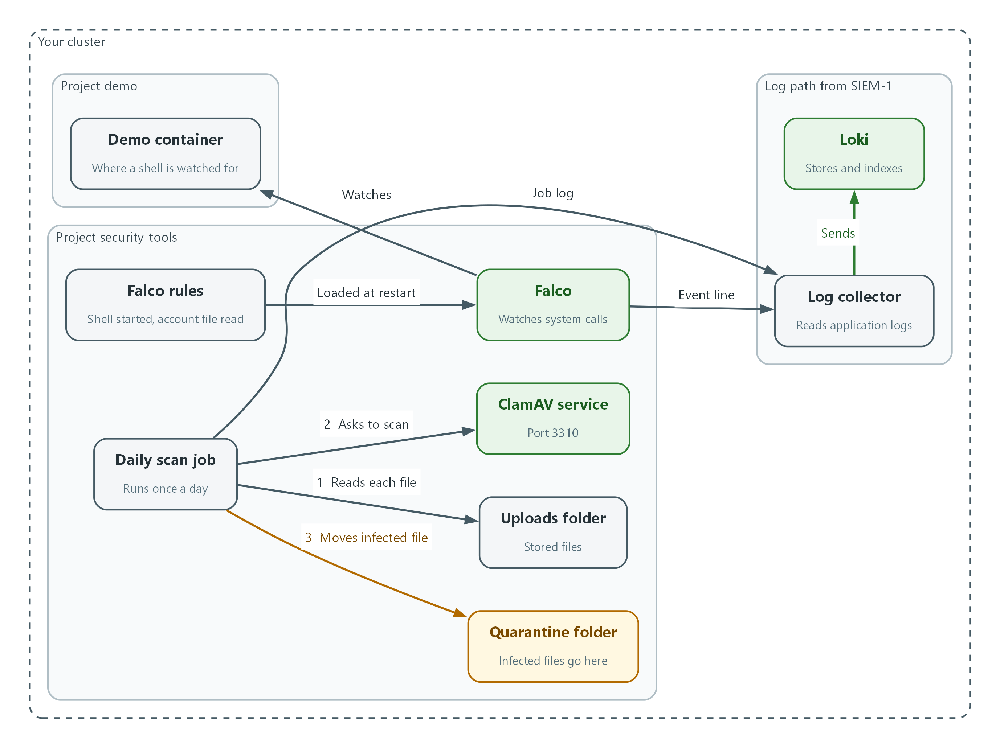
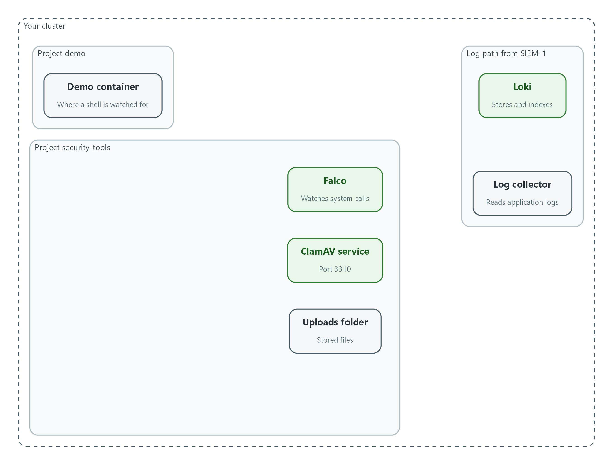
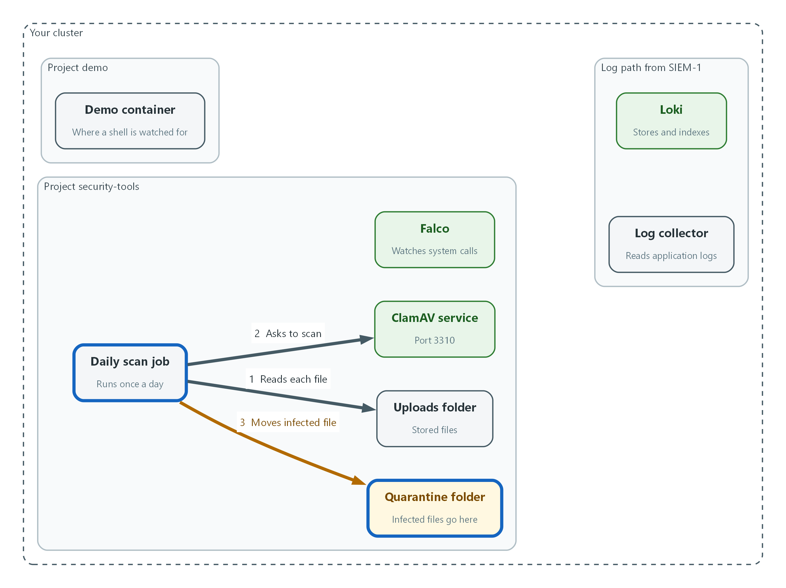
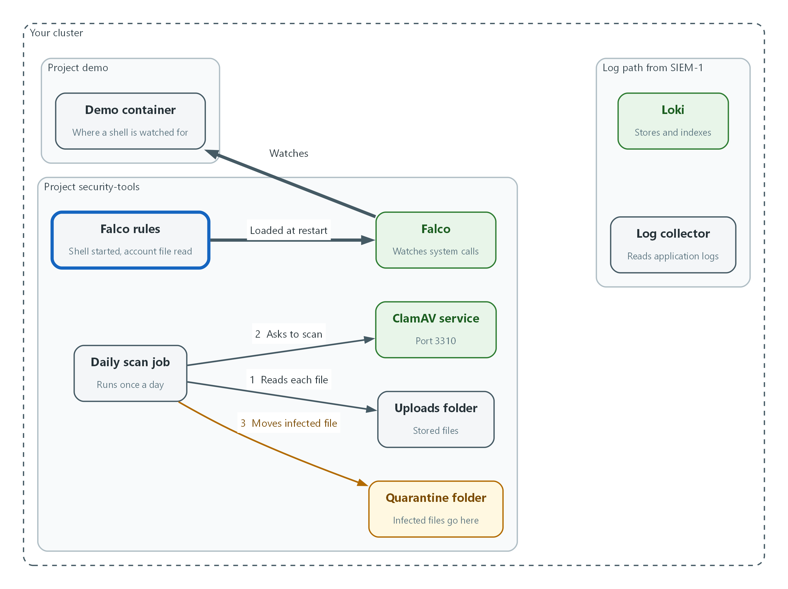
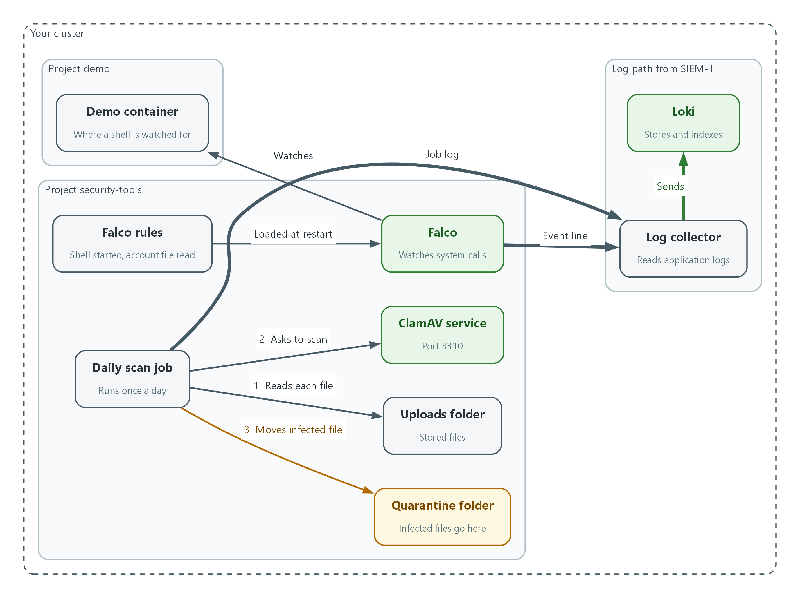

# M11: Malware and Runtime Detection (SI-3, SI-4)

> 📌 DRAFT. Commands follow the ClamAV and Falco documentation but have not yet run in the lab. The clamdscan options (--stream, --config-file, --no-summary, --version, the dash for standard input, exit code 1 for a detection) match the clamdscan manual page. Confirm them with clamdscan --help in the lab image. The Falco rule fields match the Falco rule reference and the current default rules (the old evt.dir test is no longer used, so the shell rule does not use it). Confirm the whole rules file with: oc exec -n security-tools daemonset/falco -c falco -- falco -V /etc/falco/rules.d/demo-rules.yaml. The k8s.ns.name and k8s.pod.name fields need Falco container metadata, so confirm a pod name appears in the event. Falco prints plain text unless json_output is true, and the lab must set it. Loki label names depend on the Logging release, so the log search is shown with the labels the Red Hat collector normally adds.

| Item | Detail |
| --- | --- |
| Sequence | Module 11 of 17 in the recommended order |
| Timed work | About 65 minutes (45 hands-on, 20 verify) |
| Modes | Ready Lab (prebuilt) or Architect (you design and build it) |
| Standalone start | `lab start m11` |
| Combined start | Continue from the end state of the previous module |
| End state | `lab check m11` passes |
| Tools | OpenShift Container Platform, ClamAV (free, open source), Falco (free, open source), Loki (free, open source), oc, curl, jq |
| Prerequisites | Module 0 (terminal and git basics), Module 2 (lab running), SIEM-1 (log forwarder sending application logs to Loki) |
| Extra lab needs | ClamAV running as deployment clamav in security-tools with clamd listening on port 3310, freshclam keeping the signature database current, and a persistent volume claim named uploads mounted at /scan (folders uploads and quarantine). The image has sh and find, and the claim can be mounted by the scan job on the same node.; Falco running as daemonset falco in security-tools with the modern_ebpf engine (engine.kind), json_output set to true, standard output enabled, and container metadata so k8s.ns.name and k8s.pod.name are filled (the Falco container plugin reading the CRI-O socket, which the Falco Helm chart enables by default as collectors.containerEngine). It runs with the privileges that engine needs on the OpenShift node.; The config map falco-custom-rules already exists (it can be empty) and is mounted at /etc/falco/rules.d, which is in Falco's default rules_files list.; A writable shell (sh) in the demo-app image. |

## 1. Why This Matters

An IL5 system must look for malicious code in files that enter it, scan on a schedule, and act when something is found. It must also watch what running software does, so that behavior that should never happen, such as a person opening a shell inside a running container, is noticed and sent to the SIEM. This module sets up both: ClamAV for files and uploads, and Falco for runtime behavior, with results flowing to Loki through the log forwarder you built earlier.

### Control mapping

| Control | What it requires, in plain words | Source of the value | Where this module covers it |
| --- | --- | --- | --- |
| SI-3 Malicious Code Protection | Scan files as they arrive and on a schedule, and quarantine or block what is found. | NIST; FedRAMP | Step 2 sets the daily scan and quarantine. Tests 1 and 2 prove detection and quarantine with the EICAR test file. |
| SI-4 System Monitoring | Watch the system for attacks and signs of attack, analyze what is seen, and tell the right people. | NIST; FedRAMP | Step 3 writes the Falco rules and Step 4 checks the log path. Test 3 shows the event in Loki. Test 4 proves that disabling the rules removes the event and that restoring them brings it back. |

### What each control is for

Read these answers first. They explain what each control is trying to prevent and how this module's tool meets it.

#### SI-3 Malicious Code Protection

| Question | Answer |
| --- | --- |
| What the control author feared | Malware arrives in an uploaded file or sits on storage unnoticed, because nothing scanned it when it came in and nothing scans it later. |
| Is it in scope for the system | Files the system receives or stores. |
| The operational question | If someone uploaded an infected file an hour ago, would anything have caught it, and where is the file now? |
| What evidence proves it | The scan configuration, the signature database version and date, a detection record, and the quarantine location. |
| How much is enough | Files are scanned during upload and download, a scan is scheduled daily, detected content is quarantined, and signatures update automatically where possible. This lab does those four things. This module sets no false-positive exemption. NIST leaves the scan frequency organization-defined and FedRAMP sets at least weekly, so the lab's daily scan meets both. |
| Who is told when it fails | NIST requires an alert to organization-defined personnel when malicious code is detected, and FedRAMP sets administrator or defined security personnel, in near real time. The recipient is organization-defined, so find it in the system's alerting procedure. This module writes the detection to the job log, which the collector sends to Loki. It does not build the alert. SIEM-3 shows how to build a Loki alert rule, and a rule on the word QUARANTINED would use the same method. FedRAMP selects both signature-based and non-signature-based mechanisms for SI-3(a). ClamAV is signature-based. This module does not build a non-signature mechanism, such as network traffic inspection at ingress and egress points. |
| How the tool in this module satisfies it | ClamAV scans uploads on demand (Test 1) and a daily scheduled job scans stored uploads and moves infected files to quarantine (Step 2, Test 2). |

#### SI-4 System Monitoring

| Question | Answer |
| --- | --- |
| What the control author feared | An attacker or a careless administrator does something unusual inside a running container, and no record exists because only the start and stop of the container were logged. |
| Is it in scope for the system | Containers and nodes the team operates. |
| The operational question | If someone opened a shell inside a running application container right now, would the SIEM know within minutes? |
| What evidence proves it | The detection rules, a sample event in the SIEM, and proof that turning a rule off changes what is detected. |
| How much is enough | Defined behaviors are watched, detections reach the SIEM, and the people who analyze them can find them. NIST leaves the monitoring objectives for attacks and indicators of potential attacks organization-defined; this lab sets them as improper system functioning and indicators of system malfunction or compromise. SI-4 separately requires detecting unauthorized local, network and remote connections. In this lab the ISSO coordinates alerts to system owners and users of heightened threats. |
| Who is told when it fails | A person is told when the event appears. This module proves the event reaches Loki and does not build the alert. SIEM-3 shows how to build a Loki alert rule, and a rule on the Falco rule name would use the same method. |
| How the tool in this module satisfies it | Falco watches system calls inside containers and prints a JSON line per match. The collector forwards it to Loki (Step 3, Tests 3 and 4). |

### Architect mode brief

Design the detection before building it. Decide which files and uploads must be scanned and when, where infected files go, which two or three container behaviors are never legitimate in the demo project, and how each detection will reach the SIEM. Then build it and run the tests.

### Terms in this module

Each term is also explained the first time it appears. This table is a quick lookup.

| Term | Plain meaning |
| --- | --- |
| Malware | Malicious software, such as a virus or ransomware. |
| Signature | A pattern that identifies a known piece of malware. Scanners compare files to a database of signatures. |
| ClamAV | A free, open source malware scanner. Its scanning service is called clamd, and clamdscan is the command that asks clamd to scan. |
| EICAR test file | A short harmless text string that every antivirus product agrees to treat as malware, used to test detection safely. |
| Quarantine | Moving a suspicious file to a separate place where it cannot be used. |
| Falco | A free, open source tool that watches what running containers do and raises an event when behavior matches a rule. |
| System call | A request a program makes to the operating system, such as opening a file or starting another program. Falco watches these. |
| Rule (Falco) | A condition describing behavior to watch for, plus the message to print when it happens. |
| Container | A packaged program running in isolation on a node. |
| CronJob | An OpenShift object that runs a task on a repeating schedule. |

## 2. The Tools

### Tools used in this module

Each tool name links to its official overview. The last column says how the tool is used in the lab.

| Tool (overview link) | What it is | Used in this lab |
| --- | --- | --- |
| [ClamAV](https://docs.clamav.net/) | Open-source antivirus with a daemon, command-line scanner and signature updater. | Scans uploaded files for malware. |
| [Falco](https://falco.org/docs/) | Watches system calls and alerts in real time when a rule detects suspicious behavior. | Detects suspicious behavior inside running containers. |
| [Grafana Loki](https://grafana.com/docs/loki/latest/) | Log storage that indexes only labels and keeps compressed log data in object storage. | Receives the alerts for review. |
| [OpenShift Container Platform](https://docs.redhat.com/en/documentation/openshift_container_platform/4.22/html/overview/ocp-overview) | A Kubernetes container platform for running and managing containerized applications. | The cluster every command in this module runs against. |
| [oc](https://docs.redhat.com/en/documentation/openshift_container_platform/4.22/html/cli_tools/openshift-cli-oc) | The OpenShift command-line tool for creating and managing applications and projects from a terminal. | Runs the cluster commands in each step. |
| [jq](https://jqlang.org/) | Command-line JSON processor. | Picks fields out of JSON output. |
| [curl](https://curl.se/docs/manpage.html) | Command-line tool for transferring data over URLs, used here to call web endpoints. | Calls web endpoints to test behavior. |

### How it fits together

#### Two detectors, one path to the log store

ClamAV looks inside files and Falco watches what running containers do. Both write their findings to logs, and the log collector from SIEM-1 carries those logs to Loki. Each step below adds parts, drawn with thick lines.



- The daily scan job reads each stored file, asks ClamAV to scan it (flow 2), and moves an infected file to the quarantine folder (flow 3).
- The Falco rules are loaded by Falco, which watches the demo container for a shell or a read of the account file.
- The job log and the Falco event lines are read by the log collector and sent to Loki.
### 2.1 Two ways to find bad things

What is this? Scanning looks at files and compares them to known bad patterns. Runtime detection looks at behavior while software runs and compares it to rules about what should never happen.

Why both? A scanner catches known malware in files but cannot see a person typing commands in a running container. Runtime detection sees that behavior but does not inspect file contents. Together they cover both.

| Tool | Looks at | Example finding | Control |
| --- | --- | --- | --- |
| ClamAV | File contents | The EICAR test file in an upload | SI-3 |
| Falco | System calls in containers | A shell started in the demo container | SI-4 |

### 2.2 How ClamAV is used here

ClamAV runs as a service (clamd) in the security-tools project. Anything that accepts uploads can stream a file to it and get back OK or FOUND. A CronJob (a task OpenShift runs on a schedule) does the same for files already stored, and moves infected files to a quarantine folder.

This lab scans during upload and download, runs a daily scheduled scan, quarantines detected content, and updates signatures automatically where possible.

```text
Upload or stored file --> clamdscan --> clamd (signature database)
                                          |
                         OK -> keep   FOUND -> move to /scan/quarantine, print QUARANTINED
                                                       |
                                       job log --> collector --> Loki
```

### 2.3 How Falco is used here

Falco runs on each node and watches system calls. Each rule has a condition and an output message. When a call matches, Falco prints one JSON line to its standard output. The log collector already reads application logs, so the line travels to Loki with no extra connector.

Rules live in a config map (an OpenShift object that holds settings). Because it is a file, the rule set can be kept in git and changed through change control.

| Rule part | What it means |
| --- | --- |
| condition | The behavior to match, written with Falco fields such as proc.name and k8s.ns.name. |
| output | The message printed when the condition matches. |
| priority | How serious the match is, for example WARNING. |
| enabled | true or false. A rule set to false never fires. |

> 🏭 IN PRODUCTION: In the real environment the SIEM raises the alert to the ISSO and the Platform Team and opens the investigation. The lab stops at the point where the event is visible in Loki.

## 3. Implement

Ready Lab learners start with `lab start m11`. Architect learners design each step first using the brief above.

### Step 1. Check what you have

Confirm ClamAV and Falco are running and that ClamAV has a signature database before changing anything. A scanner with an old or missing database finds nothing.

What this step adds (thick lines and outlines are new):



- Nothing is new yet. ClamAV, Falco, the uploads folder and the demo container already run, and you only check them.
```bash
oc get pods -n security-tools
oc exec -n security-tools deploy/clamav -- clamdscan --version
oc logs daemonset/falco -c falco -n security-tools --tail=5
```

| Part | What it does |
| --- | --- |
| oc get pods -n security-tools | Lists the programs running in the security tools project. |
| clamdscan --version | Asks the ClamAV service for its version, database number and database date. The date shows whether signatures are being updated. |
| oc logs daemonset/falco ... | Prints the last few Falco log lines so you can see it started and loaded rules. |

> ▶ YOUR TURN: Run the three commands. Note the database date in the ClamAV answer.

> ✅ CHECKPOINT: The ClamAV pod and a Falco pod are Running, and the version line includes a date.

### Step 2. Scan every day and quarantine what is found (SI-3)

This lab uses a daily scheduled scan and quarantines detected content. This file creates a client setting that points at the ClamAV service and a CronJob that scans the uploads folder and moves any infected file to quarantine. The job image is the same one ClamAV already runs, so no new image is pulled.

What this step adds (thick lines and outlines are new):



- A daily scan job asks ClamAV to scan every stored upload, and moves any infected file to the quarantine folder.
```yaml
apiVersion: v1
kind: ConfigMap
metadata:
  name: clamd-client
  namespace: security-tools
data:
  clamd.conf: |
    TCPSocket 3310
    TCPAddr clamav.security-tools.svc
---
apiVersion: batch/v1
kind: CronJob
metadata:
  name: clamav-daily-scan
  namespace: security-tools
spec:
  schedule: "0 3 * * *"
  concurrencyPolicy: Forbid
  jobTemplate:
    spec:
      backoffLimit: 0
      template:
        spec:
          restartPolicy: Never
          containers:
            - name: scan
              image: IMAGE_VALUE
              command: ["/bin/sh", "-c"]
              args:
                - |
                  mkdir -p /scan/quarantine
                  find /scan/uploads -type f | while read -r f; do
                    clamdscan --stream --no-summary --config-file=/etc/clamd-client/clamd.conf "$f"
                    rc=$?
                    if [ "$rc" -eq 1 ]; then mv "$f" /scan/quarantine/; echo "QUARANTINED $f"; fi
                    if [ "$rc" -gt 1 ]; then echo "SCAN-ERROR $f"; fi
                  done
              volumeMounts:
                - name: scan-data
                  mountPath: /scan
                - name: clamd-client
                  mountPath: /etc/clamd-client
          volumes:
            - name: scan-data
              persistentVolumeClaim:
                claimName: uploads
            - name: clamd-client
              configMap:
                name: clamd-client
```

| Part | What it does |
| --- | --- |
| ConfigMap clamd-client | A small settings file that tells the scan job where the ClamAV service is (port 3310 on the clamav service). |
| schedule: "0 3 * * *" | Runs once a day. The lab scans daily and picks 03:00 as the time of day. |
| image: IMAGE_VALUE | A placeholder. The next block replaces it with the image ClamAV already uses. |
| find ... | while read | Takes every stored upload one at a time. |
| clamdscan --stream ... | Sends the file to ClamAV and prints OK or FOUND. |
| rc=$? | Keeps the exit code of clamdscan: 0 means clean, 1 means malware found, 2 means an error. |
| [ "$rc" -eq 1 ] | Only a code of 1 (malware found) makes the script move the file. |
| SCAN-ERROR | A file that could not be scanned is named in the log instead of being skipped silently. |
| mv ... /scan/quarantine/ | Quarantines the file by moving it out of the uploads folder. |
| echo QUARANTINED | Writes a line to the job log. The collector sends it to Loki. |
| persistentVolumeClaim uploads | The storage that holds uploaded files, shared with the ClamAV service. |

```bash
IMG=$(oc get deploy clamav -n security-tools -o jsonpath='{.spec.template.spec.containers[0].image}')
sed "s|IMAGE_VALUE|$IMG|" clamav-scan.yaml | oc apply -f - --dry-run=server
sed "s|IMAGE_VALUE|$IMG|" clamav-scan.yaml | oc apply -f -
oc get cronjob -n security-tools
```

| Part | What it does |
| --- | --- |
| IMG=$(...) | Reads the image name from the running ClamAV deployment and keeps it in a shell variable. |
| sed "s|IMAGE_VALUE|$IMG|" | Swaps the placeholder for the real image name and passes the result on. |
| --dry-run=server | Asks the cluster to check the objects without saving them. |
| oc apply -f - | Saves the objects, or updates them if they exist. The dash means the file comes from the previous command. |
| oc get cronjob | Shows the new scheduled job. |

> 📌 On-demand scanning of uploads uses the same service: an upload handler streams the file to clamdscan before accepting it. Test 1 shows that call.

> 🔒 ClamAV documents that clamd does not protect or authenticate traffic on its TCP socket, so allow connections to port 3310 only from the scan job and the upload handler (a NetworkPolicy, an OpenShift rule that limits which pods may connect).

> 💡 Keep clamav-scan.yaml in git, so changes to the scan schedule show who changed it and when.

> ▶ YOUR TURN: Save the YAML as clamav-scan.yaml, then run the second block.

> ✅ CHECKPOINT: The cronjob clamav-daily-scan is listed with the schedule you set.

### Step 3. Write the Falco rules (SI-4)

Falco only reports behavior that a rule describes. These two rules watch the demo project for a shell being started in a container and for the account file being read. Each rule prints a message that contains the command line, which lets you find your own test later. The rules are saved in a config map that Falco loads at start, so Falco is restarted after the change.

What this step adds (thick lines and outlines are new):



- The Falco rules say which behavior to report. Falco loads them and watches the demo container for a shell or a read of the account file.
```yaml
apiVersion: v1
kind: ConfigMap
metadata:
  name: falco-custom-rules
  namespace: security-tools
data:
  demo-rules.yaml: |
    - rule: Shell Spawned in Demo Container
      desc: A shell was started inside a container in the demo project
      condition: >
        evt.type in (execve, execveat) and container.id != host
        and k8s.ns.name = demo and proc.name in (sh, bash)
      output: "Shell started in container (user=%user.name pod=%k8s.pod.name command=%proc.cmdline)"
      priority: WARNING
      enabled: true
      tags: [container, shell]
    - rule: Passwd File Read in Demo Container
      desc: The account file was opened for reading inside a container in the demo project
      condition: >
        evt.type in (open, openat, openat2) and evt.is_open_read=true
        and fd.typechar='f' and fd.num>=0 and fd.name=/etc/passwd
        and container.id != host and k8s.ns.name = demo
      output: "Account file read in container (user=%user.name pod=%k8s.pod.name process=%proc.name)"
      priority: WARNING
      enabled: true
      tags: [container, filesystem]
```

| Part | What it does |
| --- | --- |
| rule: Shell Spawned in Demo Container | The name of the first rule. It appears in every event it raises. |
| evt.type in (execve, execveat) | Matches the moment a program is started. |
| container.id != host | Only containers, not the node itself. |
| k8s.ns.name = demo | Only the demo project. |
| proc.name in (sh, bash) | Only when the program started is a shell. |
| output: ...%proc.cmdline | The message. %proc.cmdline puts the full command in it. |
| enabled: true | The switch Test 4 turns off. |
| rule: Passwd File Read ... | The second rule, for a sensitive file read. |
| evt.is_open_read=true and fd.name=/etc/passwd | Matches opening /etc/passwd for reading. |

```bash
oc apply -f falco-rules.yaml --dry-run=server
oc apply -f falco-rules.yaml
oc rollout restart daemonset/falco -n security-tools
oc rollout status daemonset/falco -n security-tools --timeout=180s
oc logs daemonset/falco -c falco -n security-tools | grep -i "demo-rules"
```

| Part | What it does |
| --- | --- |
| --dry-run=server | Checks the file without saving it. |
| oc apply -f | Saves the rules in the config map, which the lab created empty. |
| oc rollout restart daemonset/falco | Restarts Falco so it loads the new rules. |
| oc rollout status ... | Waits until Falco is running again on every node. |
| grep -i demo-rules | Finds the log line that shows Falco loaded your rules file. |

> 📌 If Falco rejects a field name, the log shows a rule-loading error with the line. Fix the field in falco-rules.yaml, apply it again and restart Falco. The lab's Falco version defines which fields exist.

> 🔒 A shell opened in a running container is a common sign of someone working around the deployment process. The rule does not stop it. It makes sure the SIEM has a record.

> ▶ YOUR TURN: Save the YAML as falco-rules.yaml, then run the second block.

> ✅ CHECKPOINT: Falco restarts and the log shows your rules file being loaded.

### Step 4. Confirm Falco logs can reach the SIEM (SI-4)

Falco prints to its standard output, and the collector from SIEM-1 reads application logs from every project. Ask Loki which projects it has application logs for. The security-tools project must be in the list, or Falco events will never arrive.

What this step adds (thick lines and outlines are new):



- You confirm that logs from the security-tools project reach Loki, so the QUARANTINED line and the Falco events can be found there.
```bash
curl -s --cacert "$LOKI_CA_FILE" -u "$LOKI_USER:$LOKI_PASSWORD" \
  "$LOKI_URL/loki/api/v1/label/kubernetes_namespace_name/values" | jq .
```

| Part | What it does |
| --- | --- |
| label/kubernetes_namespace_name/values | Asks Loki for every project name it holds logs for. |
| | jq . | Prints the answer in a readable layout. |

> 📌 If security-tools is missing, return to SIEM-1 and confirm the application input is in the forwarder pipeline.

> ▶ YOUR TURN: Run the command and look for security-tools in the list.

> ✅ CHECKPOINT: security-tools appears in the list.

## 4. Verify It Works

### Test 1 (positive). The EICAR test file is detected on upload

EICAR is a harmless string that scanners treat as malware. Stream it to ClamAV the way an upload handler would, and stream a clean line for comparison. The string is split in two so your own antivirus does not remove it from this document.

```bash
printf '%s%s%s' 'X5O!P%@AP[4\PZX54(P^)7CC)7}$' 'EICAR-STANDARD-ANTIVIRUS-TEST-FILE!$' 'H+H*' | oc exec -i -n security-tools deploy/clamav -- clamdscan --no-summary -
echo "hello" | oc exec -i -n security-tools deploy/clamav -- clamdscan --no-summary -
```

**Expected output:**

```
Example only. The signature name depends on the database version.
stdin: Win.Test.EICAR_HDB-1 FOUND
stdin: OK
```

> ✅ CHECKPOINT: The first line says FOUND and the second says OK.

### Test 2 (positive). The scheduled scan quarantines an infected file

Put the test string in the uploads folder, then run the daily job now instead of waiting for the schedule. The job should move the file and write QUARANTINED to its log.

```bash
printf '%s%s%s' 'X5O!P%@AP[4\PZX54(P^)7CC)7}$' 'EICAR-STANDARD-ANTIVIRUS-TEST-FILE!$' 'H+H*' | oc exec -i -n security-tools deploy/clamav -- sh -c 'cat > /scan/uploads/eicar-test.txt'
oc create job --from=cronjob/clamav-daily-scan clamav-scan-test -n security-tools
oc wait --for=condition=Complete job/clamav-scan-test -n security-tools --timeout=120s
oc logs job/clamav-scan-test -n security-tools
oc exec -n security-tools deploy/clamav -- ls /scan/quarantine
```

**Expected output:**

```
Example only.
/scan/uploads/eicar-test.txt: Win.Test.EICAR_HDB-1 FOUND
QUARANTINED /scan/uploads/eicar-test.txt
eicar-test.txt
```

> ✅ CHECKPOINT: The log shows FOUND and QUARANTINED, and the file is listed in the quarantine folder.

### Test 3 (positive). A shell in a container raises a Falco event that reaches Loki

Open a shell in the demo container with a recognizable marker in the command, read the account file, then search Loki for the marker. The marker keeps your test apart from any other event.

```bash
oc exec -n demo deploy/demo-app -- sh -c 'cat /etc/passwd > /dev/null # lab-shell-pos'
sleep 60
curl -sG --cacert "$LOKI_CA_FILE" -u "$LOKI_USER:$LOKI_PASSWORD" \
  "$LOKI_URL/loki/api/v1/query_range" \
  --data-urlencode 'query={log_type="application", kubernetes_namespace_name="security-tools"} |= "Shell Spawned in Demo Container" |= "lab-shell-pos"' \
  --data-urlencode 'limit=1' | jq -r '.data.result[0].values[0][1]'
```

**Expected output:**

```
Example only. The wrapper fields around the Falco line differ by Logging release, and the Falco line has more fields than shown.
{"priority":"Warning","rule":"Shell Spawned in Demo Container",
 "output":"12:01:02.123456789: Warning Shell started in container (user=1000680000 pod=demo-app-5d9c7 command=sh -c cat /etc/passwd > /dev/null # lab-shell-pos)"}
```

> ✅ CHECKPOINT: You see the rule name and the marker in a Loki record. Changing the search to the second rule name (Passwd File Read in Demo Container) also finds an event.

### Test 4 (negative). Disable the rule and the event is not raised

A detection you have only seen firing is not proven. Switch the rules off, repeat the shell with a new marker, and show that nothing arrives. Nothing here warns you that the rule is off, so keep the rules file in git (Step 2 tip applies here too). Restoring the rules and repeating the shell proves the zero count was caused by the switch and not by a broken log path.

```bash
oc get configmap falco-custom-rules -n security-tools -o yaml | sed 's/enabled: true/enabled: false/' | oc replace -f -
oc rollout restart daemonset/falco -n security-tools
oc rollout status daemonset/falco -n security-tools --timeout=180s
oc exec -n demo deploy/demo-app -- sh -c 'true # lab-shell-neg'
sleep 60
curl -sG --cacert "$LOKI_CA_FILE" -u "$LOKI_USER:$LOKI_PASSWORD" \
  "$LOKI_URL/loki/api/v1/query_range" \
  --data-urlencode 'query={log_type="application", kubernetes_namespace_name="security-tools"} |= "lab-shell-neg"' \
  --data-urlencode 'limit=1' | jq '.data.result | length'
oc get configmap falco-custom-rules -n security-tools -o yaml | sed 's/enabled: false/enabled: true/' | oc replace -f -
oc rollout restart daemonset/falco -n security-tools
oc rollout status daemonset/falco -n security-tools --timeout=180s
oc exec -n demo deploy/demo-app -- sh -c 'true # lab-shell-restored'
sleep 60
curl -sG --cacert "$LOKI_CA_FILE" -u "$LOKI_USER:$LOKI_PASSWORD" \
  "$LOKI_URL/loki/api/v1/query_range" \
  --data-urlencode 'query={log_type="application", kubernetes_namespace_name="security-tools"} |= "lab-shell-restored"' \
  --data-urlencode 'limit=1' | jq '.data.result | length'
```

**Expected output:**

```
0
1
```

> ✅ CHECKPOINT: The first count is 0 while the rules are disabled. The second count is 1 after you restore the rules and Falco restarts.

Run `lab check m11` to run these tests automatically. It checks:

- ClamAV answers and reports a signature database version.
- The EICAR test file is reported as FOUND and the daily scan job moves it to quarantine.
- A shell opened in the demo container raises a Falco event that is found in Loki.
- With the Falco rule disabled, the same shell raises no event.
## 5. Glossary and Next Steps

| Term | Meaning |
| --- | --- |
| EICAR test file | A harmless string every antivirus treats as malware. |
| Signature | A pattern that identifies known malware. |
| Quarantine | Moving a suspicious file where it cannot be used. |
| Falco rule | A condition and message describing behavior to watch. |
| System call | A request a program makes to the operating system. |
| ConfigMap | An OpenShift object that holds settings or files. |
| CronJob | An OpenShift object that runs a task on a schedule. |

> 💡 Next module: M07 Hardening and Policy as Code: check the cluster against a hardening benchmark and block resources that break a written policy.
