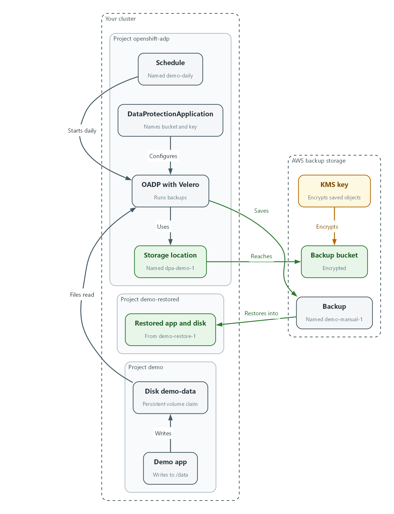
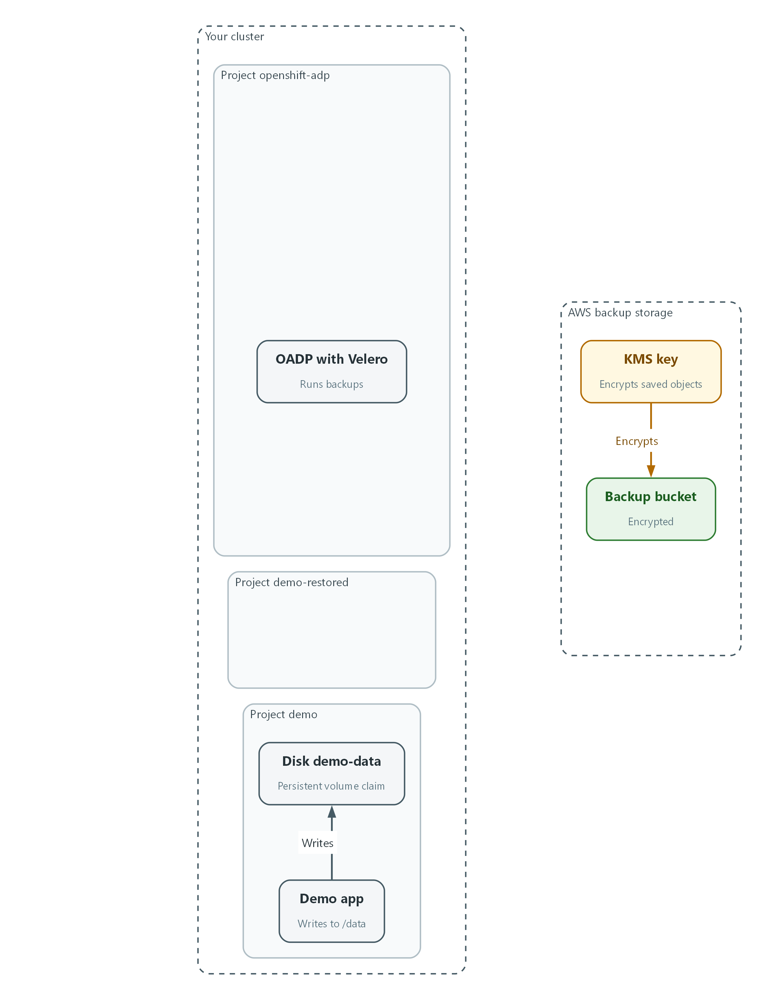
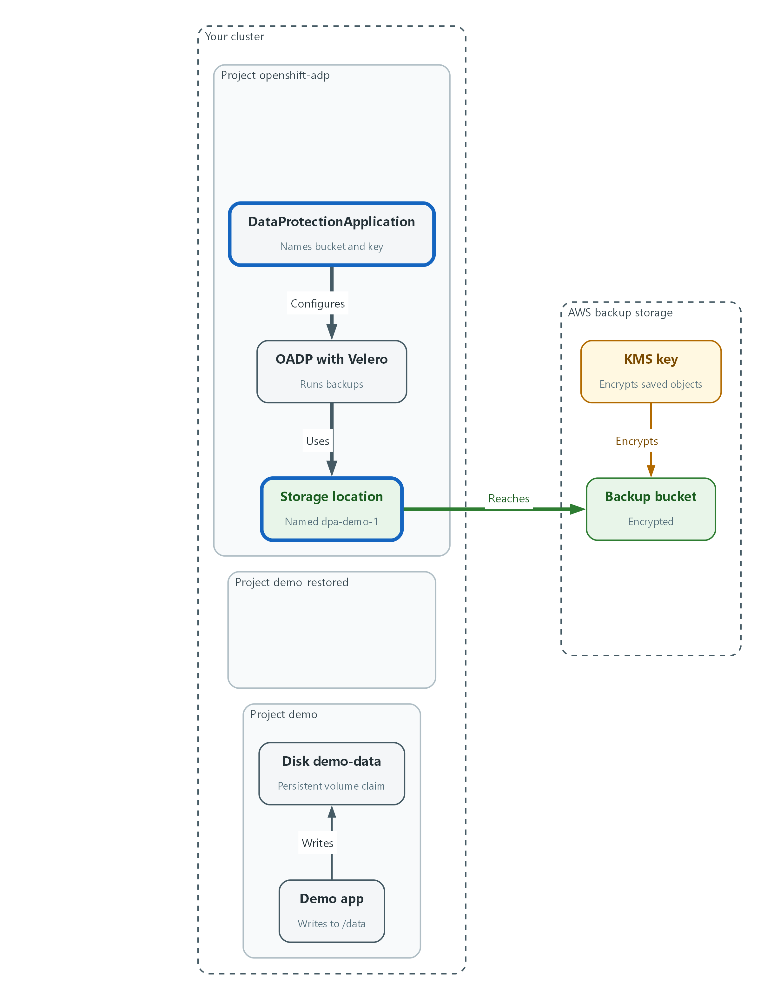
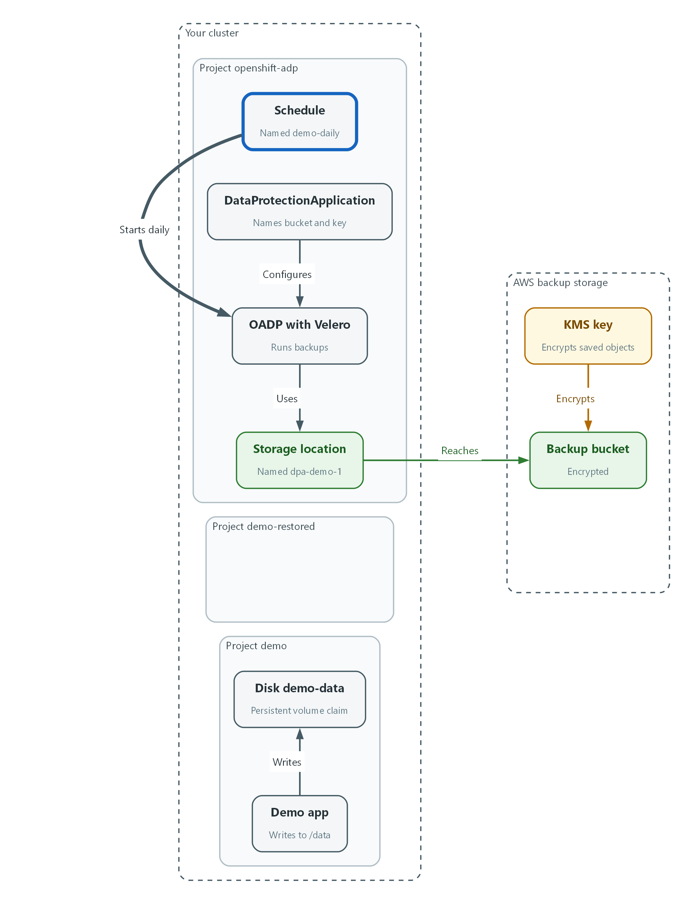
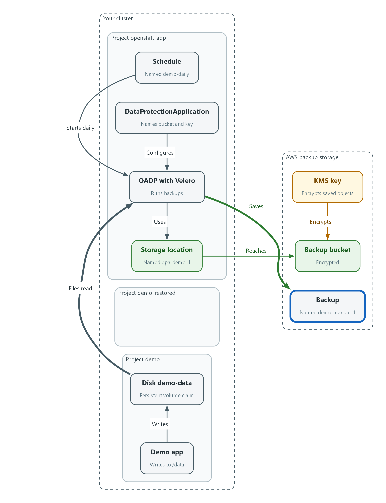
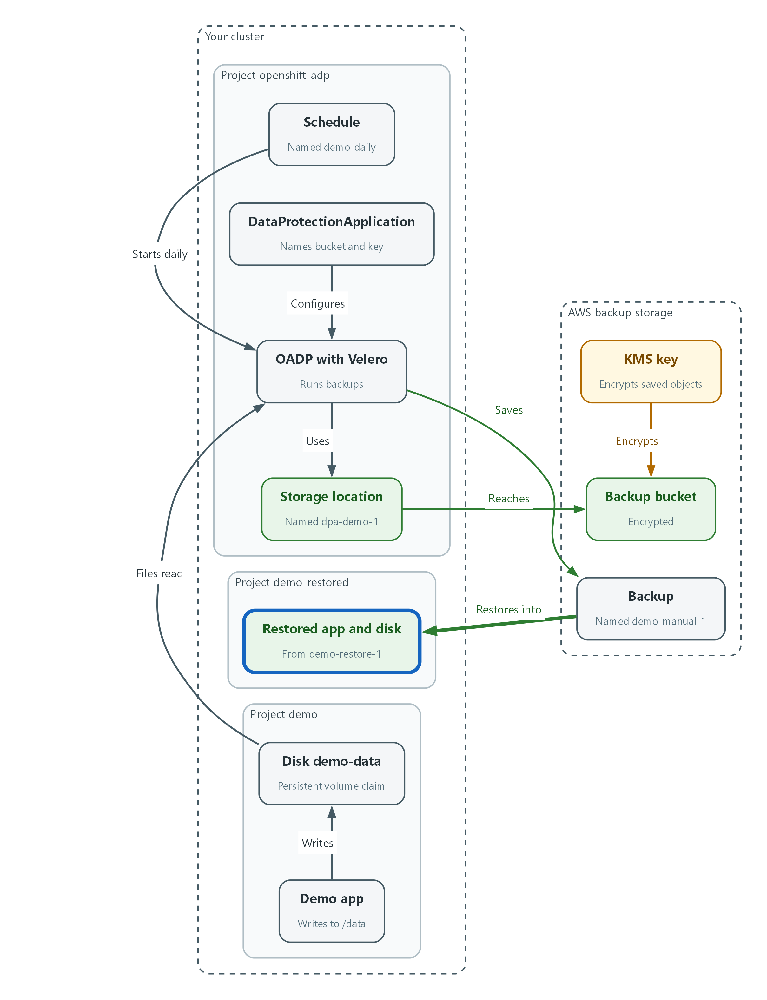

# M12: Backup and Recovery (CP-9, CP-10)

> 📌 DRAFT. The DataProtectionApplication shape (apiVersion oadp.openshift.io/v1alpha1, defaultPlugins, nodeAgent with kopia, backupLocations, the location name dpa-demo-1) and the velero schedule, backup and restore flags were checked against the Red Hat OADP documentation for OpenShift 4.22 and the Velero documentation, but nothing has run in the lab yet. kmsKeyId (key id, alias or full ARN) and serverSideEncryption are Velero AWS plugin settings passed through the config map, so oc explain cannot list them; the module checks the bucket and an uploaded object directly (the object key is looked up with list-objects-v2 because the exact Velero key layout is not shown in the Velero docs), and the location must report Available before any backup is taken. Confirm with: oc get backupstoragelocation -n openshift-adp. The velero command here runs from the lab shell, so confirm its version matches the OADP server with: velero version -n openshift-adp. Confirm field names with oc explain dataprotectionapplication.spec.configuration.nodeAgent.

| Item | Detail |
| --- | --- |
| Sequence | Module 7 of 17 in the recommended order |
| Timed work | About 65 minutes (45 hands-on, 20 verify) |
| Modes | Ready Lab (prebuilt) or Architect (you design and build it) |
| Standalone start | `lab start m12` |
| Combined start | Continue from the end state of the previous module |
| End state | `lab check m12` passes |
| Tools | OpenShift Container Platform, OADP with Velero (included with OpenShift), AWS S3 and KMS, oc, velero, aws, jq |
| Prerequisites | Module 0 (terminal and git basics), Module 2 (lab running) |
| Extra lab needs | OADP operator installed in openshift-adp, with a secret named cloud-credentials (key cloud) whose AWS identity can read and write the backup bucket and use the KMS key (generate data key and decrypt).; The bucket BACKUP_BUCKET exists, with default encryption using the key KMS_KEY_ARN.; demo-app in the demo project mounts a writable persistent volume claim named demo-data at /data, its image has a shell (sh) and cat, and the storage class supports file-level backup through the OADP node agent.; Velero's default retention (720 hours, 30 days) will expire lab backups. A learner who returns after a month must take a new backup; lab start m12 does not extend retention.; The lab shell velero version matches the OADP Velero server, and the lab shell aws identity can read the backup bucket. |

## 1. Why This Matters

An IL5 system must save its data and configuration on a schedule, protect those saved copies, and be able to bring the system back to a known working state after a failure. A backup that has never been restored is only a hope, so this module takes a backup, restores it into a fresh project, and shows what a backup does not protect.

### Control mapping

| Control | What it requires, in plain words | Source of the value | Where this module covers it |
| --- | --- | --- | --- |
| CP-9 System Backup | Back up user data, system data and system documentation on a schedule, and protect the backups. | NIST; FedRAMP | Steps 2 and 3 point backups at an encrypted bucket and schedule them. Step 4 takes a backup and checks it. Test 2 shows the data a backup cannot cover. |
| CP-10 System Recovery and Reconstitution | Bring the system back to a known state within the time the organization set. | NIST | Step 5 restores into a fresh project. Test 1 checks the data came back. |

### What each control is for

Read these answers first. They explain what each control is trying to prevent and how this module's tool meets it.

#### CP-9 System Backup

| Question | Answer |
| --- | --- |
| What the control author feared | The system fails or is damaged and the data is gone, or the backups exist but an attacker or a mistake destroyed them too. |
| Is it in scope for the system | User-level data, system-level data and documentation for the components the team operates. The host facility performs infrastructure-level backups and protects the stored copies. |
| The operational question | If the demo project vanished right now, what would I restore from, how old is it, and who else could delete it? |
| What evidence proves it | The backup schedule, a list of completed backups, proof the storage is encrypted, and a record of the last restore test. |
| How much is enough | NIST leaves the backup frequency, the encryption choice and the test frequency to the organization. FedRAMP High assigns daily incremental and weekly full backups (CP-9), a backup test at least monthly (CP-9(1)) and cryptographic protection of all backup files (CP-9(8)). This lab uses daily full backups, with continuous differential backups or snapshots to meet a recovery point objective of 2 hours, AES-256 encryption through the host key service, and a backup test twice a year, which is less often than the FedRAMP High monthly test. How long backups are kept is also organization-defined: find it in the Information System Contingency Plan (ISCP) or ask the ISSO. |
| Who is told when it fails | Someone is told when a backup fails. This module shows the command that lists failed backups; ask the ISSO who is told and how. The lab also expects two authorized people to approve deleting a critical backup. |
| How the tool in this module satisfies it | OADP, which wraps Velero, saves the demo project and the cluster-wide objects tied to it to an encrypted bucket on a schedule (Steps 2 to 4). |

#### CP-10 System Recovery and Reconstitution

| Question | Answer |
| --- | --- |
| What the control author feared | A backup exists but nobody knows how to use it, or restoring takes longer than the mission can tolerate. |
| Is it in scope for the system | The system and the recovery steps the team owns. |
| The operational question | How long does a restore take, and how much data is lost between the last backup and the failure? |
| What evidence proves it | A restore record, the time it took, a check that the data is intact, and lessons learned. |
| How much is enough | Recovery is done within a time consistent with the recovery time objective (RTO) of 48 hours and the recovery point objective of 2 hours as set by this lab, and lessons learned are written into the contingency plan (CP-2). |
| Who is told when it fails | Gaps found in a restore test are recorded and fixed in the plan. |
| How the tool in this module satisfies it | A Velero restore into a fresh project brings the app back (Step 5, Test 1). Test 2 measures the gap a backup leaves. |

### Architect mode brief

Design the backup before building it. Decide what must be saved (the project, its data, the cluster-wide objects it needs), where the copies live and how they are encrypted, how often they run, who may delete them, how you will know a backup failed, and how you will prove a restore works. Then build it and run the tests.

### Terms in this module

Each term is also explained the first time it appears. This table is a quick lookup.

| Term | Plain meaning |
| --- | --- |
| Backup | A saved copy of data and configuration that can be used to rebuild a system. |
| Restore | Using a backup to bring data and configuration back. |
| OADP | OpenShift API for Data Protection: the Red Hat operator that installs and runs Velero. |
| Velero | A free, open source tool that backs up and restores Kubernetes objects and volume data. |
| Bucket (S3) | A storage container in Amazon S3, the AWS object storage service. |
| KMS key | A key managed by the AWS Key Management Service, used to encrypt stored data. |
| RPO | Recovery Point Objective: the most data loss the organization accepts, measured as time. |
| RTO | Recovery Time Objective: the target time to get the system working again. |
| Persistent volume claim | A request for disk storage that keeps its data when a container restarts. |
| Project (OpenShift) | A named workspace in the cluster. Also called a namespace. |

## 2. The Tools

### Tools used in this module

Each tool name links to its official overview. The last column says how the tool is used in the lab.

| Tool (overview link) | What it is | Used in this lab |
| --- | --- | --- |
| [OADP (Velero)](https://docs.redhat.com/en/documentation/openshift_container_platform/4.22/html/backup_and_restore/oadp-application-backup-and-restore) | Backs up applications, their resources and persistent volumes. Not a disaster-recovery tool for etcd or Operators. | Backs up the demo application and its data, then restores it. |
| [Velero](https://velero.io/docs/) | Backs up and restores Kubernetes resources and persistent volumes. | The command-line client for running and checking backups. |
| [AWS KMS](https://docs.aws.amazon.com/kms/latest/developerguide/overview.html) | Creates and controls encryption keys, held in FIPS-validated hardware. | Encrypts the backup bucket. |
| [OpenShift Container Platform](https://docs.redhat.com/en/documentation/openshift_container_platform/4.22/html/overview/ocp-overview) | A Kubernetes container platform for running and managing containerized applications. | The cluster every command in this module runs against. |
| [oc](https://docs.redhat.com/en/documentation/openshift_container_platform/4.22/html/cli_tools/openshift-cli-oc) | The OpenShift command-line tool for creating and managing applications and projects from a terminal. | Runs the cluster commands in each step. |
| [AWS CLI](https://docs.aws.amazon.com/cli/latest/userguide/cli-chap-welcome.html) | Runs AWS actions from a shell instead of the browser console. | Reads and checks AWS resources from the shell. |
| [jq](https://jqlang.org/) | Command-line JSON processor. | Picks fields out of JSON output. |

### How it fits together

#### From the demo project to an encrypted backup and back

OADP and Velero copy the demo project and its disk into an encrypted bucket, then bring them back into a fresh project. Each step below adds one part, drawn with thick lines.



- The demo app writes to its disk in the demo project.
- Velero, run by OADP in the openshift-adp project, reads the app objects and the files on the disk and saves them as a backup in the bucket.
- The bucket encrypts every saved object with the KMS key.
- A restore reads the backup and creates the app and its disk in a fresh project, demo-restored.
### 2.1 What a backup covers

What is this? A backup saves two things: the objects that describe the app (deployments, settings, storage requests) and the data on its disks. A restore recreates both, so you get a working app and not just files.

Why encrypt? Backups hold the same data as the live system. If a copy leaks, the data leaks. This lab uses AES-256 encryption through the host key service, so the bucket is set to encrypt with a KMS key.

| Item | Where it is saved | How it comes back |
| --- | --- | --- |
| App objects and the cluster-wide objects tied to them (such as volumes) | Files in the bucket | Velero recreates them in the cluster |
| App data on disk | Files in the bucket, copied by the node agent | Velero copies the files back into a new disk |

### 2.2 Schedule, RPO and what is left uncovered

The local team sets the backup schedule and makes sure application configuration and data are included. The host facility performs the infrastructure-level backups. The recovery point objective is 2 hours, so data written since the last backup can be lost.

A daily full backup alone leaves a gap of up to a day. Continuous differential backups or snapshots close that gap. In this lab you build the daily full backup and, in Test 2, measure the gap it leaves.

```text
demo project --(Velero + node agent)--> encrypted S3 bucket (KMS key)
      ^                                         |
      |   restore into a fresh project          |
      +---- demo-restored <---------------------+
```

### 2.3 OADP, Velero and the commands

OADP installs Velero for you. You describe where to store backups in a DataProtectionApplication (DPA), then use the velero command to create schedules, backups and restores. Velero stores its own records in the openshift-adp project, so every velero command here ends with -n openshift-adp.

| Object | What it means |
| --- | --- |
| DataProtectionApplication | The OADP setting that names the bucket, the key and the plugins. |
| Backup storage location | OADP's name for the bucket target. Its phase should read Available. |
| Schedule | A recurring backup written as a cron expression. |
| Restore | A request to bring a backup back, optionally into a different project. |

> 🏭 IN PRODUCTION: In the real environment the bucket lives in the host facility's storage with its own access controls, and deleting a critical backup needs approval from two authorized people. The lab gives you one bucket and one learner.

## 3. Implement

Ready Lab learners start with `lab start m12`. Architect learners design each step first using the brief above.

### Step 1. Check what you have

Confirm the bucket is encrypted, the backup operator is running, and the demo app has a disk, before changing anything.

What this step adds (thick lines and outlines are new):



- Nothing is new yet. You check the encrypted bucket, the OADP operator and the demo disk that the lab starts with.
```bash
aws s3api get-bucket-encryption --bucket "$BACKUP_BUCKET"
oc get pods -n openshift-adp
oc get pvc -n demo
velero version -n openshift-adp
```

| Part | What it does |
| --- | --- |
| aws s3api get-bucket-encryption | Asks AWS how the bucket encrypts what it stores. You expect a KMS algorithm and the key in KMS_KEY_ARN. |
| oc get pods -n openshift-adp | Lists the backup operator programs. |
| oc get pvc -n demo | Lists the persistent volume claims (requests for disk storage) of the demo app. demo-data is the one that holds data. |
| velero version -n openshift-adp | Prints the client and server versions of velero. They should match. |

> 🔒 Never paste keys or passwords into commands. The lab keeps the bucket name and key in environment variables and the storage credentials in a secret.

> ▶ YOUR TURN: Run the three commands.

> ✅ CHECKPOINT: The encryption answer shows aws:kms, the pods are Running, demo-data is Bound, and the velero client and server versions match.

### Step 2. Point OADP at the encrypted bucket (CP-9)

The DataProtectionApplication tells OADP where to put backups and how to encrypt them. The file holds placeholders instead of real values, so the bucket name and key never sit in the file you keep in git. The sed command fills them in as it applies.

What this step adds (thick lines and outlines are new):



- The DataProtectionApplication points OADP at the bucket, and the storage location must report Available.
```yaml
apiVersion: oadp.openshift.io/v1alpha1
kind: DataProtectionApplication
metadata:
  name: dpa-demo
  namespace: openshift-adp
spec:
  configuration:
    velero:
      defaultPlugins:
        - openshift
        - aws
        - csi
    nodeAgent:
      enable: true
      uploaderType: kopia
  backupLocations:
    - velero:
        provider: aws
        default: true
        credential:
          name: cloud-credentials
          key: cloud
        objectStorage:
          bucket: BUCKET_VALUE
          prefix: velero
        config:
          region: REGION_VALUE
          serverSideEncryption: aws:kms
          kmsKeyId: KMS_KEY_VALUE
```

| Part | What it does |
| --- | --- |
| defaultPlugins | The extras Velero loads: OpenShift objects, AWS storage and volume snapshots. |
| nodeAgent ... kopia | Turns on the helper that copies the files on app disks to the bucket. |
| provider: aws, bucket, prefix | Backups go in the bucket, under a folder named velero. |
| credential | Points at the secret that holds the storage access, so no key is in this file. |
| serverSideEncryption, kmsKeyId | Asks S3 to encrypt each saved object with the KMS key. |
| BUCKET_VALUE, REGION_VALUE, KMS_KEY_VALUE | Placeholders the next block replaces. |

```bash
oc explain dataprotectionapplication.spec.configuration.nodeAgent
sed -e "s|BUCKET_VALUE|$BACKUP_BUCKET|" -e "s|REGION_VALUE|$AWS_REGION|" -e "s|KMS_KEY_VALUE|$KMS_KEY_ARN|" dpa.yaml | oc apply -f - --dry-run=server
sed -e "s|BUCKET_VALUE|$BACKUP_BUCKET|" -e "s|REGION_VALUE|$AWS_REGION|" -e "s|KMS_KEY_VALUE|$KMS_KEY_ARN|" dpa.yaml | oc apply -f -
sleep 60
oc get backupstoragelocation -n openshift-adp
```

| Part | What it does |
| --- | --- |
| oc explain ... | Prints the fields your OADP release accepts for the node agent. If a name differs, use the one it shows. The settings under config are passed to the AWS plugin, so the location check below is what proves them. |
| sed -e ... dpa.yaml | Replaces each placeholder with the value from the lab variable and passes the result on. |
| --dry-run=server | Asks the cluster to check the setting without saving it. |
| oc apply -f - | Saves the setting. The dash means the text comes from the previous command. |
| oc get backupstoragelocation | Shows whether OADP can reach the bucket. PHASE should read Available. |

> 💡 Keep dpa.yaml in git. Because it holds placeholders, it is safe to store, and git shows who changed the backup target and when.

> ▶ YOUR TURN: Save the YAML as dpa.yaml, validate it, apply it, and read the location list.

> ✅ CHECKPOINT: The location dpa-demo-1 shows PHASE Available.

### Step 3. Schedule the backup (CP-9)

The backup schedule is in the local team's hands, and this lab uses daily full backups. A Velero schedule runs a backup of the demo project, and the cluster-wide objects tied to it, on a cron expression. This lab sets no retention time because the lab does not fix one, so Velero applies its own default, which is 720 hours (30 days). Lab backups expire after that, so if you come back to the lab after a month, take a new backup before you rely on one. In the real environment set the retention (the --ttl option) from the ISCP.

What this step adds (thick lines and outlines are new):



- The demo-daily schedule tells Velero to run a backup once a day.
```bash
velero schedule create demo-daily --schedule="0 1 * * *" \
  --include-namespaces demo --default-volumes-to-fs-backup \
  -n openshift-adp
velero schedule get -n openshift-adp
```

| Part | What it does |
| --- | --- |
| velero schedule create demo-daily | Creates a schedule named demo-daily. |
| --schedule="0 1 * * *" | A cron expression that means once a day at one in the morning, in the time zone of the Velero server (a prefix such as CRON_TZ=America/New_York sets another). A new schedule does not run at once; its first backup waits for the next scheduled time. |
| --include-namespaces demo | Backs up the demo project. |
| (no cluster option) | When one project is named, Velero also saves the cluster-wide objects tied to it, such as the volume behind a disk. Cluster-wide objects are objects that belong to no project. |
| --default-volumes-to-fs-backup | Copies the files on the app disks, so the data is saved and not only the settings. |
| -n openshift-adp | Tells velero to use the OADP project. |
| velero schedule get | Lists the schedules. |

> 📌 This lab also expects continuous differential backups or snapshots so that data loss stays within the recovery point objective. That layer comes from the host facility's storage. This lab builds the daily full backup and Test 2 shows the gap that remains.

> ▶ YOUR TURN: Run the commands and read the list.

> ✅ CHECKPOINT: demo-daily is listed and not paused.

### Step 4. Take a backup and check it (CP-9)

Do not wait for the schedule. Write a known record into the app disk, take a backup now, and read its result. Then list any backup that is not Completed: this is how you detect a failed backup.

What this step adds (thick lines and outlines are new):



- A manual backup copies the demo objects and the files on the disk into the bucket, and the bucket encrypts them with the KMS key.
```bash
oc exec -n demo deploy/demo-app -- sh -c 'echo backup-test-record-1 > /data/record.txt'
velero backup create demo-manual-1 --include-namespaces demo \
  --default-volumes-to-fs-backup --wait -n openshift-adp
velero backup describe demo-manual-1 -n openshift-adp
oc get backups.velero.io -n openshift-adp -o json | jq -r '.items[] | select(.status.phase != "Completed") | .metadata.name'
```

| Part | What it does |
| --- | --- |
| echo ... > /data/record.txt | Writes a record on the demo disk. You will look for it after the restore. |
| velero backup create demo-manual-1 | Takes a backup now. |
| --wait | Holds the command until the backup finishes. |
| velero backup describe | Shows the backup's result and any errors. |
| jq ... select(.status.phase != "Completed") | Prints the name of every backup that did not complete. Empty output means none failed. |

> 📌 A failed or partly failed backup shows a phase such as Failed or PartiallyFailed in the describe output. Checking this list is the manual version of an alert.

> 🔒 Do not delete backups to tidy up. Deleting a critical backup should need approval from two authorized people.

> ▶ YOUR TURN: Run the commands.

> ✅ CHECKPOINT: The phase is Completed and the last command prints nothing.

### Step 5. Restore into a fresh project (CP-10)

Restoring into a new project proves the backup is usable without touching the live app. A name mapping tells Velero to put everything from demo into demo-restored.

What this step adds (thick lines and outlines are new):



- A restore brings the backup back into a fresh project called demo-restored.
```bash
velero restore create demo-restore-1 --from-backup demo-manual-1 \
  --namespace-mappings demo:demo-restored --wait -n openshift-adp
oc rollout status deploy/demo-app -n demo-restored --timeout=300s
oc get pods,pvc -n demo-restored
```

| Part | What it does |
| --- | --- |
| velero restore create demo-restore-1 | Starts a restore named demo-restore-1. |
| --from-backup demo-manual-1 | Uses the backup from Step 4. |
| --namespace-mappings demo:demo-restored | Puts the restored objects in a new project called demo-restored. |
| oc rollout status | Waits until the restored app is running. |
| oc get pods,pvc | Lists the restored programs and disks. |

> ▶ YOUR TURN: Run the commands.

> ✅ CHECKPOINT: The restored pod is Running and its disk is Bound.

## 4. Verify It Works

### Test 1 (positive). The restore brings the app back with its data

A running pod proves the settings came back. The record you wrote before the backup proves the data did. The last two commands find one saved backup object in the bucket and show it was encrypted with the KMS key.

```bash
oc exec -n demo-restored deploy/demo-app -- cat /data/record.txt
velero restore describe demo-restore-1 -n openshift-adp
KEY=$(aws s3api list-objects-v2 --bucket "$BACKUP_BUCKET" --prefix velero/ --query "Contents[?ends_with(Key, 'demo-manual-1/velero-backup.json')].Key" --output text)
aws s3api head-object --bucket "$BACKUP_BUCKET" --key "$KEY" --query '[ServerSideEncryption,SSEKMSKeyId]'
```

**Expected output:**

```
Example only.
backup-test-record-1
Phase:  Completed
["aws:kms", "<your KMS key ARN>"]
```

> ✅ CHECKPOINT: The record text is printed, the restore phase is Completed, and the saved backup object reports aws:kms with your key. Note how long the restore took, and compare it with the 48 hours this lab allows.

### Test 2 (negative). Data written after the last backup is lost

A backup only holds what existed when it ran. Write a record into the restored app, then delete the project and restore again from the same backup. The first record returns and the newer one does not. That difference is the data loss between backups, which the recovery point objective of 2 hours is meant to limit.

```bash
oc exec -n demo-restored deploy/demo-app -- sh -c 'echo late-record > /data/late-record.txt'
oc delete namespace demo-restored
oc wait --for=delete namespace/demo-restored --timeout=300s
velero restore create demo-restore-2 --from-backup demo-manual-1 \
  --namespace-mappings demo:demo-restored --wait -n openshift-adp
oc rollout status deploy/demo-app -n demo-restored --timeout=300s
oc exec -n demo-restored deploy/demo-app -- cat /data/record.txt
oc exec -n demo-restored deploy/demo-app -- cat /data/late-record.txt
```

**Expected output:**

```
Example only. The exact error text depends on the app image.
backup-test-record-1
cat: /data/late-record.txt: No such file or directory
```

> ✅ CHECKPOINT: record.txt returns and late-record.txt is gone. You can say which data a backup taken earlier could not protect.

Run `lab check m12` to run these tests automatically. It checks:

- The backup bucket reports encryption with a KMS key and OADP reports the storage location Available.
- A daily backup schedule exists and a manual backup completes.
- A restore into a fresh project brings back the demo data.
- Data written after the last backup is shown to be lost after a delete and restore.
## 5. Glossary and Next Steps

| Term | Meaning |
| --- | --- |
| OADP | The Red Hat operator that runs Velero on OpenShift. |
| Velero | A tool that backs up and restores cluster objects and volume data. |
| DataProtectionApplication | The OADP setting that names the backup bucket and plugins. |
| Namespace mapping | A restore option that puts restored objects in a differently named project. |
| RPO | Recovery Point Objective: the most data loss accepted. |
| RTO | Recovery Time Objective: the target time to recover. |
| KMS | Key Management Service: AWS service that manages encryption keys. |
| Cron expression | Five fields that say when a task repeats, for example once a day. |

> 💡 Next module: M08 Vulnerability Management: find known flaws in images and the cluster, fix them on a schedule, and track the ones you cannot fix in time.
