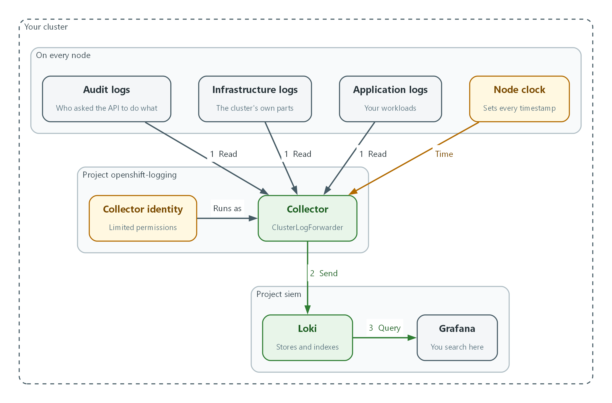
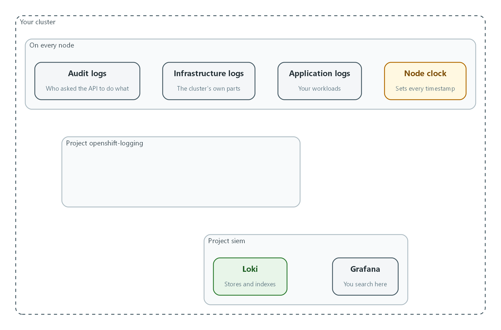
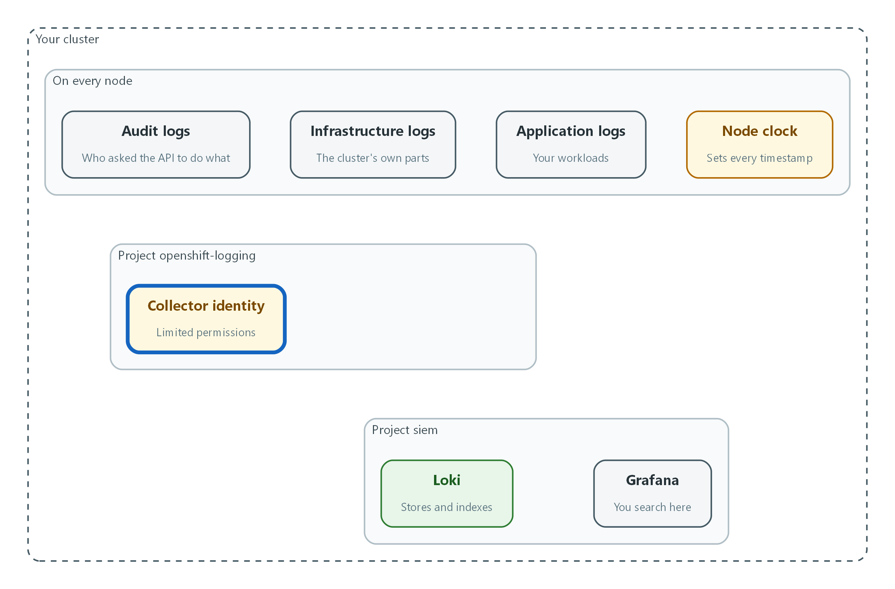
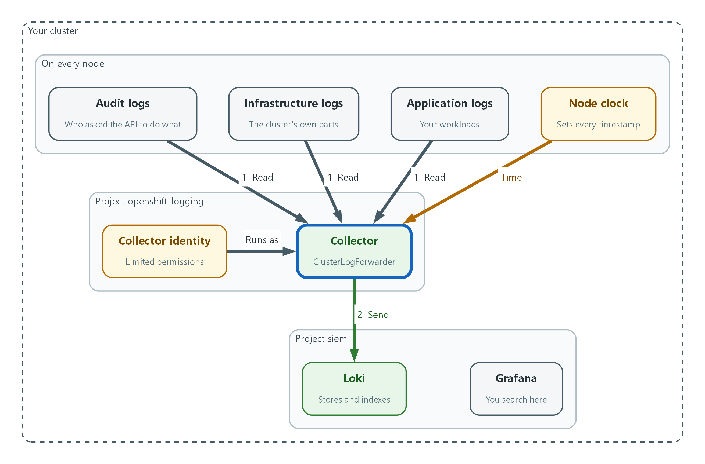

# SIEM-1: Collect Audit Logs (AU-2, AU-3, AU-8, AU-12)

> 📌 DRAFT. Commands follow Red Hat's published OpenShift Logging documentation but have not yet run in the lab. Field names can differ between Logging releases, so the forwarder is validated before it is applied.

| Item | Detail |
| --- | --- |
| Sequence | Module 3 of 17 in the recommended order |
| Timed work | About 65 minutes (45 hands-on, 20 verify) |
| Modes | Ready Lab (prebuilt) or Architect (you design and build it) |
| Standalone start | `lab start siem-1` |
| Combined start | Continue from the end state of the previous module |
| End state | `lab check siem-1` passes |
| Tools | OpenShift Container Platform, Red Hat OpenShift Logging, Loki and Grafana (free, open source), oc, curl, jq |
| Prerequisites | Module 0 (terminal and git basics), Module 2 (lab running) |

## 1. Why This Matters

An IL5 system must record security-relevant events, put enough detail in each record to reconstruct what happened, stamp each record with a trustworthy time, and make sure every required component is actually producing records. This module builds that foundation. Later modules store the records, search them for attacks, and respond.

### Control mapping

| Control | What it requires, in plain words | Source of the value | Where this module covers it |
| --- | --- | --- | --- |
| AU-2 Event Logging | Decide which events must be logged, say why, and review the list on a schedule. | NIST; FedRAMP | Steps 3 and 4 send the three log types and confirm each one arrives. |
| AU-3 Content of Audit Records | Each record says what happened, when, where, the source, the outcome, and who or what was involved. | NIST; FedRAMP | Test 1 checks a real record against all six elements. |
| AU-8 Time Stamps | Records use the system clock and a standard time reference (UTC, or a fixed offset). | NIST; FedRAMP | Test 2 checks clock synchronization and the stored timestamp format. |
| AU-12 Audit Record Generation | The listed components produce audit records, and authorized staff choose which events. | NIST; FedRAMP | Step 2 sets who may collect what. Test 3 proves the setting changes what arrives. |

### What each control is for

Read these answers first. They explain what each control is trying to prevent and how this module's tool meets it.

#### AU-2 Event Logging

| Question | Answer |
| --- | --- |
| What the control author feared | Something damaging happens and nobody can reconstruct who did what, because the events were never chosen for logging. |
| Is it in scope for the system | Every component the system team operates. Logs a customer keeps in their own tenant are theirs to answer for. |
| The operational question | If someone with privileged access did something damaging three weeks ago, is the record of it being written down today? |
| What evidence proves it | The list of events the system can log, the subset that is logged, the reason for each, and the date of the last review. |
| How much is enough | Event types are identified, the logged subset has a reason, the people who use the logs agree with it, and it is reviewed at a set frequency. NIST leaves the review frequency to the organization, and FedRAMP assigns annually and whenever there is a change in the threat environment. This lab reviews at least annually, plus after a significant system change, a security incident, or a change in requirements. |
| Who is told when it fails | Each component owner knows which events they must produce, and someone tells them when the list changes. |
| How the tool in this module satisfies it | The log forwarder (Step 3) carries audit, infrastructure and application logs, and Step 4 proves each type is arriving. |

#### AU-3 Content of Audit Records

| Question | Answer |
| --- | --- |
| What the control author feared | A log entry exists but cannot answer the question. It says something happened without saying who, where, or whether it worked. |
| Is it in scope for the system | Records produced by the components the team operates. |
| The operational question | Take one real log line. From that line alone, can you tell what happened, when, where, who did it, and whether it worked? |
| What evidence proves it | A sample record from each major component, checked against the six required elements. |
| How much is enough | The record shows event type, time, location, source, outcome, and the identity involved. Identity details in this lab include username, full name, remote and server IP addresses, and host names. |
| Who is told when it fails | If a component's records fall short, someone owns the fix. |
| How the tool in this module satisfies it | OpenShift audit records already carry these fields. Test 1 shows you where each one sits. |

#### AU-8 Time Stamps

| Question | Answer |
| --- | --- |
| What the control author feared | Records from different components cannot be put in order because their clocks disagree. |
| Is it in scope for the system | Every component that produces audit records and the SIEM that stores them. |
| The operational question | If two components logged the same event, would their timestamps agree closely enough to tell which came first? |
| What evidence proves it | Clock synchronization status for the nodes, and the stored timestamp format. |
| How much is enough | Clocks synchronize to a time server using NTP (Network Time Protocol). FedRAMP assigns one second granularity for timestamps; the lab stores them to the millisecond or finer. Timestamps map to UTC, either stored in UTC or carrying an offset. |
| Who is told when it fails | Something detects a component whose clock has drifted. This module checks by hand. SIEM-3 adds the alert. |
| How the tool in this module satisfies it | chrony keeps node clocks in sync. Test 2 reads its status and checks a stored timestamp. |

#### AU-12 Audit Record Generation

| Question | Answer |
| --- | --- |
| What the control author feared | Some components produce no audit records at all, and nobody knows which. |
| Is it in scope for the system | Components the team can configure for logging. |
| The operational question | Which components are not producing audit records right now, and is that a decision or an accident? |
| What evidence proves it | The components with logging on, the roles allowed to change it, and sample records. |
| How much is enough | Logging is on for the defined components, only authorized staff can change which events are logged, and changes go through change management (CM-3). |
| Who is told when it fails | Something detects a newly added component that is not logging. Test 3 shows why this matters. |
| How the tool in this module satisfies it | One permission per log type (Step 2) lets you see, and later remove, each type on its own. |

### Architect mode brief

Design the log path before building it. Decide which three log types must be collected, which identity the collector runs as and why it should hold no more than three read permissions, how the collector proves it is talking to the real SIEM, and how you will tell if records stop. Then build it and run the tests.

### Terms in this module

Each term is also explained the first time it appears. This table is a quick lookup.

| Term | Plain meaning |
| --- | --- |
| Audit record | One saved entry describing a security-relevant event, such as a login or a settings change. |
| Collector | A small program on each node that reads logs and sends them onward. |
| Log forwarder | The configuration that tells collectors what to send and where. |
| SIEM | Security Information and Event Management: a system that stores logs from many sources so analysts can search them and raise alerts. |
| Stream and label (Loki) | A stream is a series of log lines that share the same labels. A label is a key=value tag such as log_type=audit. |
| UTC | Coordinated Universal Time, the world reference time with no daylight-saving changes. |
| NTP | Network Time Protocol: how computers set their clocks from a trusted time server. |

## 2. The Tools

### Tools used in this module

Each tool name links to its official overview. The last column says how the tool is used in the lab.

| Tool (overview link) | What it is | Used in this lab |
| --- | --- | --- |
| [OpenShift Logging](https://docs.redhat.com/en/documentation/openshift_container_platform/4.22/html/logging/index) | Collects, forwards and stores cluster log data. (Loki as the store is described in the Logging 6.x docs, not on this page.) | Collects audit, infrastructure and application logs and forwards them. |
| [Grafana Loki](https://grafana.com/docs/loki/latest/) | Log storage that indexes only labels and keeps compressed log data in object storage. | Receives and stores the forwarded logs. |
| [Grafana](https://grafana.com/docs/grafana/latest/) | Dashboards, log browsing and alerting. | Used to browse the logs and confirm they arrive. |
| [oc](https://docs.redhat.com/en/documentation/openshift_container_platform/4.22/html/cli_tools/openshift-cli-oc) | The OpenShift command-line tool for creating and managing applications and projects from a terminal. | Applies the log forwarding configuration. |
| [OpenShift Container Platform](https://docs.redhat.com/en/documentation/openshift_container_platform/4.22/html/overview/ocp-overview) | A Kubernetes container platform for running and managing containerized applications. | The cluster every command in this module runs against. |
| [jq](https://jqlang.org/) | Command-line JSON processor. | Picks fields out of JSON output. |
| [curl](https://curl.se/docs/manpage.html) | Command-line tool for transferring data over URLs, used here to call web endpoints. | Calls web endpoints to test behavior. |

### How it fits together

#### Where the three kinds of log travel

Every node produces three kinds of log. The collector reads all three, stamps each record with the node clock, and sends them to Loki. You search them in Grafana. Each step below adds one part, drawn with thick lines.



- Audit, infrastructure and application logs all flow into the collector (flow 1).
- The node clock sets the timestamp on each record before it is sent.
- The collector in the openshift-logging project sends everything to Loki in the siem project (flow 2).
- You search the stored logs from Grafana (flow 3).
### 2.1 Why logs are collected in one place

What is this? A cluster has many nodes (the servers it runs on) and many programs. Each writes logs in its own place. Collecting means copying those logs to one central, protected store.

Why? After an incident, investigators need one timeline. Logs left on a node are lost when the node is rebuilt, and an attacker with access to a node can edit the logs on it.

| Log type | What it shows | Question it answers |
| --- | --- | --- |
| Audit | Who called the platform API, and node-level actions | Who deleted this project, and when? |
| Infrastructure | Platform and operating-system services | Did a node restart or a service fail? |
| Application | Programs running on the platform | Did the web app reject this login? |

### 2.2 The collector and the log forwarder

OpenShift Logging installs a collector on every node. A resource called ClusterLogForwarder tells the collectors which log types to read (inputs), where to send them (outputs), and how to connect the two (pipelines).

Because it is a file, the forwarder can be reviewed and kept in version control like any other configuration. That supports configuration change control.

```text
Nodes and pods                 Collector (on each node)          SIEM
--------------                 ------------------------          ----
audit, infrastructure,   -->   reads logs, adds labels   --TLS--> Loki --> Analyst (Grafana)
application logs               ClusterLogForwarder decides
                               which logs go where
```

### 2.3 Loki and Grafana

Loki stores log lines and lets you search them. Grafana is the web screen analysts use to search and chart them. Both are free and open source.

Loki indexes only the labels on each stream, not every word, so a search names a label first and then filters the text.

| Concept | What it means |
| --- | --- |
| Log line | One record stored as text. Here it is a JSON object with fields such as user, verb and time. |
| LogQL | Loki's search language. {log_type="audit"} |= "error" means audit logs containing the word error. |
| Grafana Explore | The Grafana screen for running LogQL searches. |

> 🏭 IN PRODUCTION: In the real environment the SIEM sits in a protected enclave, Loki keeps its data in object storage instead of local disk, and logs arrive over an approved path. The lab uses one Loki instance so you practice the same steps.

## 3. Implement

Ready Lab learners start with `lab start siem-1`. Architect learners design each step first using the brief above.

### Step 1. Check what you have

Confirm the cluster and the SIEM are both up before changing anything.

What this step adds (thick lines and outlines are new):



- Nothing is new yet. This is what the lab starts with: three kinds of log, a node clock, Loki and Grafana, and nothing connecting them.
```bash
oc get nodes
oc get pods -n openshift-logging
curl -s --cacert "$LOKI_CA_FILE" -u "$LOKI_USER:$LOKI_PASSWORD" "$LOKI_URL/ready"
```

| Part | What it does |
| --- | --- |
| oc get nodes | Lists the servers in the cluster. oc is the OpenShift command-line tool. |
| oc get pods -n openshift-logging | Lists programs running in the logging project (a project is a named workspace). |
| curl ... /ready | Asks Loki if it is ready. The four LOKI variables are set by lab start, so no secret is typed or saved. |

> 🔒 Never paste passwords into commands or files. The lab keeps them in environment variables, out of your command history and out of git.

> ▶ YOUR TURN: Run the three commands and count the nodes. That is how many collectors to expect.

> ✅ CHECKPOINT: Loki answers ready.

### Step 2. Give the collector a limited identity (AU-12)

A service account is an identity for a program instead of a person. The collector needs permission to read logs and nothing more, which is least privilege. The requirement leaves the roles that choose event types to the organization; this lab lets the ISSO, ISSE and Platform Administrators choose which event types are logged, through version-controlled configuration under change management, so keep these commands in git.

What this step adds (thick lines and outlines are new):



- The collector gets its own limited identity, allowed to read the three kinds of log and nothing else.
```bash
oc create sa collector -n openshift-logging
oc adm policy add-cluster-role-to-user collect-application-logs -z collector -n openshift-logging
oc adm policy add-cluster-role-to-user collect-infrastructure-logs -z collector -n openshift-logging
oc adm policy add-cluster-role-to-user collect-audit-logs -z collector -n openshift-logging
oc get clusterrolebinding | grep collect
```

| Part | What it does |
| --- | --- |
| oc create sa collector | Creates the identity named collector. |
| add-cluster-role-to-user ... collect-*-logs | Grants one read permission per log type, so each can be seen and removed on its own. |
| -z collector | Says the target is the service account named collector. |
| grep collect | Shows only the bindings you just made. |

> ▶ YOUR TURN: Run the commands and read the list at the end.

> ✅ CHECKPOINT: You see three collect bindings.

### Step 3. Store the credentials and apply the log forwarder (AU-2, AU-12)

A secret is a protected object that holds sensitive values so they are not written into files. The forwarder refers to the secrets by name, so no password appears in the file you keep in git. The forwarder then connects the three log types to Loki over TLS (encryption for data in transit).

What this step adds (thick lines and outlines are new):



- The ClusterLogForwarder starts the collector. It reads all three log types and sends them to Loki.
```bash
oc create secret generic loki-credentials -n openshift-logging \
  --from-literal=username="$LOKI_USER" \
  --from-literal=password="$LOKI_PASSWORD"
oc create secret generic loki-ca -n openshift-logging --from-file=ca.crt="$LOKI_CA_FILE"
```

| Part | What it does |
| --- | --- |
| loki-credentials | Holds the user name and password for Loki. |
| loki-ca | Holds the certificate authority file, so the collector can check it is talking to the real Loki. |

```yaml
apiVersion: observability.openshift.io/v1
kind: ClusterLogForwarder
metadata:
  name: siem-forwarder
  namespace: openshift-logging
spec:
  serviceAccount:
    name: collector
  outputs:
    - name: siem-loki
      type: loki
      loki:
        url: "${LOKI_URL}"
        authentication:
          username:
            secretName: loki-credentials
            key: username
          password:
            secretName: loki-credentials
            key: password
      tls:
        ca:
          secretName: loki-ca
          key: ca.crt
  pipelines:
    - name: security-logs
      inputRefs:
        - audit
        - infrastructure
        - application
      outputRefs:
        - siem-loki
```

| Part | What it does |
| --- | --- |
| serviceAccount | The limited identity from Step 2. |
| outputs | Where logs go: Loki over HTTPS with the certificate checked. |
| authentication | Points at the secret instead of holding the password. |
| pipelines | Connects the three log types (inputs) to the output. |

```bash
oc explain clusterlogforwarders.observability.openshift.io.spec.outputs.loki
envsubst < siem-forwarder.yaml | oc apply --dry-run=server -f -
envsubst < siem-forwarder.yaml | oc apply -f -
oc get pods -n openshift-logging
```

| Part | What it does |
| --- | --- |
| oc explain ... | Prints the fields your cluster's Logging release accepts. If a field name differs, use the one it shows. |
| envsubst < siem-forwarder.yaml | Replaces ${LOKI_URL} in the file with the real value from the lab env before passing it to oc. |
| --dry-run=server | Asks the cluster to check the file without saving it. |
| oc apply -f - | Saves the forwarder. Collectors pick it up on every node. The dash reads from stdin. |

> 🔒 The collector verifies Loki's certificate through the loki-ca secret. Skipping that check can be an assessment finding under SC-8, which protects information in transit.

> 💡 Keep siem-forwarder.yaml in git. Git shows who changed it and when, which supports change control (CM-3), and limiting who can push supports CM-5.

> ▶ YOUR TURN: Save the YAML as siem-forwarder.yaml, run envsubst to check the substitution, validate with dry-run, apply, then count the collector pods.

> ✅ CHECKPOINT: One collector pod per node, all Running.

### Step 4. Confirm each log type arrives (AU-2)

The auditable events in this lab include logons, account changes, permission changes and use of the root account. Those events reach the SIEM only if their log type is collected. Ask Loki which log types it holds.

What this step adds (thick lines and outlines are new):


- You search Loki from Grafana to confirm each log type arrived.
```bash
sleep 60
curl -s --cacert "$LOKI_CA_FILE" -u "$LOKI_USER:$LOKI_PASSWORD" \
  "$LOKI_URL/loki/api/v1/label/log_type/values" | jq .
```

| Part | What it does |
| --- | --- |
| sleep 60 | Gives the collectors time to send their first records. |
| label/log_type/values | Asks Loki for every value of the log_type label it has stored. |
| | jq . | Prints the JSON answer in a readable layout. |

> 📌 Audit covers platform API actions and node activity. Application and infrastructure cover the rest of the events the lab lists. A missing type means a whole category of events is not reaching the SIEM.

> ▶ YOUR TURN: Run the commands and list which of the three types appear.

> ✅ CHECKPOINT: The answer lists audit, infrastructure and application.

## 4. Verify It Works

### Test 1 (positive). One audit record answers the six AU-3 questions

Make something happen, then find it. Creating a project is an audited action.

```bash
oc new-project lab-audit-test
sleep 30
curl -sG --cacert "$LOKI_CA_FILE" -u "$LOKI_USER:$LOKI_PASSWORD" \
  "$LOKI_URL/loki/api/v1/query_range" \
  --data-urlencode 'query={log_type="audit"} |= "lab-audit-test"' \
  --data-urlencode 'limit=1' | jq -r '.data.result[0].values[0][1]' | jq .
```

**Expected output:**

```
Example only. Your field names and values will differ.
{
  "verb": "create",
  "user": { "username": "admin" },
  "sourceIPs": [ "10.0.4.17" ],
  "requestURI": "/apis/project.openshift.io/v1/projectrequests",
  "responseStatus": { "code": 201 },
  "stageTimestamp": "2026-10-25T14:03:11.482913Z"
}
```

> ✅ CHECKPOINT: You can point to what happened, when, where, the source, the outcome and who, or you know which is missing.

### Test 2 (positive). Clocks are synchronized and timestamps show the millisecond and UTC

If a node clock is far off, every record from that node places events at the wrong moment. chrony is the time-sync service on the node.

```bash
NODE=$(oc get nodes -o jsonpath='{.items[0].metadata.name}')
oc debug node/$NODE -- chroot /host chronyc tracking
date -u
```

**Expected output:**

```
Example only.
Reference ID    : 0A000001 (ntp.lab.internal)
Stratum         : 3
System time     : 0.000012345 seconds fast of NTP time
Leap status     : Normal
```

> ✅ CHECKPOINT: Leap status is Normal, the offset is tiny, and the timestamp from Test 1 shows fractions of a second and ends in Z.

### Test 3 (negative). Remove the audit permission and watch the records stop

A control you have only seen working is not proven. Remove one permission and see what changes. Nothing will warn you, which is the point: SIEM-3 builds the alert that does.

```bash
oc adm policy remove-cluster-role-from-user collect-audit-logs -z collector -n openshift-logging
oc new-project lab-audit-test-2
sleep 60
curl -sG --cacert "$LOKI_CA_FILE" -u "$LOKI_USER:$LOKI_PASSWORD" \
  "$LOKI_URL/loki/api/v1/query_range" \
  --data-urlencode 'query={log_type="audit"} |= "lab-audit-test-2"' \
  --data-urlencode 'limit=1' | jq '.data.result | length'
oc adm policy add-cluster-role-to-user collect-audit-logs -z collector -n openshift-logging
```

**Expected output:**

```
0
```

> ✅ CHECKPOINT: The count is 0 while the permission is removed. After you restore it, a new project's record arrives again.

Run `lab check siem-1` to run these tests automatically. It checks:

- A collector pod is running on every node.
- A test audit record reaches Loki and contains the six AU-3 elements.
- Node clocks are synchronized and stored timestamps show fractions of a second and a UTC marker.
- Removing the audit permission stops audit records, and restoring it brings them back.
## 5. Glossary and Next Steps

| Term | Meaning |
| --- | --- |
| ClusterLogForwarder | The OpenShift resource that connects log types to destinations. |
| Least privilege | Giving a user or program only the access it needs. |
| TLS | Transport Layer Security: encryption for data moving between systems. |
| Service account | An identity for a program instead of a person. |
| Project (OpenShift) | A named workspace in the cluster. |
| LogQL | Loki's search language. |

> 💡 Next module: SIEM-2 Store and Protect Audit Logs: where the records live, how long they stay, and how to stop them being altered.
