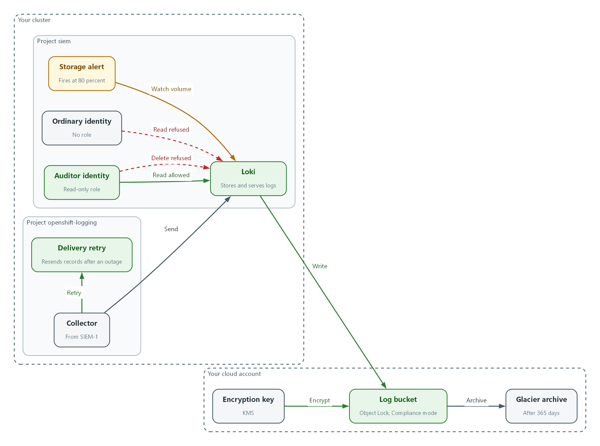
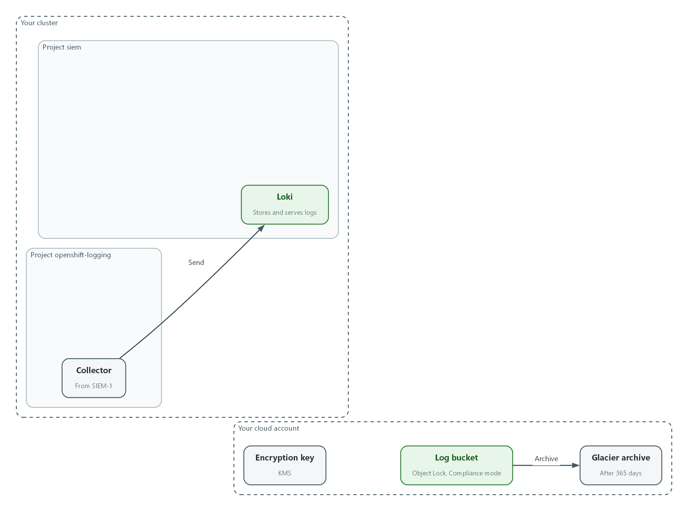
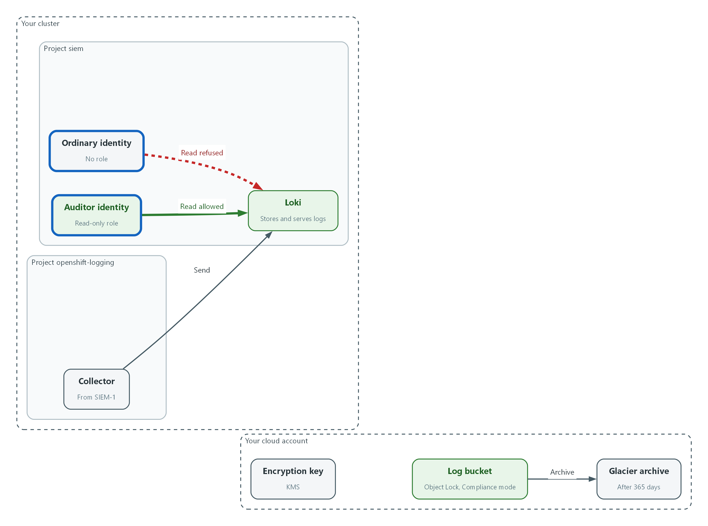
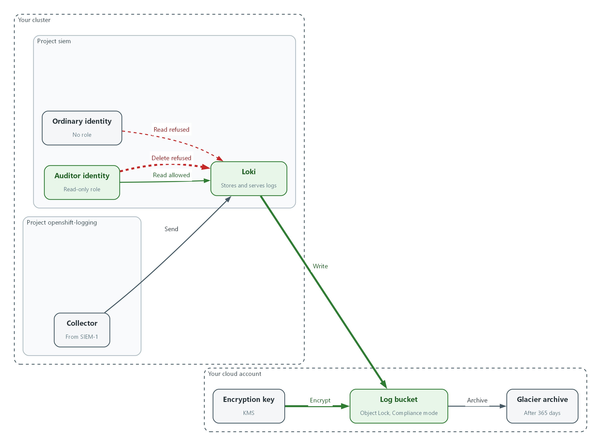
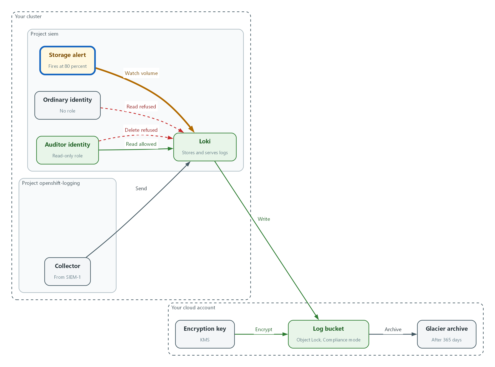
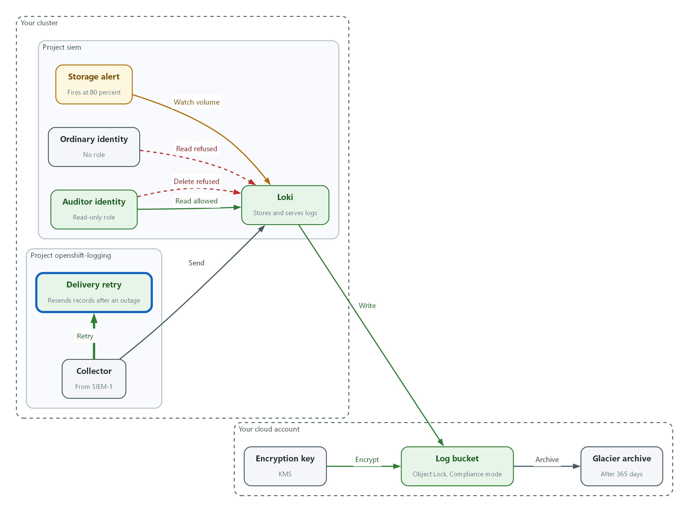

# SIEM-2: Store and Protect Audit Logs (AU-9, AU-11, AU-4, AU-5)

> 📌 DRAFT. Commands follow Grafana Loki and AWS CLI documentation but have not yet run in the lab. The Loki settings (SSE-KMS, deletion_mode, retention_enabled) and the forwarder tuning field (deliveryMode) are checked with --help, oc explain or a config verify before they are used. The Loki configuration file in Step 3 must match the lab's starting schema, which lab start provides. UNRESOLVED: The Loki compactor runs background index compaction that deletes old TSDB index files. S3 Object Lock in Compliance mode blocks those deletes with AccessDenied until each object ages past its lock period. The lab uses a short lock period so errors are transient, but this must be tested live. grafana/loki issue 20181 is still an open feature request for separate chunk and index buckets, so Loki has no supported way yet to lock only the chunks; see the note in Step 3. The Grafana alert-rule, folder and data source endpoints in Step 4 still work but the Grafana docs mark them deprecated.

| Item | Detail |
| --- | --- |
| Sequence | Module 4 of 17 in the recommended order |
| Timed work | About 70 minutes (45 hands-on, 25 verify) |
| Modes | Ready Lab (prebuilt) or Architect (you design and build it) |
| Standalone start | `lab start siem-2` |
| Combined start | Continue from the end state of the previous module |
| End state | `lab check siem-2` passes |
| Tools | Loki (free, open source), Amazon S3 with Object Lock and KMS encryption, Grafana (free, open source), OpenShift Logging, oc, aws, curl, jq |
| Prerequisites | SIEM-1 Collect Audit Logs |
| Extra lab needs | Loki runs as deployment loki in namespace siem, reads its whole configuration from ConfigMap loki-config (key config.yaml) and starts with -config.expand-env=true. The pod has the environment variables LOG_BUCKET, KMS_KEY_ARN and AWS_REGION and an AWS identity allowed to use that bucket and key.; The S3 bucket named by LOG_BUCKET was created with Object Lock enabled, versioning on, default encryption with KMS_KEY_ARN, a default Object Lock retention in Compliance mode with a short lab period, and a lifecycle rule that moves objects to Glacier after the archive period.; The Loki endpoint in LOKI_URL accepts a Kubernetes bearer token, and allows a read only when the token's identity is bound to ClusterRole audit-log-reader (lab-provided). Everyone else receives HTTP 403.; Grafana has a Loki data source named Loki and a Prometheus data source named Prometheus (cluster metrics). The learner's shell has GRAFANA_URL, GRAFANA_USER and GRAFANA_PASSWORD.; lab start siem-2 provides siem-forwarder.yaml from SIEM-1 and the starting loki-config. |

## 1. Why This Matters

An IL5 system must keep audit records for a defined period, protect them from being read, changed or deleted by people who should not, make sure there is room to hold them, and act when the logging process itself fails. This module moves the log store onto encrypted object storage, limits who can read and who can change it, shows the retention periods the lab sets, watches storage capacity, and proves that a Loki outage does not lose records.

### Control mapping

| Control | What it requires, in plain words | Source of the value | Where this module covers it |
| --- | --- | --- | --- |
| AU-9 Protection of Audit Information | Only the right people can read audit logs, nobody can change or delete them, and unauthorized attempts raise an alert. | NIST; FedRAMP | Steps 2 and 3 set read-only access and disable deletion. Tests 1 to 3 prove the read, the refusal and the locked storage. |
| AU-11 Audit Record Retention | Keep audit records for a set time so investigators can look back after an incident. | NIST; FedRAMP; DoD SRG | Step 1 reads the retention and archive settings. Step 3 turns off every way to delete early. |
| AU-4 Audit Log Storage Capacity | Reserve enough room for the logs. AU-5(1) adds a warning before the space runs out. | NIST; FedRAMP | Step 4 creates a storage alert. The lab chooses 80 percent as the warning level. |
| AU-5 Response to Audit Logging Process Failures | When logging breaks, tell named people within a set time and take the defined actions. | NIST; FedRAMP; DoD SRG | Step 5 turns on at-least-once delivery, the lab's local caching action. Test 4 stops Loki on purpose and shows no records are lost. |

### What each control is for

Read these answers first. They explain what each control is trying to prevent and how this module's tool meets it.

#### AU-9 Protection of Audit Information

| Question | Answer |
| --- | --- |
| What the control author feared | An intruder or a careless administrator edits or deletes the log of what they did, and the evidence is gone. |
| Is it in scope for the system | The log store, its storage bucket, its configuration, and the roles that can reach them. |
| The operational question | Who can read the audit logs, who can change or delete them, and would anyone be told if they tried? |
| What evidence proves it | The role list for the log store, the storage encryption and lock settings, and a refused delete attempt. |
| How much is enough | Read access is limited to named roles, unauthorized users cannot modify or delete records, integrity is protected with cryptography, and attempted tampering raises an alert. This lab goes further: nobody, including administrators, can delete the original records, and configuration changes need a second approver. |
| Who is told when it fails | Someone owns the alert for attempted tampering, and someone reviews the list of readers on a schedule. |
| How the tool in this module satisfies it | Loki on object storage with Object Lock, bearer-token read access limited to the audit role, and deletion switched off. |

#### AU-11 Audit Record Retention

| Question | Answer |
| --- | --- |
| What the control author feared | An incident is found months later and the logs that would explain it were already thrown away. |
| Is it in scope for the system | All audit records the team keeps, online and archived. |
| The operational question | If an incident is discovered today, how far back can you read the logs, and where do older ones live? |
| What evidence proves it | The retention policy, the storage settings that carry it out, and a successful read of an older record. |
| How much is enough | The retention period is written down, the settings match it, and nothing deletes records earlier. NIST leaves the period organization-defined, FedRAMP sets a minimum online period, and the lab sets online and archive stages. The lab sets no end date for the archive stage, so the end of retention is organization-defined and comes from the records retention policy. |
| Who is told when it fails | Someone owns the retention policy and the settings are reviewed when it changes. |
| How the tool in this module satisfies it | No automatic deletion in Loki, and an object-storage lifecycle rule that archives old objects. |

#### AU-4 Audit Log Storage Capacity

| Question | Answer |
| --- | --- |
| What the control author feared | The log disk fills up quietly and new records are dropped just when they are needed. |
| Is it in scope for the system | Every place audit records are stored or buffered: the object store, the Loki volume and the collector's local buffer. |
| The operational question | How full is each place that holds audit logs, and who is told before it is full? |
| What evidence proves it | Current usage figures and the alert rule with its threshold and recipients. |
| How much is enough | Capacity is sized for the retention requirement and an alert fires at 80 percent. Object storage grows on its own, so the volumes and buffers are the places that need watching. |
| Who is told when it fails | A named team receives the alert and acts on it. |
| How the tool in this module satisfies it | A Grafana alert on volume usage at 80 percent. |

#### AU-5 Response to Audit Logging Process Failures

| Question | Answer |
| --- | --- |
| What the control author feared | The log store stops and records from that time are lost, with nobody told. |
| Is it in scope for the system | The collector, the connection to Loki, and Loki itself. |
| The operational question | If Loki stopped right now, would anyone know, and would the records written meanwhile still be kept? |
| What evidence proves it | The defined failure actions, the alert, and a test where the store was stopped and restored. |
| How much is enough | Named people are alerted within the lab's alert time of 15 minutes, and the system keeps records while the store is away. The lab sets the alert delivery window and uses local caching as the defined action. FedRAMP's assigned additional action is to overwrite the oldest record; the lab chooses local caching so no records are lost. For the storage warning, the DoD mission owner overview says DoD-assigned values are used at IL5 instead of FedRAMP's; this module uses its own value. |
| Who is told when it fails | Alert recipients are current, and the failure test is repeated on a schedule. |
| How the tool in this module satisfies it | At-least-once delivery on the collector, which resends records Loki has not accepted, and the missing-logs alert built in SIEM-3. |

### Architect mode brief

Design the store before changing it. Decide which identities may read, which may change settings, and which may do neither. Decide where each retention stage lives and what removes records at the end. Decide what each place that holds logs will do when it is full or unreachable. Then build and break it.

### Terms in this module

Each term is also explained the first time it appears. This table is a quick lookup.

| Term | Plain meaning |
| --- | --- |
| Object storage (S3) | A cloud service that keeps files as objects in a bucket. It grows as needed. |
| Bucket | A named container in object storage. |
| Object Lock | An S3 feature that stops an object from being deleted or overwritten for a set period. |
| Compliance mode | The Object Lock setting where nobody, including the account owner, can shorten or remove the lock. |
| SSE-KMS | Server-side encryption using a key held in AWS Key Management Service. |
| Retention | How long records are kept. |
| Bearer token | A string that proves who is calling. The caller sends it in a request header. |
| HTTP status code | A number a web service returns: 200 means success, 403 means refused. |

## 2. The Tools

### Tools used in this module

Each tool name links to its official overview. The last column says how the tool is used in the lab.

| Tool (overview link) | What it is | Used in this lab |
| --- | --- | --- |
| [Grafana Loki](https://grafana.com/docs/loki/latest/) | Log storage that indexes only labels and keeps compressed log data in object storage. | Configured for retention and protected storage. |
| [Amazon S3 Object Lock](https://docs.aws.amazon.com/AmazonS3/latest/userguide/object-lock.html) | Makes stored objects write-once-read-many so they cannot be deleted or overwritten for a set time. | Makes stored logs tamper-resistant (write-once-read-many). |
| [AWS KMS](https://docs.aws.amazon.com/kms/latest/developerguide/overview.html) | Creates and controls encryption keys, held in FIPS-validated hardware. | Encrypts the log bucket. |
| [Grafana](https://grafana.com/docs/grafana/latest/) | Dashboards, log browsing and alerting. | Shows storage and log status. |
| [oc](https://docs.redhat.com/en/documentation/openshift_container_platform/4.22/html/cli_tools/openshift-cli-oc) | The OpenShift command-line tool for creating and managing applications and projects from a terminal. | Runs the cluster commands in each step. |
| [AWS CLI](https://docs.aws.amazon.com/cli/latest/userguide/cli-chap-welcome.html) | Runs AWS actions from a shell instead of the browser console. | Reads and checks AWS resources from the shell. |
| [jq](https://jqlang.org/) | Command-line JSON processor. | Picks fields out of JSON output. |
| [curl](https://curl.se/docs/manpage.html) | Command-line tool for transferring data over URLs, used here to call web endpoints. | Calls web endpoints to test behavior. |

### How it fits together

#### How audit logs are stored and protected

Loki keeps the logs in an encrypted, locked storage bucket. Only the auditor can read, nobody can delete, and an alert warns before the volume fills. Each step below adds one part, drawn with thick lines.



- The collector sends records to Loki, and Loki writes them to the log bucket.
- The encryption key encrypts every object in the bucket, and Object Lock in Compliance mode stops objects being deleted.
- The auditor identity can read logs through Loki. The ordinary identity is refused.
- Loki refuses every delete request, even from the auditor.
- Old objects move to the Glacier archive, and a storage alert warns at 80 percent of volume capacity.
- If Loki is unreachable, the collector resends the records until Loki accepts them.
### 2.1 Four jobs for the log store

What is this? Collecting logs (SIEM-1) is not enough. The place they land has four jobs: stay protected, keep records long enough, have room, and keep working when something fails.

Why? An attacker's first move is often to erase their tracks. A full disk or a stopped service looks the same as an attacker who switched logging off.

| Control | Job | Question to ask |
| --- | --- | --- |
| AU-9 | Protect | Can anyone change or delete records? |
| AU-11 | Retain | How far back can we read? |
| AU-4 | Have room | How full is it, and who is told? |
| AU-5 | Survive failure | What happens when logging breaks? |

### 2.2 Where Loki keeps data

Loki writes log chunks and its index to object storage. In this lab Loki keeps audit logs in AWS S3, and S3 Object Lock in Compliance mode is the cloud equivalent of write-once media (storage that cannot be rewritten).

Data is encrypted in the bucket with a key you control in KMS (Key Management Service). The copy on the wire is already protected by TLS (encryption in transit) from SIEM-1.

```text
Collector --TLS--> Loki --writes--> S3 bucket (encrypted, Object Lock)
                    ^                    |
   auditor token ---+ read only           +--> lifecycle rule --> Glacier archive
   ordinary token -----X (HTTP 403)
```

### 2.3 Who can read and who can change

Reading and changing are separate powers. In this lab the auditor role can read logs and do nothing else. Changing where logs live or how long they stay is a configuration change, and this lab sends those through a reviewed merge request with a second approver.

Loki also has a delete interface. Setting deletion_mode to disabled makes it refuse every delete request with HTTP 403, so even an administrator's credentials cannot use it.

| Identity | Read logs | Delete logs | Change Loki settings |
| --- | --- | --- | --- |
| auditor | Yes | No | No |
| ordinary user | No | No | No |
| platform administrator | Through the auditor role only | No | Yes, through reviewed change |

## 3. Implement

Ready Lab learners start with `lab start siem-2`. Architect learners design each step first using the brief above.

### Step 1. Read the current storage settings (AU-9, AU-11)

Before changing anything, record what protects the bucket today. These read-only commands show encryption, Object Lock and the lifecycle rule that archives old objects.

What this step adds (thick lines and outlines are new):



- Nothing is new yet. The collector sends records to Loki, and the bucket already has Object Lock in Compliance mode and a Glacier archive rule. You only read those settings.
```bash
aws s3api get-bucket-encryption --bucket "$LOG_BUCKET"
aws s3api get-object-lock-configuration --bucket "$LOG_BUCKET"
aws s3api get-bucket-lifecycle-configuration --bucket "$LOG_BUCKET"
oc get configmap loki-config -n siem -o jsonpath='{.data.config\.yaml}' | grep -n -E 'object_store|sse|retention|deletion'
```

| Part | What it does |
| --- | --- |
| get-bucket-encryption | Shows the default encryption on the bucket and the key it uses. |
| get-object-lock-configuration | Shows whether Object Lock is on and its default mode (Compliance or Governance) and period. |
| get-bucket-lifecycle-configuration | Shows the rule that moves old objects to the Glacier archive. The lab puts that move at 365 days. |
| grep ... loki-config | Shows the lines of Loki's current configuration that concern storage, retention and deletion. |

> 📌 This lab uses an online stage of 180 days and an archive move at 365 days. The lab sets no end date for the archive stage; that end date is organization-defined and comes from the records retention policy.

> ▶ YOUR TURN: Run the four commands. Write down the encryption algorithm, the Object Lock mode and the lifecycle transition.

> ✅ CHECKPOINT: Encryption is aws:kms, Object Lock mode is COMPLIANCE, and a lifecycle transition to GLACIER exists.

### Step 2. Create the auditor and ordinary identities (AU-9)

A service account is an identity for a program or a test user. You need one that is allowed to read logs and one that is not, so you can prove the difference. The auditor is bound to a read-only role. The ordinary identity gets nothing. This gives approved users read-only access to audit data.

What this step adds (thick lines and outlines are new):



- The auditor identity gets the read-only role. The ordinary identity gets nothing, so Loki refuses its reads.
```bash
oc create sa auditor -n siem
oc create sa ordinary-user -n siem
oc get clusterrole audit-log-reader
oc adm policy add-cluster-role-to-user audit-log-reader -z auditor -n siem
AUDITOR_TOKEN=$(oc create token auditor -n siem)
ORDINARY_TOKEN=$(oc create token ordinary-user -n siem)
```

| Part | What it does |
| --- | --- |
| oc create sa | Creates the two identities. |
| oc get clusterrole audit-log-reader | Confirms the read-only role exists before you use it. |
| add-cluster-role-to-user ... -z auditor | Gives only the auditor the read-only role. The ordinary identity is left without it. |
| oc create token | Makes a short-lived bearer token for each identity and stores it in a shell variable, not a file. Do not print it. |

> 🔒 Tokens are secrets. Keep them in shell variables only, never in files, tickets or the chat channel.

> ▶ YOUR TURN: Run the commands. Then run oc auth can-i get pods -n siem --as=system:serviceaccount:siem:ordinary-user to see that the ordinary identity has no extra rights.

> ✅ CHECKPOINT: The role exists, the binding is created, and the ordinary identity gets the answer no.

### Step 3. Store Loki data in encrypted S3 and switch off deletion (AU-9, AU-11)

This configuration file replaces the one from the starting state. It writes chunks and the index to the bucket, encrypts each object with your KMS key, and sets deletion_mode to disabled so Loki's delete interface refuses every request. The retention period stays at zero, which means no age-based deletion, so nothing removes records before the organization-defined end of retention. The bucket name, key and region come from the Loki pod's environment, so no value is typed here. Changes to this file belong in version control with a second approver (CM-3 and CM-5).

What this step adds (thick lines and outlines are new):



- Loki now writes to the bucket, each object is encrypted with your key, and the delete interface refuses every request.
```yaml
auth_enabled: false
server:
  http_listen_port: 3100
common:
  path_prefix: /var/loki
  replication_factor: 1
  ring:
    kvstore:
      store: inmemory
schema_config:
  configs:
    - from: "2024-04-01"
      store: tsdb
      object_store: s3
      schema: v13
      index:
        prefix: index_
        period: 24h
storage_config:
  tsdb_shipper:
    active_index_directory: /var/loki/index
    cache_location: /var/loki/index_cache
  aws:
    bucketnames: ${LOG_BUCKET}
    region: ${AWS_REGION}
    sse:
      type: SSE-KMS
      kms_key_id: ${KMS_KEY_ARN}
compactor:
  working_directory: /var/loki/compactor
  retention_enabled: true
  delete_request_store: s3
limits_config:
  retention_period: 0s
  deletion_mode: disabled
```

| Part | What it does |
| --- | --- |
| object_store: s3 | Stores chunks and index in S3 instead of local disk. |
| bucketnames, region | Read from the pod's environment (LOG_BUCKET, AWS_REGION). |
| sse: type SSE-KMS | Every object written is encrypted with your KMS key. |
| retention_enabled: true, delete_request_store: s3 | Switches on the part of Loki that hosts the delete interface. Without it the interface does not exist at all and answers 404 instead of refusing. Loki requires the store setting when this is on. |
| retention_period: 0s | Zero means keep logs forever, so Loki never deletes by age. The archive rule and the retention policy decide the end. |
| deletion_mode: disabled | The delete interface answers HTTP 403 to everyone. |

```bash
oc create configmap loki-config -n siem --from-file=config.yaml=loki-config.yaml --dry-run=client -o yaml | oc apply -f -
oc rollout restart deployment/loki -n siem
oc rollout status deployment/loki -n siem
sleep 60
oc logs deployment/loki -n siem | grep -i -E 'level=error' | head -5
curl -s --cacert "$LOKI_CA_FILE" -H "Authorization: Bearer $AUDITOR_TOKEN" "$LOKI_URL/ready"
```

| Part | What it does |
| --- | --- |
| --from-file ... --dry-run=client -o yaml | oc apply | Builds the configuration map from your file and applies it, replacing the old one. |
| rollout restart / status | Restarts Loki so it reads the new file and waits until it is ready. |
| logs ... grep level=error | Looks for startup errors such as a bad bucket or key. An empty result is good. |
| curl ... /ready | Asks Loki if it is ready, using the auditor token. |

> 📌 Loki runs a background compactor that merges TSDB index files and deletes the old un-compacted ones. When the S3 bucket uses Object Lock in Compliance mode, those delete calls return AccessDenied until each object ages past its lock period. The lab sets a short lock period so the errors are transient and clear on their own. In Loki logs they appear as level=error storage component=compactor. Loki has no supported setting yet to lock only the chunks and leave the index unlocked: a request for separate chunk and index buckets is still open (grafana/loki issue 20181). Turning the compactor off stops the errors but lets the index fragment, which slows queries over time. Which trade-off a production system accepts is a decision for the system owner and needs a live test.

> 🔒 Skipping SSE-KMS would leave records readable by anyone with raw bucket access. SSE-KMS keeps each object encrypted with a key you control.

> 💡 Keep loki-config.yaml in git and change it only through a reviewed merge request. That gives a second approver over audit storage settings.

> ▶ YOUR TURN: Save the YAML as loki-config.yaml, apply it, restart Loki, and read the log check.

> ✅ CHECKPOINT: Rollout completes, no error lines appear, and ready answers ready.

### Step 4. Warn before storage fills (AU-4)

Object storage grows by itself, but the Loki volume and local buffers do not. This lab alerts at 80% of capacity. This creates a Grafana alert rule on volume usage. A rule has a query, a condition and a folder. A folder is a named group of rules. SIEM-3 connects alerts to Mattermost.

What this step adds (thick lines and outlines are new):



- A Grafana alert rule watches the Loki volume and fires at 80 percent of capacity.
```bash
PROM_UID=$(curl -s -u "$GRAFANA_USER:$GRAFANA_PASSWORD" "$GRAFANA_URL/api/datasources/name/Prometheus" | jq -r .uid)
FOLDER_UID=$(curl -s -u "$GRAFANA_USER:$GRAFANA_PASSWORD" -H 'Content-Type: application/json' \
  -d '{"title":"siem-storage"}' "$GRAFANA_URL/api/folders" | jq -r .uid)
echo "$PROM_UID $FOLDER_UID"
```

| Part | What it does |
| --- | --- |
| api/datasources/name/Prometheus | Looks up the id of the metrics data source by its name. |
| api/folders | Creates a folder for storage alerts and returns its id. |
| echo | Prints both ids so you can see neither is empty or null. |

```json
{
  "title": "audit-storage-volume-high",
  "ruleGroup": "storage",
  "folderUID": "FOLDER_UID",
  "noDataState": "OK",
  "execErrState": "Error",
  "for": "1m",
  "condition": "B",
  "annotations": {"summary": "A Loki volume is at or above 80% of capacity"},
  "labels": {"control": "AU-4"},
  "data": [
    {
      "refId": "A",
      "datasourceUid": "PROM_UID",
      "relativeTimeRange": {"from": 600, "to": 0},
      "model": {"refId": "A", "expr": "max(kubelet_volume_stats_used_bytes{namespace=\"siem\"} / kubelet_volume_stats_capacity_bytes{namespace=\"siem\"}) * 100"}
    },
    {
      "refId": "B",
      "datasourceUid": "-100",
      "relativeTimeRange": {"from": 0, "to": 0},
      "model": {
        "refId": "B",
        "type": "classic_conditions",
        "datasource": {"type": "__expr__", "uid": "-100"},
        "conditions": [{"type": "query", "query": {"params": ["A"]}, "reducer": {"type": "last", "params": []}, "evaluator": {"type": "gt", "params": [80]}, "operator": {"type": "and"}}]
      }
    }
  ]
}
```

| Part | What it does |
| --- | --- |
| expr | Percent used of every volume in the siem namespace; the highest one is tested. |
| evaluator gt 80 | The rule fires when usage is above 80. |
| noDataState OK | If the metric is missing the rule stays quiet. Check the rule's health in Step 4's last command. |
| labels control AU-4 | A label SIEM-3 routing and your review can filter on. |

```bash
sed -e "s/FOLDER_UID/$FOLDER_UID/" -e "s/PROM_UID/$PROM_UID/" storage-rule.json > storage-rule-final.json
curl -s -u "$GRAFANA_USER:$GRAFANA_PASSWORD" -H 'Content-Type: application/json' -H 'X-Disable-Provenance: true' \
  -d @storage-rule-final.json "$GRAFANA_URL/api/v1/provisioning/alert-rules" | jq '{title, condition, uid}'
sleep 60
curl -s -u "$GRAFANA_USER:$GRAFANA_PASSWORD" "$GRAFANA_URL/api/prometheus/grafana/api/v1/rules" | jq '.data.groups[].rules[] | select(.name=="audit-storage-volume-high") | {name, state, health}'
```

| Part | What it does |
| --- | --- |
| sed | Fills the two ids into the rule file and writes a new copy. |
| alert-rules POST | Creates the rule. X-Disable-Provenance keeps it editable in the Grafana screen. |
| api/prometheus/grafana/api/v1/rules | Lists rules with their current state and health. |

> 📌 If health shows error, the metric name or data source is not available in your cluster. Check the data source with the Grafana Explore screen and use the volume metric it lists.

> ▶ YOUR TURN: Save the JSON as storage-rule.json, then run the commands.

> ✅ CHECKPOINT: The rule is created and its health is ok. State inactive means usage is below the threshold.

### Step 5. Keep records when the connection to Loki fails (AU-5)

This lab uses local caching as the defined action when the connection to the central store is lost. At-least-once delivery makes the collector resend any record it has read but not yet delivered, including after the collector restarts, until Loki accepts it. Red Hat's documentation does not say where those records wait, so Test 4 proves the result rather than the mechanism. Check the field name with oc explain first, because Logging releases differ.

What this step adds (thick lines and outlines are new):



- The collector resends records until Loki accepts them.
```bash
oc explain clusterlogforwarders.observability.openshift.io.spec.outputs.loki.tuning
oc patch clusterlogforwarders.observability.openshift.io siem-forwarder -n openshift-logging --type json \
  -p '[{"op":"add","path":"/spec/outputs/0/loki/tuning","value":{"deliveryMode":"AtLeastOnce"}}]' --dry-run=server
oc patch clusterlogforwarders.observability.openshift.io siem-forwarder -n openshift-logging --type json \
  -p '[{"op":"add","path":"/spec/outputs/0/loki/tuning","value":{"deliveryMode":"AtLeastOnce"}}]'
sleep 60
oc get pods -n openshift-logging
```

| Part | What it does |
| --- | --- |
| oc explain ...tuning | Prints the delivery options your Logging release accepts. |
| --dry-run=server | Asks the cluster to check the change without saving it. |
| deliveryMode AtLeastOnce | Resends records that were read but not yet delivered, instead of dropping them. Some records may arrive twice. |
| oc get pods | Collectors restart to pick up the change. Wait until all are Running. |

> 💡 The alert that tells people the store has failed is the missing-logs rule you build in SIEM-3. The lab sets 15 minutes for alert delivery.

> ▶ YOUR TURN: Run the commands and wait for the collector pods to be Running.

> ✅ CHECKPOINT: The patch is accepted and every collector pod is Running.

## 4. Verify It Works

### Test 1 (positive). The auditor role can read retained audit logs

Protection that blocks the auditor too is not useful. Prove the right role can read.

```bash
curl -sG --cacert "$LOKI_CA_FILE" -H "Authorization: Bearer $AUDITOR_TOKEN" \
  "$LOKI_URL/loki/api/v1/query_range" \
  --data-urlencode 'query={log_type="audit"}' \
  --data-urlencode 'limit=1' | jq '.data.result | length'
```

**Expected output:**

```
1
```

> ✅ CHECKPOINT: The count is 1 or more. Zero means no audit records are stored or the auditor lacks the role.

### Test 2 (negative). An ordinary user cannot read or delete audit logs

Use the identity with no role. A secure store refuses it. The delete request is also tried with the auditor, which should fail too because nobody may delete.

```bash
echo read-by-ordinary:
curl -s -o /dev/null -w '%{http_code}\n' -G --cacert "$LOKI_CA_FILE" -H "Authorization: Bearer $ORDINARY_TOKEN" \
  "$LOKI_URL/loki/api/v1/query_range" --data-urlencode 'query={log_type="audit"}'
echo delete-by-ordinary:
curl -s -o /dev/null -w '%{http_code}\n' -X POST --cacert "$LOKI_CA_FILE" -H "Authorization: Bearer $ORDINARY_TOKEN" \
  "$LOKI_URL/loki/api/v1/delete?query=%7Blog_type%3D%22audit%22%7D&start=1700000000"
echo delete-by-auditor:
curl -s -o /dev/null -w '%{http_code}\n' -X POST --cacert "$LOKI_CA_FILE" -H "Authorization: Bearer $AUDITOR_TOKEN" \
  "$LOKI_URL/loki/api/v1/delete?query=%7Blog_type%3D%22audit%22%7D&start=1700000000"
oc auth can-i update configmap/loki-config -n siem --as=system:serviceaccount:siem:ordinary-user
```

**Expected output:**

```
read-by-ordinary:
403
delete-by-ordinary:
403
delete-by-auditor:
403
no
```

> ✅ CHECKPOINT: All three web calls return 403 and the permission check says no. A 200 or 204 on any delete is a failed control.

### Test 3 (negative). A locked object cannot be deleted even with administrator cloud rights

Object Lock in Compliance mode is the cloud equivalent of write-once media. Write a small test object of your own, then try to delete that exact version and watch the bucket refuse. Your test object stays in the bucket until its lock period ends; it holds no log data.

```bash
KEY=lab-lock-test/$(date +%s).txt
VID=$(echo lock test | aws s3api put-object --bucket "$LOG_BUCKET" --key "$KEY" --body - --server-side-encryption aws:kms --ssekms-key-id "$KMS_KEY_ARN" --query VersionId --output text)
aws s3api delete-object --bucket "$LOG_BUCKET" --key "$KEY" --version-id "$VID"
```

**Expected output:**

```
Example only.
An error occurred (AccessDenied) when calling the DeleteObject operation: Access Denied because object protected by object lock.
```

> ✅ CHECKPOINT: The delete fails with AccessDenied. If it succeeds, the bucket default lock is not in Compliance mode.

### Test 4 (negative). Stop Loki and show no records are lost

Break the log store on purpose. The collector should buffer records and deliver them when Loki returns. The marker project is created while Loki is down.

```bash
oc scale deployment/loki -n siem --replicas=0
oc new-project lab-outage-test
sleep 60
oc scale deployment/loki -n siem --replicas=1
oc rollout status deployment/loki -n siem
sleep 60
curl -sG --cacert "$LOKI_CA_FILE" -H "Authorization: Bearer $AUDITOR_TOKEN" \
  "$LOKI_URL/loki/api/v1/query_range" \
  --data-urlencode 'query={log_type="audit"} |= "lab-outage-test"' \
  --data-urlencode 'limit=1' | jq '.data.result | length'
```

**Expected output:**

```
1
```

> ✅ CHECKPOINT: The count is 1 or more, so the record written during the outage arrived afterwards. A 0 means the delivery setting in Step 5 is not active.

Run `lab check siem-2` to run these tests automatically. It checks:

- The log bucket is encrypted with the lab KMS key and Object Lock is on in Compliance mode.
- Loki's delete interface is disabled and the auditor role can read audit logs.
- An ordinary identity receives HTTP 403 on read and on delete.
- A locked object cannot be deleted, even by the cluster administrator's cloud identity.
- After a Loki outage, audit records created during the outage arrive once Loki returns.
## 5. Glossary and Next Steps

| Term | Meaning |
| --- | --- |
| Object Lock | An S3 feature that stops objects being deleted or overwritten for a set time. |
| KMS | Key Management Service: AWS service that holds encryption keys. |
| Lifecycle rule | A bucket rule that moves or expires objects by age. |
| Bearer token | A string sent with a request to prove who is calling. |
| Alert rule (Grafana) | A saved query and condition that raises an alert when the condition is true. |
| Write-once media | Storage that cannot be rewritten after data is placed on it. |

> 💡 Next module: SIEM-3 Detect and Alert: rules that watch the logs, alerts that arrive in Mattermost, and a routine for reviewing them.
