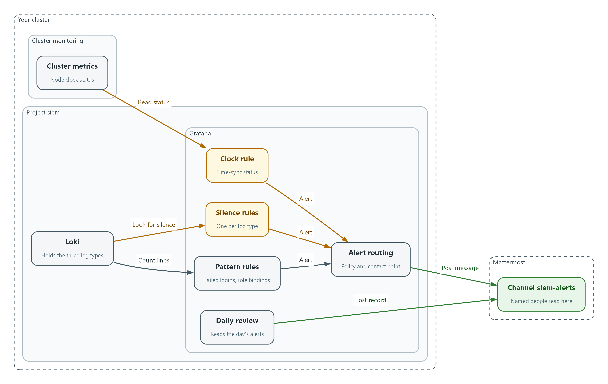
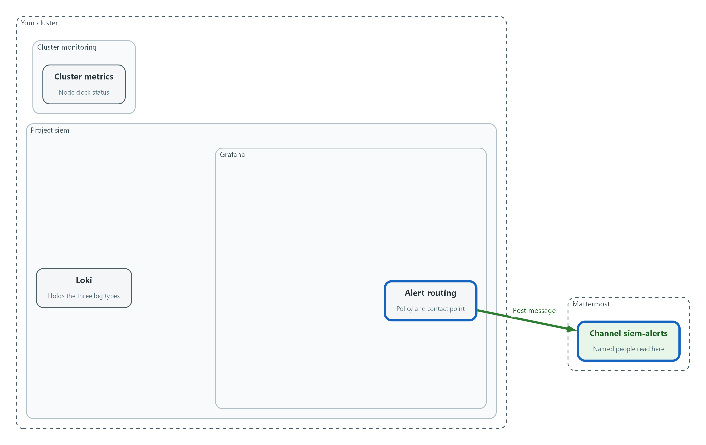
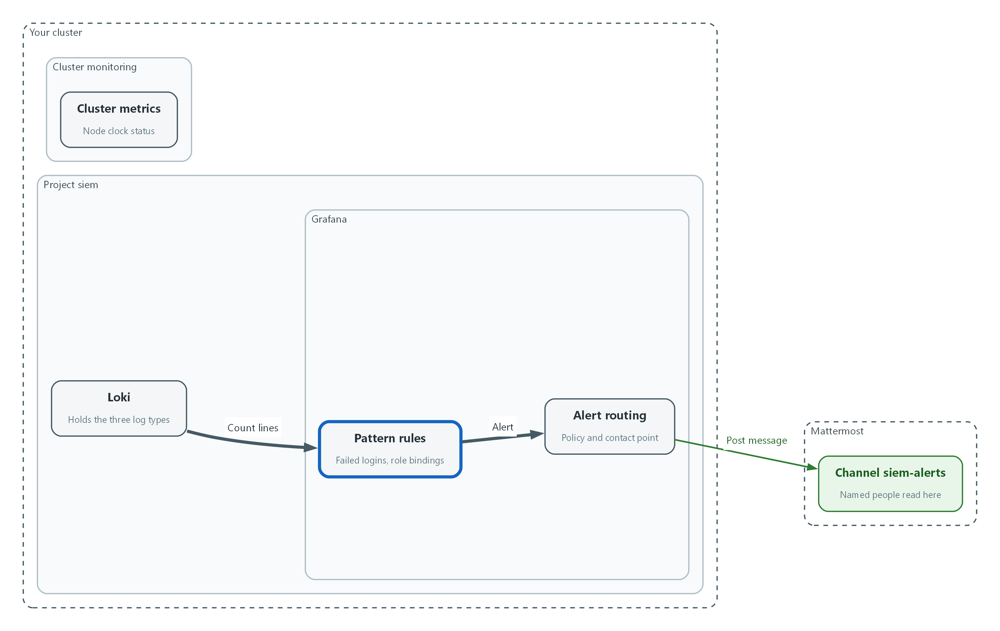
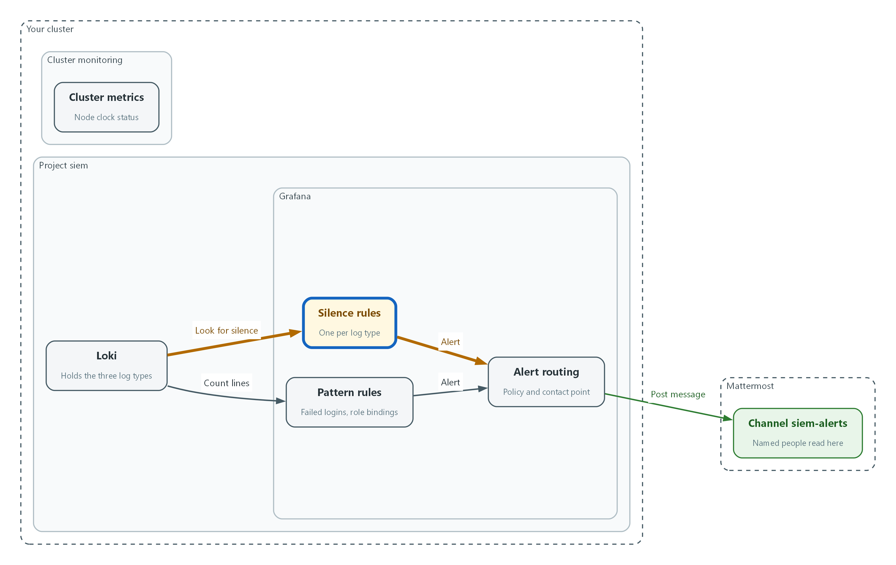
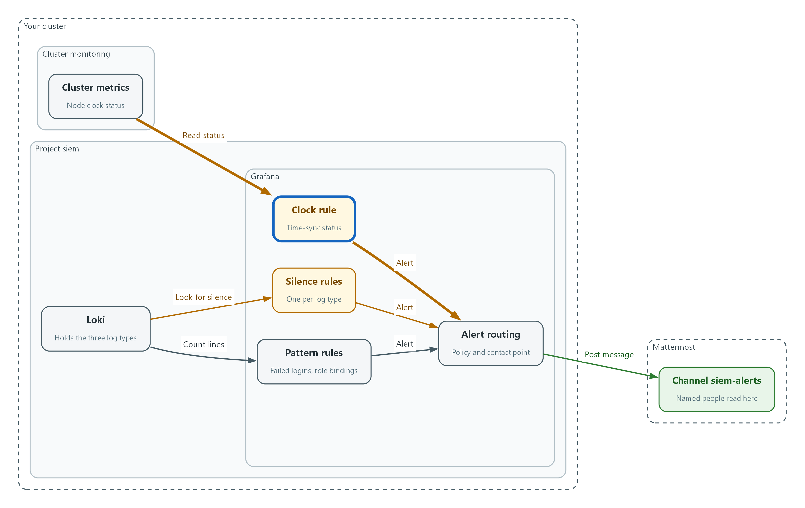
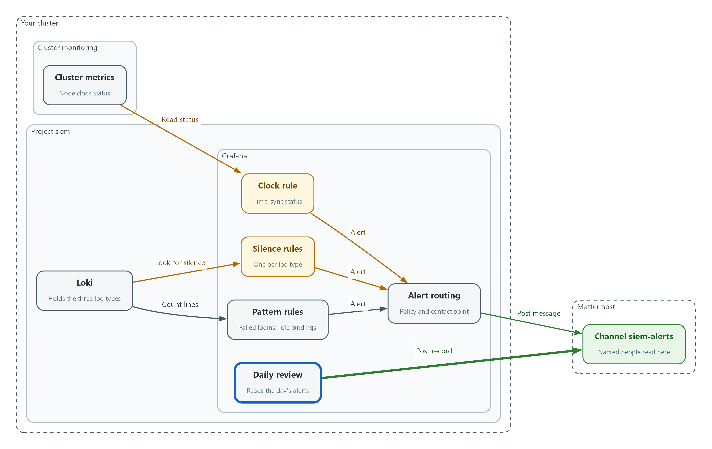

# SIEM-3: Detect and Alert (SI-4, SI-4(5), AU-6)

> 📌 DRAFT. Commands follow the Grafana alerting HTTP API and Loki LogQL documentation but have not yet run in the lab. Label names for application logs (kubernetes_namespace_name) and the Keycloak event text (LOGIN_ERROR) differ between Logging and Keycloak releases, so Step 2 lists the label values before the rules use them. The node clock metric (node_timex_sync_status) is read from the cluster's metrics data source and must exist there. Step 2 prints one audit record's fields to confirm the privilege-change rule's field names (objectRef_resource, verb). The Grafana provisioning endpoints used (alert-rules, contact-points, policies) are marked deprecated in the current Grafana API reference but still documented; Step 1 and Step 2 print the returned name or uid, which confirms each call worked. The Slack contact point setting name url is confirmed in the Grafana alerting source code. The annotation field alertName is not in the Grafana annotations reference, so Step 5 falls back to the text field. The Grafana folder, data source by name and Prometheus-format rules endpoints used here are not in the current API reference, so each is checked by its printed output on the first lab run. Test 2 lists all daemonsets in openshift-logging instead of assuming the collector daemonset name.

| Item | Detail |
| --- | --- |
| Sequence | Module 5 of 17 in the recommended order |
| Timed work | About 70 minutes (45 hands-on, 25 verify) |
| Modes | Ready Lab (prebuilt) or Architect (you design and build it) |
| Standalone start | `lab start siem-3` |
| Combined start | Continue from the end state of the previous module |
| End state | `lab check siem-3` passes |
| Tools | Grafana alerting (free, open source), Loki LogQL (free, open source), Mattermost (free, open source), oc, curl, jq |
| Prerequisites | SIEM-1 Collect Audit Logs, SIEM-2 Store and Protect Audit Logs |
| Extra lab needs | Grafana has a Loki data source named Loki and a Prometheus data source named Prometheus (cluster metrics, including node_timex_sync_status).; Mattermost has a channel named siem-alerts and an incoming webhook for it. MM_WEBHOOK_URL holds that webhook address.; Keycloak writes login events to its container log, and the SIEM-1 forwarder collects application logs from namespace keycloak.; The Grafana Loki data source authenticates with an identity bound to ClusterRole audit-log-reader, so the rules can read audit, infrastructure and application logs.; Service account auditor exists in namespace siem and is bound to ClusterRole audit-log-reader (from SIEM-2). lab start siem-3 provides it and also provides siem-forwarder.yaml.; The learner's shell has KEYCLOAK_URL and trusts the same CA file as LOKI_CA_FILE. |

## 1. Why This Matters

An IL5 system must watch its own audit records for signs of attack, alert named people when the signs appear, and have people review the records and alerts on a schedule. It must also notice when the watching itself fails: a collector that stopped, logs that went quiet, or a clock that is out of step. This module builds the rules in Grafana, sends the alerts to a Mattermost channel, and sets up the review routine. It closes the gap you saw in SIEM-1, where removing a permission stopped audit records and nothing told anyone.

### Control mapping

| Control | What it requires, in plain words | Source of the value | Where this module covers it |
| --- | --- | --- | --- |
| SI-4 System Monitoring | Watch the system for attacks, signs of attack, and unauthorized connections, and analyze what is found. | NIST | Steps 2 to 4 write the rules that watch for attacks, silence and clock failure. |
| SI-4(5) System-Generated Alerts | The system itself alerts named people when it sees defined signs of compromise. | NIST | Step 1 connects Grafana to a Mattermost channel. Tests 1 and 2 show alerts arriving. |
| AU-6 Audit Record Review, Analysis, and Reporting | Review audit records on a schedule for defined unusual activity and report what you find. | NIST; FedRAMP; DoD SRG | Steps 2 and 5 build rules for two items of unusual activity (login failures and an increase of privileges) and a daily review routine. |

### What each control is for

Read these answers first. They explain what each control is trying to prevent and how this module's tool meets it.

#### SI-4 System Monitoring

| Question | Answer |
| --- | --- |
| What the control author feared | An attack runs for days because nothing was watching, or the watching broke and nobody noticed. |
| Is it in scope for the system | The components the team operates, and the monitoring tools themselves. |
| The operational question | If someone attacked the system right now, which tool would notice first, and how would you know that tool is still working? |
| What evidence proves it | The monitoring objectives, the rules that carry them out, and a test that shows a rule firing. |
| How much is enough | Objectives are written down, rules map to them, events are analyzed, and the monitoring is itself monitored. NIST names attacks and indicators of potential attacks, and unauthorized local, network and remote connections, as what to detect. |
| Who is told when it fails | A named owner keeps the rule set current when the system or the threat changes. |
| How the tool in this module satisfies it | Grafana alert rules over Loki logs and cluster metrics, plus rules that fire when a log type goes silent. |

#### SI-4(5) System-Generated Alerts

| Question | Answer |
| --- | --- |
| What the control author feared | The system sees a sign of compromise but the message goes nowhere, or to someone who is not watching. |
| Is it in scope for the system | Alerts produced by the tools, and the people and channels that receive them. |
| The operational question | When a rule fires, who gets the message, how fast, and how do you know it arrived? |
| What evidence proves it | The list of defined compromise indicators, the recipients, and an alert that was actually delivered. |
| How much is enough | Indicators are defined, roles are named, delivery is automatic, and the delivery path was tested end to end. NIST leaves the recipients to the organization. This lab sends alerts to a named channel and uses 15 minutes as its target for logging-failure alerts. |
| Who is told when it fails | Someone checks that the recipient list and channel membership are still right. |
| How the tool in this module satisfies it | A Mattermost contact point reached through MM_WEBHOOK_URL, and a notification policy that routes every alert to it. |

#### AU-6 Audit Record Review, Analysis, and Reporting

| Question | Answer |
| --- | --- |
| What the control author feared | Records are collected but nobody looks, so a slow attack hides in plain sight. |
| Is it in scope for the system | Audit records from every collected log type, and the people who review them. |
| The operational question | Who looked at the audit records today, what were they looking for, and where is that written down? |
| What evidence proves it | The review frequency, the list of unusual activity, the alerts reviewed and a review record. |
| How much is enough | A frequency is set, unusual activity is defined, findings go to named recipients, and review depth changes when risk changes (this module does not build that last part). NIST leaves the frequency organization-defined. This lab reviews alerts daily. FedRAMP sets a floor of at least weekly. The lab's unusual-activity list includes login failures, privilege increases and attempts to clear or modify audit logs, and reports go to the ISSO and ISSM. |
| Who is told when it fails | The unusual-activity list is reviewed when requirements change, and a missed review is noticed. |
| How the tool in this module satisfies it | Rules for the unusual-activity list, and a short review routine in Step 5 that lists the day's alerts and records the review in the channel. |

### Architect mode brief

Design the detections before building them. List the unusual activity your organization defines and decide which log field or metric shows each one. Decide who receives alerts and in which channel. Decide how you will know the detections themselves have stopped working. Then write the rules and test each one.

### Terms in this module

Each term is also explained the first time it appears. This table is a quick lookup.

| Term | Plain meaning |
| --- | --- |
| Alert rule | A saved query plus a condition. When the condition is true, Grafana raises an alert. |
| Contact point | Where Grafana sends alerts, such as a chat channel. |
| Notification policy | The routing table that decides which contact point receives which alerts. |
| Webhook | A web address that accepts a message and posts it, here into a Mattermost channel. |
| Mattermost channel | A named chat room. The alert arrives there as a message. |
| LogQL metric query | A search that counts matching log lines over a time window, such as count_over_time. |
| absent_over_time | A LogQL function that returns 1 when no log line matched during the window. |
| Alert state | Normal means the condition is false. Pending means it just became true. Alerting (also shown as firing) means an alert is being sent. |

## 2. The Tools

### Tools used in this module

Each tool name links to its official overview. The last column says how the tool is used in the lab.

| Tool (overview link) | What it is | Used in this lab |
| --- | --- | --- |
| [Grafana](https://grafana.com/docs/grafana/latest/) | Dashboards, log browsing and alerting. | Hosts the alert rules. |
| [LogQL](https://grafana.com/docs/loki/latest/query/) | Loki's query language for searching and filtering logs. | The query that spots the event in the logs. |
| [Mattermost](https://docs.mattermost.com/developers/integrate/webhooks/incoming) | Open-source team chat. Incoming webhooks let tools post messages into a channel. | Receives the alert message in a chat channel. |
| [oc](https://docs.redhat.com/en/documentation/openshift_container_platform/4.22/html/cli_tools/openshift-cli-oc) | The OpenShift command-line tool for creating and managing applications and projects from a terminal. | Runs the cluster commands in each step. |
| [jq](https://jqlang.org/) | Command-line JSON processor. | Picks fields out of JSON output. |
| [curl](https://curl.se/docs/manpage.html) | Command-line tool for transferring data over URLs, used here to call web endpoints. | Calls web endpoints to test behavior. |

### How it fits together

#### From log line to Mattermost message

Grafana rules watch the logs and one cluster metric. When a rule fires, the alert goes through routing to a Mattermost channel. Each step below adds one part, drawn with thick lines.



- Pattern rules and silence rules read the logs in Loki, and the clock rule reads the cluster metrics.
- Every rule sends its alert to alert routing.
- Alert routing posts the message to the siem-alerts channel in Mattermost.
- The daily review lists the day's alerts and posts a review record in the same channel.
### 2.1 Two kinds of detection

What is this? Some rules watch for something that happens, such as repeated failed logins. Others watch for something that stops happening, such as an audit log that goes quiet. Both are needed.

Why? Attackers who cannot hide an action will try to stop the log of it. A rule that only looks for bad events never sees a quiet log.

| Kind | Example | How the rule works |
| --- | --- | --- |
| Pattern | Failed logins, privilege changes | Count matching log lines in a window. Fire when the count passes a limit. |
| Absence | Collector stopped | Fire when no line of a log type arrived in the window. |
| Health | Clock not synchronized | Read a status metric. Fire when it reports a problem. |

### 2.2 From log line to Mattermost message

Grafana runs each rule on a schedule. A rule has query A (the search) and condition B (the test). If B is true the rule goes from Normal to Pending to Alerting, and Grafana hands the alert to the notification policy. The policy sends it to the contact point, which posts to Mattermost.

Every alert has labels. The labels decide the routing and tell the reader which control the rule supports.

```text
Loki / metrics --query A--> condition B --Alerting--> notification policy
                                                          |
                                                contact point (webhook)
                                                          |
                                            Mattermost channel siem-alerts
```

### 2.3 What to watch for

This lab lists unusual activity for AU-6, including an increase of privileges, multiple or excessive login failures, and any attempt to clear or modify audit logs. NIST gives no number for multiple or excessive. This module borrows the DoD limit of three unsuccessful attempts for privileged users (an AC-7 account lockout value in the DoD Cloud Computing SRG) as a lab limit only. It is not an AU-6 requirement, so look up your own organization's value. Other items, such as the generic Administrator account, are not built here.

No number is given for how far log volume may fall before it is a problem. The rules here therefore fire only when a whole log type is silent. A partial-drop limit is organization-defined, and ask who owns it before adding such a rule.

| What to watch for | Lab rule | Signal |
| --- | --- | --- |
| Lab list: multiple or excessive login failures | failed-login-burst | Keycloak LOGIN_ERROR lines in the application log |
| Lab list: an increase of privileges (closest cluster equivalent) | privilege-change | Audit records that create a role binding |
| Not on the lab list: audit logging stops (SIEM-1 gap) | logs-missing-audit, -infrastructure, -application | No lines of that log type in the window |
| Not on the lab list: clocks not synchronized (AU-8) | node-clock-unsynchronized | Node time-sync status metric |

## 3. Implement

Ready Lab learners start with `lab start siem-3`. Architect learners design each step first using the brief above.

### Step 1. Connect Grafana to a Mattermost channel (SI-4(5))

An alert nobody receives is not an alert. A contact point tells Grafana where to send messages. Mattermost accepts messages at a webhook address, which acts like a mailbox for one channel. The address is a secret, so it stays in the MM_WEBHOOK_URL variable and is never typed. First send a plain test message, then register the contact point and make it the default route. The policy call replaces the whole routing tree, which is acceptable on a fresh lab.

What this step adds (thick lines and outlines are new):



- Alert routing sends every alert to the siem-alerts channel in Mattermost.
```bash
curl -s -H 'Content-Type: application/json' -d '{"text":"SIEM-3 delivery test"}' "$MM_WEBHOOK_URL"
jq -n --arg url "$MM_WEBHOOK_URL" '{name:"mattermost",type:"slack",settings:{url:$url}}' | curl -s -u "$GRAFANA_USER:$GRAFANA_PASSWORD" -H 'Content-Type: application/json' -H 'X-Disable-Provenance: true' -d @- "$GRAFANA_URL/api/v1/provisioning/contact-points" | jq '{name, type}'
curl -s -u "$GRAFANA_USER:$GRAFANA_PASSWORD" -X PUT -H 'Content-Type: application/json' -H 'X-Disable-Provenance: true' -d '{"receiver":"mattermost","group_by":["alertname"],"group_wait":"0s"}' "$GRAFANA_URL/api/v1/provisioning/policies"
```

| Part | What it does |
| --- | --- |
| curl ... MM_WEBHOOK_URL | Posts a test message. Mattermost answers ok when it accepts it. Look in the siem-alerts channel. |
| jq -n --arg url | Builds the contact point description with the address inserted from the variable, so the address is never shown or saved. |
| type slack | Mattermost accepts the same message format as Slack, so the Slack contact point type in Grafana works. |
| policies PUT | Makes mattermost the receiver for every alert and sends the first alert in a group at once. |

> 🔒 Anyone who holds the webhook address can post into the channel. Treat it like a password and never paste it into chat or a ticket.

> ▶ YOUR TURN: Run the three commands and open the siem-alerts channel in Mattermost.

> ✅ CHECKPOINT: The test message appears in the channel and the contact point is listed as name mattermost.

### Step 2. Write the pattern rules: failed logins and privilege changes (SI-4, AU-6)

Each rule is built the same way, so first define one small shell function, mkrule, that builds a rule from a title, a data source, a query, a comparison, a limit, a no-data setting and a control label, and sends it to Grafana. Then call it once per rule. The failed-login limit is the DoD figure for privileged users from AC-7. NIST leaves multiple or excessive undefined, so replace it with your organization's value when you have one. The 5 minutes window in the rules is a lab choice.

What this step adds (thick lines and outlines are new):



- Two pattern rules count matching log lines: failed logins and role bindings that grant permissions.
```bash
AUDITOR_TOKEN=$(oc create token auditor -n siem)
curl -s --cacert "$LOKI_CA_FILE" -H "Authorization: Bearer $AUDITOR_TOKEN" "$LOKI_URL/loki/api/v1/label/kubernetes_namespace_name/values" | jq -c .
LOKI_UID=$(curl -s -u "$GRAFANA_USER:$GRAFANA_PASSWORD" "$GRAFANA_URL/api/datasources/name/Loki" | jq -r .uid)
PROM_UID=$(curl -s -u "$GRAFANA_USER:$GRAFANA_PASSWORD" "$GRAFANA_URL/api/datasources/name/Prometheus" | jq -r .uid)
FOLDER_UID=$(curl -s -u "$GRAFANA_USER:$GRAFANA_PASSWORD" -H 'Content-Type: application/json' -d '{"title":"siem-detect"}' "$GRAFANA_URL/api/folders" | jq -r .uid)
echo "$LOKI_UID $PROM_UID $FOLDER_UID"
curl -sG --cacert "$LOKI_CA_FILE" -H "Authorization: Bearer $AUDITOR_TOKEN" "$LOKI_URL/loki/api/v1/query_range" --data-urlencode 'query={log_type="audit"} | json | objectRef_resource!=""' --data-urlencode 'limit=1' | jq -c '.data.result[0].stream'
```

| Part | What it does |
| --- | --- |
| oc create token auditor | Makes a short-lived read-only token from SIEM-2's auditor identity and keeps it in a shell variable. |
| label/kubernetes_namespace_name/values | Lists the namespace names Loki holds. keycloak must be in the list, or the failed-login rule below needs a different label name. |
| datasources/name/... | Looks up the id of each data source by name. |
| api/folders | Creates a folder for this module's rules and returns its id. |
| echo | Prints the three ids so you can see none is empty or null. |
| query_range ... json | Reads one audit record and prints its fields. verb and objectRef_resource must appear, or the privilege-change rule needs different field names. null means no audit record was found. |

```bash
mkrule() {
  QUERY=$(jq -n --arg ds "$2" --arg expr "$3" '{refId:"A",datasourceUid:$ds,relativeTimeRange:{from:600,to:0},model:{refId:"A",expr:$expr,queryType:"instant",instant:true}}')
  COND=$(jq -n --arg op "$4" --argjson thr "$5" '{refId:"B",datasourceUid:"-100",relativeTimeRange:{from:0,to:0},model:{refId:"B",type:"classic_conditions",datasource:{type:"__expr__",uid:"-100"},conditions:[{type:"query",query:{params:["A"]},reducer:{type:"last",params:[]},evaluator:{type:$op,params:[$thr]},operator:{type:"and"}}]}}')
  jq -n --arg title "$1" --arg folder "$FOLDER_UID" --arg nodata "$6" --arg control "$7" --argjson a "$QUERY" --argjson b "$COND" '{orgID:1,title:$title,ruleGroup:"detect",folderUID:$folder,noDataState:$nodata,execErrState:"Error","for":"0s",condition:"B",labels:{control:$control},annotations:{summary:$title},data:[$a,$b]}' | curl -s -u "$GRAFANA_USER:$GRAFANA_PASSWORD" -H 'Content-Type: application/json' -H 'X-Disable-Provenance: true' -d @- "$GRAFANA_URL/api/v1/provisioning/alert-rules" | jq -c '{title, uid}'
}
```

| Part | What it does |
| --- | --- |
| mkrule() { | Starts a reusable command. Its inputs are $1 title, $2 data source id, $3 query, $4 comparison, $5 limit, $6 no-data setting, $7 control label. |
| QUERY= | Builds query A, the search that Grafana runs. |
| COND= | Builds condition B, the test on A's last value: for example gt 2 means greater than 2. |
| jq -n ... | curl | Joins the two parts into one rule and sends it to Grafana. orgID 1 is the default Grafana organization. The rule group is detect and it fires with no waiting period. |

```bash
mkrule failed-login-burst "$LOKI_UID" 'sum(count_over_time({log_type="application", kubernetes_namespace_name="keycloak"} |= "LOGIN_ERROR" [5m]))' gt 2 OK AU-6
mkrule privilege-change "$LOKI_UID" 'sum(count_over_time({log_type="audit"} | json | verb="create" | objectRef_resource=~"rolebindings|clusterrolebindings" [5m]))' gt 0 OK AU-6
```

| Part | What it does |
| --- | --- |
| failed-login-burst | Counts Keycloak LOGIN_ERROR lines in the last window. gt 2 fires at three or more, the DoD limit from AC-7. no-data OK means no lines is normal. |
| privilege-change | Counts audit records that create a role binding (a grant of permissions). The json step turns each audit line into fields that can be tested. |

> 📌 A new role binding is exactly what SIEM-2 Step 2 did, so this rule will also fire for your own legitimate grants. That is expected. Reviewing and closing such alerts is the AU-6 routine.

> ▶ YOUR TURN: Save nothing; paste the commands. Confirm the namespace list contains keycloak, then run the function definition and both rule commands.

> ✅ CHECKPOINT: Each mkrule call prints a title and a uid.

### Step 3. Close the SIEM-1 gap: alert when a log type goes silent (AU-6, SI-4)

In SIEM-1 you removed a permission and audit records stopped without any warning. This step adds one rule per log type that fires when no line of that type arrived in the window. A collector that is stopped, a broken forwarder and a revoked permission all produce the same silence, so one rule covers all three.

What this step adds (thick lines and outlines are new):



- Three silence rules fire when a whole log type sends no lines, which closes the gap you saw in SIEM-1.
```bash
for t in audit infrastructure application; do mkrule "logs-missing-$t" "$LOKI_UID" "absent_over_time({log_type=\"$t\"}[5m])" gt 0 OK SI-4; done
```

| Part | What it does |
| --- | --- |
| for t in ...; do ... done | Repeats the command three times, once per log type. |
| absent_over_time({log_type=...}[5m]) | Returns 1 when no line of that type arrived in the last window, and nothing when lines are flowing. |
| gt 0 OK | Fire when the value is above zero. No result means logs are flowing, so no-data is normal. |

> 📌 A partial drop in volume is not covered. No limit is given for how much a stream may fall, so that limit is organization-defined. Ask who owns it before adding a ratio rule.

> ▶ YOUR TURN: Run the loop.

> ✅ CHECKPOINT: Three titles are printed: logs-missing-audit, logs-missing-infrastructure and logs-missing-application.

### Step 4. Alert when a node clock loses synchronization (AU-8, SI-4)

SIEM-1 checked the clocks by hand. Records with wrong times cannot be put in order. The node-exporter metric node_timex_sync_status is 1 when the kernel clock is synchronized and 0 when it is not, so no invented drift limit is needed. An allowed offset in milliseconds is organization-defined; look it up before adding an offset rule.

What this step adds (thick lines and outlines are new):



- A clock rule reads the node time-sync status from the cluster metrics.
```bash
mkrule node-clock-unsynchronized "$PROM_UID" 'min(node_timex_sync_status)' lt 1 NoData AU-8
sleep 60
curl -s -u "$GRAFANA_USER:$GRAFANA_PASSWORD" "$GRAFANA_URL/api/prometheus/grafana/api/v1/rules" | jq -r '.data.groups[].rules[] | [.name, .state, .health] | @tsv'
```

| Part | What it does |
| --- | --- |
| lt 1 NoData | Fire when the minimum status across nodes is below 1. If the metric is missing, the rule reports NoData so a gap is visible. |
| sleep 60 | Waits for the first evaluations. |
| api/prometheus/grafana/api/v1/rules | Lists every rule with its state and health. |

> ▶ YOUR TURN: Run the commands and read the table.

> ✅ CHECKPOINT: The six rules from this module are listed with health ok, along with audit-storage-volume-high from SIEM-2. Inactive is the correct state for a healthy system.

### Step 5. Set up the review routine (AU-6)

This lab has analysts review real-time alerts daily and sends reports to the ISSO and ISSM. FedRAMP sets at least weekly as a floor, and NIST leaves the frequency organization-defined, so the daily routine meets all three. This routine lists the last day of alerts, counts them by rule, and records in Mattermost that the review happened. Recording the review in the channel keeps the evidence next to the alerts and needs no document.

What this step adds (thick lines and outlines are new):



- The daily review lists the day's alerts and posts a review record in the channel.
```bash
FROM=$(( ($(date +%s) - 86400) * 1000 ))
curl -s -u "$GRAFANA_USER:$GRAFANA_PASSWORD" "$GRAFANA_URL/api/annotations?type=alert&from=$FROM&limit=100" | jq -r '.[] | [(.time/1000|floor|todate), (.alertName // .text), .newState] | @tsv' | sort | tee review.tsv
cut -f2 review.tsv | sort | uniq -c
jq -n --arg t "Daily alert review complete by $(oc whoami) at $(date -u +%Y-%m-%dT%H:%M:%SZ)" '{text:$t}' | curl -s -H 'Content-Type: application/json' -d @- "$MM_WEBHOOK_URL"
```

| Part | What it does |
| --- | --- |
| FROM= | Computes the start of the window: now minus one day, in milliseconds. |
| api/annotations?type=alert | Asks Grafana for alert state changes since then. |
| sort | tee review.tsv | Orders them by time and keeps a copy for the next command. |
| cut -f2 ... uniq -c | Counts how many state changes each rule had. |
| jq -n --arg t ... | curl | Posts a one-line review record into the alerts channel. |

> 💡 Each alert in the list is either a real event to report to the ISSO and ISSM, or a known cause to close. Say which in the channel thread under the alert.

> ▶ YOUR TURN: Run the commands once now. Repeat them each working day.

> ✅ CHECKPOINT: You see a list of recent alert changes, a count per rule, and the review line in the channel.

## 4. Verify It Works

### Test 1 (positive). A burst of failed logins raises an alert in Mattermost

Cause the event, wait for the rule, and confirm both the alert state and the message. The names used here do not exist, so every attempt fails.

```bash
for i in 1 2 3 4 5; do curl -s -o /dev/null --cacert "$LOKI_CA_FILE" -d client_id=admin-cli -d username=lab-no-such-user -d password=wrong-on-purpose -d grant_type=password "$KEYCLOAK_URL/realms/master/protocol/openid-connect/token"; done
sleep 150
curl -s -u "$GRAFANA_USER:$GRAFANA_PASSWORD" "$GRAFANA_URL/api/prometheus/grafana/api/v1/rules" | jq -r '.data.groups[].rules[] | select(.name=="failed-login-burst") | [.name, .state] | @tsv'
```

**Expected output:**

```
Example only.
failed-login-burst	firing
In the siem-alerts channel: a message titled [FIRING:1] failed-login-burst with label control=AU-6.
```

> ✅ CHECKPOINT: The state is firing and the message is visible in the channel. If it is still pending or inactive, check the label list from Step 2 and the Keycloak log text.

### Test 2 (negative). Stop the collector and the missing-logs alert fires

Delete the log forwarder so the collectors are removed. Records stop arriving, which is the silence SIEM-1 Test 3 produced. The rule needs the whole window to pass with no lines, so this takes about eight minutes. A saved copy of the forwarder, including the delivery setting from SIEM-2, is used to restore it, then the alert clears.

```bash
oc get clusterlogforwarder siem-forwarder -n openshift-logging -o json | jq 'del(.metadata.resourceVersion,.metadata.uid,.metadata.creationTimestamp,.metadata.generation,.metadata.managedFields,.status)' > siem-forwarder-backup.json
oc delete clusterlogforwarder siem-forwarder -n openshift-logging
sleep 30
oc get daemonset -n openshift-logging
sleep 480
curl -s -u "$GRAFANA_USER:$GRAFANA_PASSWORD" "$GRAFANA_URL/api/prometheus/grafana/api/v1/rules" | jq -r '.data.groups[].rules[] | select(.name=="logs-missing-audit") | [.name, .state] | @tsv'
oc apply -f siem-forwarder-backup.json
sleep 240
curl -s -u "$GRAFANA_USER:$GRAFANA_PASSWORD" "$GRAFANA_URL/api/prometheus/grafana/api/v1/rules" | jq -r '.data.groups[].rules[] | select(.name=="logs-missing-audit") | [.name, .state] | @tsv'
```

**Expected output:**

```
Example only.
No resources found in openshift-logging namespace.
logs-missing-audit	firing
logs-missing-audit	inactive
In the siem-alerts channel: a [FIRING:1] message for logs-missing-audit, then a [RESOLVED] message after the restore.
```

> ✅ CHECKPOINT: No collector daemonset is listed, the rule fires and the message arrives, and after the restore the rule returns to inactive. If it never fires, the collector is still delivering or the label does not match.

### Test 3 (positive). Every rule evaluates and reports health ok

A rule that cannot evaluate is silent, which is the failure this module exists to prevent. Check them all.

```bash
curl -s -u "$GRAFANA_USER:$GRAFANA_PASSWORD" "$GRAFANA_URL/api/prometheus/grafana/api/v1/rules" | jq -r '.data.groups[].rules[] | select(.health!="ok") | [.name, .health] | @tsv'
```

**Expected output:**

```
(empty output)
```

> ✅ CHECKPOINT: The command prints nothing. Any line printed names a rule whose query or data source is broken.

Run `lab check siem-3` to run these tests automatically. It checks:

- The Mattermost contact point exists and the default notification policy sends to it.
- Rules exist for failed logins, privilege changes, missing log types and clock synchronization, and all report health ok.
- A burst of failed Keycloak logins fires the failed-login rule and a message reaches the siem-alerts channel.
- Deleting the log forwarder fires the missing-audit-logs rule, and restoring it clears the alert.
## 5. Glossary and Next Steps

| Term | Meaning |
| --- | --- |
| Alert rule | A saved query and condition that raises an alert when true. |
| Contact point | A destination for alerts, such as a chat channel. |
| Notification policy | The rules that route alerts to contact points. |
| Webhook | A web address that accepts a message and posts it to a channel. |
| LogQL | Loki's search language. |
| Role binding | A grant of a role's permissions to an identity. |

> 💡 Next module: SIEM-4 Respond to an Incident: take an alert from Mattermost, open an incident channel, contain a compromised workload, and report.
