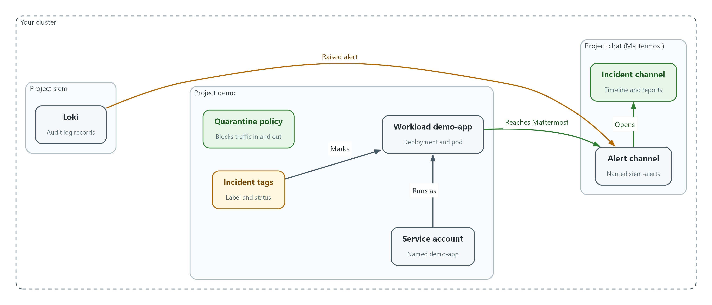
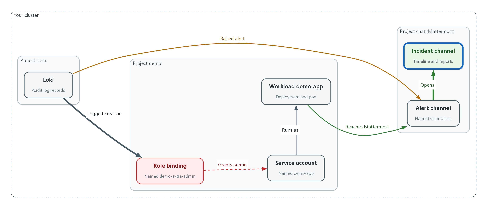
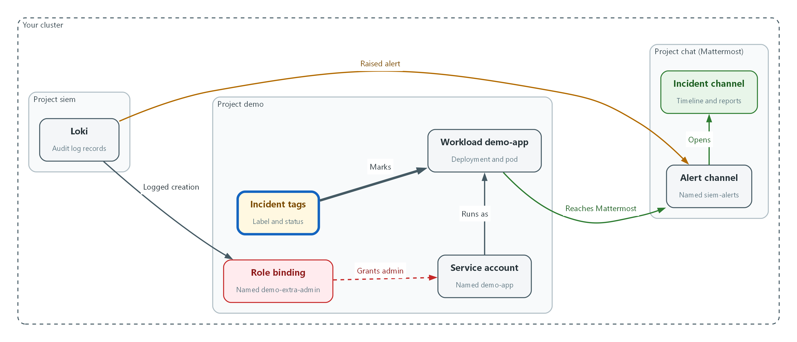
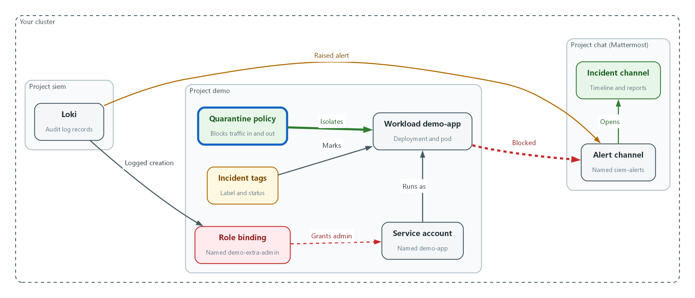
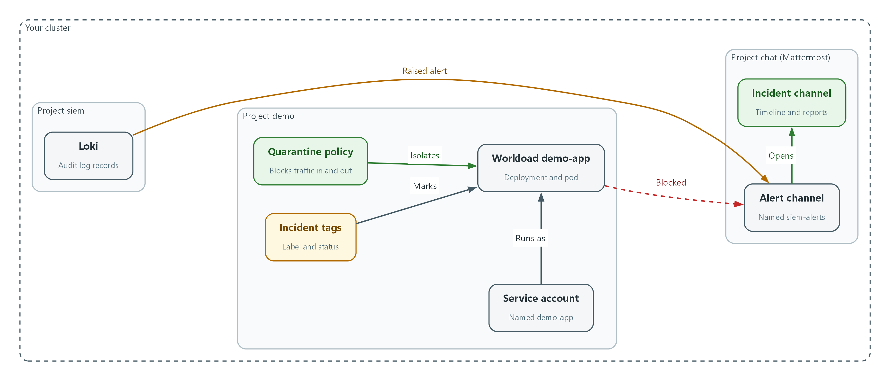
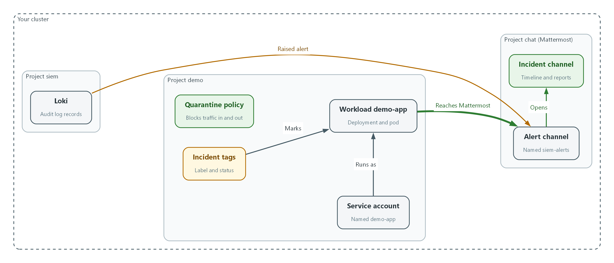

# SIEM-4: Respond to an Incident (IR-4, IR-5, IR-6)

> 📌 DRAFT. Commands follow Kubernetes and OpenShift documentation (oc adm cordon, oc scale, NetworkPolicy) but have not yet run in the lab. The NetworkPolicy is validated with --dry-run=server before it is applied. The probe inside demo-app needs curl in that image and a Mattermost service reachable by its cluster address; both are listed under lab needs. The Mattermost ping path /api/v4/system/ping is in the Mattermost API reference (no authentication needed). Not yet confirmed live: that the audit log fields flatten to objectRef_resource in Loki (confirm with the step 1 query without the last two filters).

| Item | Detail |
| --- | --- |
| Sequence | Module 6 of 17 in the recommended order |
| Timed work | About 65 minutes (45 hands-on, 20 verify) |
| Modes | Ready Lab (prebuilt) or Architect (you design and build it) |
| Standalone start | `lab start siem-4` |
| Combined start | Continue from the end state of the previous module |
| End state | `lab check siem-4` passes |
| Tools | Mattermost (free, open source), Loki and Grafana (free, open source), OpenShift Container Platform, oc, curl, jq |
| Prerequisites | SIEM-1 Collect Audit Logs, SIEM-2 Store and Protect Audit Logs, SIEM-3 Detect and Alert |
| Extra lab needs | lab start siem-4 deploys demo-app in namespace demo (label app=demo-app, service account demo-app, an image that includes curl) and creates role binding demo-extra-admin that gives that service account the admin role in demo. SIEM-3's privilege-change rule then fires and its alert is waiting in Mattermost channel siem-alerts.; The cluster network plugin enforces NetworkPolicy (the OpenShift default does).; Mattermost is reachable inside the cluster at http://mattermost.chat.svc.cluster.local:8065 and the learner has a Mattermost account that can create channels.; Service account auditor in namespace siem is bound to ClusterRole audit-log-reader (from SIEM-2). lab start siem-4 provides it. |

## 1. Why This Matters

An IL5 system must have a practiced way to handle a security incident from first alert to recovery, keep a record of what was done, and report to the right parties within set times. This module takes an alert from Mattermost, opens an incident channel, works the handling steps against a simulated compromised workload, contains it with cluster commands, proves the containment, recovers, and posts the reports. No document is written. The channel and the cluster hold the record.

### Control mapping

| Control | What it requires, in plain words | Source of the value | Where this module covers it |
| --- | --- | --- | --- |
| IR-4 Incident Handling | Have an incident handling capability that covers preparation, detection and analysis, containment, eradication and recovery, and learn from each incident. | NIST; FedRAMP | Steps 1 to 5 walk the phases in order. Step 3 contains and proves it. |
| IR-5 Incident Monitoring | Track and document every incident, including its status and the information needed to review how it was handled. | NIST; FedRAMP | Steps 1, 2 and 5 label the workload and keep the timeline in the incident channel. |
| IR-6 Incident Reporting | Personnel report suspected incidents within a set time, and incident information goes to the defined authorities. | NIST; FedRAMP; DoD SRG | Step 5 posts the reports to the parties and within the times the lab sets. |

### What each control is for

Read these answers first. They explain what each control is trying to prevent and how this module's tool meets it.

#### IR-4 Incident Handling

| Question | Answer |
| --- | --- |
| What the control author feared | An incident happens and everyone improvises: evidence is destroyed, the wrong system is shut down, or the attacker keeps access. |
| Is it in scope for the system | Incidents that affect the components the team operates. |
| The operational question | If an alert shows a workload has been compromised, who does what next, and in what order? |
| What evidence proves it | The documented phases, the roles, and a handled incident that shows each phase. |
| How much is enough | The capability covers every phase, is coordinated with contingency planning, and feeds lessons back into the plan. The lab uses the phases Preparation, Detection, Analysis, Containment, Eradication and Recovery, makes the Organization SOC the only authority that declares an incident, and has the platform team carry out containment, eradication and recovery as the SOC directs. It treats dynamic network restriction as a least-disruptive containment action. |
| Who is told when it fails | Someone runs the exercise on a schedule and updates the plan with what was learned. |
| How the tool in this module satisfies it | Cluster commands for isolation, cordon and scale-down, and a Mattermost channel that holds the working record. |

#### IR-5 Incident Monitoring

| Question | Answer |
| --- | --- |
| What the control author feared | An incident is handled but nobody can later say what happened, who did it, or whether it was closed. |
| Is it in scope for the system | Every incident from detection to closure. |
| The operational question | Can you list all open incidents right now, with status and who is working each? |
| What evidence proves it | An incident list with status history, assignees and timestamps, and one sample incident from alert to close. |
| How much is enough | Each incident has a status that moves through a lifecycle, a timeline with times and people, and references to the evidence. The lab uses a lifecycle of open, in-progress and resolved. This lab has no document step, so the incident channel and labels on the workload hold the facts a ticket would. |
| Who is told when it fails | Someone checks that no incident has stayed open without an owner. |
| How the tool in this module satisfies it | An incident identifier used as the channel name and as a label, plus a status annotation on the workload. |

#### IR-6 Incident Reporting

| Question | Answer |
| --- | --- |
| What the control author feared | The people who must act, or the authorities who must be told, hear late or never. |
| Is it in scope for the system | Suspected and confirmed incidents, and the parties the lab names. |
| The operational question | Who must be told, by whom, and by when? |
| What evidence proves it | The reporting chain, the time limits, and a timeline showing each report was made. |
| How much is enough | Personnel report suspected incidents immediately to their supervisor and the ISSO. The ISSO reports to the Organization SOC within one hour of confirmation. This lab reports incidents to CISA within 1 hour of post-triage confirmation and notifies the authorizing official (AO) and the ISSM. FedRAMP's assigned reporting time refers to the incident reporting time limits in NIST SP 800-61 (as amended) and its requirement points to the Continuous Monitoring Playbook. The DoD Cloud Service Provider SRG requires initial reports within one hour after the provider's triage. |
| Who is told when it fails | Contact details and the chain are tested, and the exercise measures the elapsed time. |
| How the tool in this module satisfies it | Time-stamped report lines posted in the incident channel, each naming the party and the time. |

### Architect mode brief

Design the response before the incident. Decide what you will isolate first and why (least disruptive first), what evidence must exist before anything is deleted, who declares the incident, and who gets each report and by when. Prepare the isolation rule in advance so containment is one command. Then run it.

### Terms in this module

Each term is also explained the first time it appears. This table is a quick lookup.

| Term | Plain meaning |
| --- | --- |
| Incident | An event that actually or imminently harms the confidentiality, integrity or availability of the system or breaks security rules. |
| Triage | A quick first look to decide whether an alert is a real incident and how urgent it is. |
| Containment | Stopping the harm from spreading while keeping evidence. |
| Eradication | Removing what the attacker left, such as stolen permissions. |
| Recovery | Returning the system to normal, safely. |
| Cordon | Mark a node so no new workloads are placed on it. Running ones keep running. |
| NetworkPolicy | A cluster rule that says which network connections a group of pods may make. |
| Scale down | Reduce the number of running copies of a workload, here to zero. |
| Incident channel | A Mattermost channel opened for one incident. It holds the timeline. |

## 2. The Tools

### Tools used in this module

Each tool name links to its official overview. The last column says how the tool is used in the lab.

| Tool (overview link) | What it is | Used in this lab |
| --- | --- | --- |
| [Mattermost](https://docs.mattermost.com/developers/integrate/webhooks/incoming) | Open-source team chat. Incoming webhooks let tools post messages into a channel. | Where the alert arrives and the response is coordinated. |
| [Grafana Loki](https://grafana.com/docs/loki/latest/) | Log storage that indexes only labels and keeps compressed log data in object storage. | Searched to trace what happened. |
| [Grafana](https://grafana.com/docs/grafana/latest/) | Dashboards, log browsing and alerting. | Used to view the query results. |
| [oc](https://docs.redhat.com/en/documentation/openshift_container_platform/4.22/html/cli_tools/openshift-cli-oc) | The OpenShift command-line tool for creating and managing applications and projects from a terminal. | Used to contain the affected workload. |
| [OpenShift Container Platform](https://docs.redhat.com/en/documentation/openshift_container_platform/4.22/html/overview/ocp-overview) | A Kubernetes container platform for running and managing containerized applications. | The cluster every command in this module runs against. |
| [jq](https://jqlang.org/) | Command-line JSON processor. | Picks fields out of JSON output. |
| [curl](https://curl.se/docs/manpage.html) | Command-line tool for transferring data over URLs, used here to call web endpoints. | Calls web endpoints to test behavior. |

### How it fits together

#### How the response changes the cluster

The alert starts in Mattermost. The response isolates the workload, removes the stolen permission and brings the workload back. Each step below adds one part, drawn with thick lines.



- The alert comes from Loki and lands in the alert channel in Mattermost.
- The role binding demo-extra-admin gives the demo-app service account administrator rights in demo until it is deleted in step 4.
- The quarantine policy blocks the workload's traffic, so its connection to Mattermost is blocked (status code 000).
- After recovery the workload runs with the new service account and reaches Mattermost again (status code 200).
### 2.1 The phases

What is this? This lab handles an incident as Preparation, Detection, Analysis, Containment, Eradication and Recovery. You do the first in advance and the other five during an incident.

Why? Doing the phases in order keeps you from deleting evidence before you understand it, or restoring a system before the attacker's access is gone.

| Phase | Question | In this lab |
| --- | --- | --- |
| Preparation | Is isolation ready before it is needed? | The quarantine policy is applied ahead of time. |
| Detection | What raised the alert? | The privilege-change alert in Mattermost. |
| Analysis | What happened and what is the reach? | Search Loki, list the permissions the workload holds. |
| Containment | How do we stop it spreading? | Network isolation, cordon, scale down. |
| Eradication | What did the attacker leave? | Remove the role binding and reset the identity. |
| Recovery | How do we return to normal? | Uncordon, scale up, check, report. |

### 2.2 Least disruptive first

Dynamic Kubernetes network policies can isolate one pod while the rest of the system keeps working. Do that first. A cordon only stops new workloads from landing on the node and breaks nothing that is running. Scale down is last, because it removes the pod and what is inside it.

A word on this lab: you have one node, so a cordon also blocks new pods for everything else until you uncordon. In a real cluster with many nodes it protects the suspect node only.

```text
alert --> triage --> open incident channel --> analyze
                                                |
           isolate pod (NetworkPolicy) --> cordon node --> scale down
                                                |
                  eradicate --> recover --> report (ISSO, SOC, CISA, AO, ISSM)
```

### 2.3 Who declares and who reports

In this lab the Organization SOC has the sole authority to declare an incident. Platform staff execute containment, eradication and recovery as the SOC directs. Reporting runs on clocks that start at set moments: immediately to the supervisor and ISSO for suspected incidents, and within one hour of confirmation from the ISSO to the SOC.

In the lab you play all the roles. Record each decision and each report as a time-stamped line in the incident channel so the timeline shows who did what and when.

| Party | When | Control |
| --- | --- | --- |
| Supervisor and ISSO | Immediately, for a suspected incident | IR-6 |
| Organization SOC | Within one hour of confirmation | IR-6 |
| CISA | Within 1 hour of post-triage confirmation | IR-6 |
| AO and ISSM | Notified by the lab; the lab sets no time limit | IR-6 |

## 3. Implement

Ready Lab learners start with `lab start siem-4`. Architect learners design each step first using the brief above.

### Step 1. Triage the alert and open the incident channel (Detection)

Triage is a quick first look: is this real, and how bad could it be? Start from the alert in Mattermost, then confirm it in the log store. Next open a channel just for this incident so every action is recorded in one place. The first message is the incident identifier, the alert and the time in UTC. In this lab the Organization SOC is the authority that declares an incident, so the declaration is also posted as a message.

What this step adds (thick lines and outlines are new):



- The alert is waiting in the alert channel. You confirm it in Loki, which logged the role binding that gave the workload administrator rights, and open an incident channel.
```bash
INC=inc-$(date -u +%Y%m%d-%H%M)
note() { echo "[$INC] $(date -u +%Y-%m-%dT%H:%M:%SZ) $*"; }
AUDITOR_TOKEN=$(oc create token auditor -n siem)
curl -sG --cacert "$LOKI_CA_FILE" -H "Authorization: Bearer $AUDITOR_TOKEN" "$LOKI_URL/loki/api/v1/query_range" --data-urlencode 'query={log_type="audit"} | json | verb="create" | objectRef_resource="rolebindings" | objectRef_namespace="demo"' --data-urlencode 'limit=5' | jq -r '.data.result[].values[][1] | fromjson | [.stageTimestamp, .user.username, .objectRef.name] | @tsv'
echo "$MM_URL"
note "DETECTED privilege-change alert for namespace demo; opening channel $INC"
```

| Part | What it does |
| --- | --- |
| INC=inc-$(date ...) | Makes an incident identifier from the current UTC date and time, for example inc-20261025-1403. |
| note() {...} | Defines a small command that prints a line starting with the identifier and the UTC time. You paste these lines into the channel. |
| oc create token auditor | Makes a read-only token from SIEM-2's auditor identity. |
| curl ... query_range | Searches the audit logs for role bindings created in namespace demo and prints time, who, and the binding name. |
| echo MM_URL | Prints the Mattermost address to open in your browser. |
| note ... | Prints the first timeline line to paste into the channel. |

> ▶ YOUR TURN: Run the commands. In Mattermost, read the alert in siem-alerts. Create a private channel and use the incident identifier as its name. Add your teammates. Paste the note line as the first message and add a second message declaring the incident, with the time. Pin the first message.

> ✅ CHECKPOINT: The search returns a binding named demo-extra-admin created by system:serviceaccount:demo:demo-app, and the incident channel exists with two messages.

### Step 2. Analyze the reach and mark the workload (Analysis, IR-5)

Before containing, learn what the compromised identity can do. Then tag the workload with the incident identifier and a status, so anyone can list incidents with a cluster command. Tags are labels (searchable key=value tags) and annotations (free notes).

What this step adds (thick lines and outlines are new):



- You tag the workload with the incident identifier and a status, so the incident can be listed with a cluster command.
```bash
oc get pods -n demo -l app=demo-app -o wide
oc get rolebinding -n demo
oc auth can-i --list -n demo --as=system:serviceaccount:demo:demo-app | head -8
oc label deployment/demo-app -n demo incident-id="$INC" --overwrite
oc annotate deployment/demo-app -n demo incident-status=in-progress --overwrite
note "ANALYZED service account demo-app holds admin in demo via demo-extra-admin; workload tagged"
```

| Part | What it does |
| --- | --- |
| oc get pods ... -o wide | Shows the workload's pods and the node they run on. |
| oc get rolebinding | Lists who has been given which role in the namespace. demo-extra-admin is the unexpected one. |
| oc auth can-i --list --as=... | Lists what the workload's identity is allowed to do. |
| oc label ... incident-id | Tags the deployment with the incident identifier. |
| oc annotate ... incident-status=in-progress | Records the status. The lab lifecycle is open, in-progress, resolved. |

> ▶ YOUR TURN: Run the commands. Paste the note line into the channel with a one-line summary of what you found.

> ✅ CHECKPOINT: You can name the identity, the role it was given, and the pod that uses it. oc get deployment -n demo -L incident-id,incident-status shows the tags.

### Step 3. Contain: isolate the pod, cordon the node, scale down (Containment)

The policy is prepared ahead (Preparation): it blocks all traffic in and out for any pod labeled quarantine=true. Labeling the pod is then the isolation. Do the least disruptive thing first, prove it works, then cordon the node and scale the workload to zero. Check that the policy is valid before applying it.

What this step adds (thick lines and outlines are new):



- The quarantine policy and label block the workload's network traffic, so it can no longer reach Mattermost. The node is then cordoned and the workload is scaled to zero.
```yaml
apiVersion: networking.k8s.io/v1
kind: NetworkPolicy
metadata:
  name: quarantine
  namespace: demo
spec:
  podSelector:
    matchLabels:
      quarantine: "true"
  policyTypes:
    - Ingress
    - Egress
```

| Part | What it does |
| --- | --- |
| podSelector quarantine: true | Applies to any pod in demo that carries the label quarantine=true. |
| policyTypes Ingress, Egress | Covers traffic coming in and going out. |
| no rules listed | With no allow rules, nothing is allowed in either direction. |

```bash
oc apply -f quarantine-policy.yaml --dry-run=server
oc apply -f quarantine-policy.yaml
POD=$(oc get pods -n demo -l app=demo-app -o jsonpath='{.items[0].metadata.name}')
oc exec -n demo "$POD" -- curl -s -m 5 -o /dev/null -w 'before isolation: %{http_code}\n' http://mattermost.chat.svc.cluster.local:8065/api/v4/system/ping
oc label pod "$POD" -n demo quarantine=true
sleep 10
oc exec -n demo "$POD" -- curl -s -m 5 -o /dev/null -w 'after isolation: %{http_code}\n' http://mattermost.chat.svc.cluster.local:8065/api/v4/system/ping
note "CONTAINED network isolation applied to $POD"
```

| Part | What it does |
| --- | --- |
| --dry-run=server | Asks the cluster to check the policy without saving it. |
| oc apply | Saves the policy. It affects nothing yet because no pod has the label. |
| POD=... | Stores the name of the workload's pod. |
| oc exec ... curl ... before | From inside the pod, tries to reach Mattermost and prints the web status. 200 means it can. |
| oc label pod ... quarantine=true | This is the isolation. The policy now applies to this pod. |
| oc exec ... after | Repeats the test. 000 means no connection was possible. |

```bash
NODE=$(oc get nodes -o jsonpath='{.items[0].metadata.name}')
oc adm cordon "$NODE"
oc scale deployment/demo-app -n demo --replicas=0
sleep 20
oc get nodes
oc get deployment demo-app -n demo
oc get pods -n demo -l app=demo-app
note "CONTAINED node cordoned; demo-app scaled to zero"
```

| Part | What it does |
| --- | --- |
| oc adm cordon | Marks the node unschedulable: no new pods are placed on it. |
| oc scale ... --replicas=0 | Removes all running copies of the workload. |
| oc get nodes | The node status shows SchedulingDisabled. |
| oc get deployment / pods | The deployment shows 0 of 0 ready and no pods remain. |

> 🔒 Do not delete the pod or the namespace before you have what you need. The audit and application records in Loki are your evidence, and SIEM-2 protects them. Further forensic capture in a real incident follows the incident response plan and the direction of the Organization SOC.

> ▶ YOUR TURN: Save the YAML as quarantine-policy.yaml. Run both command blocks. Paste each note line into the channel along with the before and after status codes.

> ✅ CHECKPOINT: Before is 200, after is 000, the node shows SchedulingDisabled, and no demo-app pods exist.

### Step 4. Eradicate: remove the stolen permission (Eradication)

Containment stops the spread, but the attacker's grant is still in place. Delete the role binding that gave the workload administrator rights. Then delete and recreate the workload's service account. Deleting it invalidates every token that was issued to it, including any copy the attacker holds.

What this step adds (thick lines and outlines are new):



- The role binding is deleted and the service account is replaced, so the stolen permission and its old tokens are gone.
```bash
oc delete rolebinding demo-extra-admin -n demo
oc delete serviceaccount demo-app -n demo
oc create serviceaccount demo-app -n demo
oc get rolebinding -n demo
oc auth can-i create rolebindings -n demo --as=system:serviceaccount:demo:demo-app
note "ERADICATED demo-extra-admin removed; service account demo-app recreated"
```

| Part | What it does |
| --- | --- |
| oc delete rolebinding | Removes the unexpected administrator grant. |
| oc delete / create serviceaccount | Replaces the identity so old tokens stop working. |
| oc get rolebinding | demo-extra-admin should be gone. |
| oc auth can-i create rolebindings | Asks if the new identity can grant permissions. The answer should be no. |

> 📌 If the pod image itself was the way in, eradication also means replacing it with a verified image from the pipeline modules. This simulated workload has a clean image, so the permission was the only foothold.

> ▶ YOUR TURN: Run the commands and paste the note line in the channel.

> ✅ CHECKPOINT: The binding is gone and the last check answers no.

### Step 5. Recover, track and report (Recovery, IR-5, IR-6)

Return to normal only after eradication. Uncordon the node, scale the workload back up, and check it. Then set the status to resolved and post the reports. The lab sets the clocks: suspected incidents go immediately to the supervisor and ISSO, the ISSO reports to the Organization SOC within one hour of confirmation, and CISA at 1 hour from post-triage confirmation with the AO and ISSM notified. The DoD SRG's initial-report limit is also one hour after triage. Each report line carries the party and a UTC time with the vulnerabilities field.

What this step adds (thick lines and outlines are new):



- The node accepts new workloads again and one clean copy of the workload runs again. It reaches Mattermost, and the reports are posted in the incident channel.
```bash
oc adm uncordon "$NODE"
oc scale deployment/demo-app -n demo --replicas=1
oc rollout status deployment/demo-app -n demo
oc annotate deployment/demo-app -n demo incident-status=resolved --overwrite
oc get deployment -n demo -L incident-id,incident-status
note "RECOVERED node uncordoned; demo-app running with new identity; status resolved"
```

| Part | What it does |
| --- | --- |
| oc adm uncordon | Allows new workloads on the node again. |
| oc scale ... --replicas=1 | Starts one clean copy of the workload. |
| oc annotate ... resolved | Moves the status to resolved. |
| oc get deployment -L ... | Lists workloads with their incident tags, which is your incident list. |

```bash
note "REPORTED supervisor and ISSO immediately: suspected incident in namespace demo"
note "REPORTED Organization SOC by the ISSO, due within one hour of confirmation"
note "REPORTED CISA through the SOC, due within 1 hour of post-triage confirmation"
note "NOTIFIED AO and ISSM (the lab sets no time limit)"
note "VULNERABILITIES none identified; cause was an unexpected role binding on service account demo-app"
note "LESSON learned: add the privilege-change rule owner to the on-call list"
```

| Part | What it does |
| --- | --- |
| REPORTED supervisor and ISSO | Immediate, for any suspected incident. |
| REPORTED Organization SOC | The ISSO reports within one hour of confirmation. |
| REPORTED CISA | Within 1 hour of post-triage confirmation, through the SOC channels. |
| NOTIFIED AO and ISSM | The lab notifies them and sets no time limit. |
| VULNERABILITIES | The lab's report carries a vulnerabilities section, such as CVE identifiers. |
| LESSON | Lessons learned feed back into the plan, training and testing. |

> 💡 Paste each line into the incident channel as you actually make the report, not afterwards. The times are your evidence for the one-hour limits. In the lab, treat the SOC, CISA, AO and ISSM lines as the record that you would make the call.

> ▶ YOUR TURN: Run both blocks. Paste every note line into the incident channel in order. Pin the final status message.

> ✅ CHECKPOINT: The deployment shows incident-status resolved, and the channel timeline runs from detection to lessons learned with a UTC time on every line.

## 4. Verify It Works

### Test 1 (positive). The recovered workload is running and holds no extra rights

Recovery is not done until the workload is healthy and the attacker's access is gone.

```bash
oc get pods -n demo -l app=demo-app
oc get rolebinding demo-extra-admin -n demo
oc auth can-i create rolebindings -n demo --as=system:serviceaccount:demo:demo-app
oc exec -n demo deployment/demo-app -- curl -s -m 5 -o /dev/null -w 'recovered: %{http_code}\n' http://mattermost.chat.svc.cluster.local:8065/api/v4/system/ping
```

**Expected output:**

```
Example only.
NAME                        READY   STATUS    RESTARTS   AGE
demo-app-6d9f7c8b5d-x2k4q   1/1     Running   0          2m
Error from server (NotFound): rolebindings.rbac.authorization.k8s.io "demo-extra-admin" not found
no
recovered: 200
```

> ✅ CHECKPOINT: The pod is Running, the binding is not found, the permission answer is no, and the network test returns 200.

### Test 2 (negative). Isolation still works on demand and the status trail is complete

Break it on purpose: quarantine the new pod and watch the connection fail, then lift it. A containment control you only used once has not been proven repeatable. Then list the incident tags.

```bash
POD=$(oc get pods -n demo -l app=demo-app -o jsonpath='{.items[0].metadata.name}')
oc label pod "$POD" -n demo quarantine=true
sleep 10
oc exec -n demo "$POD" -- curl -s -m 5 -o /dev/null -w 'isolated: %{http_code}\n' http://mattermost.chat.svc.cluster.local:8065/api/v4/system/ping
oc label pod "$POD" -n demo quarantine-
sleep 10
oc exec -n demo "$POD" -- curl -s -m 5 -o /dev/null -w 'released: %{http_code}\n' http://mattermost.chat.svc.cluster.local:8065/api/v4/system/ping
oc get deployment -n demo -L incident-id,incident-status
```

**Expected output:**

```
Example only.
isolated: 000
released: 200
NAME       READY   UP-TO-DATE   AVAILABLE   AGE   INCIDENT-ID          INCIDENT-STATUS
demo-app   1/1     1            1           1h    inc-20261025-1403    resolved
```

> ✅ CHECKPOINT: Isolated shows 000, released shows 200, and the deployment carries your incident identifier with status resolved.

Run `lab check siem-4` to run these tests automatically. It checks:

- The privilege-change alert for demo is in the siem-alerts channel.
- Network isolation blocks the workload's outbound connection.
- The node is cordoned and demo-app is scaled to zero during containment.
- The malicious role binding is gone and the recovered workload is not an administrator.
- The incident channel holds the timeline and the deployment carries an incident label and a resolved status.
## 5. Glossary and Next Steps

| Term | Meaning |
| --- | --- |
| Cordon | Mark a node so no new workloads are placed on it. |
| NetworkPolicy | A cluster rule that limits which network connections pods may make. |
| Label (Kubernetes) | A key=value tag on an object that can be searched. |
| Annotation | A free-form note attached to an object. |
| ISSO / ISSM | Information System Security Officer / Manager: the named security roles that receive incident reports. |
| AO | Authorizing Official: the senior person who accepts the risk of running the system. |
| SOC | Security Operations Center: the team that monitors and declares incidents. |
| CISA | Cybersecurity and Infrastructure Security Agency, the federal agency that receives incident reports. |

> 💡 Next module: M12 Backup and Recovery: saving the demo project to encrypted storage and bringing it back. This completes the SIEM arc: collect, store and protect, detect and alert, respond.
